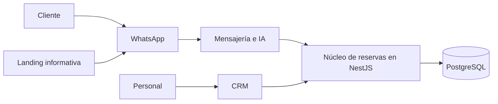

# Agendoxa

**Reservas inteligentes. Gestión más simple.** Agendoxa es una propuesta de plataforma multi-tenant para reservas y atención al cliente, desarrollada en equipo en el contexto del bootcamp Devlights.

> **Estado actual:** el repositorio contiene una página web inicial de Next.js, una API de salud y un contrato compartido. Todavía no implementa reservas, CRM, persistencia ni integraciones de WhatsApp, IA o pagos.

## Propuesta y alcance

La propuesta apunta a negocios de servicios, como barberías y clubes deportivos: sus clientes gestionarían reservas por WhatsApp y el personal operaría desde un CRM mobile-first. Una landing informativa dirigiría a WhatsApp, sin permitir reservas web. Ambos canales operativos usarían un único núcleo de reservas; las transferencias requerirían verificación humana.

El alcance y las decisiones están en revisión, con decisiones UC-01 explícitamente confirmadas y otras pendientes. Consultá las [especificaciones de producto](docs/product-specs/index.md) para reglas, exclusiones y estados, sin asumir que describen funcionalidad ya disponible.

## Arquitectura

Hoy la web y la API son aplicaciones separadas que consumen `@agendoxa/shared`; `packages/database` es un placeholder sin conexión. La web muestra una página inicial y no consulta la API. Ver [arquitectura actual](ARCHITECTURE.md).

**Dirección objetivo propuesta, no implementada:**



El diseño y sus límites están en la [propuesta de arquitectura](docs/design-docs/target-architecture.md); el diagrama no representa servicios existentes.

## Stack

| Actual | Previsto en la propuesta, no implementado |
|---|---|
| Node.js 24, pnpm workspaces, Turborepo, TypeScript | PostgreSQL y Drizzle, trabajos con pg-boss |
| Next.js, React y Tailwind CSS | Evolution API/Baileys y LangGraph para WhatsApp e IA |
| NestJS, Zod, Vitest y Supertest | Docker Compose y CI/CD |

## Arranque local

**Requisitos:** Git, Node.js 24 (ver [`.nvmrc`](.nvmrc)) y pnpm 12.16.1 (`npm i -g pnpm@12.16.1`).

```bash
git clone https://github.com/nanonoir/Agendoxa.git
cd Agendoxa
pnpm install
cp .env.example .env
pnpm dev
```

En PowerShell, se puede usar `Copy-Item .env.example .env` en lugar de `cp`. Turbo compila las dependencias compartidas antes de iniciar las aplicaciones.

| Aplicación | Dirección |
|---|---|
| Web | http://localhost:3000 |
| API | http://localhost:3001; `GET /health` devuelve `{"status":"ok"}` |

La API carga el `.env` de la raíz si existe y usa `PORT` o el puerto 3001. La web no carga ese archivo: sus variables van en `apps/web/.env.local`. `DATABASE_URL` aparece en [`.env.example`](.env.example), pero aún no se consume. No subas credenciales al repositorio.

### Comandos

Desde la raíz del repositorio:

| Comando | Resultado |
|---|---|
| `pnpm dev` | Inicia web y API en desarrollo, después de compilar sus dependencias |
| `pnpm build` | Compila shared, API y web |
| `pnpm lint` | Ejecuta ESLint en web y oxlint en API |
| `pnpm typecheck` | Comprueba tipos en shared, API y web |
| `pnpm test` | Ejecuta las pruebas unitarias de la API; no incluye E2E |

Para validaciones específicas y preparación al ejecutar comandos con `--filter`, consultá [AGENTS.md](AGENTS.md).

## Estructura actual

```text
apps/
  web/               # Aplicación Next.js inicial
  api/               # API NestJS con GET /health
packages/
  shared/            # Contrato de salud compartido
  database/          # Placeholder sin persistencia
docs/
  product-specs/     # Alcance y UC-01
  design-docs/       # Propuestas técnicas
  exec-plans/        # Planes y deuda técnica
  references/        # Material de apoyo
  generated/         # Reservado para contexto generado
```

## Documentación y colaboración

- [Especificaciones de producto](docs/product-specs/index.md): alcance, actores y flujos, con sus estados.
- [Diseños técnicos](docs/design-docs/index.md): dirección propuesta y límites de lectura.
- [Arquitectura actual](ARCHITECTURE.md): implementación y dependencias observables.
- [Guía de agentes](AGENTS.md) y [convenciones de planes](docs/PLANS.md): orientación para cambios y validación.
- [Plantilla de casos de uso](docs/references/use-case-template.md): material de apoyo.
