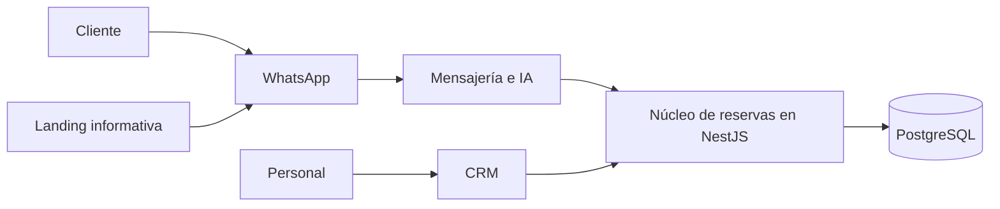

# Agendoxa

**Reservas inteligentes. Gestión más simple.** Agendoxa es una propuesta de plataforma multi-tenant para reservas y atención al cliente, desarrollada en equipo en el contexto del bootcamp Devlights.

> **Estado actual:** página web inicial, API de salud, contrato compartido y primer incremento de persistencia PostgreSQL/Drizzle con 17 entidades, migraciones y pruebas. Todavía no implementa casos de uso de reservas, CRM, autenticación ni integraciones de WhatsApp, IA o pagos.

## Propuesta y alcance

La propuesta apunta a negocios de servicios, como barberías y clubes deportivos: sus clientes gestionarían reservas por WhatsApp y el personal operaría desde un CRM mobile-first. Una landing informativa dirigiría a WhatsApp, sin permitir reservas web. Ambos canales operativos usarían un único núcleo de reservas; las transferencias requerirían verificación humana.

El alcance y las decisiones están en revisión. La reconciliación del 4 de noviembre de 2026 incorpora acuerdos con el responsable de producto, no aprobación formal de todo el equipo. Consultá las [especificaciones de producto](docs/product-specs/index.md) para las reglas canónicas UC-03, actores, flujos y pendientes, sin asumir funcionalidad disponible.

## Arquitectura

La web y la API consumen `@agendoxa/shared`. NestJS también consume `@agendoxa/database`, con un pool administrado por su ciclo de vida. La web muestra una página inicial y no consulta la API. Ver [arquitectura actual](ARCHITECTURE.md) y [alcance de persistencia](docs/design-docs/rep-02-core-persistence.md).

**Dirección objetivo propuesta, no implementada:**



El diseño y sus límites están en la [propuesta de arquitectura](docs/design-docs/target-architecture.md); el diagrama no representa servicios existentes.

## Stack

| Actual | Previsto en la propuesta, no implementado |
|---|---|
| Node.js 24, pnpm workspaces, Turborepo, TypeScript | Trabajos con pg-boss |
| Next.js, React y Tailwind CSS | Evolution API/Baileys y LangGraph para WhatsApp e IA |
| NestJS, Zod, Vitest y Supertest; PostgreSQL 18, Drizzle y Compose local | CI/CD |

## Arranque local

**Requisitos:** Git, Node.js 24 (ver [`.nvmrc`](.nvmrc)), pnpm 12.16.1 (`npm i -g pnpm@12.16.1`) y Docker con Compose.

```bash
git clone --branch develop https://github.com/nanonoir/Agendoxa.git
cd Agendoxa
pnpm install --frozen-lockfile
cp .env.example .env
pnpm db:up
pnpm db:migrate
pnpm db:seed
pnpm dev
```

En PowerShell, se puede usar `Copy-Item .env.example .env` en lugar de `cp`. Turbo compila las dependencias compartidas antes de iniciar las aplicaciones.

| Aplicación | Dirección |
|---|---|
| Web | http://localhost:3000 |
| API | http://localhost:3001; `GET /health` devuelve `{"status":"ok"}` |

La API carga el `.env` de la raíz si existe, requiere DATABASE_URL y usa PORT o el puerto 3001. La web usa `apps/web/.env.local`. PostgreSQL se publica en loopback, puerto 5432 por defecto; cambiá POSTGRES_PORT y DATABASE_URL juntos si está ocupado. Las credenciales del ejemplo son solo para desarrollo local. El seed no crea contraseñas ni un login funcional. No subas credenciales reales al repositorio.

### Comandos

Desde la raíz del repositorio:

| Comando | Resultado |
|---|---|
| `pnpm dev` | Inicia web y API en desarrollo, después de compilar sus dependencias |
| `pnpm build` | Compila shared, database, API y web |
| `pnpm lint` | Ejecuta ESLint en web y oxlint en API/database |
| `pnpm typecheck` | Comprueba tipos en shared, database, API y web |
| `pnpm test` | Ejecuta las pruebas unitarias de la API; no incluye E2E |
| `pnpm db:up` / `pnpm db:test:up` | Inicia PostgreSQL de desarrollo o el servicio separado de integración |
| `pnpm db:migrate` / `pnpm db:seed` | Aplica migraciones o carga los dos negocios de ejemplo |
| `pnpm db:generate` / `pnpm db:check` | Genera migraciones o verifica su metadata |
| `pnpm test:db` | Ejecuta las pruebas de integridad/concurrencia sobre PostgreSQL real |

Para validaciones específicas y preparación al ejecutar comandos con `--filter`, consultá [AGENTS.md](AGENTS.md).

## Estructura actual

```text
apps/
  web/               # Aplicación Next.js inicial
  api/               # API NestJS con GET /health
packages/
  shared/            # Contrato de salud compartido
  database/          # Esquema, cliente, migraciones y pruebas de persistencia
infra/               # Compose local de PostgreSQL y servicio de integración
docs/
  product-specs/     # Alcance, UC-01/02/03 y sus estados
  design-docs/       # Propuestas técnicas
  exec-plans/        # Planes y deuda técnica
  references/        # Material de apoyo
  generated/         # Reservado para contexto generado
```

## Documentación y colaboración

- [Contribuir al proyecto](CONTRIBUTING.md): Issues, Projects, ramas, Pull Requests y Definition of Done.

- [Especificaciones de producto](docs/product-specs/index.md): alcance, actores y flujos, con sus estados.
- [Diseños técnicos](docs/design-docs/index.md): dirección propuesta y límites de lectura.
- [Arquitectura actual](ARCHITECTURE.md): implementación y dependencias observables.
- [Guía de agentes](AGENTS.md) y [convenciones de planes](docs/PLANS.md): orientación para cambios y validación.
- [Plantilla de casos de uso](docs/references/use-case-template.md): material de apoyo.
