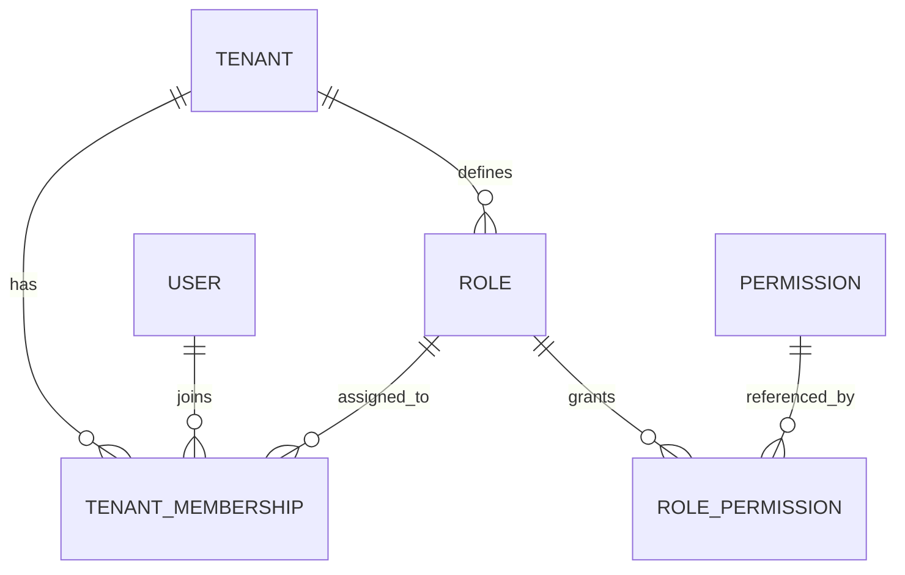
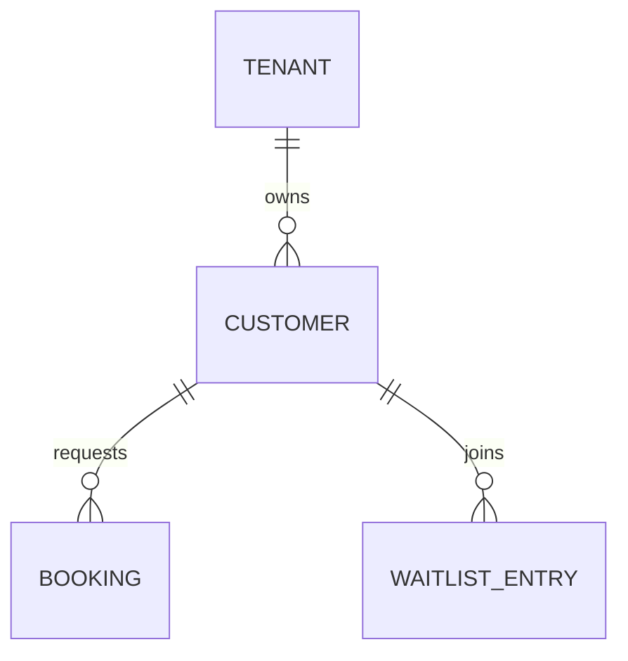
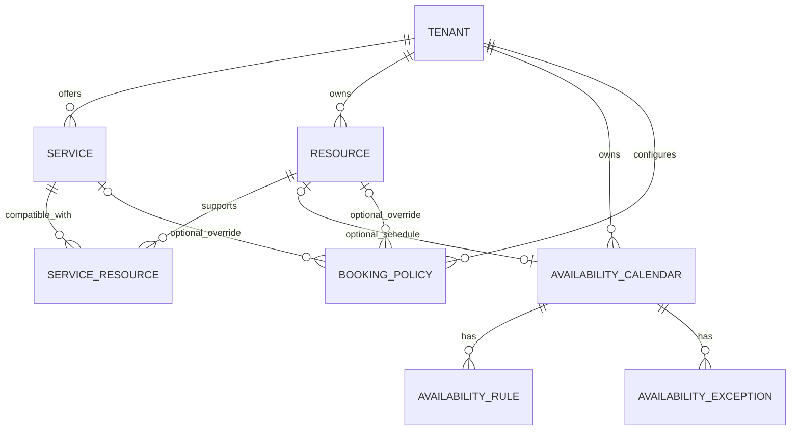
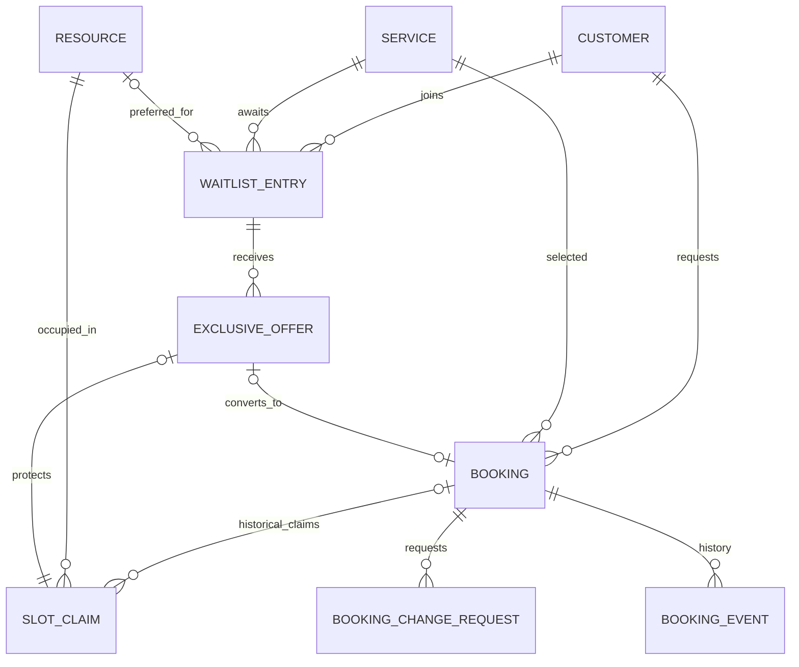
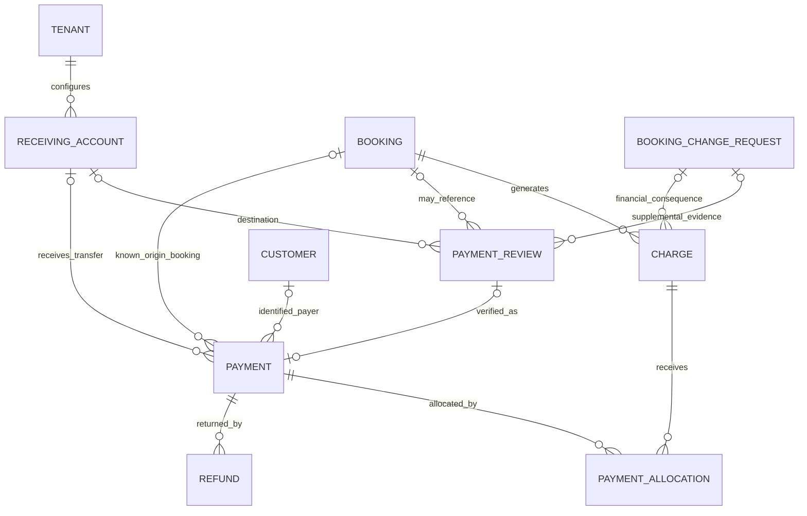
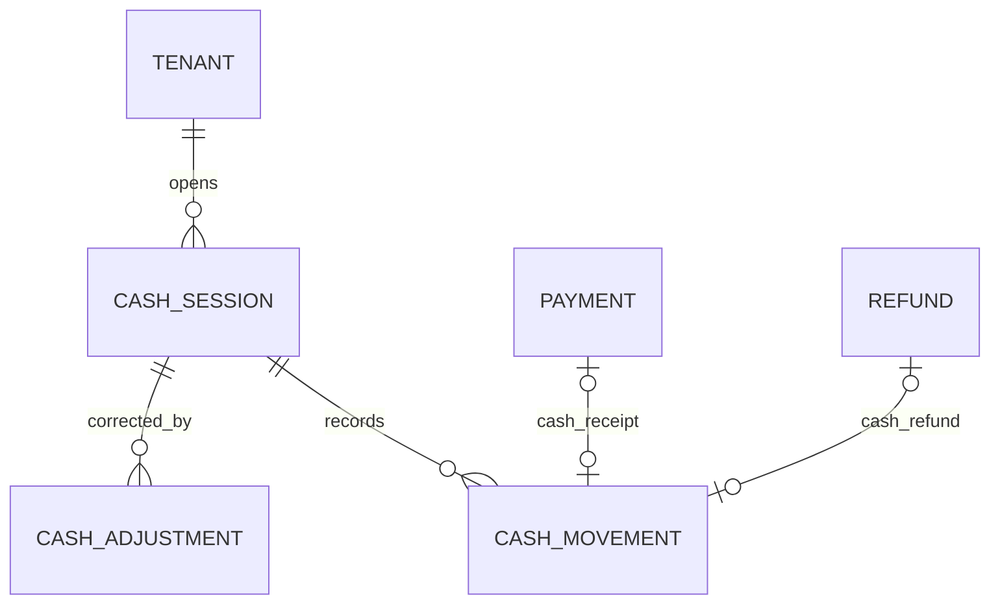
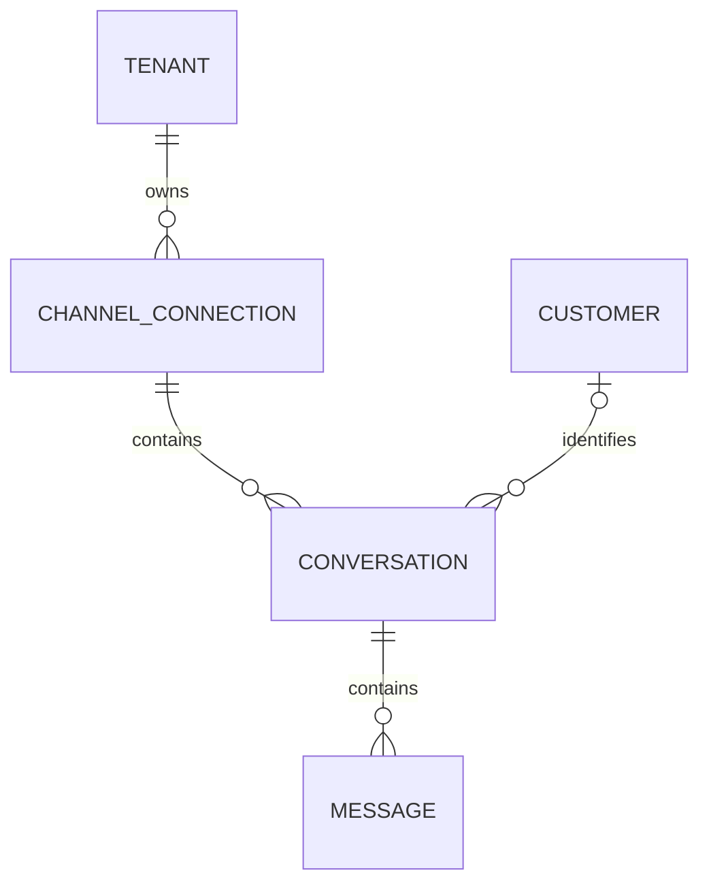
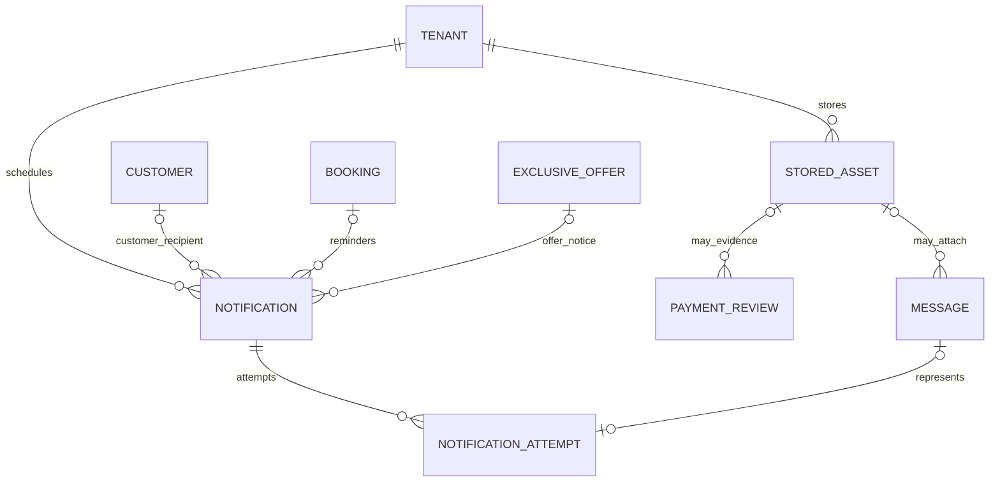
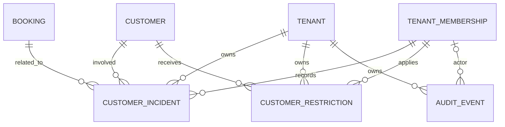

# DOM-01 — Agendoxa MVP Entity–Relationship Model

> **Status:** In Review — product-owner decisions agreed 2026-11-04; **not team-ratified or implemented**.
> **Prepared:** 2026-11-03; reconciled 2026-11-04.
> **Scope:** Logical/conceptual ERD for the two MVP verticals: barbershops/beauty businesses and sports clubs/courts.
> **Inventory:** 38 candidate entities in 9 modules: the original 36 plus `Refund` and `NotificationAttempt`.
> **Next step:** Team review, then define attributes, PKs, FKs, data types, indexes, and implementation-level constraints.
> **Out of scope here:** SQL/Drizzle schema, migrations, RLS implementation, APIs, and assumptions that the proposed infrastructure already exists.

## 0. How to use this document

This file is intended to live at **`docs/design-docs/erd.md`** in the Agendoxa repository.

1. Treat this as a **design proposal and review input**, not permission to generate persistence code. The [2026-11-04 handoff](../../agendoxa_audit_handoff.md) supersedes incompatible earlier proposals for this iteration; its decisions are reconciled in the canonical [UC-03 rules](../product-specs/uc-03/business-rules.md). Product-owner agreement and inferred technical representations remain distinct from collective team ratification.
2. Consult the existing product references: [MVP](../product-specs/mvp.md), [UC-01 actors](../product-specs/uc-01/actors.md), [UC-01 flows](../product-specs/uc-01/flows.md), [UC-02 use cases](../product-specs/uc-02/use-cases.md), [UC-03 business rules](../product-specs/uc-03/business-rules.md), and [UC-03 invariants](../product-specs/uc-03/invariants.md). Each source has its own declared approval status.
3. Read the [target architecture](./target-architecture.md), the [current implementation architecture](../../ARCHITECTURE.md), and [AGENTS.md](../../AGENTS.md). The present implementation is a starter; PostgreSQL/Drizzle persistence and queues are not implemented yet.
4. `DM-XX` marks a **DOM-01 design proposal**; `REV-XX` preserves reconciliation and review history. Product-owner agreement is not team ratification. Preserve these identifiers in PR discussions.
5. Entity names are conceptual PascalCase identifiers, not finalized SQL table names or enums. Mermaid diagrams illustrate relationships; they do **not** express every conditional, tenant-scoped, or transactional constraint.

**Mermaid notation:** `||` = exactly one, `o|` = zero or one, `o{` = zero or more, `|{` = one or more. Unless explicitly stated, a `1:N` association allows zero children. Optional relationships, conditional uniqueness, and cross-table invariants must be specified precisely in Step 3.

## 1. Entity inventory — 38 candidates

| Module | Entity | Responsibility |
|---|---|---|
| Identity (1) | `Tenant` | Business boundary, timezone, tenant-level settings |
| Identity (1) | `User` | Global authenticated CRM personnel identity; **not a customer account** |
| Identity (1) | `TenantMembership` | A user's membership in a tenant, with a tenant-specific role |
| Identity (1) | `Role` | Tenant-specific Admin, Staff, or custom role |
| Identity (1) | `Permission` | Global catalog of capabilities enforced by the backend |
| Identity (1) | `RolePermission` | Assigns catalog permissions to tenant roles |
| Customers (2) | `Customer` | Tenant-local requester/customer; phone optional for walk-ins |
| Catalog (3) | `Service` | Bookable offering, duration, price, or preconfigured service combination |
| Catalog (3) | `Resource` | Exclusive professional or physical capacity (court, chair, room, etc.) |
| Catalog (3) | `ServiceResource` | Service/resource compatibility association |
| Availability (3) | `AvailabilityCalendar` | Tenant-level or resource-level schedule container |
| Availability (3) | `AvailabilityRule` | Recurring business hours or resource schedule |
| Availability (3) | `AvailabilityException` | Blocks, absences, maintenance, or authorized special openings |
| Policies (3) | `BookingPolicy` | Base tenant policy with partial service/resource overrides |
| Bookings (4) | `Booking` | Requester, chosen service, attendee context, and booking lifecycle |
| Bookings (4) | `SlotClaim` | **Single source of truth** for exclusive resource/time occupancy |
| Bookings (4) | `BookingChangeRequest` | Change proposal, pending authorization, application history and financial consequence |
| Bookings (4) | `BookingEvent` | Functional booking history, separate from administrative audit |
| Waitlist (4) | `WaitlistEntry` | Voluntary waiting interest and explicit waitlist consent |
| Waitlist (4) | `ExclusiveOffer` | Five-minute exclusive offer for an eligible waitlist entry |
| Payments (5) | `Charge` | Amount owed by a booking, separate from money received |
| Payments (5) | `ReceivingAccount` | Tenant bank/wallet account or transfer alias |
| Payments (5) | `PaymentReview` | Human review of transfer evidence / claimed transfer |
| Payments (5) | `Payment` | Verified funds of a traceable commercial operation, possibly unallocated |
| Payments (5) | `PaymentAllocation` | Applies part or all of a payment to one or more charges |
| Cash (5) | `CashSession` | Shared register opening/closing session |
| Cash (5) | `CashMovement` | Attributed physical cash movement, potentially linked to a payment |
| Cash (5) | `CashAdjustment` | Audited post-close correction without rewriting a closed session |
| Payments (5) | `Refund` | Independently authorized and tracked return of a payment's funds |
| Messaging (6) | `ChannelConnection` | Tenant WhatsApp connection, including historical connections |
| Messaging (6) | `Conversation` | Continuous sender/channel thread and AI/human handoff state |
| Messaging (6) | `Message` | Incoming or outgoing message with authorship and deduplication |
| Assets (7) | `StoredAsset` | Private tenant-scoped file storage reference, not binary DB contents |
| Notifications (8) | `Notification` | One logical notice and its schedule and outcome |
| Notifications (8) | `NotificationAttempt` | One delivery attempt and its outcome, optionally linked to a message |
| Incidents (9) | `CustomerIncident` | Other booking-related operational incident, not a no-show counter |
| Incidents (9) | `CustomerRestriction` | Manually imposed customer restriction, preserving history |
| Audit (9) | `AuditEvent` | Administrative/security-sensitive action and actor attribution |

**Explicitly deferred:** `CustomerIdentity`, `CustomerAccount` (future tenant-local landing login), `MembershipPermission`, `MessageAttachment`, `PaymentReviewEvidence`, and `DeliveryAttempt`. No `ConsentEvent`, `NotificationConsent`, or custom `Job` entity is introduced.

## 2. Relationships, cardinalities, and decisions by module

### 2.1 Module 1 — Tenants, personnel, roles, and permissions

- Each `TenantMembership` identifies **exactly one** `User`, one `Tenant`, and one role belonging to that same tenant. Enforce at most one membership per `(tenant, user)`; the same `User` can belong to multiple businesses (**DM-01**).
- `Role` belongs to a tenant; `Permission` is a global backend capability catalog; `RolePermission` connects the two. Authorization must always validate the active membership and tenant context.
- Each tenant starts with protected, non-deletable `ADMIN` and `STAFF` roles. `ADMIN` has full tenant authority by backend rule. `STAFF` permissions and additional custom roles can be configured through the CRM (**DM-02**).
- Permissions are granted only through roles, never directly to memberships; the backend checks effective authorization. Admin authority cannot be reduced, and role administration, commercial policy exceptions, post-close adjustments, refunds and changes to agreed prices remain Admin-only. Protect the last active Admin and historical actor attribution (**REV-01**; [personnel rules](../product-specs/uc-03/business-rules.md#3-personnel-roles-and-privileges-iam)).

### 2.2 Module 2 — Customers and requesters

- A `Customer` belongs to one tenant. The same phone number in different tenants creates independent customer records (**DM-03**).
- Phone is optional for a CRM walk-in. If present, normalize it (e.g., E.164) and enforce uniqueness **within the tenant**; names are not identifiers, and matching names must never trigger automatic merges.
- `Booking` references the **requester** as a stable `Customer`. An attendee can be another person whose minimal details remain on the booking; do not require a new customer record just to book for someone else.
- WhatsApp self-management is authorized by the **validated sender associated with that tenant**, not by a phone number typed in a message. Changes to a customer's phone must preserve historical booking links and require safe identity handling.
- **Future:** Tenant-specific `CustomerAccount` credentials for landing-page self-service only after ownership verification. Do not repurpose personnel `User` for customers.

### 2.3 Module 3 — Services, resources, availability, and policies

- `Service` and `Resource` are tenant-scoped; `ServiceResource` defines compatibility (N:M). A booking involves **one service and one compatible resource**; professional and physical resources use the same engine.
- A tenant has a general availability calendar; a resource may have its own schedule or inherit the general one (**DM-04**). Resolve effective regular hours with blocks and exceptions; active/scope uniqueness remains technical review.
- Authorized special openings can extend regular hours for CRM and WhatsApp without overriding explicit blocks or claims (**DM-05**).
- `BookingPolicy` resolves **each field** by `resource > service > tenant`, distinguishing inherit, set and disable; `FULL_PREPAYMENT` overrides ordinary deposit rules except for an authorized Admin exception (**DM-06**).
- Existing bookings preserve their agreed financial and commercial conditions when future catalog, availability, or policy settings change. Changes to ordinary hours must not silently cancel existing confirmed bookings.
- **Review:** Scoped cardinalities and policy snapshots remain technical questions (**REV-06**, **REV-12**, **REV-15**); see [availability](../product-specs/uc-03/business-rules.md#6-availability-disp) and [deposits](../product-specs/uc-03/business-rules.md#9-deposits-sen).

### 2.4 Module 4 — Bookings, exclusive occupancy, and waitlist

- `SlotClaim` is the **single authority** for occupancy. Each claim belongs to exactly one booking XOR one offer, and one resource. An ordinary booking has at most one active claim; an early-terminal booking may instead retain multiple nonoverlapping private remainder fragments (**DM-07**).
- The diagram represents a booking with **zero or more historical claims** and an offer with exactly one slot claim; conditional constraints guarantee that an occupying booking has its required claim and that claims cannot have two owners. Final database semantics come in Step 3.
- `ExclusiveOffer` creates a five-minute claim. Acceptance atomically closes that historical offer-owned claim and creates a distinct booking-owned ten-minute `HOLD` claim; the offer links to zero or one resulting booking (**DM-08**).
- In the WhatsApp channel, a concrete slot selection starts a ten-minute `HOLD`. Without a deposit, explicit confirmation during the hold confirms the booking. With a deposit, timely receipt submission enters human payment review; the slot stays occupied with **no automatic payment-review timeout**. Evidence never establishes verified funds by itself.
- A pending authorization in `BookingChangeRequest` **does not lock the destination**; recheck it on approval. With an already verified partial deposit and an allowed move, atomically move the confirmed booking and release the old slot, preserving allocations; request the difference afterward. The destination is `CONFIRMED`, not a HOLD or pending review, and nonpayment is managed manually without automatic cancellation (**DM-09**; [rescheduling](../product-specs/uc-03/business-rules.md#8-cancellation-and-rescheduling-can)).
- `BookingEvent` records booking lifecycle history; `AuditEvent` records sensitive administrative decisions. Some actions may generate both without making the entities interchangeable.
- `WaitlistEntry` alone never occupies a resource. Its resource preference is optional: if present it must belong to the tenant and support the service; otherwise any compatible resource is eligible. Respect time preferences and arrival order among eligible entries; delayed offer expiry cannot cancel a subsequent HOLD.
- **Hard invariant:** active claims for the same tenant/resource cannot overlap on `[start, end)`. Early `COMPLETED`/`NO_SHOW` does not expose remaining time to ordinary public queries, WhatsApp or waitlist. Authorized explicit CRM walk-in reuse atomically closes the old claim and creates the walk-in claim plus any private restricted residual fragments, preserving the original full interval and claim history. No restricted fragment is automatically offered; correcting a no-show does not displace the walk-in. This fragment representation is an **inferred technical proposal for review**, not a new product decision; no new entity is required (**REV-07**–**REV-11**, **T-01**).
- For initial-deposit evidence, first human rejection notifies the customer and starts a private occupied 15-minute window for new evidence or valid staff resolution. Timely new evidence creates a separate pending review and suspends automatic cancellation while pending; a second human rejection of distinct evidence cancels and releases immediately if the turn has not started, notifying customer and staff. Duplicate technical attempts are not distinct rejections. Expiry workers recheck deadline, state and pending review atomically; no rejection automatically restarts the window. Once started, escalate manually without cancellation or public exposure; supplemental deposits after rescheduling do not trigger this cancellation mechanism ([booking lifecycle](../product-specs/uc-03/business-rules.md#7-booking-lifecycle-res)).

### 2.5 Module 5A — Charges, payment reviews, allocations, and receiving accounts

- `Charge` is an obligation; `Payment` is actually verified money with a traceable commercial origin, not personal or completely unknown funds. `PaymentAllocation` links payments and charges (**DM-10**).
- Origin and allocation are different associations: a payment's known commercial provenance is mandatory even when a specific origin booking or identified payer is optional. Preserve same-tenant booking/customer links when identifiable, verification actor/time, receipt and reason for zero allocations. A supplemental review/charge references its change request; it cannot be applied to a superseded request by accident. Exact origin binding and correction representation are part of **T-03/T-05**, not a new origin entity.
- Manual allocations may distribute verified funds across charges and bookings of the same tenant, or leave a payment unallocated. Each allocation is capped both by the charge's remaining net debt and the payment's verified, unrefunded, unallocated funds. Charge balance is `max(0, net charge - valid allocations)`. Transactionally coordinate allocations, corrections and pending refunds to prevent overcommitment; preserve correction history and make retries idempotent.
- `PaymentReview` is pending, approved or rejected human evidence review. Verified cash or transfer in CRM may create `Payment` directly. A review and payment are optionally one-to-one; rejected evidence creates no payment. A screenshot alone is not proof of credit.
- A tenant can have several bank/wallet receiving accounts, using a default account or **configurable automatic rotation** (**DM-11**). The actual account displayed for a transfer request must be persisted and remain stable if the rotation configuration changes. The precise location of this binding is deferred to Step 3.
- Rotation is optional; the chosen account on a payment instruction is immutable for that transaction. Its binding and rotation algorithm remain technical review (**T-02**). Late verified commercial payments may remain unallocated, but never reactivate expired bookings (**REV-02**, **REV-03**, **REV-14**; [payments](../product-specs/uc-03/business-rules.md#10-charges-balances-and-payments-cob)).
- A `Payment` has zero or more independent `Refund` records with amount, method, reason, Admin authorization, execution state, dates and origin/destination trace. Only executed refunds reduce retained funds; never mutate the original amount or create negative payments. Corrections to allocations preserve history. Execution cannot exceed available net funds and must coordinate with pending refunds and allocations (**T-03**).

### 2.6 Module 5B — Shared cash register

- At most one `CashSession` is open per tenant. Cash payments require an open session; configured automatic opening occurs on the first collection, otherwise authorized personnel open it. Opening balance is explicitly declared and audited, reconciled to the previous close where one exists. Closing is authorized, manual and immutable; serialize collection against closure (**REV-04**).
- `CashMovement` represents physical cash only. An executed cash refund requires an outflow in an open session; transfer refunds are bank outflows without a cash movement. A cash payment and its movement represent the same money, never two incomes; physical balance uses opening cash plus signed movements. Verified transfers do not alter a closed register.
- `CashAdjustment` is an append-only Admin-only correction of a **closed physical cash session**, with reason, actor and trace to the affected cash movement/payment when applicable (**DM-12**). It is not a general bank-payment correction or a substitute for `Refund`; financial corrections preserve their own payment/allocation history (**T-03**), and `AuditEvent` is not the financial ledger. Later physical movement belongs to an open session.

### 2.7 Module 6 — WhatsApp, conversations, and messages

- Each tenant retains historical WhatsApp connections but has **at most one enabled connection** at a time in the MVP (**DM-13**). Temporary Evolution/Baileys disconnection does not create a new connection; a permanent number change may.
- Keep one continuous `Conversation` per `(connection_id, sender_id)`, uniquely scoped to that connection. `customer_id` may be null before identity resolution; linking a customer never authorizes based on untrusted message text.
- `Message` records direction, author/source (customer, AI, human), provider identity, and deduplication. A conversation is under **either** AI or human control at a time; enforce safe takeover and prevent simultaneous responses.
- Authorized Staff/Admin can take over from the CRM. Admin can disable the AI across the tenant. Human inactivity may restore AI after 60 minutes only if global AI is enabled and the chosen handoff rules permit it.
- **Technical validation pending:** reliable detection of messages sent directly from the native WhatsApp client through Evolution/Baileys. Explicit CRM handoff is the trustworthy initial mechanism.

### 2.8 Modules 7–8 — Stored assets and notifications

- `StoredAsset` stores the tenant, private storage location, MIME type, size, and retention metadata; bytes live in object storage. `Message` and `PaymentReview` can each reference **at most one** asset, but the **same asset may be reused** by both (**DM-14**). A single asset may be referenced by multiple records where permitted; there is no need for attachment bridge tables in this MVP.
- Enforce tenant-aware asset references, authorized download access, validated MIME/size, and evidence-preserving retention. No permanently public receipt links.
- Each `Notification` is one logical notice tied to either one booking or one offer (`XOR`), with zero or more `NotificationAttempt` records. Each attempt has time, outcome, error and zero or one `Message`; the inverse message link is optional and at most one attempt. Messages remain in conversations. Proposed `pg-boss` execution retries the same notice, not a new notice or custom job entity (**DM-15**).
- Customer-facing reminders/offers have exactly one recipient matching the booking requester or waitlist entry, with the applicable consent. The required staff alert after a second initial-evidence rejection is a personnel-facing booking notice, not a message to the customer and not dependent on customer reminder consent; its Customer link is absent. Recipient audience and dispatch route must be distinguishable in existing Notification/Attempt data (**T-05**); the specific staff-alert transport remains technical design. No personnel WhatsApp conversation or new entity is assumed.
- Reminder consent on `Customer` and waitlist consent on `WaitlistEntry` are independent (**DM-16**). Record only grants and revocations in `AuditEvent`, with date, channel, scope and actor; atomically update state and audit. Do not audit every message or retry. Revocation prevents future sends, including queued ones (**REV-05**).
- Recheck consent, booking/time and offer expiry immediately before each attempt. If confirmation occurs at or after start minus lead time, record the reminder as skipped with zero attempts; confirmation is separate. Rescheduling invalidates the old reminder and schedules a new one only if timely; cancellation prevents sending. Use tenant timezone for calendar rules and UTC instants. Provider acceptance is not delivery; reconcile uncertain timeouts before retry where possible. Retention is operational and remains unspecified (**T-04**; [notifications](../product-specs/uc-03/business-rules.md#14-notifications-and-consent-not)).

### 2.9 Module 9 — Incidents, restrictions, and administrative audit

- `CustomerIncident` records other booking-related operational incidents such as damage or conduct, not no-shows (**DM-17**). Every no-show belongs to the booking requester, including a third-party attendee's absence. Count the current `Booking` operational result by requester, never incident rows; `BookingEvent` records corrections and actors.
- Two current no-shows produce an **internal indicator only**, never an automatic restriction. Corrections recalculate the count and do not displace a valid walk-in reuse.
- `CustomerRestriction` preserves history but allows **at most one currently active restriction** for each customer (**DM-18**). Initial effective restrictions are `FULL_PREPAYMENT` and `BLOCKED`; normal service requires no active restriction row. Changes include human actor, reason, and effective dates.
- `AuditEvent` records significant administrative/security-sensitive actions. It is not a second booking-history table, a full message log, or a replacement for `BookingEvent`; one real-world operation can create both kinds of record when justified.
- Historical actor links must survive membership deactivation. Internal incident/restriction labels must never be exposed in customer-facing AI messages.

## 3. Cross-cutting invariants

| ID | Required invariant | Future enforcement/check |
|---|---|---|
| `ERD-I01` | Every operational record belongs to exactly one tenant; `User` and `Permission` are global | Tenant-aware FKs, authorization, negative isolation tests |
| `ERD-I02` | A membership can only select a role owned by its tenant | Tenant-aware referential constraints |
| `ERD-I03` | WhatsApp requesters only manage their own bookings within the tenant | Validated sender/channel context; backend authorization |
| `ERD-I04` | A booking selects a service and compatible resource from the same tenant | Same-tenant and compatibility checks |
| `ERD-I05` | Incompatible active occupancy claims never overlap on a resource | DB-backed transactional exclusion of `[start, end)` ranges |
| `ERD-I06` | Expiry cannot free a confirmed, pending-review or started-turn claim; initial rejection follows its correction window | Guarded transitions, pending-review recheck and idempotent workers |
| `ERD-I07` | Pending reschedules retain the original slot; target is checked only when applying | Version/state check, one atomic booking update |
| `ERD-I08` | Offer claim ownership is immutable; acceptance closes it and creates a separate HOLD claim | Atomic transition, idempotent expiry |
| `ERD-I09` | Transfer evidence is never equivalent to automatic financial accreditation | Human verification, recorded actor/time |
| `ERD-I10` | Allocations cannot exceed either net charge debt or verified, unrefunded available payment funds | Transactional sums, pending-refund coordination and same-tenant references |
| `ERD-I11` | At most one open cash session; closed sessions are immutable | Conditional uniqueness, append-only correction |
| `ERD-I12` | Reminder/offer notices require current consent and current booking/offer validity | Send-time recheck, durable deduplication |
| `ERD-I13` | At most one active customer restriction; an indicator never automatically sanctions | Conditional uniqueness, explicit human authorization |
| `ERD-I14` | Sensitive operations keep actor and timestamp despite staff deactivation | Persistent membership linkage and auditing |
| `ERD-I15` | Early terminal residual intervals remain private; explicit authorized CRM reuse preserves full history without overlap | Atomic close, walk-in and restricted residual claims; availability filtering |
| `ERD-I16` | Refunds are independent; only execution reduces retained funds, never the original payment | Immutable originals, idempotent execution and coordinated allocation/refund limits |
| `ERD-I17` | One notice can have zero attempts; each attempt has at most one message | Optional association and idempotent retries |
| `ERD-I18` | Every no-show counts for the requester from current booking outcome alone | Derive count from bookings; preserve correction events |

## 4. Agreed modeling proposals (team ratification pending)

| ID | Subject | Proposed decision from DOM-01 discussion |
|---|---|---|
| `DM-01` | Memberships | A user may join multiple tenants; exactly one role per membership |
| `DM-02` | Roles | Non-deletable per-tenant Admin/Staff; editable Staff and custom roles; protected full Admin authority |
| `DM-03` | Customers | Tenant-local customer, optional tenant-unique phone; future local landing login |
| `DM-04` | Calendars | One tenant general calendar plus optional resource-specific calendars |
| `DM-05` | Exceptional hours | Only explicitly authorized special openings can extend regular hours |
| `DM-06` | Policy precedence | Per-field override: resource > service > tenant |
| `DM-07` | Occupancy | One active claim for ordinary bookings; early-terminal private residual fragments are an inferred technical representation |
| `DM-08` | Waitlist | Offer claim closes; a distinct booking HOLD claim is created atomically |
| `DM-09` | Rescheduling | Prior approval takes no target lock; an eligible partially prepaid move stays confirmed while its difference is collected later |
| `DM-10` | Payment allocations | Payments can be split across charges and temporarily left unallocated |
| `DM-11` | Receiving accounts | Multiple accounts; default or configurable automatic rotation |
| `DM-12` | Cash corrections | `CashAdjustment` after close; immutable closed session |
| `DM-13` | WhatsApp | One enabled connection per tenant; one continuous thread per sender/connection |
| `DM-14` | Assets | At most one asset per message or payment review; direct optional references |
| `DM-15` | Notifications | One logical notice, zero or more distinct attempts; proposed pg-boss execution |
| `DM-16` | Consent | Reminders on `Customer`, waitlist consent on `WaitlistEntry`; configurable lead time |
| `DM-17` | Incidents | All no-shows count for requester from booking; incidents cover other operational events |
| `DM-18` | Restrictions | One effective restriction per customer, retaining full change history |

## 5. Reconciliation backlog — review history

The following discrepancies are reconciled in this proposal against the product-owner handoff, subject to team review and implementation. Canonical product rules remain in [UC-03](../product-specs/uc-03/business-rules.md); review those rules together with this ERD. Reconciled does not mean team-approved or implemented.

| ID | Topic | Status and remaining review |
|---|---|---|
| `REV-01` | Role permissions | Reconciled: role-only with protected Admin actions. |
| `REV-02` | Receiving accounts | Reconciled: optional rotation and fixed instruction; algorithm **T-02**. |
| `REV-03` | Payment origin and allocations | Reconciled: verified commercial origin and manual multi-charge allocations. |
| `REV-04` | Cash and late transfers | Reconciled: open session for cash; transfer independent of physical cash. |
| `REV-05` | Consent audit | Reconciled: independent state and transactional grant/revoke audit; retention **T-04**. |
| `REV-06` | Policy precedence | Reconciled: field-level resource/service/tenant with inherit/set/disable. |
| `REV-07` | Offer claims | Reconciled: XOR and distinct historical claims; enforcement **T-01**. |
| `REV-08` | Reschedule target | Reconciled: pending authorization takes no destination lock. |
| `REV-09` | Early terminal occupancy | Reconciled: private remainder and explicit CRM reuse; inferred fragments **T-01**. |
| `REV-10` | Reschedule history | Reconciled: same booking, claim and event history with preserved verified funds. |
| `REV-11` | Approval | Reconciled: prior human authorization differs from subsequent deposit verification and Admin exceptions. |
| `REV-12` | Effective hours | Reconciled: inheritance and authorized openings across channels, preserving blocks. |
| `REV-13` | No-show attribution | Reconciled: every no-show counts for requester; attendee details remain a product question. |
| `REV-14` | Late funds | Reconciled: verified commercial funds may be unallocated and resolved manually. |
| `REV-15` | Calendar/policy scope | Conceptual precedence reconciled; physical scope uniqueness remains **T-05**. |
| `REV-16` | Shared assets | Conceptual optional associations retained; physical FK and multiplicity validation remains **T-05**. |

### Technical review register

- **T-01:** Validate private residual-fragment representation, history reconstruction, exclusion and atomic CRM reuse, including concurrent offer expiry and claim changes.
- **T-02:** Choose account-rotation algorithm, concurrent selection and immutable instruction binding.
- **T-03:** Specify transactional allocation/refund reservation, commercial-origin linkage, financial correction history and idempotency. A lower adjusted charge cannot retain valid allocations above its debt: require an explicit correction plan preserving prior facts and releasing excess as unallocated, without silently reallocating it elsewhere. Define reporting/correction boundaries for transfers independently of physical cash sessions.
- **T-04:** Define operational notification/attempt and consent-audit retention, and uncertain-delivery reconciliation.
- **T-05:** Define scoped calendar/policy uniqueness, asset references, actor/recipient audience (including personnel alerts), notification/attempt dispatch correlation, correction-window timestamp binding, types, indexes and physical constraints in Step 3.

Product questions such as waitlist chain limits, customer booking limits, minimum attendee details, underpaid or image-less evidence and remaining pending-review edge cases belong in the [UC-03 pending decisions](../product-specs/uc-03/business-rules.md#16-pending-decisions); no defaults are inferred here.

## 6. Step 3 — Detailed schema specification (not started)

For **each of the 38 entities**, the next reviewed iteration should define:

- Stable identifier, tenant scope where applicable, attributes, types, mandatory/nullable fields, and lifecycle.
- PKs, tenant-aware FKs, uniqueness, checks, indexes, retention rules, and whether deletion is ever allowed.
- Exact Mermaid/cardinality optionality, including conditional associations and `XOR` constraints.
- Tenant-local time interpretation and unambiguous persisted instants; monetary unit, precision, and rounding; approved persisted states (not guessed enums).
- Validation scenarios for concurrent slot claims, payment allocations, cash closure, permission checks, messaging deduplication, and notification jobs.

### DOM-01 completion checklist

- [x] 38 candidate entities inventoried.
- [x] Relationships across nine modules discussed and documented.
- [x] Relevant cross-cutting invariants documented.
- [x] Modeling decisions explicitly separated from team approval.
- [ ] Cross-document reconciliation with UC-02/UC-03 independently reviewed.
- [ ] Attributes and conceptual types specified for every entity.
- [ ] PKs, FKs, optional associations, uniqueness, and delete rules validated.
- [ ] Concurrency and financial invariants validated against use cases.
- [ ] Team approval recorded.

**Exit criterion:** This file is a reviewable conceptual/logical ERD proposal. It does not authorize creating tables, migrations, or endpoints until blocking functional contradictions and Step 3 details are resolved.
