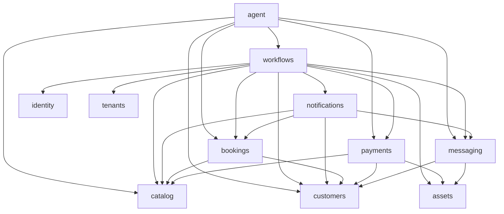

# CON-01 — Module Boundaries and Dependencies

> **Status:** In Review — proposal; **not team-ratified or implemented**.
> **Prepared:** 2026-11-08, on top of the [DOM-01 ERD](./erd.md), [DOM-02 tenancy](./tenancy.md), [UC-03 rules](../product-specs/uc-03/business-rules.md) and [invariants](../product-specs/uc-03/invariants.md), and the [architecture proposal](./target-architecture.md) v1.2.
> **Scope:** The functional modules of the NestJS modular monolith: responsibilities, data and operation ownership, allowed and prohibited dependencies, communication between modules, internal hexagonal structure, and the integration points that CON-02 and CON-03 must specify.
> **Out of scope:** NestJS modules, endpoints, services or repositories as code; detailed API contracts ([CON-02 #11](https://github.com/nanonoir/Agendoxa/issues/11)); provider contracts ([CON-03 #12](https://github.com/nanonoir/Agendoxa/issues/12)); microservices or distributed infrastructure.
> **Next step:** Team review. Decisions are `MOD-DM-XX`, all **Proposed**; open questions are `MOD-Q-XX` in [§10](#10-decisions-and-open-questions).

## 1. How to use this document

- **Sources keep their roles.** Business rules and guarantees stay in [UC-03](../product-specs/uc-03/business-rules.md); entities and attributes in the [ERD](./erd.md); tenant context in [DOM-02](./tenancy.md). This file assigns them to modules and adds only the structural decisions they leave open. If it disagrees with them, they win and this file is corrected.
- **It extends the architecture proposal.** The capability table ([§6.1](./target-architecture.md#61-business-capability-boundaries)), layer rules ([§6.2–§6.3](./target-architecture.md#62-example-internal-structure-for-a-rule-heavy-module)) and reviewable dependency rules ([§13.1](./target-architecture.md#131-reviewable-dependency-rules)) are linked, not repeated.
- **Nothing here is implemented.** Today `apps/api` has `AppController` (`GET /health`) and `DatabaseModule`, and `packages/database` holds 17 of the 38 entities ([REP-02](./rep-02-core-persistence.md)). The structure in [§7](#7-internal-structure-and-hexagonal-separation) applies when the first business module is created, for example in [REP-03 #16](https://github.com/nanonoir/Agendoxa/issues/16), [#30](https://github.com/nanonoir/Agendoxa/issues/30) or [#31](https://github.com/nanonoir/Agendoxa/issues/31).
- **Terms used below:**

| Term | Meaning |
|---|---|
| Module | One NestJS module under `apps/api/src/modules/<module>/` that owns a business capability |
| Owner | The only module that may change a record, and the only one whose persistence adapter reads or writes its tables |
| Public API | What a module exports to other modules from its plain contracts surface; Nest composition is exported separately |
| Platform code | Cross-cutting technical support with no business rules: tenant and actor context, transactions, event dispatch, error categories, clock, database connection |

## 2. Module catalog

### MOD-DM-01: Nine business modules and two platform modules

- **What:** The final module list after evaluating the ticket's initial ten.
- **Rule:** Each module below owns the responsibilities listed and nothing else. "Must not" repeats only the boundary that is easiest to break.

| Module | Responsibility | Must not | Rules |
|---|---|---|---|
| `tenants` | Business profile (name, slug, timezone, currency, branding), the `Tenant` row and typed access to the settings stored on it ([MOD-DM-06](#mod-dm-06-shared-rows-have-one-row-owner-and-named-field-owners)); public business information for the landing | Authorize from a slug or tenant ID; interpret settings that another module owns | BR-TEN |
| `identity` | Personnel sign-in, global `User`, memberships, tenant roles, role permissions and the permission catalog; effective-permission checks; last-Admin protection | Grant permissions directly to memberships; give customers CRM access; decide the business rule behind a permission | BR-IAM |
| `customers` | Tenant-local customers (requesters), notice preferences and their consent changes, deletion requests, incidents and restrictions | Count no-shows from incidents; merge customers by name; expose internal labels to customers | BR-CLI, BR-NOT-09, BR-DAT |
| `catalog` | Services (including preconfigured combinations), professional and physical resources, service–resource compatibility, calendars, hours, blocks, openings, effective windows, booking policies and their per-field resolution ([MOD-DM-03](#mod-dm-03-booking-policies-belong-to-catalog)) | Build vertical-specific engines; decide occupancy | BR-CAT, BR-SEN-02 |
| `bookings` | Booking lifecycle and transitions; occupancy through `SlotClaim`, its single authority ([MOD-DM-04](#mod-dm-04-bookings-owns-all-occupancy)); HOLDs; free-slot search; waitlist entries, rounds and invitations; change requests; outcomes and walk-in reuse; booking history; required-deposit snapshot | Depend on WhatsApp, Next.js or an LLM; record money; send messages itself | BR-RES, BR-CAN, BR-DISP-04/05/09, BR-CLI-10, lifecycle part of BR-SEN |
| `payments` | Charges, receiving accounts and collection modes, payment instructions, evidence review, verified payments, manual allocations, refunds, recording corrections and shared cash sessions, movements and adjustments | Credit evidence automatically; mutate an original payment; change booking status directly | BR-COB, financial part of BR-SEN |
| `notifications` | Logical notices and attempts, scheduling, send-time revalidation, retry and unknown-outcome handling | Duplicate a notice on retry; send without current consent and validity; change booking state | BR-NOT |
| `messaging` | WhatsApp connections, webhook intake, persisted and deduplicated messages, conversations, AI/human control, the global AI switch, outbound sending | Grant business privileges; decide commercial policy | BR-HND, BR-AGT-05, BR-NOT-05, BR-CH-06–07 |
| `agent` | Conversation orchestration, tool schemas that map to other modules' public use cases, escalation summaries | Persist business data except through public use cases; choose the tenant or requester; become a second booking core | BR-AGT |
| `audit` *(platform)* | Appending `AuditEvent` inside the caller's transaction; tenant audit queries | Act as booking history or as a financial ledger | BR-AUD |
| `assets` *(platform)* | `StoredAsset` metadata, private storage and authorized download | Decide on its own whether evidence may be deleted | DM-14, BR-DAT-03 |

- **Reference:** [architecture §6.1](./target-architecture.md#61-business-capability-boundaries), [UC-03 areas](../product-specs/uc-03/business-rules.md#areas), [ERD §1](./erd.md#1-entity-inventory--38-candidates).

### Capability grouping

Waitlist is a `bookings` subfeature, cash is a `payments` subfeature, and calendars and policy resolution belong to `catalog`. These responsibilities retain their rules. `audit` and `assets` are technical modules; database and scheduler are support, not business owners.

## 3. Data ownership

### MOD-DM-02: Every entity has one owner; only the owner touches its tables

- **What:** Applies "no module accesses another module's private persistence" to a repository where every table lives in one package.
- **Rule:**
  - Each of the 38 ERD entities has exactly one owner module, listed below.
  - The physical schema and the single migration history stay in `packages/database`. Same-tenant composite foreign keys ([TEN-DM-02](./tenancy.md#ten-dm-02-same-tenant-references-are-enforced-by-the-database)) cross module lines, so splitting the schema per module would lose them.
  - A foreign key is a data reference, not access permission. Only the owner's `adapters/out/persistence` imports its tables from `@agendoxa/database`, including for reads and joins. Other modules use the owner's public API.
  - The owner is the only module that changes a record's state. Another module that needs a change calls the owner's use case.
- **Example:** A workflow obtains the booking's required deposit from `bookings` and supplies the relevant facts to `payments`; neither `payments` nor the workflow selects booking tables. Joining `slot_claims` directly would expose its private representation (T-01).

| Owner | ERD entities | Physical tables today ([REP-02](./rep-02-core-persistence.md)) |
|---|---|---|
| `tenants` | `Tenant` | `tenants` |
| `identity` | `User`, `TenantMembership`, `Role`, `Permission`, `RolePermission` | `users`, `tenant_memberships`, `roles`, `permissions`, `role_permissions` |
| `customers` | `Customer`, `CustomerIncident`, `CustomerRestriction` | `customers`; the others are deferred |
| `catalog` | `Service`, `Resource`, `ServiceResource`, `BookingPolicy`, `AvailabilityCalendar`, `AvailabilityRule`, `AvailabilityException` | `services`, `resources`, `service_resources`, `booking_policies`, `availability_calendars`, `availability_rules`, `availability_exceptions` |
| `bookings` | `Booking`, `SlotClaim`, `BookingChangeRequest`, `BookingEvent`, `WaitlistEntry`, `ExclusiveOffer` | `bookings`, `slot_claims`, `booking_events`; change requests and waitlist are deferred |
| `payments` | `Charge`, `ReceivingAccount`, `PaymentReview`, `Payment`, `PaymentAllocation`, `Refund`, `CashSession`, `CashMovement`, `CashAdjustment` | Deferred |
| `notifications` | `Notification`, `NotificationAttempt` | Deferred |
| `messaging` | `ChannelConnection`, `Conversation`, `Message` | Deferred |
| `agent` | None. Conversation state is in `messaging`; any orchestration checkpoint storage is infrastructure, decided in CON-03 | — |
| `audit` | `AuditEvent` | Deferred |
| `assets` | `StoredAsset` | Deferred |

The 38 entities are each listed once. Derived values have no owner table: the no-show and late-change counts come from `bookings` queries, and the current restriction from `customers` ([ERD §6.4](./erd.md#64-module-2--customers)).

- **Physical grouping is not ownership.** `packages/database/src/schema/` groups tables by ERD area: `Tenant` is in `identity.ts`, and `BookingPolicy` is in `availability.ts`. The table above is authoritative. Moving schema files is not required by this decision; do it only when a change already touches them.
- **Reference:** [ERD §1](./erd.md#1-entity-inventory--38-candidates), [architecture §5](./target-architecture.md#5-monorepo-organization) ("not an excuse for modules to query another module's private tables").

### MOD-DM-03: Booking policies belong to `catalog`

- **What:** `BookingPolicy` resolves each field by resource > service > tenant ([DM-06](./erd.md#4-agreed-modeling-proposals-team-ratification-pending)). The ERD groups it with availability and the schema stores it in `availability.ts`; neither assigns an owner.
- **Rule:** `catalog` owns `BookingPolicy` and exposes one query that returns the effective policy for a service and resource, with inherit, set and disable already resolved. `bookings` calculates and snapshots what it needs at booking time (`notice_snapshot`, `required_deposit`, refund policy). `notifications` reads `reminder_lead`; a coordinator supplies booking snapshot facts to `payments` when needed.
- **Alternatives:** In `bookings`, which would put configuration CRUD in the busiest module; or in `tenants`, which does not own services and resources.
- **Example:** An Admin sets a 20% deposit on the court service and disables it for one court. `catalog` resolves "disabled" for that court and "20%" for the rest; no other module reimplements the precedence.

### MOD-DM-04: `bookings` owns all occupancy

`bookings` owns every `SlotClaim`, booking transition and waitlist entry/invitation, including the initial priority claim. Claim conversion and HOLD creation are atomic; later invitations have no exclusive claim. See [REP-02 T-01](./rep-02-core-persistence.md#t-01-occupancy-subset) and INV-WL-01/08.

### MOD-DM-05: `catalog` supplies windows; `bookings` finds free slots

`catalog` resolves effective schedules, blocks, openings and policy without knowing occupancy. `bookings` combines windows, compatibility and duration with claims and policy to find free slots. The protected transaction rechecks schedule, compatibility, restrictions, policy and occupancy; a search is never a lock.

### MOD-DM-06: Shared rows have one row owner and named field owners

- **What:** Some rows carry settings or references whose meaning belongs to another module. Without a rule, two modules would write the same row.
- **Rule:** The row owner persists the row and its migrations. The field owner defines the meaning; a coordinator passes the shared transaction and invokes the row owner's narrow API when a direct call would violate the DAG. The row owner never interprets those fields.

| Row (owner) | Field | Field owner | Why |
|---|---|---|---|
| `Tenant` (`tenants`) | `collection_mode`, `business_account_selection`, `rotation_cursor` | `payments` | Instruction issue and business-pool rotation (BR-COB-19, BR-SEN-06, T-02) |
| `Tenant` (`tenants`) | `resource_assignment_mode`, `resource_rotation_cursor` | `bookings` | Any-resource selection happens while acquiring the claim (BR-DISP-05, T-01) |
| `Tenant` (`tenants`) | `cash_auto_open` | `payments` | Automatic opening on first collection (BR-CAJA-03) |
| `Tenant` (`tenants`) | `ai_enabled`, `ai_disabled_until` | `messaging` | Global AI switch and routing (BR-HND-04) |
| `Resource` (`catalog`) | `receiving_account_id` | `payments` | Professional destination account (DM-11) |
| `Booking` (`bookings`) | `deposit_instruction_*`, `balance_instruction_*`, `collection_mode_snapshot` | `payments` | Issued instructions are frozen when shown (BR-SEN-06, INV-PAY-11) |
| `SlotClaim` (`bookings`) | `offer_id` and `OFFER_PRIORITY` kind | `bookings` | Initial priority only ([MOD-DM-04](#mod-dm-04-bookings-owns-all-occupancy)) |

- **Example:** Sequential rotation picks the next business account. `payments` asks `tenants` to read and advance `rotation_cursor` under a row lock inside the instruction transaction; a retry reuses the instruction already stored on the booking and does not rotate again.
- **Open:** Whether these fields should move to tables of their field owners is [MOD-Q-01](#10-decisions-and-open-questions). It changes the ERD, so it is not decided here.

### Who guarantees each invariant area

| Invariants | Owner | Coordination |
|---|---|---|
| INV-TEN, INV-AUD, INV-CLI | Each owner scopes its data; `identity`, `audit`, `customers` | Verified context and atomic audit/consent effects |
| INV-DISP, INV-RES, INV-WL, INV-CAN | `bookings`; schedules and compatibility in `catalog` | Transactional rechecks; `workflows` coordinates money and notices |
| INV-SEN, INV-PAY, INV-CAJA | `bookings` for transitions and applied requirement; `payments` for financial facts and cash | Multi-owner workflow and consistent locking |
| INV-NOT, INV-MSG, INV-DAT | `notifications`, `messaging`, `customers` respectively | Revalidation and immediate transactional deletion effects; durable follow-ups |

## 4. Operations by module

Each owner decides its own state; `workflows` coordinates only multi-owner business operations, not a new business owner. Single-owner commands use a local transaction runner even when using technical `audit` or `tenants` support.

| Use cases | Owner / coordinator | Other participants |
|---|---|---|
| CU-01, CU-07, CU-21 information and booking reads | `bookings`, `tenants`, `catalog` | Read composition may include `payments` |
| CU-02–04, CU-06, CU-08–11, CU-22 booking, claim, money and expiry | `workflows` where multi-owner | `bookings`, `payments`, `notifications`, as needed |
| CU-05 waitlist | `bookings` or `workflows` when consent spans owners | `customers`, `catalog` |
| CU-12–18 restrictions, cash, handoff, settings, notices, sign-in, channel | Respective `customers`, `payments`, `messaging`, `catalog`, `identity`, `notifications` | `workflows` if business effects span owners |
| CU-19 preferences | `workflows` | `customers`, `bookings`, `audit` |
| CU-20 onboarding | `workflows` | `tenants`, `identity`, `catalog` |
| CU-23 deletion | `workflows` | `customers`, `bookings`, `notifications`, `messaging`, `payments`, `assets` |

Calling an owner never bypasses its invariants or table ownership.

## 5. Dependencies

### 5.1 Dependency diagram

Arrows include actual imports, calls and Nest DI bindings, not just port declarations. `workflows` is application composition above owners, not a functional module. Technical `tenants`, `identity`, `audit` dependencies are omitted from the diagram for readability and listed explicitly below; together they form the verifiable graph.



**Technical dependencies omitted from the diagram:**

| Module | May depend on | Notes |
|---|---|---|
| `tenants`, `audit`, `assets` | No functional module, and none of each other | Authorization of support commands lives in the caller or entry composition, not in these modules |
| `identity` | `tenants`, `audit` | Records authentication/membership audit without a cycle |
| `customers`, `catalog`, `bookings`, `payments`, `messaging`, `notifications` | `identity`, `tenants`, `audit`, according to the operation | Plus the functional edges in the diagram |
| `workflows` | `identity`, `tenants`, `audit`, according to the operation | Plus the diagram edges |

These are permissions, not scaffolding: add an edge only when an operation needs it, and do not infer application dependencies from database foreign keys. `agent` reaches these only through the diagram's owners or coordinators, and nothing adds an inverse callback. Another equally acyclic arrangement consistent with the existing protocol is acceptable if it is stated explicitly in this section.

### MOD-DM-07: Dependencies only point to lower levels

A topological order is `tenants`, `audit`, `assets`; `identity`; `customers`, `catalog`; `bookings`, `payments`, `messaging`; `notifications`; `workflows`; `agent`. Modules on the same line have no edge between them. Actual permitted edges are the diagram edges plus the technical table above. No same-level or upward imports, calls, DI binding or callback instances; no `forwardRef()` to mask cycles. `bookings` imports neither `payments` nor `notifications`; `messaging` never imports or holds an `agent` instance. Bootstrap wiring and each new dependency must preserve the DAG.

### 5.2 Coordination and asynchronous activation

`workflows` invokes participating owner facades in one transaction for multi-owner business mutations. Agent tools call those coordinators for composite changes and owners directly for reads, without pass-through wrappers. `notifications` reads `bookings` and `customers` to revalidate and calls `messaging` for transport/status. A final invitation-send failure is coordinated above notifications and bookings, not reported through a callback into the higher coordinator. `messaging` persists and schedules a neutral, durable batch-ready signal; an `agent` handler consumes it through the messaging facade, never a responder callback registered back into messaging. Onboarding is a top-level coordinator, not a provisioning callback.

### 5.3 Prohibited dependencies

- Other owners' private repositories, adapters, tables or cross-owner SQL joins; use their public contracts.
- Inverse finance ports, notice guards or responder/provisioning callbacks whose implementations create a real DI cycle.
- Agent or messaging direct business-table writes; agent-selected tenant or requester; business rules in platform, inbound adapters, shared contracts or web.
- External providers, LLM, WhatsApp or human waits inside transactions; a broker to replace local synchronous calls.

## 6. Communication between modules

### 6.1 Synchronous calls are the default

Call narrow public owner contracts in-process with validated tenant and actor context. Return portable results, not database rows. Expected errors use the categories in [architecture §11](./target-architecture.md#11-internal-api-and-integration-boundaries). Multi-owner business commands are composed above the owners.

### 6.2 Transactions

### MOD-DM-08: The initiating use case owns the transaction

A coordinator opens one transaction for a multi-owner operation; an owner opens its local runner for a single-owner command. Application signatures pass an **opaque ORM-neutral scope** explicitly. The runner binds one checked-out database transaction to every participating persistence adapter: participants neither commit nor roll back independently, start autocommit work, nor fall back to the pool. No Drizzle transaction type leaks into domain or application contracts. The initiator alone commits or retries the complete idempotent transaction, with bounded retries for retryable conflicts. Future integration tests must force failure after writes across two owners and prove complete rollback.

**Tenant-first concurrency baseline:** all relevant writers acquire the tenant guard first through `tenants`' own persistence adapter using `FOR NO KEY UPDATE`, before dependent reads/writes. This is compatible with foreign-key `FOR KEY SHARE`; do not use stronger locking merely for FK references. Set a bounded, configured `SET LOCAL lock_timeout` in the transaction: it is not the pool connection-acquisition timeout. Review trigger-acquired locks and ordering. Then lock affected bookings in deterministic order and financial records in a consistent documented order. Restriction, catalog/schedule/configuration and financial/deposit writers, including effects involving multiple bookings, follow the same protocol. Reads of restrictions, compatibility and schedules are rechecked inside the guarded transaction. The coarse guard makes no throughput claim; actual queries/indexes and T-01–T-05 remain open and need PostgreSQL concurrency tests.

| Operation | Same-transaction effects |
|---|---|
| Create booking/HOLD | Booking, occupancy, event, applied deposit calculation/snapshot; charge, frozen instruction where applicable, notices and durable expiry intent |
| Evidence, rejection, partial funds, correction or expiry | Payment/review facts and booking transitions, notices and audit as applicable; recheck funds, review, deadline, start and occupancy before release. For both HOLD and correction-window expiry, the transaction rechecks timely receipt and unresolved screening before any human review exists, so a worker cannot release during analysis (BR-SEN-16, INV-SEN-02/03/10). The receipt and durable screening record commit before the provider call outside any transaction; the result is applied in a new transaction that rechecks current state. Screening never rerolls a HOLD or credits money |
| Reschedule | New/old claims, booking/event, charge correction, preserved funds, any supplemental instruction and notices; confirmed remains confirmed when applicable; failure preserves original |
| Cash collection or refund | Payment/refund and movement against an open session, including authorized auto-open where applicable |
| Early outcome and walk-in reuse | Outcome/history and private residual occupancy; chosen walk-in portion and remaining fragments change atomically |
| Cancellation or confirmed deletion request | Booking/notice effects and release intent as applicable; deletion immediately closes waitlist entries and priority capacity, and permits the data use required to execute/revert the request or let personnel resolve booking/money |
| Notice preference changes | Preferences, entry-specific provenance and scoped audit atomically |
| Onboarding | Tenant root, roles/first Admin membership, calendar and policy, coordinated together |

### 6.3 Events and durable intents

### MOD-DM-09: Events are notifications; required follow-ups are durable

Required delayed work has a transactionally recorded intent or transactional scheduler enqueue, with tenant, IDs and deduplication key; consumers reload and recheck authoritative state and are idempotent. Delayed invalidation never replaces required transactional changes. No mandatory outbox, custom Job or consent entity is implied. Representation and recovery ownership of markers remain T-01/T-05 and CON-03 gates **before the first worker**, not an assertion that a field or event entity exists. No exactly-once delivery claim.

| Trigger | Durable follow-up and owner |
|---|---|
| Released booking capacity | `bookings` reevaluates eligible waitlist rounds after rechecking capacity, excluding private remainders |
| Catalog block removed | A workflow persists a range/resource evaluation intent in `bookings` even without a prior booking or round; recovery reevaluates actual availability |
| Confirmed second invitation-send failure | The invitation-dispatch ingress lives in `workflows/adapters/in/jobs` and invokes notifications' public prepare/send operations, with the provider call outside any transaction. Its coordinator then opens one transaction, asks `notifications` to record the final outcome and `bookings` to advance or record a durable advancement intent, under MOD-DM-08. Recovery of unfinished attempts uses the same coordinator and correlated facts/IDs; no result-only commit can lose advancement. Do not delete the entry or extend priority. Neither owner imports or calls back into workflows |
| Unknown send outcome | Recover provider status when possible, otherwise personnel attention; no blind retry |
| Incoming message batch | `messaging` records a durable neutral batch-ready signal; `agent` consumes through its public facade |
| Deletion execution | Immediate effects remain transactional; owners handle permitted delayed deletion/anonymization with recovery and retention rechecks |

### 6.4 Queries and read compositions

Owners publish queries; CRM views compose results without cross-owner SQL. A booking view needing financial facts is composed above `bookings` and `payments`, never via a bookings finance port.

### 6.5 Tenant and actor context

Inbound adapters resolve the tenant and actor once, from the single source each entry point has ([TEN-DM-07](./tenancy.md#ten-dm-07-every-entry-point-has-one-source-of-tenant-context)): the CRM membership, the validated WhatsApp connection, or a job payload rechecked against the record. The context is passed explicitly to use cases and from them to other modules. No public API accepts a tenant chosen by a client or by the LLM, and every persistence adapter scopes reads and writes by `tenant_id`. A record of another tenant is reported as `not_found` (EJ-01).

### 6.6 Jobs

A single-owner job lives in that module's `adapters/in/jobs` and calls its own use cases, including permitted lower-level reads for revalidation ([architecture §10.3](./target-architecture.md#103-durable-jobs-and-notifications)). A job that mutates several business owners, or needs facts unavailable through permitted descending dependencies (for example payment/review facts with a booking expiry), has its inbound adapter in `workflows/adapters/in/jobs`, which invokes the named coordinator with the participating modules. `bookings` remains owner of its deadline, transition and durable intent; the scheduler/runner is platform code. No owner imports workflows or holds a callback to it.

| Job | Owner |
|---|---|
| HOLD expiry; initial-evidence correction-window expiry | State, deadline and intent: `bookings`. Inbound adapter and coordinator: `workflows` (with `bookings`, `payments`) |
| Initial priority expiry, progressive invitation steps, entry expiry | `bookings` (single-owner) |
| Booking notices: dispatch, one retry after a confirmed failure, status recovery | State and single-owner ingress: `notifications` |
| Invitation dispatch/recovery that may advance a round | Notice/attempt state: `notifications`; round state: `bookings`; ingress and coordinator: `workflows` |
| Five-second message grouping; 60-minute AI return | `messaging`; `agent` consumes the durable batch signal |
| Deletion execution on day 30 | `workflows`, with owning participants |
| Reconciliation of durable intents | The module that produced each intent |

## 7. Internal structure and hexagonal separation

### 7.1 Folder and public contract conventions

```text
apps/api/src/
├── modules/<module>/
│   ├── contracts/       # Plain TypeScript public types and tokens
│   ├── index.ts         # Nest composition export, not imported by pure application code
│   ├── domain/          # Pure rules
│   ├── application/     # Use cases and required ports
│   └── adapters/        # Inbound and outbound implementations
├── workflows/           # Multi-owner business coordinators and their inbound adapters (adapters/in/jobs)
└── platform/            # Context, transaction runner, clock and errors
```

Create folders only when needed. Relative imports use `.js`; tests and filenames follow [CONTRIBUTING](../../CONTRIBUTING.md#nombres-de-archivos-carpetas-y-módulos). The paths are illustrative, not a mandatory scaffold.

### MOD-DM-10: A module's public surface separates contracts from Nest composition

Public `contracts/` contains portable types, facade interfaces and DI tokens without decorators or Nest imports. The separate Nest composition barrel exports the module for bootstrap/wiring. Pure application code imports contracts only, never a barrel that transitively loads Nest decorators. Neither surface exports repositories, adapters, Drizzle tables or private domain internals. Cross-module access is limited to those explicit surfaces; enforcement tooling remains MOD-Q-03.

### 7.2 Layer rules

Domain imports no framework, provider or foreign domain types. Application depends on domain and declared contracts, not concrete adapters; adapters translate and implement ports; Nest composition wires concrete providers. Use ports for actual persistence or replaceable providers, not an inversion that hides an owner cycle.

### MOD-DM-11: `bookings` is the conceptual reference module

| Layer | Responsibilities |
|---|---|
| Domain | Lifecycle, range overlap, outcome timing, deposit requirement and snapshots, late-change rules, waitlist arbitration |
| Application | Slot search, claims, booking and waitlist transitions, expiry and guarded rechecks |
| Outbound persistence | Owner-only tables, transaction scope binding, exclusion-conflict translation |
| Public contracts | Typed commands/queries and neutral outcomes; no finance port or notice guard |

For a WhatsApp HOLD, the agent invokes the protected workflow with conversation-derived context. The workflow opens the shared scope; `bookings` rechecks restrictions, catalog compatibility, policy and windows inside it, acquires occupancy and calculates the applied requirement; `payments` and `notifications` contribute charge/instruction and notices where needed. Commit is atomic; an overlap yields conflict. No external provider is awaited in the transaction.

## 8. Integration points for CON-02 and CON-03

These are the questions this document leaves to the contract tickets, with the boundary each answer must respect. The contracts themselves are not defined here.

### 8.1 For CON-02: API contracts

Issue [#11](https://github.com/nanonoir/Agendoxa/issues/11).

| Topic | CON-02 defines | Constraint from this document |
|---|---|---|
| CRM endpoints | Routes, methods, inputs and outputs per operation | Each endpoint invokes an owner command or the multi-owner coordinator in [§4](#4-operations-by-module); it never writes tables itself |
| Public endpoints | The read-only landing data | Only `tenants` business information and `catalog` services. No booking, cancellation or rescheduling endpoint (BR-CH-02, [architecture §11](./target-architecture.md#11-internal-api-and-integration-boundaries)) |
| Authentication and tenant selection | Session or token, and how the CRM selects a business | Resolved by `identity`; a selected tenant only selects, it never authorizes (BR-TEN-02) |
| Errors | HTTP mapping of the error categories | `not_found` for another tenant's record (EJ-01); `conflict` for occupancy races (EJ-08) |
| Shared schemas | Which request and response schemas live in `packages/shared` | Only HTTP contracts used by `apps/web` and `apps/api`; never entities, database rows or domain objects. Inbound adapters validate with them and map to use-case inputs |
| Representations | Formats on the wire | Money as decimal strings, as the database already returns them; instants in UTC; recurring times as local times with the tenant timezone; UUID identifiers |
| Booking status | How status and conditions appear | The seven statuses only. Pending operational close, review state and partial-deposit waiting are separate derived fields, not new statuses ([§11](#11-reconciliation-with-sources)) |
| Idempotency | Which operations accept a key and how | At least payments and refunds (ERD `idempotency_key`, T-03) and booking creation retries |
| Internal consumers | Which use cases the agent reuses | Agent tools call module facades, not HTTP ([§8.2](#82-for-con-03-integration-contracts)) |

### 8.2 For CON-03: integration contracts

Issue [#12](https://github.com/nanonoir/Agendoxa/issues/12).

| Integration | Port owned by | CON-03 defines | Constraint from this document |
|---|---|---|---|
| WhatsApp provider (Evolution API) | `messaging` | Send, webhook verification and normalization, connection status, provider identifiers and deduplication, status recovery | Only `messaging` talks to the provider. The tenant comes from the connection (INV-MSG-02). Provider capabilities are unvalidated (T-04) |
| Conversation runtime (LangGraph) | `agent` | Runtime adapter, tool input and output schemas, failures and escalation | Tools are inbound adapters of `agent` over the allowlist below. Tenant and requester come from the conversation (BR-AGT-02) |
| Job scheduler (pg-boss) | Platform code | Schedule and cancel by deduplication key, transactional enqueue or durable intent with reconciliation, retries | Payload is `tenant_id` plus record IDs; handlers recheck state ([MOD-DM-09](#mod-dm-09-events-are-notifications-required-follow-ups-are-durable)); jobs per module in [§6.6](#66-jobs) |
| Notice dispatch | `notifications` uses the `messaging` facade | How a notice becomes a message and how outcomes return | Internal calls and recoverable outcomes as in [§6.3](#63-events-and-durable-intents); no provider details in `notifications` |
| Private file storage | `assets` | Store, read through authorized access, delete; MIME and size validation | No public links (DM-14); deletion is decided by the record owners |
| Receipt screening | `agent` adapter | Replaceable `receipt-screening` port; Gemini Flash is the requested direction and five seconds a latency objective, not a guarantee. CON-03 defines model, results, failures and recovery | Protected workflow accepts trusted screening outcomes; no bank-credit decision, payment rule or false rejection by AI. See [UC-03](../product-specs/uc-03/business-rules.md) |
| Payments | — | **No bank-verification provider port** | The MVP has manual transfers verified by a person and cash (BR-SEN-07, BR-SEN-08, MVP §5.3); screening is not bank verification. |

**Operations available to the agent**, all through public facades and always with the conversation's requester:

| Allowed | Module |
|---|---|
| Business information, services and prices | `tenants`, `catalog` |
| Find free slots and consult the requester's future bookings | `bookings` |
| Create a HOLD; confirm without deposit; cancel; reschedule | `workflows` where multi-owner |
| Join the waitlist; claim an invitation | `bookings` or `workflows` when multi-owner |
| Read payment status; attach and preliminarily screen receipt evidence | `payments` read; `agent` screening adapter and protected workflow |
| Record notice preferences; request or withdraw data deletion | `workflows` where multi-owner |
| Escalate to a human with a summary | `messaging` |

Screening checks only whether an image/PDF is plausibly transfer evidence. The first clearly unrelated file requests a correct file; the second explains failed attempts and escalates to human review. Neither discard is a human payment rejection, retries never reset a HOLD, and timely escalation does not acquire a review inactivity timeout. Plausible evidence enters human review; uncertain or failed technical analysis is not classified as unrelated and never credits money.

Never exposed to the agent: verifying or allocating money, recording outcomes, cash operations, restrictions, exceptions, configuration and roles (BR-AGT-04, BR-IAM-07).

**Simulated implementations for parallel work:** a fake WhatsApp provider that records sends and replays webhooks, a scripted conversation runtime, a scheduler that runs jobs on demand in tests, and in-memory storage. CON-03 decides their exact form.

## 9. Technical autonomy and shared changes

Owners can evolve internals and tests without changing public surfaces. Shared contract, dependency, schema, transaction protocol, event payload or ownership changes involve affected maintainers under [CONTRIBUTING](../../CONTRIBUTING.md#coordinación-y-conflictos). The single migration history and existing applied migrations remain intact. Agent/messaging, workflows/owners, booking/payment and notification/booking changes require explicit coordination; review includes actual Nest bootstrap edges, not only source arrows.

### Review rationale

| Decision | Real problem | Simpler alternative | Coupling / cost | Reversibility |
|---|---|---|---|---|
| Nine owners; waitlist, cash and calendars grouped | Closely related state has atomic rules | Separate modules per feature | Fewer seams, larger cohesive owners | Split later with explicit contracts and migration review |
| Multi-owner workflows above owners | Cyclic calls and atomic business changes | Direct owner calls or wrappers for every command | Explicit orchestration, fewer inverse DI edges; local commands stay local | Move boundaries after observing real use cases |
| Opaque transaction and tenant-first lock | Cross-owner partial commits and stale protected reads | Per-owner transactions or unlocked reads | Coarse contention and coordinated lock protocol; no untested capacity claim | Refine after measured concurrency and correctness tests |
| Durable signals and rechecks | Crashes, stale work and uncertain sends | In-memory callbacks/timers | Recovery and idempotence complexity; no mandatory outbox | Representation selectable at worker implementation |
| Replaceable receipt screening | Early relevance filtering without claiming bank verification | Route every file directly to human | Provider failure and protected handoff contract; human retains authority | Swap/disable adapter without changing payment authority |

## 10. Decisions and open questions

All decisions are **Proposed**, subject to team review, not implemented.

| ID | Decision |
|---|---|
| [MOD-DM-01](#mod-dm-01-nine-business-modules-and-two-platform-modules) | Nine functional modules plus audit/assets |
| [MOD-DM-02](#mod-dm-02-every-entity-has-one-owner-only-the-owner-touches-its-tables) | One owner per entity |
| [MOD-DM-03](#mod-dm-03-booking-policies-belong-to-catalog) | Catalog owns policy resolution |
| [MOD-DM-04](#mod-dm-04-bookings-owns-all-occupancy) | Bookings owns occupancy |
| [MOD-DM-05](#mod-dm-05-catalog-supplies-windows-bookings-finds-free-slots) | Catalog supplies windows; bookings finds free slots |
| [MOD-DM-06](#mod-dm-06-shared-rows-have-one-row-owner-and-named-field-owners) | Row and field ownership |
| [MOD-DM-07](#mod-dm-07-dependencies-only-point-to-lower-levels) | Real acyclic import and DI graph |
| [MOD-DM-08](#mod-dm-08-the-initiating-use-case-owns-the-transaction) | Opaque shared transaction and guard protocol |
| [MOD-DM-09](#mod-dm-09-events-are-notifications-required-follow-ups-are-durable) | Durable follow-ups and recovery |
| [MOD-DM-10](#mod-dm-10-a-modules-public-surface-separates-contracts-from-nest-composition) | Separate pure contracts and Nest composition |
| [MOD-DM-11](#mod-dm-11-bookings-is-the-conceptual-reference-module) | Bookings as conceptual reference |

| ID | Pending team/contract decision | Blocks |
|---|---|---|
| MOD-Q-01 | Whether shared-row settings move to field-owner tables; coordinate with T-01/T-02 | No current work |
| MOD-Q-02 | Exact onboarding contracts and failure handling for the proposed coordinator | Onboarding implementation |
| MOD-Q-03 | Lint/import enforcement for contract and DAG boundaries | Future enforcement |
| MOD-Q-04 | Transactional enqueue vs durable intent, recovery markers and ownership; T-01/T-05 and CON-03 | First worker |
| — | Exact guard queries/indexes, trigger locking, retry bounds and timeout configuration; T-01–T-05 | Relevant concurrent writers |
| — | Provider model, screening result/uncertainty and recovery contracts | CON-03 screening adapter |

[TEN-Q1 and TEN-Q6](./tenancy.md#10-open-questions) remain in DOM-02. Product-owner agreements remain distinct from team ratification.

## 11. Reconciliation with sources

The [ERD](./erd.md) groups data conceptually; §3 assigns all 38 entities without changing physical schema. REP-02 has implemented the seven-value `booking_status` enum, but not the proposed workflows. Pending review, partial-deposit waiting and operational close are conditions, not new statuses. `ExclusiveOffer` is a legacy conceptual name; bookings owns invitations and any initial-priority claim. Public landing remains read-only and no bank/payment-gateway integration is implied. CON-02/03 specify contracts, not new product scope.

## 12. Traceability

**[CON-01 (#10)](https://github.com/nanonoir/Agendoxa/issues/10)**

| Criterion | Where |
|---|---|
| MVP modules identified | §2 |
| Responsibilities and boundaries documented | §2, §5.3 |
| Data and operation ownership per module | §3, §4 |
| Allowed and prohibited dependencies | §5 |
| Communication between modules | §6 |
| Hexagonal separation with a conceptual reference module | §7, MOD-DM-11 |
| Integration points and contracts identified | §8 |
| Technical autonomy and shared-change conventions | §9 |
| Reviewed and approved by the team | **Pending** |

| Deliverable in the Issue | Where |
|---|---|
| Module catalog with responsibilities, boundaries and dependencies | This file, §2–§5. The Issue names `docs/architecture/modules.md`; this file follows the design catalog, as DOM-01 and DOM-02 did |
| Mermaid dependency diagram | §5.1 |
| Internal structure conventions for NestJS modules | §7 |
| Contracts and integration points for CON-02 and CON-03 | §8 |
