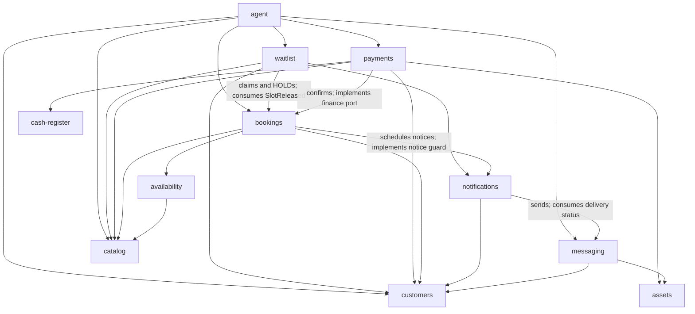

# CON-01 — Module Boundaries and Dependencies

> **Status:** In Review — proposal; **not team-ratified or implemented**.
> **Prepared:** 2026-11-08, on top of the [DOM-01 ERD](./erd.md), [DOM-02 tenancy](./tenancy.md), [UC-03 rules](../product-specs/uc-03/business-rules.md) and [invariants](../product-specs/uc-03/invariants.md), and the [architecture proposal](./target-architecture.md) v1.2.
> **Scope:** The functional modules of the NestJS modular monolith: responsibilities, data and operation ownership, allowed and prohibited dependencies, communication between modules, internal hexagonal structure, and the integration points that CON-02 and CON-03 must specify.
> **Out of scope:** NestJS modules, endpoints, services or repositories as code; detailed API contracts ([CON-02 #11](https://github.com/nanonoir/Agendoxa/issues/11)); provider contracts ([CON-03 #12](https://github.com/nanonoir/Agendoxa/issues/12)); microservices or distributed infrastructure.
> **Next step:** Team review. Decisions are `MOD-DM-XX`, all **Proposed**; open questions are `MOD-Q-XX` in [§10](#10-decisions-and-open-questions).

## 1. How to use this document

- **Sources keep their roles.** Business rules and guarantees stay in [UC-03](../product-specs/uc-03/business-rules.md); entities and attributes in the [ERD](./erd.md); tenant context in [DOM-02](./tenancy.md). This file assigns them to modules and adds only the structural decisions they leave open. If it disagrees with them, they win and this file is corrected.
- **It extends the architecture proposal.** The capability table ([§6.1](./target-architecture.md#61-business-capability-boundaries)), layer rules ([§6.2–§6.3](./target-architecture.md#62-example-internal-structure-for-a-rule-heavy-module)) and reviewable dependency rules ([§13.1](./target-architecture.md#131-reviewable-dependency-rules)) are linked, not repeated.
- **Nothing here is implemented.** Today `apps/api` has `AppController` (`GET /health`) and `DatabaseModule`, and `packages/database` holds 17 of the 38 entities ([REP-02](./rep-02-core-persistence.md)). The structure in [§7](#7-internal-structure-and-hexagonal-separation) applies when the first business module is created, for example in [REP-03 #16](https://github.com/nanonoir/Agendoxa/issues/16), [#30](https://github.com/nanonoir/Agendoxa/issues/30) or [#31](https://github.com/nanonoir/Agendoxa/issues/31).
- **Terms used below:**

| Term | Meaning |
|---|---|
| Module | One NestJS module under `apps/api/src/modules/<module>/` that owns a business capability |
| Owner | The only module that may change a record, and the only one whose persistence adapter reads or writes its tables |
| Public API | What a module exports to other modules from its `index.ts`: use-case facades, query functions, contract types, events and the ports others implement |
| Platform code | Cross-cutting technical support with no business rules: tenant and actor context, transactions, event dispatch, error categories, clock, database connection |

## 2. Module catalog

### MOD-DM-01: Twelve business modules and two platform modules

- **What:** The final module list after evaluating the ticket's initial ten.
- **Rule:** Each module below owns the responsibilities listed and nothing else. "Must not" repeats only the boundary that is easiest to break.

| Module | Responsibility | Must not | Rules |
|---|---|---|---|
| `tenants` | Business profile (name, slug, timezone, currency, branding), the `Tenant` row and typed access to the settings stored on it ([MOD-DM-06](#mod-dm-06-shared-rows-have-one-row-owner-and-named-field-owners)); public business information for the landing | Authorize from a slug or tenant ID; interpret settings that another module owns | BR-TEN |
| `identity` | Personnel sign-in, global `User`, memberships, tenant roles, role permissions and the permission catalog; effective-permission checks; last-Admin protection | Grant permissions directly to memberships; give customers CRM access; decide the business rule behind a permission | BR-IAM |
| `customers` | Tenant-local customers (requesters), notice preferences and their consent changes, deletion requests, incidents and restrictions | Count no-shows from incidents; merge customers by name; expose internal labels to customers | BR-CLI, BR-NOT-09, BR-DAT |
| `catalog` | Services (including preconfigured combinations), professional and physical resources, service–resource compatibility, booking policies and their per-field resolution ([MOD-DM-03](#mod-dm-03-booking-policies-belong-to-catalog)) | Build vertical-specific engines; decide occupancy | BR-CAT, BR-SEN-02 |
| `availability` | Calendars, recurring hours, blocks and authorized openings; effective open windows per resource in the tenant timezone ([MOD-DM-05](#mod-dm-05-availability-supplies-windows-bookings-finds-free-slots)) | Read or create occupancy; treat a query as a lock | BR-DISP-01–03, 06–08 |
| `bookings` | Booking lifecycle and transitions; occupancy through `SlotClaim`, its single authority ([MOD-DM-04](#mod-dm-04-bookings-owns-all-occupancy)); HOLDs; free-slot search; change requests; outcomes and walk-in reuse; booking history; required-deposit snapshot | Depend on WhatsApp, Next.js or an LLM; record money; send messages itself | BR-RES, BR-CAN, BR-DISP-04/05/09, BR-CLI-10, lifecycle part of BR-SEN |
| `waitlist` | Entries and consent provenance, release rounds, invitations, initial priority, queue limit and claim arbitration | Create claims or HOLDs itself; promise exclusivity to later invitees; ask anyone to transfer | BR-WL |
| `payments` | Charges, receiving accounts and collection modes, payment instructions, evidence review, verified payments, manual allocations, refunds and recording corrections | Credit evidence automatically; mutate an original payment; change booking status directly | BR-COB, financial part of BR-SEN |
| `cash-register` | The tenant's shared register: sessions, physical cash movements and post-close adjustments | Count transfers as cash; rewrite a closed session; sell products | BR-CAJA |
| `notifications` | Logical notices and attempts, scheduling, send-time revalidation, retry and unknown-outcome handling | Duplicate a notice on retry; send without current consent and validity; change booking state | BR-NOT |
| `messaging` | WhatsApp connections, webhook intake, persisted and deduplicated messages, conversations, AI/human control, the global AI switch, outbound sending | Grant business privileges; decide commercial policy | BR-HND, BR-AGT-05, BR-NOT-05, BR-CH-06–07 |
| `agent` | Conversation orchestration, tool schemas that map to other modules' public use cases, escalation summaries | Persist business data except through public use cases; choose the tenant or requester; become a second booking core | BR-AGT |
| `audit` *(platform)* | Appending `AuditEvent` inside the caller's transaction; tenant audit queries | Act as booking history or as a financial ledger | BR-AUD |
| `assets` *(platform)* | `StoredAsset` metadata, private storage and authorized download | Decide on its own whether evidence may be deleted | DM-14, BR-DAT-03 |

- **Reference:** [architecture §6.1](./target-architecture.md#61-business-capability-boundaries), [UC-03 areas](../product-specs/uc-03/business-rules.md#areas), [ERD §1](./erd.md#1-entity-inventory--38-candidates).

### Changes to the ticket's initial list

| Change | Reason |
|---|---|
| `waitlist` added | Its own rules (BR-WL), entities, jobs and concurrency (T-01). The architecture proposal and UC-03 already treat it as a capability; folding it into `bookings` would mix arbitration rounds with the booking lifecycle |
| `cash-register` added | Physical cash has its own lifecycle (open, collect, close, adjust) and permissions (BR-CAJA). Keeping it apart preserves the rule that a verified payment is not the same as cash in the register |
| `payments` keeps its name, with a narrower scope | The ticket describes it as payment signals; in the MVP there is no gateway and every credit is verified by a person (BR-SEN-07, BR-SEN-08). The proposal's `billing` alias is not used |
| `audit` and `assets` are platform modules | Each is used by three or more modules and holds no business rules. Making them business modules would invite rules into them |
| Incidents and restrictions live in `customers` | As in the architecture proposal. The ERD's "Incidents" module is a data grouping, not a capability |
| Not modules | The existing `DatabaseModule` (connection provider), the job scheduler adapter (CON-03), platform code, `packages/shared` and the web features. They support modules; none owns business data |

## 3. Data ownership

### MOD-DM-02: Every entity has one owner; only the owner touches its tables

- **What:** Applies "no module accesses another module's private persistence" to a repository where every table lives in one package.
- **Rule:**
  - Each of the 38 ERD entities has exactly one owner module, listed below.
  - The physical schema and the single migration history stay in `packages/database`. Same-tenant composite foreign keys ([TEN-DM-02](./tenancy.md#ten-dm-02-same-tenant-references-are-enforced-by-the-database)) cross module lines, so splitting the schema per module would lose them.
  - A foreign key is a data reference, not access permission. Only the owner's `adapters/out/persistence` imports its tables from `@agendoxa/database`, including for reads and joins. Other modules use the owner's public API.
  - The owner is the only module that changes a record's state. Another module that needs a change calls the owner's use case.
- **Example:** `payments` needs the booking's required deposit. It calls a `bookings` query; it does not select from `bookings`. If it joined `slot_claims` directly, a change to the private-remainder representation (T-01) would silently break payments.

| Owner | ERD entities | Physical tables today ([REP-02](./rep-02-core-persistence.md)) |
|---|---|---|
| `tenants` | `Tenant` | `tenants` |
| `identity` | `User`, `TenantMembership`, `Role`, `Permission`, `RolePermission` | `users`, `tenant_memberships`, `roles`, `permissions`, `role_permissions` |
| `customers` | `Customer`, `CustomerIncident`, `CustomerRestriction` | `customers`; the others are deferred |
| `catalog` | `Service`, `Resource`, `ServiceResource`, `BookingPolicy` | `services`, `resources`, `service_resources`, `booking_policies` |
| `availability` | `AvailabilityCalendar`, `AvailabilityRule`, `AvailabilityException` | `availability_calendars`, `availability_rules`, `availability_exceptions` |
| `bookings` | `Booking`, `SlotClaim`, `BookingChangeRequest`, `BookingEvent` | `bookings`, `slot_claims`, `booking_events`; change requests are deferred |
| `waitlist` | `WaitlistEntry`, `ExclusiveOffer` | Deferred |
| `payments` | `Charge`, `ReceivingAccount`, `PaymentReview`, `Payment`, `PaymentAllocation`, `Refund` | Deferred |
| `cash-register` | `CashSession`, `CashMovement`, `CashAdjustment` | Deferred |
| `notifications` | `Notification`, `NotificationAttempt` | Deferred |
| `messaging` | `ChannelConnection`, `Conversation`, `Message` | Deferred |
| `agent` | None. Conversation state is in `messaging`; any orchestration checkpoint storage is infrastructure, decided in CON-03 | — |
| `audit` | `AuditEvent` | Deferred |
| `assets` | `StoredAsset` | Deferred |

The 38 entities are each listed once. Derived values have no owner table: the no-show and late-change counts come from `bookings` queries, and the current restriction from `customers` ([ERD §6.4](./erd.md#64-module-2--customers)).

- **Physical grouping is not ownership.** `packages/database/src/schema/` groups tables by ERD area: `Tenant` is in `identity.ts`, and `BookingPolicy` is in `availability.ts`. The table above is authoritative. Moving schema files is not required by this decision; do it only when a change already touches them.
- **Reference:** [ERD §1](./erd.md#1-entity-inventory--38-candidates), [architecture §5](./target-architecture.md#5-monorepo-organization) ("not an excuse for modules to query another module's private tables").

### MOD-DM-03: Booking policies belong to `catalog`

- **What:** `BookingPolicy` resolves each field by resource > service > tenant ([DM-06](./erd.md#4-agreed-modeling-proposals-team-ratification-pending)). The ERD groups it with availability and the schema stores it in `availability.ts`; neither assigns an owner.
- **Rule:** `catalog` owns `BookingPolicy` and exposes one query that returns the effective policy for a service and resource, with inherit, set and disable already resolved. `bookings` snapshots what it needs at booking time (`notice_snapshot`, `required_deposit`, refund policy). `notifications` reads `reminder_lead`; `payments` reads deposit settings only through that query or the booking snapshot.
- **Alternatives:** In `bookings`, which would put configuration CRUD in the busiest module; or in `tenants`, which does not own services and resources.
- **Example:** An Admin sets a 20% deposit on the court service and disables it for one court. `catalog` resolves "disabled" for that court and "20%" for the rest; no other module reimplements the precedence.

### MOD-DM-04: `bookings` owns all occupancy

- **What:** `SlotClaim` is the single occupancy authority ([ERD §2.4](./erd.md#24-module-4--bookings-exclusive-occupancy-and-waitlist)), and its claims are owned by a booking or by an invitation's initial priority.
- **Rule:** `bookings` owns every `SlotClaim`, including the `OFFER_PRIORITY` claims that `waitlist` needs. `waitlist` asks `bookings` to acquire, close or convert a priority claim through public use cases, inside the same transaction as its own changes. No other module inserts, closes or reads claims directly.
- **Example:** A released court slot has three eligible people. `waitlist` asks `bookings` for an initial priority claim for the first one. When someone claims, `waitlist` calls the `bookings` use case that closes the priority claim and creates the booking HOLD atomically (BR-WL-08), then marks its invitation `CLAIMED`.
- **Reference:** INV-DISP-01, INV-WL-01, INV-WL-08, [REP-02 T-01](./rep-02-core-persistence.md#t-01-occupancy-subset).

### MOD-DM-05: `availability` supplies windows; `bookings` finds free slots

- **What:** Avoids a cycle: free slots need both schedules (`availability`) and active claims (`bookings`), and creating a booking needs both too.
- **Rule:** `availability` returns effective open windows for a resource and range: regular hours or inherited tenant hours, plus authorized openings, minus blocks (BR-DISP-01–03, 06). It knows nothing about claims. `bookings` owns the free-slot search: windows from `availability`, compatibility and duration from `catalog`, minus active claims, filtered by lead time and policy. The same check runs again inside the booking transaction (BR-DISP-04).
- **Example:** The agent asks for courts at 19:00. `bookings` gets Court 1's windows, sees an active HOLD at 19:00 and offers 20:00. `availability` never sees the HOLD and never reserves anything.

### MOD-DM-06: Shared rows have one row owner and named field owners

- **What:** Some rows carry settings or references whose meaning belongs to another module. Without a rule, two modules would write the same row.
- **Rule:** The row owner persists the row and its migrations. The field owner defines the meaning and is the only module that changes the value, by calling the row owner's narrow API inside its own transaction. The row owner never interprets those fields.

| Row (owner) | Field | Field owner | Why |
|---|---|---|---|
| `Tenant` (`tenants`) | `collection_mode`, `business_account_selection`, `rotation_cursor` | `payments` | Instruction issue and business-pool rotation (BR-COB-19, BR-SEN-06, T-02) |
| `Tenant` (`tenants`) | `resource_assignment_mode`, `resource_rotation_cursor` | `bookings` | Any-resource selection happens while acquiring the claim (BR-DISP-05, T-01) |
| `Tenant` (`tenants`) | `cash_auto_open` | `cash-register` | Automatic opening on first collection (BR-CAJA-03) |
| `Tenant` (`tenants`) | `ai_enabled`, `ai_disabled_until` | `messaging` | Global AI switch and routing (BR-HND-04) |
| `Resource` (`catalog`) | `receiving_account_id` | `payments` | Professional destination account (DM-11) |
| `Booking` (`bookings`) | `deposit_instruction_*`, `balance_instruction_*`, `collection_mode_snapshot` | `payments` | Issued instructions are frozen when shown (BR-SEN-06, INV-PAY-11) |
| `SlotClaim` (`bookings`) | `offer_id` and `OFFER_PRIORITY` kind | `waitlist` decides; `bookings` writes | Initial priority only ([MOD-DM-04](#mod-dm-04-bookings-owns-all-occupancy)) |

- **Example:** Sequential rotation picks the next business account. `payments` asks `tenants` to read and advance `rotation_cursor` under a row lock inside the instruction transaction; a retry reuses the instruction already stored on the booking and does not rotate again.
- **Open:** Whether these fields should move to tables of their field owners is [MOD-Q-01](#10-decisions-and-open-questions). It changes the ERD, so it is not decided here.

### Who guarantees each invariant area

The [invariants](../product-specs/uc-03/invariants.md) state where each guarantee holds (`DB`, `TX`, `UC`, `JOB`). This table states which module answers for it. Database constraints live in `packages/database`, but the owner of the table is still the one who must keep them.

| Invariant area | Responsible module | Cross-module part |
|---|---|---|
| INV-TEN-01–04 tenant isolation | Every owner for its tables; `identity` and messaging resolve the context | Context resolution per entry point ([TEN-DM-07](./tenancy.md#ten-dm-07-every-entry-point-has-one-source-of-tenant-context)) |
| INV-RES-01–08 lifecycle | `bookings` | Payment facts come from `payments` |
| INV-DISP-01, 02, 06, 07, 09 occupancy and concurrency | `bookings` | Windows from `availability` |
| INV-DISP-04, 08 openings and blocks | `availability` | — |
| INV-DISP-05 compatibility | `bookings` validates, `catalog` owns the links | Locking protocol with catalog changes ([#31](https://github.com/nanonoir/Agendoxa/issues/31)) |
| INV-SEN-01–04, 06–11 HOLDs and deposit-dependent transitions | `bookings` | Verified and allocated amounts from `payments` |
| INV-SEN-05 human verification | `payments` | — |
| INV-PAY-01–12 payments | `payments` | Cash parts with `cash-register` |
| INV-CAN-01–09 cancellation and rescheduling | `bookings` | Reminder suppression with `notifications`; ownership check uses the requester from `messaging` |
| INV-WL-01–13 waitlist | `waitlist` | Claims through `bookings` |
| INV-CLI-01–07 customers | `customers`; counts in `bookings` | INV-CLI-06 also binds `agent` |
| INV-CAJA-01–09 cash | `cash-register` | Collection is started by `payments` |
| INV-MSG-01, 02, 04–07 messaging | `messaging` | — |
| INV-MSG-03 tool context | `agent` | Context supplied by `messaging` |
| INV-NOT-01–08 notices | `notifications` | Validity rechecked by `bookings` and `waitlist` ([§5.3](#53-needs-against-the-direction)) |
| INV-AUD-01–03 audit | `audit` for storage; each caller writes in its own transaction | — |
| INV-AUD-04 roles | `identity` | — |
| INV-DAT-01–04 personal data | `customers` coordinates | Each owner deletes or keeps its own data ([§6.3](#63-events-and-durable-intents)) |

## 4. Operations by module

Each [UC-02 use case](../product-specs/uc-02/use-cases.md) has one module that owns the operation and decides its outcome. Collaborators are called through their public APIs.

| Use case | Owner | Collaborators |
|---|---|---|
| CU-01 Consult information and availability | `bookings` (free slots); `tenants`, `catalog` (information) | `availability`, `catalog` |
| CU-02 Booking without deposit | `bookings` | `customers`, `catalog`, `availability`, `payments` (charge), `notifications`, `audit` |
| CU-03 Booking with transfer deposit | `bookings` (lifecycle); `payments` (instruction, review, allocation) | `assets`, `notifications` |
| CU-04 Booking for other attendees | `bookings` | `customers` |
| CU-05 Join waitlist | `waitlist` | `customers` (consent, restriction), `catalog` |
| CU-06 Invitation and claim | `waitlist` | `bookings` (claims, HOLD), `notifications` |
| CU-07 Consult future bookings | `bookings` | — |
| CU-08 Cancel | `bookings` | `notifications`; `waitlist` reacts to the released slot |
| CU-09 Reschedule | `bookings` | `payments` (coverage, supplemental charge), `catalog`, `availability`, `notifications` |
| CU-10 Complete or no-show | `bookings` | `audit` |
| CU-11 Record, verify or correct payment | `payments` | `bookings` (confirmation), `cash-register`, `audit` |
| CU-12 Incidents and restrictions | `customers` | `audit` |
| CU-13 Cash register | `cash-register` | `audit` |
| CU-14 Takeover | `messaging` | `audit` |
| CU-15 Configure operations | `catalog`, `availability`, `payments` (accounts), `identity` (roles), `tenants` (settings) | Field owners of [MOD-DM-06](#mod-dm-06-shared-rows-have-one-row-owner-and-named-field-owners) |
| CU-16 Send notice | `notifications` | `messaging`, `customers` |
| CU-17 Sign in | `identity` | `tenants` |
| CU-18 Connect WhatsApp | `messaging` | — |
| CU-19 Notice preferences | `customers` | `waitlist` (entry provenance), `audit` |
| CU-20 Onboard a business | `tenants` | `identity`, `availability`, `catalog` ([MOD-Q-02](#10-decisions-and-open-questions)) |
| CU-21 Agenda | `bookings` | `payments` (review status) |
| CU-22 Expire HOLD | `bookings` | `payments` (funds recheck), `notifications`; `waitlist` reacts |
| CU-23 Request data deletion | `customers` | `messaging`, `waitlist`, `notifications`, `payments`, `assets` |

An operation that changes another module's state always does it through that module's use case, inside one transaction when the invariants require it ([§6.2](#62-transactions)).

## 5. Dependencies

### 5.1 Dependency diagram

An arrow means "depends on": imports the public API of, calls, implements a port of, or consumes an event of.



Omitted for readability: every module depends on `tenants`; every module above level 1 also depends on `identity` (permission checks) and `audit` (recording). `agent` implements the conversation responder port of `messaging`.

### MOD-DM-07: Dependencies only point to lower levels

- **What:** Makes "no circular dependencies" checkable without reading the code.
- **Rule:** A module may depend only on modules of a **lower** level and on platform code. Same-level dependencies are forbidden; for example `waitlist` and `payments` never call each other. A needed upward or same-level interaction uses [§5.3](#53-needs-against-the-direction) or changes this table in the same PR.

| Level | Modules | May depend on |
|---|---|---|
| 0 | `tenants` | Platform code only |
| 1 | `identity`, `audit`, `assets` | `tenants` |
| 2 | `customers`, `catalog`, `cash-register` | Levels 0–1 |
| 3 | `availability`, `messaging` | Levels 0–2 (`availability` → `catalog`; `messaging` → `customers`, `assets`) |
| 4 | `notifications` | Levels 0–3 (`customers`, `messaging`) |
| 5 | `bookings` | Levels 0–4 (`customers`, `catalog`, `availability`, `notifications`) |
| 6 | `waitlist`, `payments` | Levels 0–5 (see the diagram for each) |
| 7 | `agent` | Levels 0–6 |

- **Example:** `notifications` must check that a reminder's booking is still `CONFIRMED` before sending (INV-NOT-02). It cannot import `bookings`, which is higher. It defines a guard port that `bookings` implements ([§5.3](#53-needs-against-the-direction)).
- **Reference:** [architecture §6.3](./target-architecture.md#63-dependency-direction-and-composition), [§13.1](./target-architecture.md#131-reviewable-dependency-rules).

### 5.2 Why this order

- `bookings` is the core: the agent, the CRM, the waitlist and payments all drive it, so it sits above what it consumes (customers, catalog, schedules, notices) and below what drives it.
- `notifications` sits below `bookings` so that a booking transaction can schedule or suppress its reminders atomically (INV-CAN-08), instead of relying only on an asynchronous event.
- `messaging` sits below `notifications` because notices are sent through it, and below `agent` because the agent is one possible responder to a conversation, replaceable by a human (BR-CH-06).
- `cash-register` sits below `payments`: a cash payment and its movement are written together, started by `payments` (INV-CAJA-08). The register never needs payment rules.

### 5.3 Needs against the direction

When a lower module needs something from a higher one, the lower module owns the contract and the higher one implements or consumes it.

| Need | Contract owned by | Implemented or consumed by | Mechanism |
|---|---|---|---|
| Create charges, read verified and allocated deposit, read review status | `bookings`: finance port | `payments` | Port; called inside the booking transaction |
| Recheck that a notice is still valid before each attempt | `notifications`: notice guard, one per notice kind | `bookings` (booking notices), `waitlist` (invitations) | Port registered at composition |
| Answer an AI-eligible conversation turn | `messaging`: conversation responder | `agent` | Port; `messaging` keeps working without it |
| A released slot may start a waitlist round | `bookings`: `SlotReleased` | `waitlist` | Durable event ([§6.3](#63-events-and-durable-intents)) |
| Delivery outcomes update attempts | `messaging`: outbound status event | `notifications` | Event |
| Customer deletion confirmed or executed | `customers`: deletion events | `messaging`, `waitlist`, `notifications`, `payments` | Durable events; each owner handles its own data |
| No-show and late-change counts on the customer view | `bookings`: queries | CRM read composition | Query; never stored in `customers` |
| Settings stored on another module's row | Row owner's API | Field owner | [MOD-DM-06](#mod-dm-06-shared-rows-have-one-row-owner-and-named-field-owners) |

A port exists here because it breaks a real cycle at an important boundary ([architecture §6.2](./target-architecture.md#62-example-internal-structure-for-a-rule-heavy-module)), not as a default wrapper.

### 5.4 Prohibited dependencies

- Importing anything of another module outside its `index.ts`: repositories, adapters, Drizzle tables, domain internals.
- Reading or writing another module's tables through `@agendoxa/database`, including read-only joins. If a read becomes too slow, the owner publishes a query or read model as a [shared change](#9-technical-autonomy-and-shared-changes).
- Upward or same-level dependencies, and `forwardRef()` used to hide a cycle.
- `agent` or `messaging` changing bookings, payments or customers except through public use cases; `agent` choosing the tenant or the requester (BR-AGT-02).
- Business rules in platform code, `packages/shared`, inbound adapters or `apps/web`.
- `apps/web` importing `apps/api` or `@agendoxa/database`.
- Calling a provider, the LLM or WhatsApp, or waiting for a person, inside a database transaction (INV-DISP-07).
- A message broker or separate service to replace an in-process call ([architecture §6.3](./target-architecture.md#63-dependency-direction-and-composition)).

## 6. Communication between modules

### 6.1 Synchronous calls are the default

A module calls another through the facade exported by its `index.ts`, injected by NestJS. Inputs carry the validated tenant and actor context ([§6.5](#65-tenant-and-actor-context)); outputs are contract types, never database rows or another module's domain objects. Expected failures are typed results in the error categories of [architecture §11](./target-architecture.md#11-internal-api-and-integration-boundaries) (`validation`, `forbidden`, `not_found`, `conflict`, `external_dependency`), so callers decide without parsing messages.

### 6.2 Transactions

### MOD-DM-08: The initiating use case owns the transaction

- **What:** Several invariants span modules and must hold in one transaction.
- **Rule:**
  - The use case that starts the operation opens one transaction, through a transaction runner in platform code built on the existing `DatabaseModule` connection.
  - Every public API method that writes receives the caller's transaction explicitly and never commits, rolls back or opens its own. Explicit passing is preferred over an implicit ambient transaction because it stays visible in signatures and tests.
  - Nothing inside the transaction waits for a provider, the LLM, WhatsApp delivery or a person (INV-DISP-07).
  - A rejected commit, such as a serialization failure, fails the whole operation; only the initiator may retry it, and only when the operation is idempotent ([REP-02 transactional guards](./rep-02-core-persistence.md#transactional-guards)).
- **Operations that need one transaction across modules:**

| Operation | Initiator | Writes in the same transaction | Invariants |
|---|---|---|---|
| Create a booking | `bookings` | Claim, booking, charge (`payments`), booking event, audit, HOLD-expiry intent, reminder when confirmed (`notifications`) | INV-DISP-01, INV-SEN-06, INV-RES-04 |
| Cancel a booking | `bookings` | Status, claim closed, reminders suppressed (`notifications`), `SlotReleased` intent, audit | INV-CAN-08 |
| Apply a reschedule | `bookings` | New claim, old claim closed, reminders replaced, change request applied, event | INV-CAN-02–03, INV-CAN-06 |
| Allocation reaches the deposit threshold | `payments` | Allocation, booking confirmed (`bookings`), reminder (`notifications`) | INV-PAY-07, EJ-20 |
| Record a cash payment | `payments` | Payment, cash movement, automatic session opening (`cash-register`) | INV-CAJA-08 |
| Claim an invitation | `waitlist` | Priority claim closed and HOLD created (`bookings`), invitation claimed | INV-WL-08 |
| Change notice preferences | `customers` | Preferences, scoped audit events, entry provenance (`waitlist` reads it) | INV-AUD-03, INV-NOT-07 |
| Correct an outcome | `bookings` | Status, booking event with reason, audit | INV-RES-02, INV-RES-04 |

### 6.3 Events and durable intents

### MOD-DM-09: Events are notifications; required follow-ups are durable

- **What:** How a lower module triggers a higher one, and how delayed effects survive restarts ([architecture §6.5](./target-architecture.md#65-cross-module-atomicity-and-delayed-effects)).
- **Rule:**
  - An event exists only when a lower module must trigger a higher one ([§5.3](#53-needs-against-the-direction)). Modules at a lower level never call upward.
  - A follow-up that must happen is recorded in the same transaction as its cause: either a job enqueued transactionally or a durable intent reconciled later. Which one depends on the scheduler, and CON-03 decides it.
  - Payloads carry `tenant_id`, the record IDs and a deduplication key; they are never the source of truth. The consumer reloads the record under that tenant and rechecks current state before acting ([TEN-DM-08](./tenancy.md#ten-dm-08-jobs-carry-and-recheck-their-tenant)). Handlers are idempotent.
  - Names below are provisional; CON-03 defines payloads.

| Event | Producer | Consumers | Purpose |
|---|---|---|---|
| `SlotReleased` | `bookings`, on cancellation, HOLD expiry, correction-window cancellation and the old slot of a reschedule | `waitlist` | Start a release round for real free capacity, never for private remainders (BR-WL-05, BR-WL-15) |
| Outbound message status changed | `messaging` | `notifications` | Record attempt outcomes; unknown outcomes are not resent (BR-NOT-10) |
| Customer deletion confirmed | `customers` | `waitlist`, `notifications`, `messaging` | Close entries and pending invitations, stop notices and AI use (BR-DAT-01, BR-DAT-09) |
| Customer deletion executed | `customers` | `messaging`, `payments`, `notifications` | Each owner deletes or anonymizes its own data and asks `assets` to remove files it no longer needs to keep (BR-DAT-03, T-04) |

- **Example:** A cancellation commits with its `SlotReleased` intent. The process crashes before the waitlist reacts. On recovery the intent is still there; `waitlist` reloads the booking, sees the claim closed and the slot still free, and starts the round. If someone booked the slot meanwhile, it does nothing.

### 6.4 Queries and read compositions

The owner answers questions about its data through query functions in its public API. A CRM screen that combines several modules, such as the customer view with its no-show count or the agenda with review status, is composed by the highest module involved or by the HTTP adapter of that screen, never by a SQL join across owners. A booking-level read that needs payment facts goes through the finance port.

### 6.5 Tenant and actor context

Inbound adapters resolve the tenant and actor once, from the single source each entry point has ([TEN-DM-07](./tenancy.md#ten-dm-07-every-entry-point-has-one-source-of-tenant-context)): the CRM membership, the validated WhatsApp connection, or a job payload rechecked against the record. The context is passed explicitly to use cases and from them to other modules. No public API accepts a tenant chosen by a client or by the LLM, and every persistence adapter scopes reads and writes by `tenant_id`. A record of another tenant is reported as `not_found` (EJ-01).

### 6.6 Jobs

Each job belongs to the module that owns the state it changes. It lives in that module's `adapters/in/jobs` and calls the module's own use cases, which recheck state ([architecture §10.3](./target-architecture.md#103-durable-jobs-and-notifications)).

| Job | Owner |
|---|---|
| HOLD expiry; initial-evidence correction-window expiry | `bookings` |
| Initial priority expiry, progressive invitation steps, entry expiry | `waitlist` |
| Notice dispatch, one retry after a confirmed failure, status recovery | `notifications` |
| Five-second message grouping; 60-minute AI return | `messaging` |
| Deletion execution on day 30 | `customers`, then each consumer of the deletion event |
| Reconciliation of durable intents | The module that produced each intent |

## 7. Internal structure and hexagonal separation

### 7.1 Folder and file conventions

```text
apps/api/src/
├── modules/
│   └── <module>/                       # Name from §2, kebab-case
│       ├── index.ts                    # Public API: the only file other modules import
│       ├── <module>.module.ts          # NestJS composition
│       ├── domain/                     # Pure rules and concepts
│       ├── application/
│       │   ├── use-cases/
│       │   └── ports/                  # Interfaces this module needs
│       └── adapters/
│           ├── in/                     # http/, jobs/, events/
│           └── out/                    # persistence/, plus one folder per provider
├── platform/                           # Context, transactions, events, errors, clock
└── database/                           # Existing DatabaseModule
```

- **Create a folder only when a file needs it.** A module without jobs has no `adapters/in/jobs/`; the tree lists the possible places, not a checklist ([architecture §6.2](./target-architecture.md#62-example-internal-structure-for-a-rule-heavy-module)).
- **Names follow [CONTRIBUTING](../../CONTRIBUTING.md#nombres-de-archivos-carpetas-y-módulos):** kebab-case files with a responsibility suffix. The module folder and file use the module name from §2, so `bookings/bookings.module.ts` declares `BookingsModule`. Suggested suffixes: `.use-case.ts`, `.repository.ts` for a persistence port and `drizzle-<name>.repository.ts` for its adapter, `.controller.ts`, `.job.ts`, `.policy.ts` for a pure rule.
- **Imports:** relative imports end in `.js` (NodeNext). A module imports another only as `../<module>/index.js`.
- **Tests:** unit tests next to the file (`.spec.ts`); PostgreSQL integration tests in the existing integration configuration; HTTP behavior in E2E. Levels and costs follow [architecture §13](./target-architecture.md#13-testing-and-architecture-controls) and the focused validation in [AGENTS.md](../../AGENTS.md#focused-validation).

### MOD-DM-10: A module's public surface is its `index.ts`

- **What:** Makes [MOD-DM-02](#mod-dm-02-every-entity-has-one-owner-only-the-owner-touches-its-tables) and [§5.4](#54-prohibited-dependencies) reviewable file by file.
- **Rule:** `index.ts` exports the NestJS module, the facades other modules may inject, contract types (plain TypeScript), event names and payload types, and the ports others implement. It never exports repositories, adapters, Drizzle tables, entity classes or domain internals. Changing it is a [shared change](#9-technical-autonomy-and-shared-changes).
- **Enforcement:** Review now. When the second business module exists, add an import restriction to the lint configuration so that a path into another module's folder, other than its `index.ts`, fails `pnpm lint`. The tool and rule are chosen then ([MOD-Q-03](#10-decisions-and-open-questions)); no dependency is added for it today.

### 7.2 Layer rules

The rules per layer are those of [architecture §6.3](./target-architecture.md#63-dependency-direction-and-composition): the domain imports nothing from NestJS, Drizzle, HTTP, LangGraph or providers; application code depends on the domain and on ports, never on concrete adapters; inbound adapters translate and call use cases; outbound adapters implement ports; the NestJS module only wires them. This document adds three rules about modules:

1. **A use case is the unit other modules call.** Facades in `index.ts` delegate to use cases or queries; they add no rules.
2. **A port is owned by the module that needs it.** Persistence ports belong to the module whose tables they hide. Ports that break a cycle belong to the lower module ([§5.3](#53-needs-against-the-direction)). A call to a lower module's facade needs no port.
3. **Domain code never sees another module's types.** The application layer maps what it receives from other modules into its own domain concepts.

### 7.3 Expected depth per module

| Depth | Modules | What it means |
|---|---|---|
| Full | `bookings`, `waitlist`, `payments`, `notifications`, `messaging` | Domain rules with tests, use cases, persistence port and adapter; provider adapters where they apply |
| Medium | `customers`, `identity`, `cash-register`, `agent` | Use cases and persistence; domain policies only where a rule exists, such as restriction effects, last-Admin protection or expected cash. `agent` has tools as inbound adapters and the conversation runtime as an outbound adapter, and no persistence of its own |
| Light | `tenants`, `catalog`, `availability`, `audit`, `assets` | Use cases over a persistence adapter. `catalog` keeps policy resolution and `availability` keeps window calculation as pure, tested functions, because those are their rules |

A module moves to more depth when a real rule appears, not in advance.

### MOD-DM-11: `bookings` is the conceptual reference module

- **What:** The ticket asks for one module that shows the hexagonal separation. `bookings` has the most rules, both channels and the hardest concurrency, so it exercises every layer. It is a design reference, not code to create now.

| Layer | Contents (conceptual names) | Rules it carries |
|---|---|---|
| `domain/` | `booking-lifecycle.policy.ts`: allowed transitions by actor and condition | INV §2.1–2.3, INV-RES-01–02 |
| | `time-range.ts`: half-open `[start, end)` intervals and overlap | BR-RES-02, INV-DISP-02 |
| | `outcome-timing.policy.ts`: completion from start, no-show from start + 15 minutes | BR-RES-10–12, INV-RES-08 |
| | `deposit-requirement.policy.ts`: required amount from the effective policy and `FULL_PREPAYMENT` | BR-SEN-03–05, INV-SEN-07 |
| | `late-change.policy.ts`: whether a change is outside the notice window | BR-CAN-01, BR-CAN-14 |
| | Derived conditions: pending operational close, partial-deposit waiting, correction window open | BR-RES-13, BR-SEN-10–11 |
| `application/use-cases/` | Find free slots; create WhatsApp HOLD; confirm HOLD; create CRM booking; cancel; request and apply reschedule; record and correct outcome; reuse a remainder for a walk-in; expire HOLD; expire correction window; confirm after deposit (called by `payments`); acquire and convert priority claims (called by `waitlist`) | — |
| `application/ports/` | Booking and occupancy repository (persistence, transactional); finance port (implemented by `payments`); clock (platform) | — |
| `adapters/in/` | `http/`: CRM controllers specified in CON-02. `jobs/`: HOLD and correction-window expiry. No agent adapter: tools in `agent` call the facade | — |
| `adapters/out/persistence/` | Drizzle implementation over `bookings`, `slot_claims`, `booking_events` and, later, `booking_change_requests`. Translates the GiST exclusion violation into a `conflict` result | INV-DISP-01, EJ-08 |
| `index.ts` | `BookingsModule`, the bookings facade, query functions, contract types, `SlotReleased`, the finance port and the notice guard implementation | — |

- **Example flow, create a WhatsApp HOLD (BR-RES-03):**
  1. `agent` calls the facade with the context fixed by the conversation: tenant, requester and the chosen slot.
  2. The use case asks `customers` for the requester's current restriction; `BLOCKED` ends here (BR-CLI-09).
  3. It asks `catalog` for compatibility, duration and the effective policy, and `availability` for the resource's windows.
  4. In one transaction ([MOD-DM-08](#mod-dm-08-the-initiating-use-case-owns-the-transaction)): it rechecks lead time and the future-booking cap, inserts the claim (the database rejects an overlap), creates the booking in `HOLD` with `hold_expires_at`, creates the charge through the finance port, records the booking event and the HOLD-expiry intent.
  5. After commit, the facade returns the HOLD and its deadline; `agent` phrases the reply. A `conflict` result makes `agent` offer other slots instead.
- **What stays outside `bookings`:** whether money was verified (`payments`), when to send the reminder (`notifications`, scheduled from inside the transaction), who wins a release round (`waitlist`), and what the customer is told (`agent`).

## 8. Integration points for CON-02 and CON-03

These are the questions this document leaves to the contract tickets, with the boundary each answer must respect. The contracts themselves are not defined here.

### 8.1 For CON-02: API contracts

Issue [#11](https://github.com/nanonoir/Agendoxa/issues/11).

| Topic | CON-02 defines | Constraint from this document |
|---|---|---|
| CRM endpoints | Routes, methods, inputs and outputs per operation | Each endpoint belongs to the owner module of its operation ([§4](#4-operations-by-module)) and calls one use case. An endpoint never writes to two modules except through that use case |
| Public endpoints | The read-only landing data | Only `tenants` business information and `catalog` services. No booking, cancellation or rescheduling endpoint (BR-CH-02, [architecture §11](./target-architecture.md#11-internal-api-and-integration-boundaries)) |
| Authentication and tenant selection | Session or token, and how the CRM selects a business | Resolved by `identity`; a selected tenant only selects, it never authorizes (BR-TEN-02) |
| Errors | HTTP mapping of the error categories | `not_found` for another tenant's record (EJ-01); `conflict` for occupancy races (EJ-08) |
| Shared schemas | Which request and response schemas live in `packages/shared` | Only HTTP contracts used by `apps/web` and `apps/api`; never entities, database rows or domain objects. Inbound adapters validate with them and map to use-case inputs |
| Representations | Formats on the wire | Money as decimal strings, as the database already returns them; instants in UTC; recurring times as local times with the tenant timezone; UUID identifiers |
| Booking status | How status and conditions appear | The seven statuses only. Pending operational close, review state and partial-deposit waiting are separate derived fields, not new statuses ([§11](#11-reconciliation-with-sources)) |
| Idempotency | Which operations accept a key and how | At least payments and refunds (ERD `idempotency_key`, T-03) and booking creation retries |
| Internal consumers | Which use cases the agent reuses | Agent tools call module facades, not HTTP ([§8.2](#82-for-con-03-integration-contracts)) |

### 8.2 For CON-03: integration contracts

Issue [#12](https://github.com/nanonoir/Agendoxa/issues/12).

| Integration | Port owned by | CON-03 defines | Constraint from this document |
|---|---|---|---|
| WhatsApp provider (Evolution API) | `messaging` | Send, webhook verification and normalization, connection status, provider identifiers and deduplication, status recovery | Only `messaging` talks to the provider. The tenant comes from the connection (INV-MSG-02). Provider capabilities are unvalidated (T-04) |
| Conversation runtime (LangGraph) | `agent` | Runtime adapter, tool input and output schemas, failures and escalation | Tools are inbound adapters of `agent` over the allowlist below. Tenant and requester come from the conversation (BR-AGT-02) |
| Job scheduler (pg-boss) | Platform code | Schedule and cancel by deduplication key, transactional enqueue or durable intent with reconciliation, retries | Payload is `tenant_id` plus record IDs; handlers recheck state ([MOD-DM-09](#mod-dm-09-events-are-notifications-required-follow-ups-are-durable)); jobs per module in [§6.6](#66-jobs) |
| Notice dispatch | `notifications` uses the `messaging` facade | How a notice becomes a message and how outcomes return | Internal call plus the status event of [§6.3](#63-events-and-durable-intents); no provider details in `notifications` |
| Private file storage | `assets` | Store, read through authorized access, delete; MIME and size validation | No public links (DM-14); deletion is decided by the record owners |
| Payments | — | **No provider port** | The MVP has manual transfers verified by a person and cash (BR-SEN-07, BR-SEN-08, MVP §5.3). [§11](#11-reconciliation-with-sources) lists the conflict with the Issue |

**Operations available to the agent**, all through public facades and always with the conversation's requester:

| Allowed | Module |
|---|---|
| Business information, services and prices | `tenants`, `catalog` |
| Find free slots; create a HOLD; confirm without deposit; cancel; reschedule; consult the requester's future bookings | `bookings` |
| Join the waitlist; claim an invitation | `waitlist` |
| Read payment status; attach evidence to a pending review | `payments` |
| Record notice preferences; request or withdraw data deletion | `customers` |
| Escalate to a human with a summary | `messaging` |

Never exposed to the agent: verifying or allocating money, recording outcomes, cash operations, restrictions, exceptions, configuration and roles (BR-AGT-04, BR-IAM-07).

**Simulated implementations for parallel work:** a fake WhatsApp provider that records sends and replays webhooks, a scripted conversation runtime, a scheduler that runs jobs on demand in tests, and in-memory storage. CON-03 decides their exact form.

## 9. Technical autonomy and shared changes

### 9.1 What a module decides on its own

Within the rules of §5–§7, the module's responsible person decides, with the normal review of [CONTRIBUTING](../../CONTRIBUTING.md#pull-requests-y-revisión): its internal folders and depth, its domain model, how use cases are written, the queries of its persistence adapter, its tests and any refactor that leaves `index.ts` unchanged. A new index on its own tables is local too, but the migration still joins the single history, so announce it.

### 9.2 Shared changes

These follow [Coordinación y conflictos](../../CONTRIBUTING.md#coordinación-y-conflictos): tell the affected people and make the impact visible in the PR's "Impacto compartido" section. Telling them does not mean waiting for prior approval.

| Change | Involve | Extra rule |
|---|---|---|
| A module's `index.ts`: facades, contract types, events | Responsible people of the consuming modules | Prefer additive changes; remove only after consumers move |
| A port that another module implements | The implementing module | The port's owner proposes; both update in one PR when possible |
| Event or job payloads | Consumers | Additive fields; consumers must tolerate replays |
| Migrations in `packages/database` | The table owner and owners of tables that reference it | Never edit an applied migration ([database README](../../packages/database/README.md#migraciones-y-conexión)) |
| Shared rows ([MOD-DM-06](#mod-dm-06-shared-rows-have-one-row-owner-and-named-field-owners)) | Row owner and field owner | — |
| `packages/shared` contracts | `apps/web` and `apps/api` consumers | Follow CON-02's evolution rules once they exist |
| Permission catalog keys | `identity` and the modules that check them | — |
| A new dependency, a new module, or moving an entity to another owner | Everyone affected | Update this document in the same PR; it is an architecture decision ([architecture §14.1](./target-architecture.md#141-architecture-decision-records-when-needed)) |
| An exception to a layer or dependency rule | Reviewer and affected owners | Record the reason and the agreement in the PR ([architecture §14](./target-architecture.md#14-team-implementation-conventions), item 7) |

### 9.3 Module responsibility

- Each module has a responsible person, recorded in its Issue or in GitHub Projects when work on it starts. That person is the preferred reviewer for changes inside the module, never an exclusive approver: CONTRIBUTING still asks for one approval from anyone else on the team.
- A PR that touches more than one module names every affected module and its responsible person.
- Changing another module's internals is coordinated with its responsible person; prefer asking for a change to its public API.
- Modules can be built in parallel once the public API of the lower module they need is agreed. Until it exists, the higher module codes against that contract with a test double.

### 9.4 Where coordination will be needed

| Boundary | Why | Related |
|---|---|---|
| `bookings` ↔ `payments` | Deposit lifecycle, confirmation on allocation, partial deposits, instructions and rotation | T-02, T-03, BR-SEN-09–11 |
| `bookings` ↔ `waitlist` | Priority claims, rounds, the unique winning HOLD | T-01, BR-WL-06–15 |
| `bookings` ↔ `notifications` | Scheduling and suppressing reminders inside booking transactions | INV-CAN-06, INV-CAN-08 |
| `bookings` ↔ `catalog` | Compatibility checks while catalog links change | [#31](https://github.com/nanonoir/Agendoxa/issues/31), INV-DISP-05 |
| `messaging` ↔ `agent` | Control mode, takeover and the responder port | BR-HND, INV-MSG-04 |
| `customers` → every consumer | Deletion and anonymization fan-out | T-04, BR-DAT |
| `tenants` ↔ `identity` and the rest | Onboarding and the settings stored on `Tenant` | [#30](https://github.com/nanonoir/Agendoxa/issues/30), [MOD-DM-06](#mod-dm-06-shared-rows-have-one-row-owner-and-named-field-owners) |

## 10. Decisions and open questions

| ID | Decision | Status |
|---|---|---|
| [MOD-DM-01](#mod-dm-01-twelve-business-modules-and-two-platform-modules) | Twelve business modules and two platform modules | Proposed |
| [MOD-DM-02](#mod-dm-02-every-entity-has-one-owner-only-the-owner-touches-its-tables) | One owner per entity; only the owner's persistence adapter touches its tables | Proposed |
| [MOD-DM-03](#mod-dm-03-booking-policies-belong-to-catalog) | `BookingPolicy` belongs to `catalog` | Proposed |
| [MOD-DM-04](#mod-dm-04-bookings-owns-all-occupancy) | `bookings` owns every `SlotClaim` | Proposed |
| [MOD-DM-05](#mod-dm-05-availability-supplies-windows-bookings-finds-free-slots) | `availability` supplies windows; `bookings` finds free slots | Proposed |
| [MOD-DM-06](#mod-dm-06-shared-rows-have-one-row-owner-and-named-field-owners) | Row owner and named field owners for shared rows | Proposed |
| [MOD-DM-07](#mod-dm-07-dependencies-only-point-to-lower-levels) | Dependencies only point to lower levels | Proposed |
| [MOD-DM-08](#mod-dm-08-the-initiating-use-case-owns-the-transaction) | The initiating use case owns the transaction; writes receive it explicitly | Proposed |
| [MOD-DM-09](#mod-dm-09-events-are-notifications-required-follow-ups-are-durable) | Events only upward triggers; required follow-ups are durable | Proposed |
| [MOD-DM-10](#mod-dm-10-a-modules-public-surface-is-its-indexts) | `index.ts` is the only public surface | Proposed |
| [MOD-DM-11](#mod-dm-11-bookings-is-the-conceptual-reference-module) | `bookings` is the conceptual reference module | Proposed |

These questions are flagged, not resolved here.

| ID | Question | Why it matters | Owner | Blocks |
|---|---|---|---|---|
| `MOD-Q-01` | Should the settings and references of [MOD-DM-06](#mod-dm-06-shared-rows-have-one-row-owner-and-named-field-owners) move to tables of their field owners? | It would remove shared rows, but it changes the ERD and REP-02's schema | Team, with T-01 and T-02 | Nothing now |
| `MOD-Q-02` | How does CU-20 onboarding create the tenant, its roles, first membership, calendar and policy atomically? Proposal: a provisioning port owned by `tenants` and implemented by `identity`, `availability` and `catalog` | `tenants` is level 0 and cannot call them directly | [#30](https://github.com/nanonoir/Agendoxa/issues/30) | Onboarding |
| `MOD-Q-03` | Which lint rule enforces [MOD-DM-10](#mod-dm-10-a-modules-public-surface-is-its-indexts) and [MOD-DM-07](#mod-dm-07-dependencies-only-point-to-lower-levels)? | Review alone does not scale once several people work in parallel | Team, when the second module exists | Nothing now |
| `MOD-Q-04` | Transactional job enqueue or durable intent plus reconciliation? | Decides how [MOD-DM-09](#mod-dm-09-events-are-notifications-required-follow-ups-are-durable) is built | CON-03 | The first job |

[TEN-Q1](./tenancy.md#10-open-questions) and [TEN-Q6](./tenancy.md#10-open-questions) belong to `identity` and stay in DOM-02.

## 11. Reconciliation with sources

Differences found while assigning the sources to modules, and how this document handles them.

| Topic | Sources say | This document |
|---|---|---|
| Module list | The ticket lists ten; the architecture proposal lists twelve capabilities, with a `payments` / `billing` alias | Twelve business modules plus `audit` and `assets`; the name `payments` ([§2](#changes-to-the-tickets-initial-list)) |
| ERD modules | Nine data groupings, including Policies, Assets, Incidents and Audit | Capability modules own the 38 entities ([§3](#mod-dm-02-every-entity-has-one-owner-only-the-owner-touches-its-tables)); the ERD grouping remains valid as data documentation |
| Booking statuses | UC-03 §0 and architecture §9.1 call the seven labels conceptual and "not finalized DB enums"; [REP-02](./rep-02-core-persistence.md) implemented `booking_status` with the same seven values | The seven are the only booking statuses, and only `bookings` changes them. Actually pending review, rejected evidence awaiting correction, partial-deposit waiting and pending operational close are derived conditions computed by `bookings` with payment facts, not statuses ([INV §2](../product-specs/uc-03/invariants.md#2-booking-lifecycle), BR-RES-13). Updating the wording of architecture §9.1 is left to its own review |
| `ExclusiveOffer` | Legacy name; only first small-cohort priority holds a claim (DM-08) | `waitlist` owns the invitation; any claim is a `bookings` claim ([MOD-DM-04](#mod-dm-04-bookings-owns-all-occupancy)) |
| Reminder suppression | INV-CAN-08 requires suppression atomically with cancellation; the proposal schedules notices through jobs | `notifications` sits below `bookings`, so the booking transaction schedules and suppresses; the send-time recheck (INV-NOT-02) still guards every attempt |
| Paths in the Issues | `docs/domain/*.md`, `architecture.md`, `docs/architecture/` | The documents are in `docs/product-specs/` and `docs/design-docs/`. This file follows the [design catalog](./index.md), as DOM-01 and DOM-02 did |
| CON-02 Issue | Public API to create, consult, cancel and reschedule bookings | Excluded by BR-CH-02 and architecture §11; UC-03 §17 already records it. [§8.1](#81-for-con-02-api-contracts) keeps public endpoints read-only |
| CON-03 Issue | Mercado Pago payment contracts | Excluded by BR-SEN-08 and MVP §5.3. [§8.2](#82-for-con-03-integration-contracts) defines no payment provider port; changing that needs a product decision |
| Module naming | CONTRIBUTING's examples use `BookingModule` | The examples are illustrative; module folders, files and classes follow the names in §2, such as `BookingsModule` |

## 12. Traceability

**[CON-01 (#10)](https://github.com/nanonoir/Agendoxa/issues/10)**

| Criterion | Where |
|---|---|
| MVP modules identified | §2 |
| Responsibilities and boundaries documented | §2, §5.4 |
| Data and operation ownership per module | §3, §4 |
| Allowed and prohibited dependencies | §5 |
| Communication between modules | §6 |
| Hexagonal separation with a conceptual reference module | §7, MOD-DM-11 |
| Integration points and contracts identified | §8 |
| Technical autonomy and shared-change conventions | §9 |
| Reviewed and approved by the team | **Pending** |

| Deliverable in the Issue | Where |
|---|---|
| Module catalog with responsibilities, boundaries and dependencies | This file, §2–§5. The Issue names `docs/architecture/modules.md`; this file follows the design catalog, as DOM-01 and DOM-02 did |
| Mermaid dependency diagram | §5.1 |
| Internal structure conventions for NestJS modules | §7 |
| Contracts and integration points for CON-02 and CON-03 | §8 |
