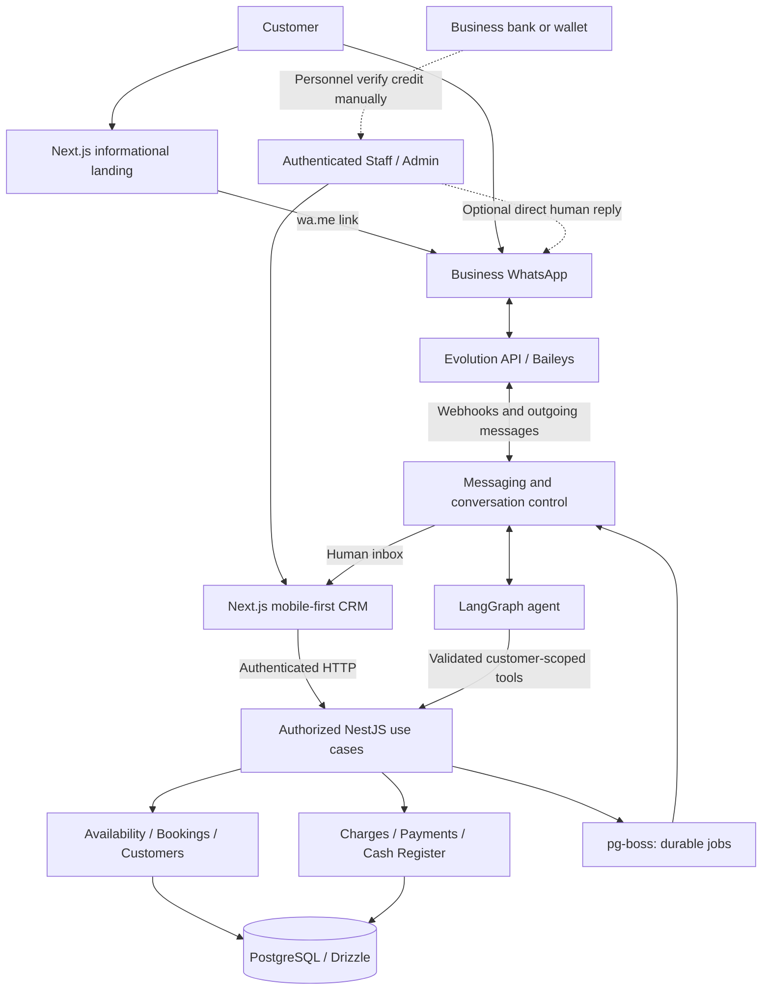
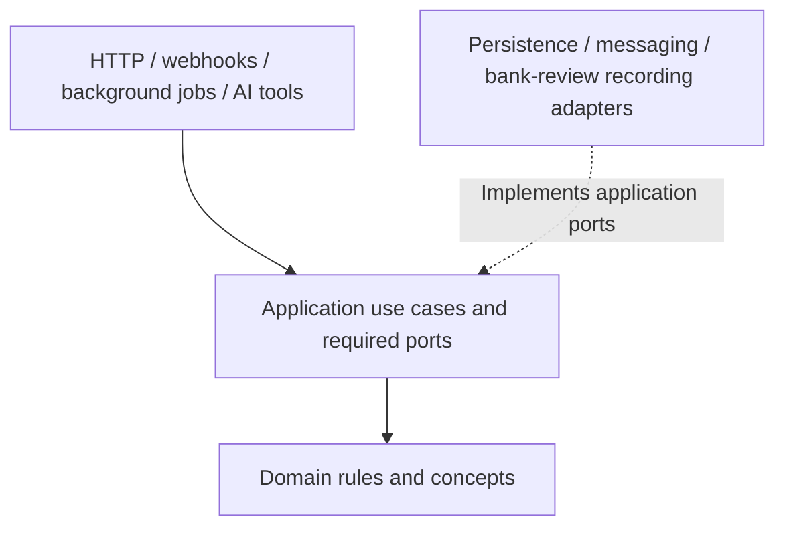
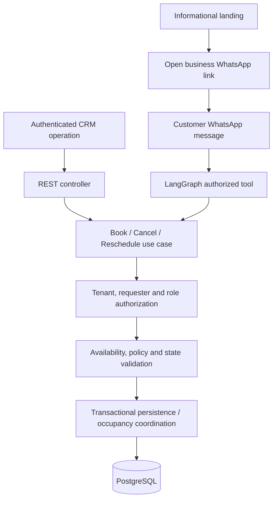

# Agendoxa — Architecture: Modular Booking and Customer Service Platform

> **Version:** 1.1 · **Date:** November 2, 2026 · **Status:** Updated architecture proposal for team review  
> **Project:** Devlights bootcamp · Shared codebase with independently operated deployments.  
> **Product scope:** [`mvp.md`](../product-specs/mvp.md) v0.2  
> **Functional references (UC-01):** [`uc-01/actors.md`](../product-specs/uc-01/actors.md) and [`uc-01/flows.md`](../product-specs/uc-01/flows.md)  
> **Supersedes:** Architecture v1.0 (October 28, 2026) wherever its public-booking, payment-provider, or integration assumptions conflict with the approved UC-01 direction.

## 1. Purpose and Documentation Boundaries

This document defines **how Agendoxa's components are organized and integrated**, their responsibilities, dependency rules, technical safeguards, and verifiable architecture constraints. It is **not** the source of truth for the detailed behavior of every use case.

- **`mvp.md`** defines the product scope, exclusions, delivery milestones, and acceptance criteria.
- **`docs/design-docs/target-architecture.md`** defines architectural choices, technical boundaries, and implementation constraints.
- **`docs/product-specs/uc-01/actors.md`** defines actors, permissions, channels, and the use-case index.
- **`docs/product-specs/uc-01/flows.md`** defines UC-01 flows, exceptions, and supporting diagrams.
- Final endpoint contracts, persisted state machines, database schemas, DTOs, screen designs, and prompts are **deferred** to the appropriate implementation/design tasks.

If the documents disagree, **flag and resolve the conflict explicitly** rather than silently treating an outdated example as a requirement.

**Adopted approach:** A **NestJS modular monolith**, organized around business capabilities, with **pragmatic hexagonal architecture** for modules containing significant business rules or external integrations. The Next.js application uses a **feature-first** structure; the codebase lives in a **pnpm + Turborepo monorepo**.

## 2. Architectural Goals and Non-Goals

1. **One booking authority:** Authenticated CRM users and the WhatsApp AI agent invoke the **same backend application use cases**. An informational landing does not create or manage bookings.
2. **Business-first boundaries:** Services, assignable professionals, and physical resources share one booking core without duplicating logic per vertical.
3. **Tenant isolation:** A multi-business deployment must prevent any cross-tenant data or action access.
4. **Independent deployment:** The same code supports shared installations and dedicated installations operated separately.
5. **Controlled evolution:** Messaging, payment providers, public booking, and external integrations can be added later without moving booking rules outside the core.
6. **Operational resilience:** The CRM and booking engine remain usable when WhatsApp, Evolution API, or the LLM is unavailable.
7. **Transactional correctness:** Exclusive holds, confirmed bookings, pending payment reviews, and waitlist offers cannot produce incompatible occupancy.
8. **Simple team operations:** Prefer the fewest necessary deployable processes and avoid architecture that is difficult to review or operate.

**Non-goals:** Microservices, full CQRS, event sourcing, a generalized plugin platform, a third-party/public booking API, automatic payment reconciliation, and speculative scaling mechanisms are **not MVP requirements**.

## 3. Solution Context and High-Level Architecture



**Logical vs physical components:** `MSG`, `AGENT`, `CORE`, and `FIN` are responsibilities **inside the NestJS modular monolith**, not required standalone services. LangGraph runs inside the NestJS application initially. Evolution API and PostgreSQL remain separate infrastructure services; `pg-boss` uses PostgreSQL. There is **no Mercado Pago integration or automated bank connection** in the MVP.

**Channels:**

- **Customer self-service:** Individual WhatsApp messages, routed through Evolution/Baileys and authorized agent tools.
- **Business operations:** Authenticated mobile-first CRM; staff can create/manage bookings independently of WhatsApp.
- **Public landing:** Business information, SEO, and contact/WhatsApp links only. It has **no reservation calendar, checkout, or booking forms**.
- **Optional Google Maps discovery:** A business may manually publish a WhatsApp link in a supported profile; **no Google API integration**.

## 4. Technology Decisions

| Responsibility | Choice | Architectural rule |
|---|---|---|
| Monorepo | **pnpm workspaces + Turborepo** | Explicit package boundaries and unified development/build scripts. |
| Web | **Next.js App Router, TypeScript, Tailwind CSS** | Mobile-first authenticated CRM and informational landing in one app, organized by feature. |
| Backend | **NestJS + TypeScript** | One modular monolith and one implementation of each authoritative business use case. |
| Persistence | **PostgreSQL + Drizzle ORM** | Versioned migrations, transactional writes, tenant-scoped access. |
| Exclusive scheduling | **PostgreSQL `tstzrange`, GiST / `btree_gist` where applicable** | Database-enforced overlap protection for exclusive resources, including blocking claims. |
| Durable background work | **pg-boss** | Hold expiry, five-minute waitlist offers, reminders, retries, and reconciliation. |
| Conversational agent | **LangGraph.js** | Limited orchestration through typed, authorized use-case tools. |
| WhatsApp pilot | **Evolution API + Baileys** | Unofficial external channel with monitored connectivity and fallback. |
| MVP payments | **Manual bank/wallet transfers and cash** | Staff/Admin verify actual accreditation; no integrated payment gateway. |
| Deployment | **Docker Compose** | Reproducible local setup and independent installations. |
| CI / images | **GitHub Actions + GHCR** | Targeted checks and versioned container artifacts. |

**Not included:** A mandatory Redis instance, Mercado Pago webhooks, bank APIs, Google Calendar synchronization, and public third-party booking integrations. Choose actual dependency versions in package manifests and the lockfile; a tool selection alone does not justify an abstract interface or new service.

## 5. Monorepo Organization

```text
agendoxa/
??? apps/                     # Proposed web and API responsibilities
??? packages/                 # Proposed database, shared and optional UI packages
??? docs/
?   ??? product-specs/
?   ?   ??? mvp.md
?   ?   ??? uc-01/            # actors.md and flows.md
?   ??? design-docs/
?       ??? target-architecture.md
??? infra/                    # Proposed operational configuration
??? .github/workflows/        # Proposed CI/CD
??? pnpm-workspace.yaml
??? turbo.json
??? package.json
??? .env.example
```

**Dependency and ownership rules:**

- `apps/web` consumes **HTTP contracts** and shared portable types. It does **not** import NestJS application internals, Drizzle repositories, or server-only database code.
- `packages/shared` holds reusable API/data contracts and validation schemas, **not a second booking core** or secrets.
- `packages/database` remains server-only. It does not provide an excuse for modules to query another module's private tables directly.
- `packages/ui` contains reusable view components; vertical-specific booking behavior stays in its feature or the backend.
- Create packages and layers **only when used**; the tree is illustrative, not a checklist of empty folders.
- Turborepo coordinates tasks and caching; Docker Compose handles services and deployment topology.

## 6. Backend Organization: Business Modules and Pragmatic Hexagonal Architecture

### 6.1 Business Capability Boundaries

The following are **logical responsibilities**, not a requirement to create a NestJS module for every row on day one.

| Capability / possible module | Owns | Must not do |
|---|---|---|
| `tenants` | Business configuration, timezone, feature settings, validated tenant context. | Assume every installation contains multiple tenants. |
| `identity` | Personnel authentication, tenant memberships, Admin/Staff roles and delegated operational privileges. | Treat a tenant ID or subdomain as proof of authorization. |
| `customers` | Tenant-scoped customer/requester records, attendee context, no-show incidents, individual restrictions. | Give the AI unrestricted access to customer profiles. |
| `catalog` | Services, prices/durations, preconfigured combinations, resources and compatibility. | Build separate booking engines for barbershops and sports clubs. |
| `availability` | Resource working hours, blocks, exceptions, compatible time windows. | Treat an availability read as an exclusive lock. |
| `bookings` | Booking lifecycle, requester ownership, holds, reschedules, cancellation and occupancy coordination. | Depend on WhatsApp, Next.js, or an LLM to enforce business rules. |
| `waitlist` | Voluntary interest, eligibility, ordered offers, five-minute exclusive priority. | Promise a slot before it is transactionally secured. |
| `payments` / `billing` | Booking charges, amounts due, received payments, deposit evidence, human review and adjustments. | Mark a transfer as paid because an image looks valid. |
| `cash-register` | One tenant-shared register, opening/closing sessions, attributed cash movements, discrepancies. | Sell inventory/POS items or rewrite a closed session. |
| `notifications` | Opt-in preferences, consented reminders, delivery intentions and outcomes. | Send messages regardless of revocation or current booking status. |
| `messaging` | Evolution adapter, normalized messages, conversations, human/AI routing and inbox state. | Grant business privileges to the agent or decide commercial policy. |
| `agent` | LangGraph orchestration, conversation context, tool schemas and error escalation. | Write directly to booking/payment persistence or become a second booking core. |

**Boundaries to preserve:** The booking creates/maintains obligations; payments record verified funds; the cash register records relevant physical-cash movements and accountable sessions. A recorded payment is **not** the same as service completion. `waitlist` must coordinate atomically with `availability`/`bookings` when offering exclusive time slots. Shared workflow coordination belongs in application use cases, not duplicated across modules.

**Specialized Admin/Staff permissions:** Staff may operate bookings, register payments, verify transfers, log attendance and apply **individual customer restrictions**. Staff needs **separate explicit grants** to open/close cash or edit operational schedules. Only Admin controls general prices/policies, personnel grants, receiving aliases, global AI settings, out-of-policy exceptions and audited adjustments after cash close. The exact permission representation is deferred.

### 6.2 Example Internal Structure for a Rule-Heavy Module

```text
apps/api/src/modules/bookings/
├── domain/
│   ├── entities/                    # Domain concepts with invariants
│   ├── value-objects/               # Only if they express real constraints
│   └── policies/                    # Pure booking and transition rules
├── application/
│   ├── use-cases/                   # CreateBooking, RescheduleBooking, etc.
│   ├── ports/                       # Interfaces required by application layer
│   └── models/                      # Internal use-case inputs / outputs
├── adapters/
│   ├── in/http/                    # Controllers and transport DTOs
│   └── out/persistence/            # Drizzle implementation of ports
└── bookings.module.ts              # NestJS DI composition
```

**Pragmatic application:** Do not populate empty directories or wrap every function in a port. A simple CRUD feature may need fewer layers than bookings, payments, or messaging. Add a port where it isolates persistence, an important module boundary, or a replaceable external provider, or enables valuable testing.

### 6.3 Dependency Direction and Composition



| Layer | May use | Must not depend on |
|---|---|---|
| **Domain** | Pure TypeScript and its own business concepts. | NestJS, Drizzle, Next.js, HTTP, LangGraph or providers. |
| **Application** | Domain rules and declared ports/contracts. | Concrete DB adapters, Evolution clients or user-interface implementations. |
| **Inbound adapters** | Public use-case entry points and transport DTOs. | Direct SQL or a second implementation of business rules. |
| **Outbound adapters** | Ports and required domain/application types. | Controllers, UI decisions or unrelated private module internals. |
| **NestJS composition** | DI providers and concrete implementations. | Embedded booking/payment policy decisions. |

**Module communication:** Modules expose narrow public use cases/facades, consumed through DI. Do not import another module's private repository/table access to bypass its invariants; avoid circular dependencies and review boundaries before introducing `forwardRef()`. Call in-process APIs by default. Use durable jobs for delayed side effects, **not** a broker to simulate local synchronous calls.

### 6.4 One Booking Core, Two Transactional Entry Paths



- Controllers translate authenticated HTTP requests into use-case calls; they **do not** perform their own availability calculations.
- AI tools translate validated conversational arguments into **customer-scoped** use-case requests; the backend rechecks tenant, ownership and policy.
- CRM may create a complete manual booking in one operation, without forcing personnel through a ten-minute conversational HOLD.
- WhatsApp booking applies the **ten-minute initial HOLD** after a concrete slot is selected, with or without a deposit.
- The landing leads customers to WhatsApp; **it never calls `CreateBooking` directly**.

### 6.5 Cross-Module Atomicity and Delayed Effects

- Use cases coordinating a booking and a blocking claim **must** establish a clear transaction boundary and preserve the original booking if a reschedule fails.
- Do not hold PostgreSQL transactions open while waiting for a human, WhatsApp delivery, or an LLM response.
- Notifications, expirations and waitlist wakeups are triggered by durable intentions/jobs and must recheck current state when executed.
- Shared state-changing operations must be idempotent where retries or duplicate webhook/messages can occur.
- A successful business transaction and its required follow-up job must not become permanently inconsistent; use a durable intent plus reconciliation, introducing a formal outbox only if warranted.

## 7. Next.js Frontend: Feature-First Organization

Hexagonal layering is **not mandatory in the frontend**. Keep routes, features, UI components and API access separated by practical responsibility.

```text
apps/web/src/
├── app/
│   ├── (public)/                    # Informational landing and WhatsApp CTA
│   └── (admin)/                     # Authenticated mobile-first CRM
├── features/
│   ├── bookings/
│   ├── availability/
│   ├── customers/
│   ├── payments/
│   ├── cash-register/
│   ├── conversations/
│   └── settings/
├── components/                      # Shared view components
└── lib/
    ├── api/                         # Typed API client / adapters
    └── auth/                        # Session and authorization helpers
```

**Frontend rules:**

- UI validation improves usability, but **NestJS decides** actual availability, policy, pricing and authorization.
- The CRM supports fast mobile workflows: schedule, manual booking, transfer review, payment, close cash, customer incidents, and human message takeover.
- The landing is **read-only business information** with WhatsApp links. It does not show a live availability calendar or a guest booking form.
- Distinguish remote/server state from UI state; do not duplicate canonical booking data across unrelated stores.
- Basic brand customization stays tenant-configurable rather than forking code per customer.
- A third-party ecommerce/site can link to WhatsApp now; public API/embedded booking integration is **post-MVP**.

## 8. Multi-Tenancy, Security, and Portability

### 8.1 Deployment Modes

```text
Operator A: shared installation
  Next.js + NestJS + PostgreSQL + Evolution
  ├── Tenant A: barbershop
  ├── Tenant B: sports courts
  └── Tenant C: beauty salon

Operator B: dedicated installation
  Next.js + NestJS + PostgreSQL + Evolution
  └── Tenant D: one business
```

Both installations use the **same code and tenant-aware data model**. A dedicated installation does not remove tenant identity; it may simply contain one tenant.

### 8.2 Tenant Boundary and Authentication

- Operational entities and relationships are tenant-owned. A global personnel `User` may belong to multiple businesses through `TenantMembership`, with distinct roles for each.
- Resolve tenant context from **verified personnel membership or validated channel connection**. A supplied `tenant_id` or subdomain selects context but does not grant access.
- Enforce tenant scope for every read/write, including attachments, conversations, bank evidence, cash sessions, queue jobs, audit logs and customer restrictions.
- Use constrained foreign keys/indices where appropriate (for example, composite tenant-aware references) to prevent cross-business associations.
- Evaluate PostgreSQL **RLS** as defense-in-depth only when its role/connection/transaction implications are understood; do not claim it is active until implemented.
- Store secrets outside the repo, redact them in logs, and never send sensitive connection settings to the browser or LLM context.
- Test negative cases using manipulated resource/customer IDs and two tenants; never trust only the frontend's filtering.

**WhatsApp requester boundary:** The channel's validated sender number identifies the customer operationally **within the tenant**; it grants self-service only over bookings managed by that number. An attendee name or a different sender number does not convey booking authority. Technical operators have **no default business-data access**.

### 8.3 Portability Preparation

- Prefer stable identifiers, explicit tenant ownership, and traceable links for business records, messages, receipts, preferences and jobs.
- Do not create irreversible associations between tenants' private data.
- Keep per-installation domains, secrets, webhook endpoints, credentials and infrastructure references separate from portable business data.
- Allow personnel with memberships in more than one tenant without merging the tenants' operational records.
- Review these properties before the first persistent schemas; **tenant export/import and zero-downtime migration tooling are not MVP features**.

## 9. Booking, Payment, Waitlist, and Cash Consistency

### 9.1 Exclusive Booking and Availability

- Interpret business-local dates with the tenant's configured timezone; persist unambiguous instants in PostgreSQL.
- For exclusive resources, represent time intervals consistently (e.g., `[start, end)` with `tstzrange`) and enforce incompatible overlaps at the **database/transaction boundary**, not only in API checks.
- Blocking claims must account for **initial `HOLD`, human-review-pending deposits, confirmed bookings and active five-minute exclusive waitlist offers**. Exact persistence design and final state names are deferred; **do not assume the original `HOLD`/`CONFIRMED`-only exclusion is sufficient**.
- A read-only availability query does **not** reserve a time. A customer selecting a concrete slot starts a **ten-minute HOLD** in the WhatsApp flow, whether or not a deposit applies.
- Without deposit, explicit confirmation within the HOLD confirms. With deposit, a timely receipt starts human review **without automatic timeout**; approval after actual bank accreditation confirms, rejection releases.
- An expired HOLD or a rejected receipt frees occupancy only through a consistent state transition. A delayed job must not free an already confirmed/approved claim.
- Rescheduling must acquire valid new occupancy and update/release the previous interval **atomically**; on a conflict, preserve the original booking.

**State labels** `HOLD`, `PENDING_PAYMENT_REVIEW`, `CONFIRMED`, `CANCELLED`, `COMPLETED`, `NO_SHOW`, and `EXPIRED` are **conceptual labels from UC-01**, not finalized DB enums or exhaustive state transitions.

### 9.2 Waitlist Exclusive Priority

- First offer available alternatives unless the customer explicitly requires one fixed day/time. Joining a waitlist requires consent; the entry **does not block** a resource.
- When a slot is genuinely released, choose the next eligible waiter in arrival order and establish a **single exclusive five-minute opportunity** for that resource/interval.
- Acceptance within five minutes begins a **new ten-minute booking HOLD**; failure to accept expires the offer and allows consideration of the next waiting customer or general availability.
- Coordinate offers and ordinary bookings transactionally so the same interval cannot be promised exclusively to two parties. If a WhatsApp notification fails, do not block indefinitely; detailed retry/failure behavior remains an open design item.
- Queue entry expiry, limits, long chains, and undelivered messages are not invented here; defer precise decisions to domain design.

### 9.3 Manual Deposits and Financial Records

- Payments in this MVP are **cash and business-received bank/wallet transfers**. Admin manages aliases/accounts (possibly several with one default), with no automatic account rotation.
- Deposit rules may be fixed or percentage-based, with business defaults and specific service/resource overrides. Before the customer pays, show applicable price, deposit, alias, and cancellation policy.
- A receipt uploaded within ten minutes changes the booking to **pending human payment review**. Staff/Admin check actual credit in the bank/wallet; only an accountable approval records an accredited deposit and confirms the booking.
- **No image/OCR/AI-only accreditation.** A transfer arriving after the slot is released or an unmatched amount is a human financial incident, never a silent reconfirmation.
- Allow partial and combined-method payments. Model charges/sums due separately from money recorded as received and from service completion; prevent duplicate financial movements from retries.
- For rescheduling, keep already verified funds and calculate any additional deposit or remaining balance. New required amounts must be verified before committing the changed booking; overpayments and exceptional refunds are handled manually with audit.
- Do not hold an open DB transaction during bank-app review. **Risk accepted:** a receipt under human review blocks the slot without automatic expiration, potentially enabling prolonged blocking; surface and attribute pending items without unilaterally adding an expiry policy.

### 9.4 Shared Cash Register and Attendance

- **One logical cash register per tenant**, used by multiple employees; every movement includes an accountable actor.
- Admin or separately authorized Staff may open/close sessions. Opening is manual or automatic per tenant policy; automatic opening carries forward the **previous declared physical cash balance**, with subsequent withdrawals/adjustments explicitly recorded.
- **Closing is always manual**: record responsible user, physical count, expected amount, discrepancies and time. Transfers are separately displayed, **not** counted as physical cash.
- Pending booking balances do not prevent closing. Closed sessions remain immutable; after close, **only Admin** adds a separately audited adjustment.
- Staff/Admin register completion or `NO_SHOW` explicitly; time passing does not imply attendance or payment. A personal no-show is not the same as a third-party attendee incident.
- Two personal no-shows trigger an **internal label**, not an automatic penalty. Staff/Admin may apply individual restrictions with reasons; Admin owns the general commercial policy.
- The register covers service and rental payments, **not** a bar POS, inventory, product sales, tax invoicing or full accounting.

## 10. LangGraph, WhatsApp, Human Handoff, and Durable Jobs

### 10.1 Bounded LangGraph Agent

The LLM is **an orchestrator and conversation interface**, not an independent business authority.

- Each tool call is linked to a validated tenant and WhatsApp requester identity; NestJS revalidates all inputs, ownership and policy.
- Tools read configured business information and invoke permitted actions (availability, HOLD, confirm without deposit, cancel, reschedule, waitlist, reminder consent).
- The agent cannot fabricate slots/prices, grant discounts, change business settings, check actual bank accreditation, infer no-shows or directly change DB state.
- For payments, the agent can associate **receipt evidence with a pending review**, never approve its own interpretation.
- Capture meaningful context, ask for missing data, and hand off unresolved or out-of-policy requests with a concise conversation summary.
- The booking core and CRM must remain usable when the LLM is disabled or unavailable.

### 10.2 Messaging Adapter and Conversation Ownership

- The messaging module receives Evolution API webhooks, validates their origin and tenant connection, deduplicates event IDs, and stores important incoming messages durably.
- Group consecutive incoming messages after **five seconds with no additional incoming messages**, without relying solely on in-memory timers. Each processed message/intent must remain attributable.
- Support **individual text messages and receipt images**. No WhatsApp groups, voice-note workflows, or mass-marketing campaigns in the MVP.
- Maintain **persistent, authoritative per-conversation routing state**: AI eligible, human-taken-over, or globally disabled as appropriate. A human takeover suppresses bot replies to the same conversation.
- **Admin controls global AI** (temporary disable or indefinite until reenabled). **Staff/Admin control individual handoff** from the CRM shared inbox.
- On manual handback or **60 minutes without a human reply**, AI may resume **only if globally enabled**; each new human reply resets the inactivity interval. AI reactivation cannot clear pending payment review.
- Direct human replies from the business WhatsApp app are desirable but **must be validated against actual Evolution/Baileys event behavior**. CRM's explicit takeover/handback is the reliable fallback; do not infer human authorship from the bot's own outgoing messages.
- An Evolution disconnection temporarily interrupts customer self-service and outbound reminders; CRM bookings and financial operations remain available.

### 10.3 Durable Jobs and Notifications

- Use `pg-boss` for ten-minute HOLD expiry, five-minute exclusive-offer expiry, waitlist progression, reminders, AI/human return timing where scheduled, and controlled retries.
- Jobs must be **idempotent and state-aware**. A stale expiry or retry cannot cancel a confirmed booking, release an approved slot, double-register a payment, or send a false confirmation.
- Persist intent and a deduplication key for critical tasks; reconcile when a DB commit succeeds but a follow-up enqueue fails. A formal outbox is optional if its added complexity becomes justified.
- Send **one same-day reminder per confirmed booking by default**, at configurable lead time, only with recorded, revocable consent. An opted-in waitlist offer uses a separate consent basis.
- Respect current status, preferences, connection availability and tenant context before every message. Track attempts/delivery/failure; a delivery failure does not roll back a booking.
- Never assume that 600–800 monthly reminders or a specified number of WhatsApp connections is a provider-approved limit or guaranteed capacity; measure the pilot.

## 11. Internal API and Integration Boundaries

- **Authenticated REST** is the primary interface for the CRM and current platform adapters. OpenAPI may be generated from NestJS for internal coordination.
- AI tools are **application adapters** that call authorized use cases, not a separately exposed public administrative API.
- Public unauthenticated endpoints, if needed, expose **read-only landing information**; they do not authorize booking creation, cancellation or rescheduling.
- Validate DTOs at inbound boundaries; keep business-policy and tenant/role checks in application/domain paths.
- Use stable error meanings (`validation`, `unauthorized`, `forbidden`, `not_found`, `conflict`, `external_dependency`) without leaking secrets or cross-tenant data.
- Verify message webhooks and map business-WhatsApp connection to tenant; deduplicate retries. There are **no Mercado Pago webhooks** in the MVP.
- **Not in scope:** A published external booking REST API/SDK, third-party booking widgets, ecommerce webhooks or external systems writing directly to Agendoxa tables. These can be designed later with explicit authorization and ownership rules.

## 12. Infrastructure, CI/CD, and Scaling

### 12.1 Local Development and Independent Deployment

- Turborepo orchestrates `dev`, `lint`, `typecheck`, targeted `test`, and `build`, with cache/dependency configuration appropriate to each package.
- Docker Compose starts PostgreSQL, Evolution API, and required app services locally; optional profiles are acceptable when an integration is not needed for a specific stage.
- GitHub Actions validates PRs; GHCR can publish reproducibly tagged images as deployment matures.
- Each operator owns the installation's database, secrets, domain, WhatsApp configuration, backups and support.
- Run migrations as controlled release steps with backup/recovery planning; container restart is not a migration strategy.
- Document health checks, sanitized structured logs, minimal backup and a **tested restore procedure** before handling real pilot data.
- Deploy only changed services where practical; a Next.js update should not require restarting PostgreSQL/Evolution.

### 12.2 Capacity Evolution

Start with a NestJS API and a logical job worker **in the same application/process if justified**. If monitoring warrants it, run API and worker as separate processes **sharing code and domain boundaries**, without adopting microservices. Separate agent workload further only if supported by measurements.

**Measure** memory, CPU, disk, webhook throughput, WhatsApp connection reliability and agent usage/costs. A 2-vCPU/4-GB VPS or a specified number of business numbers has **no guaranteed capacity without tests**.

## 13. Testing and Architecture Controls

| Level | What to verify | Minimum-effective approach |
|---|---|---|
| Domain | Time overlap, deposit rules, notice policies, no-show attribution and invariants. | Fast unit tests of pure logic. |
| Application | Staff/Admin/requester authorization, use-case behavior and conflict handling. | Targeted tests with suitable test doubles. |
| Integration | Drizzle persistence, exclusion constraints, race conditions, tenant boundaries and state-aware jobs. | PostgreSQL-backed integration tests. |
| Contracts | CRM controllers, Evolution webhooks, AI tool schemas and permission checks. | Targeted API/tool validation. |
| Critical workflows | Manual CRM booking, WhatsApp HOLD/deposit review, waitlist priority, human handoff and cash closing. | Focused integration or E2E tests only where the risk requires a real browser. |
| Operations | Deployment, migrations, restore and health checks. | Reproducible scripts/checklists and documented verification. |

**Must-verify architecture outcomes:**

1. A user/agent from tenant A cannot read, modify or associate tenant B's booking, customer, payment, conversation or cash information, even by tampering with IDs.
2. Two concurrent requests cannot create overlapping **active blocking claims**, including HOLDs, payment review and exclusive waitlist offers.
3. A ten-minute expiry never releases a booking already confirmed or moved to human payment review; five-minute offer expiry never bypasses a newer HOLD.
4. A receipt cannot mark a deposit paid without recorded human verification; duplicate messages/actions do not duplicate payments or confirmations.
5. The CRM and WhatsApp paths call the same booking core, while the landing never submits a booking.
6. A requester cannot cancel/reschedule another WhatsApp number's bookings, even when the attendee name matches.
7. Only authorized Staff/Admin can perform privileged operations; post-close cash correction requires Admin and leaves an immutable close history.
8. A human takeover prevents competing AI messages; the 60-minute return respects global AI disablement.
9. The CRM and booking core work with Evolution/AI unavailable, and an independent installation can start without relying on another operator's services.

**Cost rule:** Use the least expensive verification level that reliably covers the relevant risk. Do not execute large Playwright/E2E suites during routine feature work; reserve wider suites for critical integration milestones or release/PR-to-main checks when justified.

### 13.1 Reviewable Dependency Rules

- `domain/` does not import NestJS, Drizzle, HTTP, LangGraph, Evolution or any provider.
- Application use cases do not import concrete outbound adapters.
- Controllers and LangGraph tools do not execute SQL or reimplement availability/business rules.
- Every tenant-scoped query/action has verified tenant and actor context.
- A module exposes a narrow public interface; callers do not bypass it with private repository imports.
- No duplicate booking engine exists for CRM, WhatsApp, or either vertical.
- No gratuitous module cycles, `forwardRef()` shortcuts, empty abstraction layers, or unreviewed dependency inversions.

These can be checked partly with lint/import rules and partly through pull-request review.

## 14. Team Implementation Conventions

1. **Responsibility over ceremony:** Do not introduce classes, DTOs, interfaces, mappers or folders without a concrete role.
2. **Shared business vocabulary:** Prefer `Tenant`, `Booking`, `Resource`, `Service`, `Requester`, `Attendee`, `Hold`, `Waitlist`, `Payment`, and `CashSession` consistently across modules. These are **conceptual names**, not mandatory DB tables.
3. **Explicit use-case contracts:** State inputs, outputs, expected conflicts and required actor context.
4. **Correct transaction boundaries:** Application use cases coordinate state changes; persistence provides the transactional mechanisms.
5. **Minimal observability:** Structured logs and meaningful correlation/tenant identifiers, while protecting customer data, message contents, receipts and secrets.
6. **Small reviewable changes:** Keep the build runnable and avoid simultaneous unrelated module refactors.
7. **Document deviations:** A feature-specific exception to an architecture constraint requires a reason and explicit agreement, never an undocumented workaround.

### 14.1 Architecture Decision Records (When Needed)

For substantial changes, use short ADRs in `docs/adr/` with **context → decision → alternatives → consequences**. Examples: Changing the messaging adapter, splitting the worker, enabling RLS, altering tenant boundaries or adding a payment gateway. A trivial endpoint or internal rename does not need an ADR.

## 15. Stage 0: Architecture Foundation Exit Criteria

The repository foundation is ready when:

- [ ] `pnpm` + Turborepo run consistent commands from the root.
- [ ] `apps/web` and `apps/api` start with documented local configuration.
- [ ] PostgreSQL/Drizzle apply at least one reproducible initial migration.
- [ ] Docker Compose starts the required development dependencies.
- [ ] A small representative NestJS module demonstrates the intended domain/application/adapter boundaries without artificial code.
- [ ] Two sample tenants exist and at least one negative isolation check is reproducible.
- [ ] The frontend consumes a real authorized API route without directly querying application databases.
- [ ] Minimal CI validates install, types, relevant tests and build without production secrets.
- [ ] `.env.example`, startup instructions, and pull-request conventions exist.
- [ ] `docs/product-specs/mvp.md`, `docs/design-docs/target-architecture.md`, and UC-01 reference docs are available in the repository.

**Not required for Stage 0:** Implementing all booking workflows, Evolution, AI, cash register, transfer review, or waitlist mechanics. Their architecture is recorded here, but implementation follows the MVP's delivery stages.

---

## Final Architectural Decision

> **Adopted architecture:** A NestJS modular monolith with pragmatic hexagonal boundaries; a feature-first Next.js mobile-first CRM and informational landing; PostgreSQL/Drizzle as the transactional source of truth; pg-boss for durable work; Evolution API/Baileys plus bounded LangGraph tools for WhatsApp self-service; manual bank-transfer verification and a shared cash register; pnpm/Turborepo and Docker Compose for independent deployments.
>
> **Central invariant:** No channel or agent duplicates the booking domain, grants itself extra authority, or bypasses transactional exclusive-occupancy controls.
>
> **Deferred evolution:** Public web booking and third-party API, Mercado Pago/bank integrations, POS/inventory, additional channels, and larger-scale distributed infrastructure require separate product decisions.
