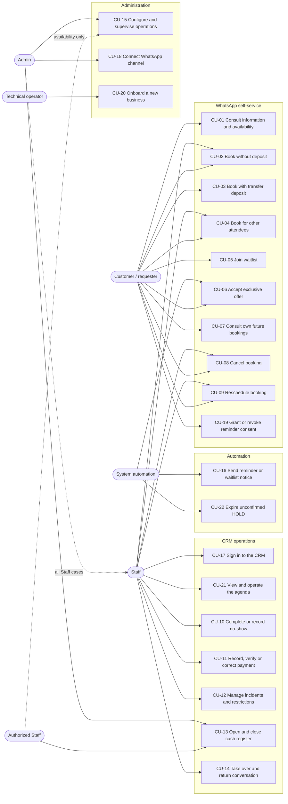
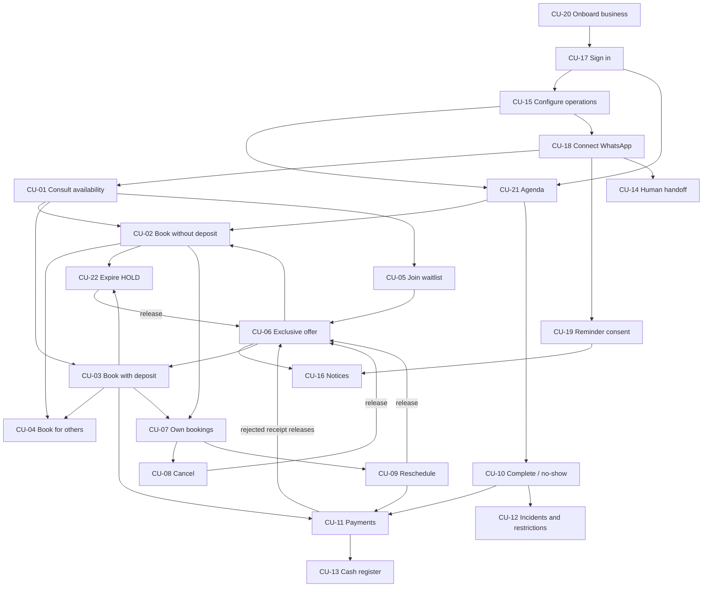

# UC-02 — Prioritized Use Cases and Functional Specifications

> **Status:** Draft
> **Objective:** Define which behaviors Agendoxa must offer, under which conditions, and which of them the MVP needs, starting from the actors and flows identified in UC-01.
> **Scope:** The full catalog of functional use cases (`CU-XX`) for customers, personnel, the AI agent and automated processes; detailed specifications; MVP priority; delivery by MVP stage; functional dependencies; a general use case diagram.
> **Out of scope:** Domain invariants and state-machine guarantees (UC-03: [business-rules.md](./business-rules.md), [invariants.md](./invariants.md)); entities and relations (DOM-01/DOM-02); endpoints, DTOs or technical contracts (CON-XX); implementation.
> **References:** [actors.md](./actors.md) and [flows.md](./flows.md) (UC-01, authoritative for behavior); [mvp.md](../../mvp.md) v0.2 (scope, stages, acceptance criteria); [architecture.md](../../architecture.md) v1.1. `rules.md` (30/10/2026) predates UC-01 and keeps some superseded decisions (see [§8](#8-differences-with-the-issue-and-base-documents)).

## Confirmed Decisions

These come from UC-01 and are not reopened here. The full list is in [actors.md — Confirmed Decisions](./actors.md#confirmed-decisions).

- WhatsApp (individual chats) is the **only customer self-service channel**. The landing page is informational and links to `wa.me`.
- Personnel operate through a **mobile-first CRM**, which keeps working when WhatsApp is down.
- Deposits are paid by **bank/wallet transfer** and **verified by a human**. Mercado Pago is not integrated in the MVP.
- A WhatsApp booking starts with a **10-minute HOLD**, with or without a deposit; waitlist offers give **5 minutes of exclusive priority**.
- One **shared cash register per tenant**; no bar/shop POS.

## Open Questions

- **The priorities, stage mapping and cut order are a proposal** derived from `mvp.md` v0.2 ([§3](#3-prioritized-catalog), [§5](#5-delivery-by-mvp-stage)); the team must approve them.
- **CU-17 to CU-22 are new** in UC-02 (sign-in, WhatsApp connection, reminder consent, onboarding, agenda, HOLD expiry). UC-01 implies them, but they need confirmation from the UC-01 author.
- Who connects the WhatsApp channel (CU-18) and who onboards a business (CU-20) is not stated in UC-01; this document proposes Admin and the technical operator respectively.
- Use-case-level questions are listed inside each specification. Business-rule questions are tracked as `P-NN` in [business-rules.md §16](./business-rules.md#16-pending-decisions).

## 1. How to Read This Document

- **`CU-XX`** identifiers are stable and shared with UC-01. CU-01 to CU-16 keep their UC-01 meaning; CU-17 onward are added here.
- **[flows.md](./flows.md)** keeps the narrative summary and the shared diagrams of CU-01 to CU-16. **This document** is the detailed functional specification (numbered steps, alternatives, postconditions, rules). Diagrams are linked, not copied. If the two disagree, raise it in review; do not silently pick one.
- **Rules** cite `BR-*` identifiers from [business-rules.md](./business-rules.md). The guarantees each rule needs (concurrency, idempotency, audit) are in [invariants.md](./invariants.md).
- **Conceptual states** (`HOLD`, `PENDING_PAYMENT_REVIEW`, `CONFIRMED`, `EXPIRED`, `CANCELLED`, `COMPLETED`, `NO_SHOW`) are defined in [invariants.md §2](./invariants.md#2-booking-lifecycle). They are not persisted enums.

### 1.1 Priority Scale

| Priority | Meaning |
|---|---|
| **Must** | Required by `mvp.md` v0.2: it appears in the required capabilities (§5.1) and/or an acceptance criterion (§12) depends on it. |
| **Could** | Optional improvement inside a *Must* case; `mvp.md` or UC-01 marks it as conditional or pending validation. |
| **Won't (MVP)** | Explicitly excluded from the MVP ([§7](#7-excluded-and-deferred-use-cases); `mvp.md` §5.3). |

Since `mvp.md` v0.2 turns every catalog case into an acceptance requirement, the ordering **within** *Must* comes from two other columns: the **MVP stage** in which the case becomes demonstrable (`mvp.md` §11) and the **cut order** proposed in [§5.2](#52-cut-order-if-the-schedule-slips) in case the schedule slips.

## 2. General Use Case Diagram

**How to read it:** Admin can do everything Staff can (dotted arrow). Authorized Staff are Staff with delegated privileges: cash sessions (CU-13) and/or operational hours and availability blocks (part of CU-15). The AI agent (SYS-01) is not drawn as an actor: it runs the WhatsApp cases **on behalf of the customer**, with no permissions of its own ([actors.md §1.2](./actors.md#12-internal-automated-component)).

## 3. Prioritized Catalog

| ID | Use case | Primary actor | Channel | Priority | MVP stage | `mvp.md` reference | Depends on |
|---|---|---|---|---|---|---|---|
| [CU-01](#cu-01) | Consult business information and availability | Customer | WhatsApp | Must | 4 | §5.1 Bookings, AI · §12 #3, #9 | CU-15, CU-18 |
| [CU-02](#cu-02) | Create a booking without a deposit | Customer; Staff/Admin | WhatsApp / CRM | Must | 1 → 2 (CRM) → 4 (WhatsApp) | §5.1 Bookings · §12 #3, #5, #6 | CU-01 or CU-21, CU-15 |
| [CU-03](#cu-03) | Create a booking with a transfer deposit | Customer; Staff/Admin verify | WhatsApp / CRM | Must | 3 (review) → 4 (receipt by WhatsApp) | §5.1 Holds and deposits · §12 #4 | CU-01, CU-11, CU-15, CU-22 |
| [CU-04](#cu-04) | Create bookings for other attendees | Customer requester; Staff/Admin | WhatsApp / CRM | Must | 1 (data) → 4 | §5.1 Customers · §12 #7, #10 | CU-02, CU-03 |
| [CU-05](#cu-05) | Join a voluntary waitlist | Customer | WhatsApp | Must | 3 (mechanics) → 4 | §5.1 Waitlist · §12 #9 | CU-01 |
| [CU-06](#cu-06) | Receive and accept an exclusive slot offer | System; Customer responds | WhatsApp | Must | 3 (mechanics) → 4 | §5.1 Waitlist · §12 #6, #9 | CU-05, CU-16, release events |
| [CU-07](#cu-07) | Consult the requester's future bookings | Customer | WhatsApp | Must | 4 | §5.1 Bookings · §12 #7 | CU-02, CU-03, CU-18 |
| [CU-08](#cu-08) | Cancel a booking | Customer; Staff/Admin | WhatsApp / CRM | Must | 2 (CRM) → 3 (policies) → 4 | §5.1 Bookings · §12 #8 | CU-02/CU-03, CU-07 |
| [CU-09](#cu-09) | Reschedule a booking | Customer; Staff/Admin | WhatsApp / CRM | Must | 2 (CRM) → 3 (policies, deposits) → 4 | §5.1 Bookings · §12 #8 | CU-02/CU-03, CU-07, CU-11 |
| [CU-10](#cu-10) | Complete a service/rental or record a no-show | Staff/Admin | CRM | Must | 3 | §5.1 Bookings, CRM · §12 #10 | CU-21 |
| [CU-11](#cu-11) | Record, verify or correct a payment | Staff/Admin | CRM | Must | 3 | §5.1 Payments · §12 #11 | CU-17, CU-21 |
| [CU-12](#cu-12) | Manage customer incidents and restrictions | Staff/Admin | CRM | Must | 3 | §5.1 Customers · §12 #10 | CU-10 |
| [CU-13](#cu-13) | Open and close the shared cash register | Admin / authorized Staff | CRM | Must; Could (automatic opening) | 3 | §5.1 Cash register · §12 #11 | CU-11 |
| [CU-14](#cu-14) | Take over and return a conversation | Staff/Admin | CRM / direct WhatsApp | Must (CRM takeover); Could (direct WhatsApp detection) | 4 | §5.1 AI · §8.2 · §12 #13 | CU-18, CU-17 |
| [CU-15](#cu-15) | Configure and supervise business operations | Admin; authorized Staff (availability) | CRM | Must | 1 (data) → 2 (CRM) | §5.1 Tenants, Permissions, Catalog, Availability · §12 #14 | CU-17 |
| [CU-16](#cu-16) | Send a consented reminder or waitlist notice | System | WhatsApp | Must | 4 | §5.1 Notifications · §12 #12 | CU-18, CU-19, CU-05 |
| [CU-17](#cu-17) | Sign in to the CRM and work within a business | Staff/Admin | CRM | Must | 1 → 2 | §5.1 Tenants and identity · §12 #1, #5 | CU-20 |
| [CU-18](#cu-18) | Connect and monitor the business WhatsApp channel | Admin | CRM | Must | 4 | §5.1 WhatsApp · §12 #3 | CU-17 |
| [CU-19](#cu-19) | Grant or revoke reminder consent | Customer | WhatsApp | Must | 4 | §5.1 Notifications · §12 #12 | CU-18 |
| [CU-20](#cu-20) | Onboard a new business | Technical operator; first Admin | Operational tooling / CRM | Must | 1 | §5.1 Tenants and identity · §12 #1, #2 | — |
| [CU-21](#cu-21) | View and operate the agenda | Staff/Admin | CRM | Must | 2 | §5.1 CRM operations · §7.1 · §12 #5 | CU-17, CU-15 |
| [CU-22](#cu-22) | Expire an unconfirmed HOLD | System | — (scheduled job) | Must | 1 (conflict-safe holds) | §6.3 inv. 6 · §12 #6 | CU-02, CU-03 |

**Why every case is *Must*.** `mvp.md` v0.2 lists waitlist, cash register, restrictions and third-party bookings as required capabilities, and acceptance criteria #7, #9, #10 and #11 depend on them. Making any of them *Should* would contradict the approved scope. The ordering inside *Must* therefore comes from the **stage** column (when each case becomes demonstrable) and from the **cut order** in [§5.2](#52-cut-order-if-the-schedule-slips). Only the sub-features that UC-01 or `mvp.md` treat as conditional are *Could*.

## 4. Functional Dependencies

An arrow `A → B` means **B needs A**, either as a precondition or because B is reached from A.

| Dependency | Why it matters |
|---|---|
| CU-20 → CU-17 → everything in the CRM | No tenant context or role exists without an onboarded business and an active membership. |
| CU-15 → CU-01, CU-02, CU-03, CU-21 | Availability, prices, deposit rules and aliases come from configuration; the AI must not invent them. |
| CU-18 → every WhatsApp case | The tenant of an incoming message is derived from the validated channel connection. |
| CU-03 ↔ CU-11 | A deposit is confirmed only by the human verification performed in CU-11. |
| CU-22, CU-08, CU-09, CU-11 → CU-06 | Every real release of a slot is a potential waitlist trigger. |
| CU-10 → CU-12 | The "Problematic customer" label is derived from recorded own no-shows. |
| CU-19 → CU-16 | A reminder is never sent without recorded, unrevoked consent. |
| CU-11 → CU-13 | Cash totals are built from recorded payments; whether CU-11 requires an open session is P-10. |

## 5. Delivery by MVP Stage

### 5.1 Use Cases per Stage

This follows `mvp.md` v0.2 §11. A case that spans several stages is listed where each part becomes demonstrable.

| `mvp.md` stage | Use cases (part) | Demonstrable result |
|---|---|---|
| **1. Core booking domain** | CU-20; CU-17 (memberships, roles); CU-15 (catalog, hours as data); CU-02 (conflict-safe booking); CU-22 (HOLD expiry); CU-04 (requester/attendee data) | Two isolated tenants, bookings and HOLDs that cannot overlap, expiry that is idempotent. |
| **2. Business-facing web** | CU-17 (CRM sign-in); CU-15 (CRM configuration); CU-21; CU-02 (walk-in); CU-08, CU-09 (CRM, without policies) | Staff run the agenda of both verticals manually; the landing links to WhatsApp. |
| **3. Deposits and operations** | CU-03 (review queue, verification); CU-08, CU-09 (notice, exceptions, deposits); CU-10; CU-11; CU-12; CU-13; CU-05, CU-06 (mechanics) | Transfer review, partial/mixed payments, cash close with difference, no-show label and restrictions, exclusive offers. |
| **4. WhatsApp + AI** | CU-18; CU-01; CU-02, CU-03, CU-04, CU-07, CU-08, CU-09 (WhatsApp); CU-05, CU-06 (conversation); CU-14; CU-16; CU-19 | End-to-end conversational booking with and without deposit, handoff, reminders and waitlist messages. |
| **5. Pilot validation** | All | `mvp.md` §12 acceptance criteria. |

**Data that must exist from stage 1 even if its use case comes later:** the requester/attendee distinction (CU-04), the restriction field (CU-12), the payment method vs. verification split (CU-11), and occupancy for pending review and exclusive offers (CU-03, CU-06). Adding them later forces a migration of live data.

### 5.2 Cut Order if the Schedule Slips

Proposal for the team. Only **sub-features** are listed: dropping a whole case would break an `mvp.md` §12 acceptance criterion and requires changing `mvp.md` first. The order goes from first to cut to last.

1. CU-14 — detection of direct human replies from the WhatsApp app (keep explicit CRM takeover).
2. CU-13 — automatic cash opening (keep manual opening).
3. CU-15 — the "today overview" dashboard (keep the agenda in CU-21).
4. CU-04 — several attendees in one conversation (keep one attendee per booking request).
5. CU-06 — retries after a failed waitlist notice (keep moving to the next requester).

**Exception to watch:** if P-10 decides that a payment can only be recorded with an open cash session, manual opening of CU-13 must be ready together with CU-11.

## 6. Functional Specifications

### CU-01 — Consult Business Information and Availability

- **Primary actor:** Customer.
- **Participants:** AI agent (SYS-01); availability core.
- **Channel:** WhatsApp.
- **Trigger:** The customer asks about services, prices, hours, a resource or a time.
- **Preconditions:** The message arrives through the tenant's validated connection (CU-18). Catalog and hours are configured (CU-15). Global AI is enabled and no human has taken over the conversation; otherwise [CU-14](#cu-14) applies.

#### Main Flow
1. The customer sends one or more messages; the system persists them and groups consecutive messages after 5 seconds of inactivity.
2. The AI identifies the service or resource, day and time, and asks **only** for missing details.
3. The system queries live availability, in the tenant's timezone, for the named professional/court or for any compatible resource.
4. The AI presents the options, with price, duration and conditions (deposit, cancellation notice) taken from configuration.
5. The customer selects a concrete slot and the flow continues in [CU-02](#cu-02) or [CU-03](#cu-03). The backend, not the AI, decides whether a deposit applies.

#### Alternatives and Exceptions
- **A1 — Information only:** At step 2, if the question needs no availability check (address, opening hours, prices), the AI answers from configured data and the case ends.
- **A2 — Preferred slot unavailable:** At step 3, the AI proposes available alternatives. If the customer accepts one, resume at step 5; otherwise go to A3.
- **A3 — Fixed time:** At step 3, if the customer states the time is non-negotiable, the AI offers [CU-05](#cu-05) directly.
- **A4 — No selection:** At step 4, if the customer chooses nothing, the case ends **without a HOLD**.
- **A5 — Query failure:** At step 3, if a tool fails, the AI does not invent slots, informs the customer and offers [CU-14](#cu-14).

#### Outcome / Postconditions
- **Success:** Accurate information, or a selected slot passed to booking. **No slot is occupied by a query.**
- **Failure:** Nothing changes; the customer is told the information is unavailable.

#### Rules and Authorization
- BR-CH-01, BR-DISP-03, BR-DISP-04, BR-DISP-05, BR-DISP-07, BR-AGT-01, BR-AGT-05.
- Any customer writing to the business may consult; restrictions apply only when booking.

#### Verifiable Scenario
- **Given** Friday 22:00 is the team's only acceptable time and the court is booked, **when** the customer asks for it, **then** the AI offers the waitlist directly and no HOLD is created.

#### Use-Case-Specific Open Questions
- P-03: which resource is assigned when the customer accepts "any available".

---

### CU-02 — Create a Booking Without a Deposit

- **Primary actor:** Customer (WhatsApp), or Staff/Admin on behalf of a customer (CRM).
- **Participants:** AI agent; booking core.
- **Channel:** WhatsApp / CRM.
- **Trigger:** A concrete slot is selected and the backend determines that no deposit is required.
- **Preconditions:** A slot was selected in [CU-01](#cu-01) (WhatsApp) or in the agenda [CU-21](#cu-21) (CRM).

#### Main Flow (WhatsApp)
1. The backend validates tenant, customer restriction, future-booking limit, booking policy and availability.
2. The system creates an **exclusive 10-minute HOLD** for the requester.
3. The AI shows a summary (service/resource, attendee, date/time, price, cancellation notice) and asks for **explicit confirmation**.
4. The customer confirms before the HOLD expires.
5. The booking becomes `CONFIRMED`; the customer is notified. If reminder consent was never asked, [CU-19](#cu-19) follows.

#### Alternatives and Exceptions
- **A1 — Concurrent conflict:** At step 2, if another booking, HOLD or exclusive offer took the slot, no HOLD is created and the AI returns to CU-01 A2.
- **A2 — No confirmation in time:** At step 4, if 10 minutes pass, [CU-22](#cu-22) expires the HOLD.
- **A3 — Customer declines:** At step 4, the HOLD is released immediately (customer cancellation) and [CU-06](#cu-06) is considered.
- **A4 — Full prepayment restriction:** At step 1, if the customer has `FULL_PREPAYMENT`, the flow switches to [CU-03](#cu-03) with a 100% requirement.
- **A5 — Blocked customer:** At step 1, if the customer is `BLOCKED`, the booking is declined without revealing the internal label, and human contact is offered.
- **A6 — Future-booking limit reached:** At step 1, the booking is declined and the limit is explained.
- **A7 — CRM walk-in:** Staff/Admin enter the customer's name (required), phone (optional), service, resource, date and time. The same occupancy check runs, outside regular hours if the resource is free (BR-DISP-06), and the booking is created **`CONFIRMED` directly**, without a HOLD, with origin `CRM`.
- **A8 — Booking for someone else:** At step 1, see [CU-04](#cu-04).

#### Outcome / Postconditions
- **Success:** A `CONFIRMED` booking occupies the resource. It is associated with the requester's number (WhatsApp) or with the customer record (CRM), and its origin is recorded.
- **Failure:** No booking is created, or the HOLD is released; the resource is free again.

#### Rules and Authorization
- BR-RES-03, BR-RES-04, BR-RES-09, BR-CLI-09, BR-CLI-10, BR-DISP-04, BR-DISP-06, BR-CH-05.
- WhatsApp: only the requester's own context. CRM: any authenticated Staff/Admin of the tenant.

#### Verifiable Scenario
- **Given** two customers ask for Court 1, 19:00–20:00, at the same moment, **when** both select it, **then** exactly one HOLD is created and the other customer receives alternatives.

#### Use-Case-Specific Open Questions
- P-16: whether Staff can create a CRM booking for a `BLOCKED` customer without lifting the restriction first.
- P-20: whether a CRM booking for a service that requires a deposit must also go through a HOLD.

---

### CU-03 — Create a Booking With a Transfer Deposit

- **Primary actor:** Customer.
- **Participants:** AI agent; Staff/Admin (verification); business bank/wallet account (EXT-03).
- **Channel:** WhatsApp (customer); CRM (verification).
- **Trigger:** The selected slot requires a deposit, either by policy or because of a `FULL_PREPAYMENT` restriction.
- **Preconditions:** The deposit rule and a default receiving alias are configured (CU-15); the requester is eligible.

#### Main Flow
1. The backend validates as in CU-02 step 1 and **computes the required deposit**.
2. The system creates an **exclusive 10-minute HOLD**.
3. Before any transfer, the AI shows price, deposit amount, alias and account holder, and the cancellation and forfeiture conditions.
4. The customer transfers and sends the receipt **before the HOLD expires**.
5. The AI attaches the receipt as a **transfer pending review**. The booking becomes `PENDING_PAYMENT_REVIEW`, the slot stays blocked **with no review timeout**, the booking appears in the CRM pending-review queue, and the customer is told confirmation follows verification.
6. Staff/Admin check the **actual credit** in the bank/wallet account ([CU-11](#cu-11)).
7. On approval, the payment is recorded as verified (verifier and time), the booking becomes `CONFIRMED`, and the customer is notified.

#### Alternatives and Exceptions
- **A1 — No receipt in time:** At step 4, [CU-22](#cu-22) expires the HOLD and releases the slot.
- **A2 — Receipt after expiry:** At step 4, if the receipt arrives after the HOLD expired, the booking is **not reactivated**. The receipt is recorded as a **financial incident** for human handling (CU-11 A8), and the customer is told the slot was released.
- **A3 — Rejected or not credited:** At step 6, the payment is rejected, the booking is released, the customer is notified and [CU-06](#cu-06) is considered.
- **A4 — Unreadable or non-receipt attachment:** At step 5, the AI asks again; the HOLD deadline does not change.
- **A5 — Amount below the required deposit:** At step 6, Staff/Admin decide (see open questions).
- **A6 — Full prepayment:** The same flow with 100% of the price as the required amount.
- **A7 — Customer withdraws:** At steps 3–4, the customer may cancel the HOLD with no forfeiture.

#### Outcome / Postconditions
- **Success:** A `CONFIRMED` booking with a verified deposit linked to it.
- **Failure:** The slot is released and no payment is counted as verified; a late receipt remains as an incident.

#### Rules and Authorization
- BR-SEN-01 to BR-SEN-08, BR-RES-05 to BR-RES-08, BR-COB-05, BR-COB-07, BR-COB-12.
- The AI **never** marks a payment as verified. Any Staff/Admin of the tenant may verify.

#### Verifiable Scenario
- **Given** a HOLD with 3 minutes left, **when** the customer sends the receipt, **then** the slot stays blocked after the original deadline until a human verifies or rejects the credit.

#### Use-Case-Specific Open Questions
- P-24: what happens when a booking is still pending review at its start time, and how to limit abuse of indefinite review.
- P-27: deposit evidence without an image, and receipts for less than the required amount.

**Diagram:** [flows.md — Shared Diagram With / Without Deposit](./flows.md#booking-deposit-diagram).

---

### CU-04 — Create Bookings for Other Attendees

- **Primary actor:** Customer requester (WhatsApp); Staff/Admin (CRM).
- **Participants:** AI agent.
- **Channel:** WhatsApp / CRM.
- **Trigger:** The requester books for friends, family or a team.
- **Preconditions:** The requester is identified (sender number or CRM customer record).

#### Main Flow
1. The requester states that the booking is for other people; the AI asks for each attendee's name. **A phone number per attendee is not required.**
2. Each attendee/slot becomes a **separate booking** through [CU-02](#cu-02) or [CU-03](#cu-03), validated on its own.
3. Every booking is associated with the requester. The requester's number manages them through WhatsApp.

#### Alternatives and Exceptions
- **A1 — Sequential appointments:** Several haircuts become independent bookings and times. One may fail without cancelling the others; the AI reports which were created.
- **A2 — Combined service:** "Haircut + beard" or a manicure combo is **one preconfigured service** with its own price and duration, not two bookings.
- **A3 — Court plus barbecue area:** These are **separate bookings**, and the barbecue area may be free. There is no atomic multi-resource booking; if one fails, the other remains.
- **A4 — The attendee writes from their own number:** The attendee cannot manage the booking (CU-07 A2).

#### Outcome / Postconditions
- **Success:** Bookings carry both requester and attendee. The attendee gains **no** management rights.
- **Failure:** Failed bookings are not created; successful ones remain.

#### Rules and Authorization
- BR-CLI-03, BR-CAT-01, BR-CAT-04, BR-CLI-10.

#### Use-Case-Specific Open Questions
- P-01: how bookings for third parties count toward the future-booking limit.
- P-23: the minimum attendee data, and how a third party's no-show is counted.

---

### CU-05 — Join a Voluntary Waitlist

- **Primary actor:** Customer.
- **Participants:** AI agent.
- **Channel:** WhatsApp.
- **Trigger:** No acceptable availability was found in CU-01.
- **Preconditions:** Availability was checked, and alternatives were declined or the customer requires a fixed time.

#### Main Flow
1. The AI offers available alternatives, **unless** the customer said the time is non-negotiable.
2. The AI offers the waitlist and explains that it **does not reserve or guarantee** a slot.
3. The customer explicitly opts in. The system records the requested conditions (service, specific or any compatible resource, day and time window), the arrival time and a **waitlist-specific consent**, under the requester and tenant.
4. The AI confirms the registration.

#### Alternatives and Exceptions
- **A1 — Alternative accepted:** At step 1, continue in CU-02/CU-03; no waitlist entry is created.
- **A2 — Opt-in declined:** At step 3, nothing is recorded.
- **A3 — Duplicate interest:** At step 3, if the same requester already waits with the same conditions, the existing entry is kept, with its original arrival order.
- **A4 — Blocked customer:** At step 2, the waitlist is not offered (proposal).

#### Outcome / Postconditions
- **Success:** A registered interest with consent. **No slot is reserved.**
- **Failure:** Nothing is recorded.

#### Rules and Authorization
- BR-WL-01 to BR-WL-04, BR-NOT-02.

#### Use-Case-Specific Open Questions
- P-19: waitlist expiry, queue size limits and repeated offers.

---

### CU-06 — Receive and Accept an Exclusive Slot Offer

- **Primary actor:** System (initiates); Customer (responds).
- **Participants:** AI agent; notification job ([CU-16](#cu-16)).
- **Channel:** WhatsApp.
- **Trigger:** A compatible slot is **actually released**: cancellation (CU-08), reschedule (CU-09), expired HOLD (CU-22), rejected receipt (CU-03 A3) or a lifted availability block (CU-15).
- **Preconditions:** The slot is still free; at least one opted-in waitlist entry is eligible; its consent is valid; the channel is enabled.

#### Main Flow
1. The system selects the first eligible entry **in arrival order**.
2. The system protects the slot with an **exclusive 5-minute offer** for that requester.
3. A notice with the expiry time is sent through [CU-16](#cu-16).
4. The customer accepts within 5 minutes.
5. The offer becomes a standard **HOLD of up to 10 minutes**, and the flow continues at CU-02 step 3 or CU-03 step 3.

#### Alternatives and Exceptions
- **A1 — Declined, no reply or expired:** At step 4, the offer ends and the next eligible entry is tried (step 1); if none remains, the slot returns to general availability.
- **A2 — No eligible entry:** At step 1, nothing is held.
- **A3 — Notice fails:** At step 3, the offer **never blocks the slot indefinitely**; the system moves on to the next entry or releases the slot.
- **A4 — Requester no longer eligible:** At step 1, if the requester is now `BLOCKED` or at the future-booking limit, the entry is skipped (proposal).
- **A5 — Accepted but not completed:** After step 5, if the HOLD expires, [CU-22](#cu-22) releases it and this case may start again for the next entry.

#### Outcome / Postconditions
- **Success:** One protected chance that turns into a HOLD. Acceptance is **not** a confirmation, and an offer is never renewed automatically.
- **Failure:** The slot goes to the next requester or back to general availability.

#### Rules and Authorization
- BR-WL-05 to BR-WL-10.
- Never displaces a confirmed booking; never runs two exclusive offers for the same slot.

#### Use-Case-Specific Open Questions
- P-18: how an exclusive offer occupies the slot in the data model.
- P-19: retries and how the queue advances after a failed notice.

**Diagram:** [flows.md — CU-06](./flows.md#cu-06).

---

### CU-07 — Consult the Requester's Future Bookings

- **Primary actor:** Customer.
- **Participants:** AI agent.
- **Channel:** WhatsApp.
- **Trigger:** The customer asks for their upcoming bookings, or wants to cancel or reschedule one.
- **Preconditions:** Tenant and sender number are identified.

#### Main Flow
1. The system queries **future bookings managed by the sender number in this tenant** that are in `HOLD`, `PENDING_PAYMENT_REVIEW` or `CONFIRMED`.
2. The AI lists them: service/resource, attendee, date/time, and payment status (pending review / verified / balance due).
3. The customer may pick one to continue in [CU-08](#cu-08) or [CU-09](#cu-09).

#### Alternatives and Exceptions
- **A1 — No bookings:** The AI says so, without showing anyone else's.
- **A2 — Another number:** If the customer asks about a booking made from another number, access is refused and the business is suggested.
- **A3 — History:** Past bookings are not part of self-service in the MVP.

#### Outcome / Postconditions
- **Success:** An authorized, read-only view.
- **Failure:** No data is disclosed.

#### Rules and Authorization
- BR-CAN-02, BR-CLI-01, BR-CLI-03, BR-AGT-02.

---

### CU-08 — Cancel a Booking

- **Primary actor:** Customer (WhatsApp); Staff/Admin (CRM).
- **Participants:** AI agent; Admin (exceptions).
- **Channel:** WhatsApp / CRM.
- **Trigger:** A cancellation is requested.
- **Preconditions:** The booking is in `HOLD`, `PENDING_PAYMENT_REVIEW` or `CONFIRMED`.

#### Main Flow (WhatsApp)
1. The AI resolves the booking among those managed by the sender number ([CU-07](#cu-07)).
2. The backend checks ownership and the minimum notice, including service/resource overrides.
3. If a **verified deposit** exists, the AI warns that it will be forfeited and offers [CU-09](#cu-09) when possible.
4. The customer **explicitly confirms** the cancellation.
5. The booking becomes `CANCELLED` (reason: customer), the slot is released, scheduled reminders are voided, the customer is notified and [CU-06](#cu-06) is considered.

#### Alternatives and Exceptions
- **A1 — Outside the notice window:** At step 2, the AI declines and explains the policy. Only an **Admin** can approve an audited exception, with a reason, from the CRM.
- **A2 — Different number:** At step 1, the request is refused and referred to the business.
- **A3 — Customer does not confirm:** At step 4, the booking stays unchanged, or the customer chooses CU-09.
- **A4 — HOLD not yet paid:** At step 3, there is nothing to forfeit; the slot is released.
- **A5 — CRM, on the customer's request:** Staff/Admin cancel within policy; outside it, only an Admin can authorize the exception (`mvp.md` §6.3.9).
- **A6 — Business-caused cancellation:** Staff/Admin cancel with reason "business". The deposit is **not** forfeited automatically; any refund or credit is handled by an Admin in [CU-11](#cu-11), and the customer is notified.

#### Outcome / Postconditions
- **Success:** An authorized, confirmed cancellation; the slot is released.
- **Failure:** The booking is unchanged.

#### Rules and Authorization
- BR-CAN-01 to BR-CAN-06, BR-NOT-03.

#### Use-Case-Specific Open Questions
- P-07: how a forfeited deposit is reflected in cash; legally required refunds.
- P-24: what happens to a receipt under review when the customer cancels.

**Diagram:** [flows.md — Shared Diagram Cancel / Reschedule](./flows.md#change-booking-diagram).

---

### CU-09 — Reschedule a Booking

- **Primary actor:** Customer (WhatsApp); Staff/Admin (CRM).
- **Participants:** AI agent; Staff/Admin (extra deposit verification); Admin (exceptions).
- **Channel:** WhatsApp / CRM.
- **Trigger:** A change of date/time, service or resource is requested.
- **Preconditions:** The booking is `CONFIRMED` and managed by the requester (WhatsApp) or by tenant personnel (CRM).

#### Main Flow
1. The backend checks ownership, the notice window and the reschedule limit (**unlimited by default**).
2. The system checks the candidate slot **without releasing the current one**.
3. The system keeps the verified payments and computes the new price, the outstanding balance and any additional deposit.
4. If more deposit is required, the customer transfers it and Staff/Admin **verify the extra credit** ([CU-11](#cu-11)) before the change is applied.
5. The customer **explicitly confirms** the new conditions.
6. The system moves the booking to the new slot **atomically** and releases the old one; reminders are rescheduled, the customer is notified and [CU-06](#cu-06) is considered for the old slot.

#### Alternatives and Exceptions
- **A1 — Outside the notice window or over the limit:** At step 1, declined; only an Admin can approve a documented exception.
- **A2 — Candidate slot unavailable:** At step 2, alternatives are offered; **the original booking stays intact**.
- **A3 — Extra deposit rejected or still pending:** At step 4, the original booking stays intact and the change is not applied.
- **A4 — Smaller deposit or price:** At step 3, verified funds reduce the final balance and **nothing is refunded automatically** (example: new total $15,000, paid $8,000 → $7,000 due).
- **A5 — Paid more than the new total:** At step 3, the overpayment is resolved manually by an Admin.
- **A6 — Declined confirmation or concurrent conflict:** At steps 5–6, the original booking stays intact.

#### Outcome / Postconditions
- **Success:** The booking has new conditions, an accurate balance and its payments preserved.
- **Failure:** The original booking is unchanged.

#### Rules and Authorization
- BR-CAN-01 to BR-CAN-03, BR-CAN-07 to BR-CAN-12, BR-COB-03.

#### Use-Case-Specific Open Questions
- P-15: whether the same booking is modified (with history) or replaced by a linked one.
- P-25: whether the target slot is protected while an extra deposit awaits verification.

**Diagram:** [flows.md — Shared Diagram Cancel / Reschedule](./flows.md#change-booking-diagram).

---

### CU-10 — Complete a Service/Rental or Record a No-Show

- **Primary actor:** Staff/Admin.
- **Channel:** CRM.
- **Trigger:** After the booked time starts, personnel record what happened.
- **Preconditions:** The booking belongs to the tenant and is `CONFIRMED`; its start time has passed (proposal, P-06).

#### Main Flow
1. From the agenda ([CU-21](#cu-21)), the employee chooses one of the quick actions: **complete**, **complete and collect payment** (amount prefilled), **complete with balance due** or **record no-show**.
2. For a no-show, the employee identifies **who was absent** when the attendee differs from the requester.
3. The balance is kept independent of the outcome; "complete and collect" records the payment through [CU-11](#cu-11).
4. The responsible employee and time are recorded.

#### Alternatives and Exceptions
- **A1 — Completed but unpaid or partly paid:** The debt is kept and stays visible.
- **A2 — A third-party attendee was absent:** Recorded as a managed-third-party incident, not as the requester's own no-show.
- **A3 — Erroneous no-show:** Staff/Admin correct it to completed, with audit; the no-show count is recalculated.
- **A4 — Valid cancellation or expired HOLD:** Never recorded as a no-show.

#### Outcome / Postconditions
- **Success:** A human-attested outcome. Time passing never completes a booking, marks attendance or proves payment.
- **Failure:** The booking stays `CONFIRMED` and pending operational close.

#### Rules and Authorization
- BR-RES-10 to BR-RES-14, BR-RES-16, BR-CLI-06, BR-CLI-07.

#### Use-Case-Specific Open Questions
- P-05: whether a completed booking can be corrected to a no-show.
- P-06: when outcomes may be recorded, and whether completed/no-show bookings keep occupying the slot.

**Diagram:** [flows.md — CU-10](./flows.md#cu-10).

---

### CU-11 — Record, Verify or Correct a Payment

- **Primary actor:** Staff/Admin.
- **Participants:** Customer (may send evidence by WhatsApp); business bank/wallet account.
- **Channel:** CRM.
- **Trigger:** A receipt to review, a payment to collect, or a correction.
- **Preconditions:** A booking with a charge in the tenant.

#### Main Flow
1. The employee reviews the price, the verified payments and the amount due.
2. The employee records a **cash** or **transfer** payment, including partial and mixed methods.
3. For a transfer, the employee **verifies the credit** in the bank/wallet account; for cash, the employee confirms physical receipt. Amount, method, date/time and employee are recorded.
4. The balance is updated without double-counting the deposit. Optionally, the booking is completed through [CU-10](#cu-10).

#### Alternatives and Exceptions
- **A1 — Receipt from WhatsApp:** The pending transfer created in CU-03 step 5 is **verified** (CU-03 step 7) or **rejected** (CU-03 A3).
- **A2 — Payment without an image:** The CRM can record cash or a bank-verified transfer with no attachment.
- **A3 — Correction during an open cash session:** Staff/Admin correct it with audit; nothing is deleted silently.
- **A4 — Correction after the cash close:** Only an **Admin** records a new audited adjustment; the closed session is not rewritten.
- **A5 — Change to an agreed price:** Only an Admin, with a reason, and with **customer acceptance** if the price increases.
- **A6 — Refund:** When warranted, an Admin records a manual refund; there are no automated bank refunds.
- **A7 — Overpayment:** Resolved manually by an Admin.
- **A8 — Late or unmatched transfer:** Recorded as a **financial incident** linked to the customer or booking when identifiable; never reconfirms a booking automatically.
- **A9 — Repeated submission:** The same payment entered twice is not counted twice.

#### Outcome / Postconditions
- **Success:** Collected money and remaining debt are traceable to an employee, a method and a time.
- **Failure:** The balance does not change.

#### Rules and Authorization
- BR-COB-01 to BR-COB-15, BR-IAM-03.
- Every Staff member records and verifies payments; post-close adjustments are Admin-only.

#### Use-Case-Specific Open Questions
- P-10: whether recording a payment requires an open cash session, and how late-verified transfers enter cash.
- P-26: how a late or unmatched transfer is finally resolved (refund, applied to another booking).

---

### CU-12 — Manage Customer Incidents and Individual Restrictions

- **Primary actor:** Staff/Admin.
- **Channel:** CRM.
- **Trigger:** Personnel review absences, or apply or remove a restriction.
- **Preconditions:** The customer belongs to the tenant.

#### Main Flow
1. The CRM shows the customer's **own no-shows** separately from **incidents in bookings managed for other attendees**.
2. From **two own no-shows**, the CRM shows the internal **"Problematic customer"** label with reason and count.
3. The employee chooses: continue normally, require **100% advance payment**, or **block** new bookings; the actor and reason are recorded.
4. From then on the backend enforces the restriction in every channel. The AI applies it **without disclosing the internal label**.

#### Alternatives and Exceptions
- **A1 — No decision:** There is **no automatic sanction**; the label alone restricts nothing.
- **A2 — Corrected absence:** The count is recalculated with audit; the label may disappear.
- **A3 — Removing a restriction:** Staff/Admin remove it with a reason.
- **A4 — Same name, different person:** Customers are never merged by name.

#### Outcome / Postconditions
- **Success:** A tenant-specific, manually decided measure with an audit trail.
- **Failure:** The restriction is unchanged.

#### Rules and Authorization
- BR-CLI-06 to BR-CLI-09, BR-AGT-03.
- The global restriction policy is Admin's; individual restrictions are Staff/Admin.

#### Use-Case-Specific Open Questions
- P-23: how incidents involving third-party attendees are aggregated.

---

### CU-13 — Open and Close the Shared Cash Register

- **Primary actor:** Admin, or Staff with the cash privilege.
- **Participants:** Staff (record payments and cash movements during the session).
- **Channel:** CRM.
- **Trigger:** Start or end of a cash session.
- **Preconditions:** One logical register per tenant; the actor holds the right privilege.

#### Main Flow
1. The session opens **manually**, with the declared opening cash, or **automatically**, carrying the cash declared at the previous close, according to the tenant setting.
2. During the session, Staff/Admin record booking payments and **cash-in/cash-out movements with a reason**; transfers are kept separate from physical cash.
3. An authorized person requests the **manual close** and reviews the expected physical cash and the non-cash totals.
4. The person counts the actual cash; the system records the counted amount and the difference.
5. The close is confirmed with responsible person, period, timestamp and totals; it becomes **immutable**.

#### Alternatives and Exceptions
- **A1 — Difference:** The close is still allowed, with the difference recorded.
- **A2 — Unpaid bookings:** They do not block the close, and money not received is never counted.
- **A3 — Post-close adjustment:** Admin-only, as a new audited entry ([CU-11](#cu-11) A4).
- **A4 — Unauthorized employee:** Opening or closing is refused; recording payments is still allowed.

#### Outcome / Postconditions
- **Success:** A shared cash history with individual accountability. **Closing is always manual.**
- **Failure:** The session stays open; no partial close is stored.

#### Rules and Authorization
- BR-CAJA-01 to BR-CAJA-10, BR-IAM-05.

#### Use-Case-Specific Open Questions
- P-10: session boundaries, day changes, and whether a payment requires an open session.

**Diagram:** [flows.md — CU-13](./flows.md#cu-13).

---

### CU-14 — Take Over and Return a WhatsApp Conversation

- **Primary actor:** Staff/Admin.
- **Participants:** AI agent; customer.
- **Channel:** CRM shared inbox; direct business WhatsApp.
- **Trigger:** The customer asks for a human, the AI cannot resolve the request, or an employee decides to take over.
- **Preconditions:** The conversation belongs to the tenant; the global AI status is known.

#### Main Flow
1. The escalation enters the **shared CRM inbox**, with history and a summary.
2. An employee takes the conversation; the AI **pauses only in that conversation**.
3. The employee replies from the CRM, or from the business WhatsApp app if direct replies can be detected.
4. The AI resumes on **manual handback**, or after **60 minutes without a human reply**, and **only if global AI is enabled**.

#### Alternatives and Exceptions
- **A1 — Human keeps replying:** Each human reply restarts the 60-minute timer.
- **A2 — Global AI disabled by an Admin:** Temporarily or indefinitely; incoming messages wait for humans.
- **A3 — Direct WhatsApp reply not detected:** Explicit CRM takeover is the reliable fallback; messages sent by the bot never count as human replies.
- **A4 — AI resumes with a payment pending review:** The AI never verifies or approves it.
- **A5 — Messaging outage:** CRM booking operations continue.

#### Outcome / Postconditions
- **Success:** Human/AI handoff without overlapping answers.
- **Failure:** If takeover cannot be recorded, the AI remains active and the employee is warned.

#### Rules and Authorization
- BR-HND-01 to BR-HND-06, BR-CH-07.
- The global AI switch is Admin-only.

#### Use-Case-Specific Open Questions
- Reliability of detecting direct human replies with the pilot's Evolution/Baileys version (UC-01 open question 7).

**Diagram:** [flows.md — CU-14](./flows.md#cu-14).

---

### CU-15 — Configure and Supervise Business Operations

- **Primary actor:** Admin; Staff with the availability privilege (operational hours and blocks only).
- **Channel:** CRM.
- **Trigger:** A configuration change, or the daily overview.
- **Preconditions:** The actor is signed in to the tenant ([CU-17](#cu-17)) with the right role or privilege.

#### Main Flow
1. The Admin configures services and combined services, compatible professionals/resources, prices, durations, business hours, deposit rules and receiving aliases, notice periods, reschedule and future-booking limits, personnel and delegated privileges, and the global AI mode.
2. Staff with the delegated privilege change **operational hours and availability blocks only**.
3. The CRM shows a mobile-first **today overview**: bookings, money collected, pending payment reviews, bookings pending operational close, and links to the agenda ([CU-21](#cu-21)) and cash ([CU-13](#cu-13)). Customer incidents have a separate view ([CU-12](#cu-12)).

#### Alternatives and Exceptions
- **A1 — Unauthorized setting:** Rejected.
- **A2 — Price change on an existing agreed booking:** Admin-only, with a reason, and with customer acceptance when the price increases.
- **A3 — Availability change that conflicts with confirmed bookings:** Confirmed bookings are preserved; the exact policy is deferred.
- **A4 — Disabling a member:** The member's historical attribution is preserved.
- **A5 — Lifting a block:** May release slots and trigger [CU-06](#cu-06).

#### Outcome / Postconditions
- **Success:** Authorized tenant configuration and an operational overview.
- **Failure:** The configuration is unchanged.

#### Rules and Authorization
- BR-IAM-04, BR-IAM-05, BR-IAM-06, BR-CAT-01 to BR-CAT-06, BR-DISP-01, BR-DISP-02, BR-DISP-08, BR-SEN-02, BR-SEN-06.

---

### CU-16 — Send an Authorized Reminder or Waitlist Notice

- **Primary actor:** System automation.
- **Participants:** Customer (receives); WhatsApp/Evolution.
- **Channel:** WhatsApp.
- **Trigger:** A reminder is due, or a waitlist offer was created ([CU-06](#cu-06)).
- **Preconditions:** An active booking or offer; timing in the tenant's timezone; explicit, valid consent of the right type.

#### Main Flow
1. Before sending, the job re-checks: the booking is still `CONFIRMED` for the same slot (or the offer is still active), consent is unrevoked, the channel is enabled and the customer has a phone number.
2. The job sends the booking reminder or the offer notice.
3. The job records the attempt and its delivery or failure.

#### Alternatives and Exceptions
- **A1 — No consent, or consent revoked:** Nothing is sent.
- **A2 — Booking cancelled, expired or moved:** No reminder for the old slot.
- **A3 — Delivery failure:** Logged and retried durably within limits; the booking and payments do not change, and an offer is not blocked indefinitely.
- **A4 — Job runs late:** It never invalidates or modifies a confirmed booking.

#### Outcome / Postconditions
- **Success:** At most one logical reminder per booking slot, with its delivery result recorded.
- **Failure:** Nothing is sent; the failure reason is recorded.

#### Rules and Authorization
- BR-NOT-01 to BR-NOT-07, BR-WL-10.

#### Use-Case-Specific Open Questions
- P-19: retry policy for failed waitlist notices.

---

### CU-17 — Sign In to the CRM and Work Within a Business

- **Primary actor:** Staff/Admin.
- **Channel:** CRM.
- **Trigger:** An employee opens the CRM.
- **Preconditions:** A user account with at least one active membership (CU-15 personnel or CU-20).

#### Main Flow
1. The employee authenticates.
2. The system resolves the user's active memberships; if there are several, the employee selects the business.
3. The system establishes a **validated tenant context** with that membership's role and delegated privileges.
4. The CRM offers only the actions that role allows.

#### Alternatives and Exceptions
- **A1 — Invalid credentials:** Access is denied without revealing whether the account exists.
- **A2 — Disabled or missing membership:** Access to that business is denied.
- **A3 — A business selected by URL or subdomain without a membership:** Denied; **selecting a business is not authorization**.
- **A4 — Switching business:** A new tenant context is established; nothing from the previous one remains visible.
- **A5 — Session expired:** The employee re-authenticates.

#### Outcome / Postconditions
- **Success:** A session scoped to one tenant and one role.
- **Failure:** No tenant data is shown.

#### Rules and Authorization
- BR-TEN-02, BR-IAM-01, BR-IAM-02, BR-TEN-07.

#### Use-Case-Specific Open Questions
- The authentication method and account recovery are decided in the contract tasks (CON-XX), not here.

---

### CU-18 — Connect and Monitor the Business WhatsApp Channel

- **Primary actor:** Admin (proposal; UC-01 does not name the actor).
- **Participants:** Evolution API + Baileys (EXT-02); technical operator (operational support only).
- **Channel:** CRM.
- **Trigger:** First setup, reconnection or an incident.
- **Preconditions:** The installation has a working Evolution API service.

#### Main Flow
1. The Admin requests the connection from the CRM.
2. The system creates or reuses the tenant's channel connection and shows a QR code.
3. The Admin scans it with the business phone.
4. The system records the connection as the tenant's **validated channel**; incoming messages are attributed to this tenant from now on.
5. The CRM shows the connection status.

#### Alternatives and Exceptions
- **A1 — QR expired:** A new one is generated.
- **A2 — Disconnection:** The status shows it; customer self-service is unavailable, and the CRM and the core keep working.
- **A3 — Channel disabled by the Admin during an incident:** No proactive messages are sent; the AI stops replying.
- **A4 — Number already linked to another tenant:** Rejected (proposal).

#### Outcome / Postconditions
- **Success:** One validated WhatsApp connection per tenant, with visible status.
- **Failure:** No connection; WhatsApp cases are unavailable.

#### Rules and Authorization
- BR-CH-06, BR-TEN-02, BR-TEN-05, BR-NOT-05.

---

### CU-19 — Grant or Revoke Reminder Consent

- **Primary actor:** Customer.
- **Participants:** AI agent; Staff/Admin (may record consent stated in person — proposal).
- **Channel:** WhatsApp (CRM proposed).
- **Trigger:** After a booking is confirmed, if consent was never asked; or the customer asks to stop.
- **Preconditions:** The requester is identified in the tenant.

#### Main Flow
1. The AI asks whether the customer wants a reminder; consent is **never presumed**.
2. The customer answers.
3. The system records the decision (granted/declined) with timestamp and channel, for that requester in that tenant.
4. Later, if the customer says to stop, the system records the **revocation**, and pending reminders are not sent.

#### Alternatives and Exceptions
- **A1 — No answer:** Treated as no consent.
- **A2 — Phone number known but no consent:** No reminders; **having a number is not consent**.
- **A3 — Waitlist notices:** They use the separate consent of [CU-05](#cu-05).

#### Outcome / Postconditions
- **Success:** An auditable, revocable consent state.
- **Failure:** No reminders are sent.

#### Rules and Authorization
- BR-NOT-02, BR-NOT-03.

#### Use-Case-Specific Open Questions
- P-12: whether consent is per customer or per booking, and the exact moment it is requested.

---

### CU-20 — Onboard a New Business

- **Primary actor:** Technical operator (ACT-06); then the first Admin.
- **Channel:** Operational tooling (may be a script or seed in the MVP), then the CRM.
- **Trigger:** A new business joins an installation, shared or dedicated.
- **Preconditions:** The installation is running.

#### Main Flow
1. The operator creates the tenant with its name, unique identifier and **timezone**.
2. The operator creates the first Admin's account and membership.
3. The first Admin signs in ([CU-17](#cu-17)), completes the configuration ([CU-15](#cu-15)) and connects WhatsApp ([CU-18](#cu-18)).
4. The tenant can take bookings once it has at least one service, one compatible resource and business hours.

#### Alternatives and Exceptions
- **A1 — Identifier already in use:** Rejected.
- **A2 — Dedicated installation:** The same flow, with a single tenant.
- **A3 — After onboarding:** The operator keeps **no business authorization** over the tenant's bookings, customers or payments.

#### Outcome / Postconditions
- **Success:** An isolated tenant with its first Admin.
- **Failure:** Nothing is created.

#### Rules and Authorization
- BR-TEN-01, BR-TEN-04, BR-TEN-06, BR-TEN-08, BR-IAM-01.
- Self-signup and SaaS billing are out of the MVP (`mvp.md` §5.3).

---

### CU-21 — View and Operate the Agenda

- **Primary actor:** Staff/Admin.
- **Channel:** CRM (mobile-first).
- **Trigger:** An employee opens the agenda.
- **Preconditions:** Signed in to the tenant ([CU-17](#cu-17)).

#### Main Flow
1. The employee selects a day or week and one or more resources.
2. The system shows bookings with their state (`HOLD`, pending review, confirmed, completed, no-show), requester and attendee, balance, and availability blocks.
3. The system highlights **bookings pending operational close** (ended and still `CONFIRMED`) and **pending payment reviews**.
4. From a booking or a free slot, the employee starts [CU-02](#cu-02) (walk-in), [CU-08](#cu-08), [CU-09](#cu-09), [CU-10](#cu-10) or [CU-11](#cu-11).

#### Alternatives and Exceptions
- **A1 — Vertical-specific view:** A court grid by hour, or a calendar by professional, over the **same booking data**.
- **A2 — WhatsApp disconnected:** The agenda works the same.

#### Outcome / Postconditions
- **Success:** A tenant-scoped view of the full schedule; no data from other tenants.

#### Rules and Authorization
- BR-TEN-01, BR-IAM-03, BR-RES-13.

---

### CU-22 — Expire an Unconfirmed HOLD

- **Primary actor:** System (scheduled job).
- **Channel:** — (internal); the customer may be notified by WhatsApp.
- **Trigger:** A HOLD's deadline is reached.
- **Preconditions:** A booking was created in `HOLD` (CU-02 or CU-03).

#### Main Flow
1. The job runs at the deadline and **re-checks the current state**.
2. If the booking is still `HOLD` (no confirmation and no receipt), it becomes `EXPIRED` and the slot is released.
3. The customer is notified, best effort.
4. [CU-06](#cu-06) is considered for the released slot.

#### Alternatives and Exceptions
- **A1 — Already confirmed, under review or cancelled:** The job does nothing (idempotent).
- **A2 — Job lost or delayed:** A durable expiry intention lets a reconciler expire it later; a HOLD **never** occupies a slot indefinitely.
- **A3 — Receipt arrives at the same moment:** Whichever change commits first wins. If the receipt is recorded first, the booking goes to review; otherwise the receipt becomes a late-receipt incident (CU-03 A2).

#### Outcome / Postconditions
- **Success:** The slot is free and the booking is `EXPIRED`, which is **not** a no-show.

#### Rules and Authorization
- BR-RES-08, BR-RES-16, BR-WL-05.

## 7. Excluded and Deferred Use Cases

| ID | Use case | Status | Source |
|---|---|---|---|
| X-01 | Book, cancel or reschedule from the public landing page | **Won't (MVP).** The landing is informational. | UC-01 Confirmed Decisions; `rules.md` RG-02 |
| X-02 | Automatic deposit confirmation through Mercado Pago | **Won't (MVP).** Future adapter. | actors.md EXT-05 |
| X-03 | Sell bar/shop products; inventory; POS | **Won't (MVP).** The design must allow it later without duplicating payments or cash. | actors.md §4; `rules.md` RG-48, RG-50 |
| X-04 | Book several resources atomically (court + barbecue area) | **Won't (MVP).** | actors.md §4 |
| X-05 | Recurring bookings, memberships, group capacity | **Won't (MVP).** | `mvp.md` §5.3 |
| X-06 | Google Calendar sync, ecommerce/CRM integrations, public third-party booking API | **Deferred.** | actors.md EXT-06 |
| X-07 | Voice notes and group chats with the AI | **Won't (MVP).** | actors.md SYS-01 |
| X-08 | Self-service history of past bookings | **Won't (MVP).** | flows.md CU-07 |
| X-09 | Automated bank refunds | **Won't (MVP).** Refunds are manual (CU-11 A6). | flows.md CU-11 |
| X-10 | Export or migrate a tenant between installations | **Deferred.** Design keeps it possible. | `mvp.md` §6.2; ARQ §8.3 |
| X-11 | Business self-signup and SaaS billing | **Won't (MVP).** | `mvp.md` §5.3 |

## 8. Differences With the Issue and Base Documents

`mvp.md` v0.2 and `architecture.md` v1.1 are already aligned with UC-01; no contradiction was found with them. The remaining differences are:

| Source | Says | UC-01 / this document |
|---|---|---|
| UC-02 issue — Scope | "Contemplar … reservas públicas". | Public bookings are excluded (X-01; `mvp.md` §5.3). Public **information** is covered by the landing (`wa.me` link) and by CU-01 over WhatsApp. |
| `rules.md` RG-21, RG-28 | HOLD only with a deposit; Mercado Pago confirms the deposit. | A WhatsApp booking always starts with a HOLD; confirmation comes from the customer (no deposit) or from human verification (deposit). |
| `rules.md` RG-08, RG-39 | Only Admin applies restrictions to customers. | Staff and Admin apply individual restrictions; Admin owns the general policy. |
| `rules.md` RG-09, RG-10 | The cash permission is the only granular permission. | Two delegated privileges: cash sessions and operational availability. |
| `rules.md` §11 | Cash, waitlist and handoff details still undefined. | Partly settled by UC-01 (see [business-rules.md §16](./business-rules.md#16-pending-decisions)). |

`rules.md` should be marked as superseded by UC-01 and `mvp.md` v0.2, or updated; that is outside UC-02.

## 9. UC-02 Acceptance Checklist

- [x] Main use cases identified (CU-01 to CU-22) and excluded ones listed (§7).
- [x] Each use case has a primary actor and channel consistent with [actors.md](./actors.md).
- [x] Main flows documented with numbered steps.
- [x] Relevant alternatives and exceptions documented, with where each one occurs.
- [x] Use cases prioritized against the MVP scope (§3, §5).
- [x] Functional dependencies identified (§4).
- [x] CRM, WhatsApp and the public landing are covered; payments, availability, users and administration have their own cases.
- [ ] Reviewed and approved by the team.
