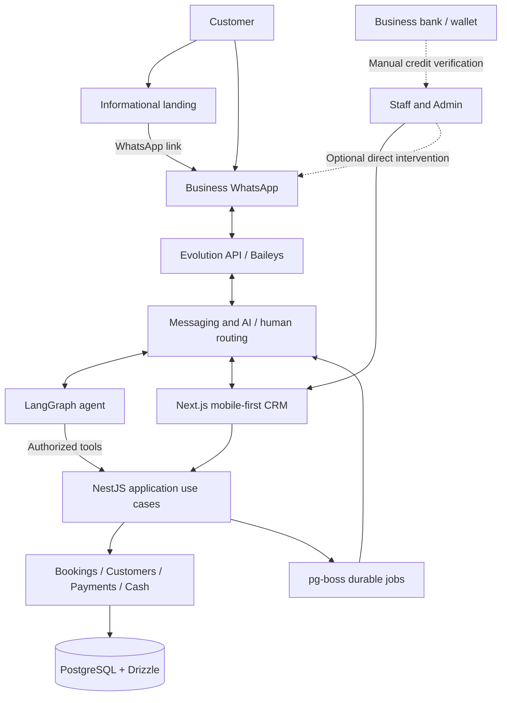

# Agendoxa — MVP: Modular Booking and Customer Service Platform

> **Status:** Proposed consolidated MVP definition for team review  
> **Version:** 0.2  
> **Date:** November 2, 2026  
> **Context:** Devlights bootcamp team project, designed as a reusable product that team members may independently deploy and commercialize under terms to be agreed.  
> **Related specifications:** [`uc-01/actors.md`](./uc-01/actors.md) and [`uc-01/flows.md`](./uc-01/flows.md) (UC-01).  
> **Supersedes:** The initial MVP v0.1 scope where it conflicts with the later UC-01 decisions. This document does not itself define every use-case transition or low-level implementation detail.

## 1. Purpose and Document Boundaries

This document defines **what Agendoxa's MVP includes, excludes, and must demonstrate**. It is the product-level scope reference for coordinating development and evaluating pilots, **not** a specification of database tables, endpoints, prompts, pixel-level screens, or exhaustive state machines.

- **This document (`mvp.md`):** Product vision, MVP scope, core constraints, delivery stages, acceptance criteria, and risks.
- **[`uc-01/actors.md`](./uc-01/actors.md):** Actors, channels, permissions, and use-case catalog.
- **[`uc-01/flows.md`](./uc-01/flows.md):** Main use-case behaviors, exceptions, and Mermaid diagrams.

When a product decision changes, update the affected references together. **Do not infer an undocumented implementation detail from an example or diagram.** The original technical proposal remains historical context, not a competing MVP specification.

## 2. Product Vision and Business Model

Build a **B2B, multi-tenant booking and customer-service platform** for businesses that need to manage appointments or physical-resource rentals. Customers ask questions and manage bookings through **WhatsApp**, supported by an AI agent; business personnel operate a **mobile-first CRM**. A public landing page presents business information and directs customers to WhatsApp.

### 2.1 MVP Product Components

1. **Booking core and business management:** A single authoritative engine for availability, bookings, business policies, customer restrictions, payments, and operational records.
2. **Mobile-first CRM and informational landing page:** Staff/Admin agenda and administration via authenticated web UI; public business details and WhatsApp calls to action, **without web booking**.
3. **Conversational customer service:** Individual WhatsApp conversations via Evolution API/Baileys and LangGraph, calling authorized backend use cases; human intervention remains available.

### 2.2 Initial Validation Verticals

| Vertical | Reserved unit | Main validation scenario |
|---|---|---|
| **Barbershop / beauty / manicure** | A configured service with price and duration, assigned to an available compatible professional | Customer books an appointment; personnel manage schedule, attendance, payment, and exceptions |
| **Sports club / courts** | An exclusive physical resource for a specified interval | Customer books a court, may require a fixed time, and can join the waitlist when unavailable |

Both verticals must use **the same booking and availability core**. A professional may be an assignable resource without having CRM access; a court or barbecue area is a resource, not a user. Preconfigured combined services (e.g., haircut + beard trim) are modeled as one catalog offering. A court and barbecue area are requested/booked separately; the MVP does not require an atomic multi-resource bundle.

### 2.3 Distribution and Commercialization

- Contributors work in **one shared code repository**.
- Each member, freelancer, or company may eventually **commercialize and deploy an independent installation**, subject to an agreed license and ownership terms.
- An installation may serve **multiple tenants** or run dedicated infrastructure for a single business; operators manage their own deployments, credentials, domains, customers, and support.
- Basic business identity/white-label customization has priority over the platform operator's branding.
- **Out of scope:** A reseller marketplace, centralized billing for all installations, or a control plane spanning independent operators.

**Non-technical decision pending:** Ownership, licensing, commercial-use rights, and contribution terms must be agreed before formal commercialization. This does not block preparing the repository or building the technical foundation.

## 3. Architectural Principles and Constraints

1. **Modular monolith:** NestJS houses the business domain and application use cases. Evolution API is an independently deployed messaging integration, not an in-house microservice decomposition.
2. **One authoritative booking core:** CRM and AI invoke the same protected use cases; neither channel implements its own booking rules or changes bookings by writing directly to the database.
3. **Tenant isolation:** All business data and authorizations are scoped to the appropriate business, whether the installation is shared or dedicated.
4. **Internal REST contracts, not a public integration product:** API contracts support the CRM and integrations used by Agendoxa. A documented third-party/public API, SDK, and external booking widgets are **not MVP deliverables**.
5. **Graceful channel degradation:** A WhatsApp/Evolution/AI outage must not prevent authenticated staff from operating the booking core through the CRM. Customer self-service can be temporarily unavailable during a messaging outage.
6. **Configuration before vertical-specific forks:** Service duration, prices, resource schedules, deposit rules, cancellation policies, and operational privileges vary per business, with service/resource exceptions where approved.
7. **Transactional correctness and simple operations:** Prevent overlapping exclusive bookings and duplicate financial/notification effects. Avoid unnecessary infrastructure and abstraction.
8. **Human authority over business exceptions and bank accreditation:** AI never creates commercial exceptions, verifies funds from an image, or inherits staff privileges.

## 4. High-Level Architecture



The bank/wallet is **not connected through an API**: customers transfer directly to the business; staff check actual credit outside Agendoxa and record the outcome in CRM. LangGraph is a logical agent component within the agreed backend architecture, not necessarily a separately deployed application. The public landing never creates or edits reservations.

### 4.1 Agreed Technology Stack

| Layer | Technology | MVP responsibility |
|---|---|---|
| Monorepo | **pnpm workspaces + Turborepo** | Shared workspace, scripts and build orchestration |
| Web | **Next.js (App Router), TypeScript, Tailwind CSS** | Authenticated mobile-first CRM; informational public landing |
| API / domain | **NestJS + TypeScript** | Authentication, business rules, transactions, AI tools and integrations |
| Database | **PostgreSQL + Drizzle ORM** | Persistence, migrations and tenant-scoped transactions |
| Exclusive availability | **PostgreSQL range/exclusion constraints**, where applicable | Prevent incompatible overlapping holds and bookings |
| Durable jobs | **pg-boss** | Hold expiration, waitlist priority windows, reminders and retries |
| AI | **LangGraph.js** | Bounded conversational workflows using authorized tools |
| WhatsApp pilot | **Evolution API + Baileys** | Incoming/outgoing business WhatsApp messages and media |
| Payments | **Manual bank/wallet transfers and cash** | Deposit evidence and human verification; payment records in CRM |
| Infrastructure | **Docker Compose** | Repeatable local and independently deployed environments |
| CI/CD | **GitHub Actions + GHCR** | Validations, reproducible builds and versioned container images |

Redis is not a default dependency. Database connection management must account for API, queue workers, and agent persistence without assuming one global connection pool is appropriate for every component.

## 5. MVP Functional Scope

### 5.1 Required Capabilities

| Area | MVP capabilities |
|---|---|
| **Tenants and identity** | Business onboarding/basic settings, time zone, branding, secure access, Admin/Staff membership and tenant isolation; multiple Admins supported |
| **Permissions** | Staff operations; explicitly delegated privileges for cash opening/closing and operational availability changes; Admin-only commercial configuration and policy exceptions |
| **Customers** | WhatsApp-number-based requester identity within a tenant, name capture/reuse/update, minimal history, third-party attendees, attendance incidents and individual restrictions |
| **Catalog and resources** | Services with duration/price; compatible professionals; physical resources; configurable combined services; resource/service-specific exceptions |
| **Availability** | Recurring operating schedules, blocks/absences and exceptions; transactionally protected exclusive intervals; authorized manual CRM bookings when applicable |
| **Bookings** | Query availability, create, confirm, cancel, reschedule, consult future bookings, record completion or no-show; configurable limits and policy enforcement |
| **Temporary holds and deposits** | Ten-minute customer-facing HOLD with/without deposit; deposit by business bank/wallet alias; human transfer verification and explicit review status |
| **Waitlist** | Voluntary opt-in, alternative-slot suggestions, five-minute exclusive offer when a compatible slot opens, then a normal ten-minute HOLD |
| **CRM operations** | Mobile-first schedule, fast manual booking, customer details, staff actions, payment review, shared conversations, audit views and a concise daily operational dashboard |
| **Payments** | Register cash and manually verified transfers, deposits/balances, partial or mixed payments, authorized corrections and manual refunds where necessary |
| **Cash register** | One shared register per tenant, manual/optional automatic opening, staff-attributed movements, manual close, counted-vs-expected differences, immutable historical closure |
| **WhatsApp** | Connect each business number via Evolution, individual text/image conversations, consented messages, customer booking self-service, staff handoff |
| **AI** | Business information and availability queries; permitted booking/waitlist tools; human escalation; global AI switch; per-chat AI pause and return |
| **Notifications** | Booking confirmation, hold/waitlist notices, one configurable same-day reminder by default with recorded consent, reliable/retryable jobs |
| **Public landing** | Basic business/service/location information, basic branding, SEO-ready content and links to the business's WhatsApp; **no booking form or scheduling calendar** |
| **Deployability** | Clonable repository, documented environment configuration, independently deployable installation, basic operational checks and backup/restore procedure |

**Important scope clarification:** Operational payments and a cash register exist **only for services and resource rentals recorded in Agendoxa**. A sports-club bar or shop does not gain an MVP sales/POS module.

### 5.2 Customer and Staff Entry Points

- **WhatsApp (customer self-service):** The customer consults services, availability, prices and location; creates and manages bookings associated with their sender number; may book for others without providing every attendee's phone number.
- **CRM (authenticated personnel):** Staff/Admin can operate the tenant's schedule, create bookings immediately using the same conflict controls, process payments, and handle exceptions within their permissions. Staff does not need to follow a chatbot HOLD for a manual booking.
- **Public landing and discovery:** Visitors read business information and continue via `wa.me`. An optional WhatsApp link may be configured manually in Google Business Profile/Maps where supported. No Google API connection is required.

### 5.3 Explicitly Out of Scope

- Public website booking, cancellation or rescheduling; customer booking accounts/portal; embeddable booking widget and third-party public API/SDK.
- **Mercado Pago** integration, automatic transfer reconciliation, payment webhooks, bank APIs and automatic refunds.
- POS for beverages/products, inventory/stock, commercial checkout, fiscal invoicing, payroll, commissions and full accounting.
- Complex recurring reservations, memberships, generalized group-capacity rules and an atomic multi-resource bundle engine.
- Native mobile apps, advanced landing-page visual builders, external calendar synchronization and Google Business Profile API.
- WhatsApp groups, voice-note handling, cold outreach, mass marketing, and WhatsApp Cloud API integration in the pilot.
- Advanced marketing CRM/BI, autonomous finance agents, broad RAG knowledge systems and open-ended administrative AI permissions.
- Reseller portal, central SaaS subscription billing, automated cross-installation migration, multi-region infrastructure and high availability.

## 6. Conceptual Domain and Booking Invariants

### 6.1 Domain Concepts (Not a Database Schema)

| Concept | Purpose / relationship |
|---|---|
| `Tenant` | Business settings, timezone and logical isolation boundary |
| `User` / `TenantMembership` | Authenticated personnel and tenant-specific roles/permissions |
| `Customer` / `Requester` / `Attendee` | WhatsApp-identified booking manager versus people receiving the service; attendee identity is minimal |
| `Service` / `Resource` | Catalog offering, duration, price and assignable professional or physical resource |
| `AvailabilityRule` / `AvailabilityException` | Regular working hours, blocks and one-off changes |
| `Booking` / `Hold` | Reserved interval, requester, attendee context, channel and conceptual lifecycle |
| `WaitlistEntry` / `ExclusiveOffer` | Voluntary interest and temporary priority on a released compatible slot |
| `Charge` / `Payment` / `PaymentReview` | Service/rental amount due, registered funds and human review of transfer evidence |
| `CashSession` / `CashMovement` | Shared cash register opening, withdrawals/additions, payments and accountable manual closing |
| `CustomerIncident` / `CustomerRestriction` | Attendance history, separate third-party incidents, and human-imposed restrictions |
| `ChannelConnection` / `Conversation` / `Message` | Per-tenant WhatsApp connection, messaging, context and human handoff |
| `Reminder` / `Job` | Consent-aware scheduling, retry and delivery records |

These are **conceptual responsibilities**; exact table boundaries, names, constraints, enums and relationships are defined in later domain-design tasks. The `HOLD`, `PENDING_PAYMENT_REVIEW`, `CONFIRMED`, `CANCELLED`, `COMPLETED`, `NO_SHOW` and `EXPIRED` names in UC-01 are descriptive, not finalized database enums.

### 6.2 Tenant Isolation and Future Portability

- Business data belongs to a tenant; query/write authorization and relations must prevent cross-tenant access, including attachments, payment records, conversations, jobs and secrets.
- Tenant identity comes from a **validated, authorized context**, not from an untrusted arbitrary ID in a client request.
- Support personnel who belong to multiple businesses via membership, with separate roles in each.
- Use stable identifiers and relationships to preserve the **future ability** to move one tenant from shared to dedicated infrastructure.
- Add targeted automated authorization/isolation tests; consider PostgreSQL RLS as defense-in-depth, not a substitute for application authorization.
- **Do not implement** tenant export/import tooling or zero-downtime migration in the MVP.

Illustrative deployment patterns:

```text
Operator A -> Shared installation -> PostgreSQL A -> tenants [X, Y, Z]
Operator B -> Independent installation -> PostgreSQL B -> tenants [K, L]
Dedicated customer -> Dedicated installation -> PostgreSQL C -> tenant [Y]
```

### 6.3 Booking, Payment and Authorization Invariants

1. **Timezone:** Interpret business scheduling in the tenant's configured timezone and persist unambiguous instants.
2. **Exclusive capacity:** No two active incompatible bookings/holds/offers may occupy the same exclusive resource/time interval. PostgreSQL enforces the final transactional constraint; a previous availability query is not a lock.
3. **Initial customer HOLD:** Once a customer selects a concrete time, create a **ten-minute HOLD** regardless of deposit requirement. Merely checking availability does not create a HOLD.
4. **No deposit:** Explicit customer confirmation during the HOLD confirms the reservation without human payment review.
5. **Transfer deposit:** Disclose price, required deposit, receiving alias and cancellation policy; a timely submitted receipt moves the booking into **human payment review**. That interval remains occupied **without automatic expiry** until personnel approve or reject. A receipt is **not** proof of bank accreditation.
6. **Expiration and rejection:** Expire a HOLD when the required confirmation/receipt does not arrive in time; release the resource and consider eligible waitlisted customers. Rejected evidence releases the resource. A late transfer or unmatched credit is an incident for human resolution, never an automatic rebooking.
7. **Waitlist priority:** Offer alternative availability first unless the customer explicitly requires the original time. Waitlist enrollment is voluntary. Once a slot truly opens, provide one eligible customer **five minutes of exclusive priority**; acceptance begins a normal ten-minute HOLD. Never offer the same exclusive slot to multiple customers concurrently.
8. **Customer authority:** WhatsApp self-management is limited to future bookings managed by that sender number **within that tenant**, even where the attendee is a friend. Other numbers need business intervention.
9. **Cancellation/rescheduling:** Apply the configured minimum notice period, with service/resource exceptions. Only Admin can authorize out-of-policy changes with an auditable reason. For voluntary cancellations with an accredited deposit, warn about the agreed forfeiture and offer rescheduling before explicit confirmation; business-caused and legal exceptions are handled manually.
10. **Rebooking with deposits:** Preserve accredited amounts when rescheduling. If the new required deposit is larger, request/verify the difference before completing the change; if smaller, previously credited funds reduce the remaining total rather than triggering an automatic refund. Keep the existing booking intact if the new slot cannot be acquired consistently.
11. **Completion and absence:** Personnel explicitly mark service/rental completion or `NO_SHOW`; no automatic inference from elapsed time. Separate the requester's own absence from incidents involving attendees booked on behalf of others.
12. **Customer restrictions:** From **two recorded personal no-shows**, the CRM displays an internal problematic-customer indicator. It never automatically sanctions. Staff/Admin can individually continue service, block new bookings, or require full advance payment, with an audit record. The AI enforces configured restrictions without revealing internal labels.
13. **Human authority and audit:** Staff/Admin check actual incoming bank credit; they may register cash/part-payments. Staff cannot change price or general policy. Admin handles commercial exceptions and post-close corrections. Sensitive actions record responsible user and time.
14. **Safe async behavior:** Expirations, waitlist offers and notifications are durable and idempotent. Delayed jobs must never invalidate an already confirmed booking or create duplicate occupancy.

For scenario steps and exceptions, see [`uc-01/flows.md`](./uc-01/flows.md); for exact actor authority, see [`uc-01/actors.md`](./uc-01/actors.md).

## 7. User Experience and Operational Interfaces

### 7.1 Authenticated Mobile-First CRM

Minimum operational workflows:

- Calendar by resource/day/week, booking search, quick walk-in booking, cancellation and rescheduling.
- Customer/requester records, attendee context, booking and no-show history, individual restrictions.
- Payments, bank-transfer evidence awaiting **human** review, manual cash/transfer registration, partial or mixed settlements.
- Fast **Complete and collect payment** action, without conflating service completion with money received.
- **One shared cash register per tenant**, with attributable movements and manual closing; Staff can open/close or adjust operational hours only when separately authorized.
- Shared conversation inbox with explicit take-over/handback, escalation context, and a global AI control for Admin.
- Business-level catalog, resource, staff, deposit, cancellation and alias configuration controlled by Admin; tenant-scoped audit history.
- Compact daily overview: bookings, recorded collections, pending transfer reviews, unresolved operational items and quick navigation; customer incidents in a separate view.

### 7.2 Informational Public Landing

- Public business identity, basic branding, services, location, hours and contact information suitable for discovery/SEO.
- Clear WhatsApp call to action, optionally with a prefilled message.
- **No availability calendar, guest checkout, online appointment form, reservation management or account system**.
- Linking from an existing website or Google Maps to WhatsApp is sufficient; no embedded third-party booking widget is required.

### 7.3 Operational Booking Differences

- **Professionals:** Service length and price determine the slot and must be compatible with the assigned professional's schedule. A preconfigured service combination is a **single offering**.
- **Physical resources:** Court/rental duration and exclusive interval control occupancy. A barbecue area is a distinct request/resource; free pricing is allowed, but no atomic court-plus-barbecue booking is required.
- **Third-party bookings:** The requester can book for friends; their WhatsApp number remains the management identity. Avoid automatically treating an attendee's absence as the requester's personal no-show.

## 8. WhatsApp, AI, Human Handoff, and Notifications

### 8.1 Pilot Messaging Scope and Risk

- **Pilot provider:** Evolution API + Baileys, connecting each business's WhatsApp number.
- Customer self-service uses **individual text conversations and images/receipts**; voice notes and WhatsApp groups are excluded.
- Allowed outbound messaging is linked to a real booking or an explicitly opted-in waitlist/notification; **no cold outreach or mass marketing**.
- A planning assumption of approximately **600–800 monthly reminders per business** may be used for pilot measurement only. This is **not** an official WhatsApp quota or safety guarantee.
- The integration is unofficial and subject to disconnection, service changes or account restrictions. Do not claim that typing simulations or message randomization can eliminate these risks.
- The pilot business is informed about these limitations. The CRM remains functional if WhatsApp becomes unavailable.

### 8.2 Incoming Conversation and Authorized Actions

1. Evolution receives an incoming message; NestJS resolves the connection and tenant, validates the source and records/deduplicates the event.
2. Group consecutive incoming messages after **five seconds without another incoming message**, while preserving the relevant conversation context through durable handling rather than an in-memory-only queue.
3. If AI is allowed for the tenant/chat, LangGraph consults configured business information and calls **typed, authorized backend use cases** for availability, holds, bookings, cancellations, reschedules, waitlists and consent.
4. NestJS validates requester authority, tenant scope, policies and transactional availability. The AI reports the actual outcome and asks only for missing information.
5. When the AI cannot resolve a request, a user asks for a human, or an exception is needed, hand the conversation to the shared CRM inbox with useful context.

**Human control:** Admin can disable AI globally for a configured duration or indefinitely. Staff/Admin can take over a particular conversation; AI is paused until explicit handback or **60 minutes without a human reply**, provided global AI is enabled. Each human reply resets the 60-minute interval. Detecting human replies sent directly from the WhatsApp app requires real pilot verification; explicit CRM takeover is the authoritative fallback. Returning to AI does not approve/reject pending payment evidence.

### 8.3 Reminders and Availability Notices

- Default to **one reminder for each confirmed booking on its scheduled day**, with configurable lead time in business timezone.
- Reminders require recorded, revocable customer consent; merely retaining a phone number does not imply consent.
- Waitlist availability alerts require **separate voluntary opt-in** associated with that waitlist interest.
- Use `pg-boss` for retryable, durable, deduplicated expiration/notification jobs, record delivery attempts/failures, and never notify as if a booking were confirmed when it is not.
- Failed WhatsApp delivery does not compromise the CRM or booking core. Detailed rules for unavailable recipients and priority-offer retries remain deferred.

## 9. Transfers, Payments, and Shared Cash Register

### 9.1 Deposit and Payment Rules

- Admin configures whether a deposit is required, a **fixed amount or percentage**, and permitted service/resource exceptions.
- The business can configure **multiple bank/wallet aliases with one default**; automatic alias rotation is not part of the MVP.
- When a deposit is required, the customer transfers funds to the business and submits the receipt within the initial ten-minute HOLD. A timely receipt leaves the slot blocked in pending review until Staff/Admin verify bank accreditation and approve/reject.
- A screenshot, OCR result or AI interpretation **never settles a payment**. Late or unmatched transfers are logged for manual resolution and do not recover a released slot automatically.
- Staff/Admin can record cash, verified transfers, partial payments and mixed payments; do not require a receipt image for an ordinary in-person payment.
- Reconciliations, refunds and edge cases involving overpayments are handled manually with traceability; there is no automated bank refund or Mercado Pago integration.

### 9.2 Cash Register

- One **logical shared cash register per tenant**, with payments and movements attributed to the responsible user.
- Opening may be manual or automatically configured. Automatic opening carries forward the **declared physical cash closing balance** as its reference; additional withdrawals/adjustments are explicitly recorded to prevent double-counting.
- Admin or separately authorized Staff may open/close; **closing is always manual**, with actual cash count, expected cash and any discrepancy recorded.
- Transfers are **not** included in physical cash counted. Registering a cash addition/withdrawal requires a reason and responsible person.
- Pending service payments do not block closing. Closed sessions are immutable; only Admin creates audited post-close adjustments rather than rewriting history.
- The register tracks **service/rental-related money**, not product/bar/shop sales or full accounting.

**Accepted operational risk:** Timely deposit receipts keep slots reserved until human review **without automatic timeout**. This avoids unverified payment loss but may allow prolonged resource blocking or abuse. Surface pending reviews prominently, track responsibility, and define further safeguards during detailed design; **do not silently add an expiry rule**.

## 10. Repository, Development, and Deployment

### 10.1 Initial Repository Layout (Illustrative)

```text
agendoxa/
??? apps/                     # Proposed web and API responsibilities
??? packages/                 # Proposed database, shared and optional UI packages
??? docs/
?   ??? product-specs/
?   ?   ??? mvp.md
?   ?   ??? uc-01/            # actors.md and flows.md
?   ??? design-docs/
?       ??? target-architecture.md
??? infra/                    # Proposed operational configuration
??? .github/workflows/        # Proposed CI/CD
??? pnpm-workspace.yaml
??? turbo.json
??? package.json
??? .env.example
```

This is a starting convention, not a requirement to create empty packages. NestJS remains the authoritative business-logic implementation; shared packages contain reusable contracts, not a second booking engine.

### 10.2 Team Development Practices

- A reproducible `pnpm`/Turborepo workspace with clearly documented commands for install, typecheck, lint, targeted tests and build.
- Docker Compose for PostgreSQL, Evolution and the necessary application services, using local reproducible configuration.
- Seed at least **two tenants** to expose accidental cross-tenant access in development and testing.
- Versioned migrations, reviewable pull requests, CI, and secrets stored outside Git; document required variables in `.env.example`.
- Validate behavior with **risk-proportionate tests**; targeted unit/integration checks during feature work, and broader end-to-end verification for major integration milestones or promotion to the main branch when justified.

### 10.3 Delivery and Operations

- Early CI validates install, types, lint, relevant tests and build; GitHub Actions/GHCR can publish versioned container images as delivery matures.
- Independent installations have separate database, secrets, WhatsApp credentials, domain and operator responsibilities.
- Document health checks, backup and basic restore before a pilot uses real business data.
- Measure Evolution/WhatsApp connection stability, CPU/RAM and storage in real pilots; **do not** treat hypothetical tenant/WhatsApp counts on a small VPS as proven capacity.

## 11. Implementation Stages and Deliverables

| Stage | Demonstrable outcome |
|---|---|
| **0. Repository foundation** | pnpm/Turborepo, Next.js, NestJS, PostgreSQL/Drizzle, Compose, minimal CI, environment example and local run instructions |
| **1. Core booking domain** | Tenants, user memberships, services/resources, availability, conflict-safe holds/bookings, basic customer identity and role enforcement |
| **2. Business-facing web** | Mobile-first CRM for both verticals; manual bookings and schedule management; informational landing linking to WhatsApp |
| **3. Deposits and operations** | Manual transfer review, payment records, basic cash register, cancellation/reschedule policies, no-show handling and waitlist priority mechanics |
| **4. WhatsApp + AI** | Evolution connected, message routing and human handoff, LangGraph authorized tools, customer booking lifecycle, consented reminders and waitlist messages |
| **5. Pilot validation** | End-to-end scenarios for both verticals, tenant isolation and concurrency checks, independent deployments, operational documentation and informed pilot participation |

Stages communicate **dependencies and demonstrable milestones**, not a promise that every feature within one stage is developed simultaneously. The CRM/core must remain useful when the messaging agent is offline. A bank-payment provider integration is **not** an MVP dependency.

### 11.1 Stage 0 Exit Criteria

A teammate can clone the repository, configure `.env`, start the local services, apply migrations, see Next.js/NestJS running, and run the basic CI-equivalent commands **without production credentials**.

## 12. MVP Acceptance Criteria

1. **Tenant isolation:** Two businesses coexist within an installation without cross-tenant reads or writes, including attempts with modified IDs and API requests.
2. **Independent deployment:** The same code runs for single-tenant or multi-tenant installations with isolated secrets and storage.
3. **WhatsApp booking without deposit:** A customer selects a real slot, receives a ten-minute HOLD, confirms explicitly, and the CRM shows the confirmed booking.
4. **Deposit with human verification:** Timely receipt submission blocks the slot for review; personnel check actual bank credit and approve/reject. No AI/image-only approval or silent auto-expiry during review.
5. **CRM continuity:** Authenticated Staff/Admin can create and manage bookings even if Evolution/WhatsApp or the AI is disconnected; the landing remains informational only.
6. **Concurrency:** Simultaneous requests cannot produce incompatible active holds, exclusive offers or confirmed bookings for the same exclusive resource/time interval.
7. **Customer ownership:** A WhatsApp requester can consult/change only their own managed future bookings within the correct tenant, including when booking for a friend.
8. **Cancellation/rescheduling:** Business policies and authorized exceptions are enforced; a valid reschedule preserves credited payments and does not lose the original booking on conflict.
9. **Waitlist:** Alternatives are offered first unless the customer requires a specific time; opt-in creates a waitlist interest. One five-minute offer at a time leads to a normal ten-minute HOLD upon acceptance.
10. **Operational attendance:** Staff/Admin explicitly mark completion or absence; personal no-shows are distinguishable from third-party attendance incidents. Restrictions are human decisions, not automatic sanctions.
11. **Payment/cash:** Staff/Admin register partial/mixed payments and verify transfers; a shared register records responsible users, manual close and discrepancies, and preserves closed-session history.
12. **Messaging consent:** A same-day reminder can be sent once logically with recorded opt-in and result tracking; waitlist notifications require separate consent and are delivered through durable jobs.
13. **Human intervention:** An employee can take/release a chat; global AI control and the 60-minute inactivity return operate without granting payment or staff permissions to the agent.
14. **Two-vertical validation:** Demonstrate at least one professional-service workflow and one physical-court rental workflow using the same booking core.
15. **Operational readiness:** Repeatable setup, basic CI, health monitoring, and a backup/restore procedure tested at least once before live pilot data.

These are **technical and operational MVP acceptance criteria**, not assertions of commercial traction, guaranteed WhatsApp uptime, or performance at scale.

## 13. Risks and Open Decisions

| Risk / unresolved detail | Current treatment |
|---|---|
| **Unofficial WhatsApp integration** | Informed pilot, monitoring, bounded message types, human fallback and tenant-level disconnect/disable capability; no promise of ban-free operation |
| **Long-running human deposit review** | Explicitly permit indefinite pending-review occupancy; show review queue and ownership, assess abuse safeguards later |
| **Waitlist corner cases** | Exact enrollment expiry, queue limits, failed-delivery/retry rules, long offer chains and high-demand behavior remain to be specified |
| **Cancellation, refunds and legal exceptions** | Configurable baseline policies; Admin authorizes exceptions; exceptional refunds/business-initiated cancellations need detailed handling |
| **Customer identity and no-shows** | Number-based requester management; minimum third-party identity and exact attendance attribution still require detailed rules |
| **Cash sessions and late credits** | Manual traceable adjustments; detailed session boundaries, carry-forward and reconciliation rules still need validation |
| **Direct WhatsApp human messages** | Confirm Evolution/Baileys detection against the pilot version; use explicit CRM takeover as reliable fallback |
| **Authorization model and RLS** | Separate Staff privileges, Admin-only policy changes, cross-tenant tests; finalize exact enforcement during domain design |
| **Infrastructure capacity and costs** | Test real load, connection reliability and agent usage; avoid unverified VPS density assumptions |
| **Future tenant migration** | Preserve tenant-scoped identifiers/relations now; do not build migration tooling yet |
| **AI provider/model selection** | Keep configuration replaceable; evaluate price, latency and reliability during implementation |
| **IP and commercial ownership** | Resolve ownership/license/contribution terms before selling or licensing |

An unresolved detail in this table must **not** be treated as confirmed implementation behavior. Cross-reference the approved use cases for current scope; take new business decisions explicitly.

## 14. Post-MVP Evolution

Only pursue these when justified by pilot evidence and an updated product decision:

- **Customer web booking:** Public booking pages, richer guest reservation management, widgets/SDKs and a documented third-party API.
- **Integrated payments:** Mercado Pago, automated confirmations, bank integrations, automated refund handling and reconciliation.
- **Calendar and discovery integrations:** Google Calendar synchronization, Google Business Profile/API functionality and additional supported acquisition channels.
- **Advanced scheduling:** Multi-resource atomic bundles, complex recurring bookings, memberships, capacity/group rules and more specialized availability policies.
- **Advanced conversational service:** Official WhatsApp Cloud API adapter, further channels, richer handoff/knowledge management and supported media beyond text/images.
- **Specialized vertical modules:** Sports-club bar POS, inventory, commissions and industry-specific financial/operational functionality.
- **Commercial and infrastructure tooling:** Tenant export/migration utilities, subscription billing, reseller management, metrics, scaling limits and higher-availability options.

The underlying system could support independent service offerings such as **Agenda Online** and **Intelligent Customer Service** for Onflow Labs or other operators. This is a product opportunity, **not** a requirement to build a full commercial suite in the MVP.

---

## Final Scope Rule

> **Build a reliable, tenant-safe booking core and a usable mobile-first CRM; deliver customer self-service through WhatsApp with bounded AI, human-verified transfers, and operational cash tracking.**
>
> The landing provides information and points to WhatsApp. Every new capability must support a demonstrable MVP scenario; everything else is deferred explicitly.
