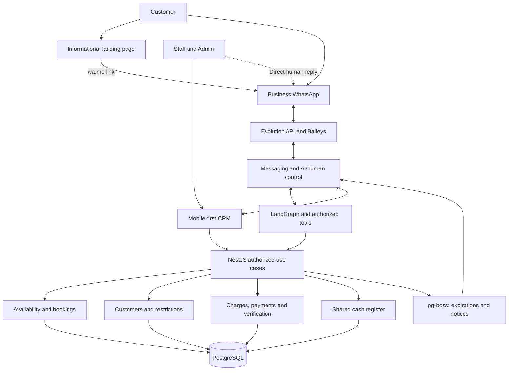
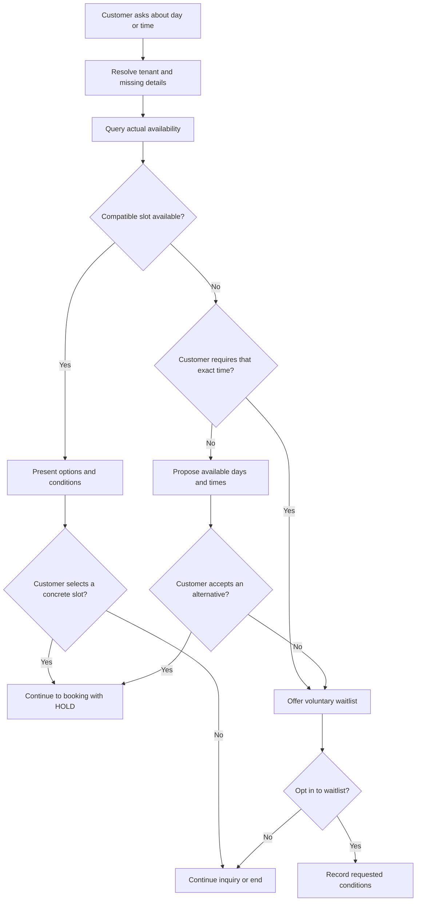
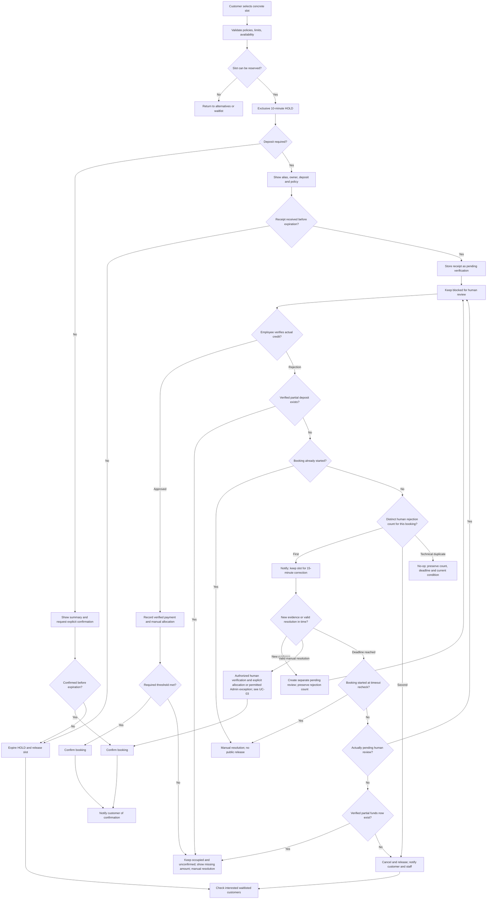
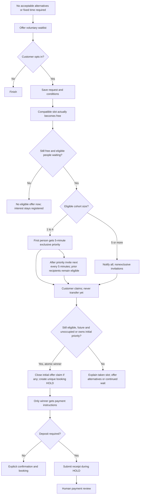
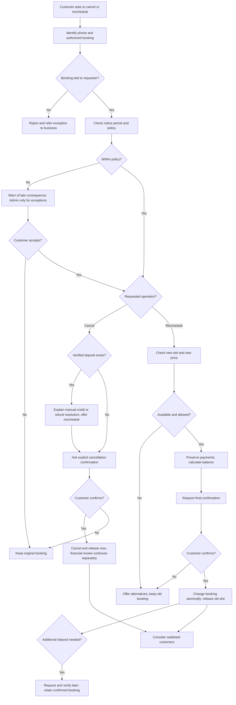
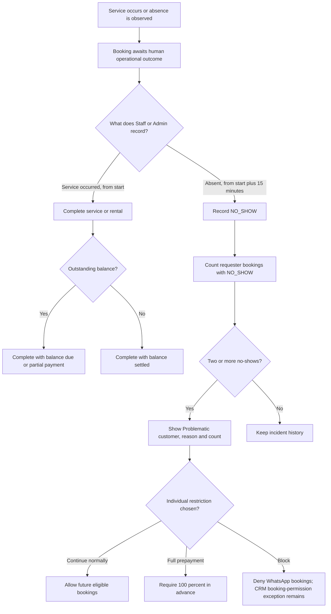
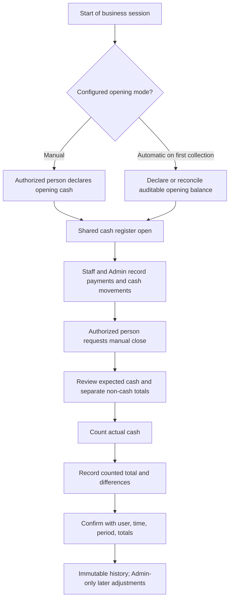
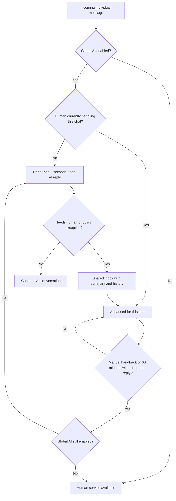

# UC-01 — Main Functional Flows

> **Status:** In review · **Scope:** Main MVP use cases for barbershops/beauty and sports clubs/courts.  
> **Related:** [Actors, permissions and use-case index](./actors.md).  
> **Boundary:** Functional scenarios, not implementation contracts. [UC-03 business rules](../uc-03/business-rules.md) and [invariants](../uc-03/invariants.md) own canonical rules. Product-owner decisions of 2026-11-04 are in review, not team-approved or implemented.

## Shared Rules (Apply to All Cases)

- **Channels:** Customer self-service is through **individual WhatsApp chats** only; the public landing is informational and links to `wa.me`. Authenticated Staff/Admin use the **mobile-first CRM**, including when WhatsApp is offline.
- **Authority:** WhatsApp/AI and CRM call the **same tenant-scoped booking core**. The AI executes authorized customer-context tools, never Staff/Admin privileges. [Permission matrix](./actors.md#2-permissions-matrix).
- **Personnel authorization:** In every CRM case and diagram, Staff/Admin is actor shorthand, not an unconditional grant: an active tenant membership and the applicable role permission are required and checked by the backend. Role management, agreed-price changes, commercial exceptions, refunds, post-close cash adjustments and global AI control retain their Admin-only boundaries.
- **Exclusivity:** Availability inquiries do not reserve a slot; bookings, HOLDs and exclusive waitlist offers must prevent overlapping allocations for the same resource/time.
- **Initial HOLD:** **10 minutes** after selecting a concrete slot (with or without deposit); no hold for information-only inquiries. A CRM employee can book/confirm directly, without a HOLD; when a deposit applies, see the CRM path of [CU-03](#cu-03).
- **Deposit:** Timely evidence enters human review and occupies the slot while actually pending; explicit rejection follows [CU-03](#cu-03). An image never proves credit. No-deposit bookings require explicit customer confirmation during HOLD.
- **Waitlist:** Voluntary; actual release starts progressive invitations for 1–4 eligible people (only first gets five-minute exclusivity), or simultaneous invitations for 5+. Prior recipients may claim late; one atomic winner gets the ten-minute HOLD, then payment instructions. See [CU-06](#cu-06).
- **Defaults and selection:** Booking lead time defaults to 0, never past start. Future-booking limit defaults off; if enabled count future occupying bookings, including third parties, per requester/tenant. Any-resource assignment uses the tenant's active preference-order or rotation mode.
- **Operational truth:** Time passing never proves attendance or payment. Human-recorded completion, outstanding balance and cash closing are independent.
- **Cross-cutting:** Tenant isolation, business-local timezone, audit for sensitive changes and explicit/revocable consent for proactive messages.

**Conceptual labels:** `HOLD`, `PENDING_PAYMENT_REVIEW`, `CONFIRMED`, `CANCELLED`, `COMPLETED`, `NO_SHOW`, `EXPIRED`. These **do not** prescribe persisted enums or exact transition contracts.

## Channel and System Overview

**Continuity:** WhatsApp/Evolution failure interrupts customer self-service, **not** CRM operations. Google Business Profile may have a manually configured WhatsApp link; no Google Business Profile API integration is included.

## Use-Case Index

| Case | Goal | Case | Goal |
|---|---|---|---|
| [CU-01](#cu-01) | Check availability | [CU-09](#cu-09) | Reschedule booking |
| [CU-02](#cu-02) | Book without deposit | [CU-10](#cu-10) | Complete / no-show |
| [CU-03](#cu-03) | Book with deposit | [CU-11](#cu-11) | Record payments |
| [CU-04](#cu-04) | Book for others | [CU-12](#cu-12) | Manage incidents |
| [CU-05](#cu-05) | Join waitlist | [CU-13](#cu-13) | Open/close cash |
| [CU-06](#cu-06) | Accept waitlist offer | [CU-14](#cu-14) | Human handoff |
| [CU-07](#cu-07) | Review upcoming bookings | [CU-15](#cu-15) | Configure operations |
| [CU-08](#cu-08) | Cancel booking | [CU-16](#cu-16) | Send authorized notice |

## CU-01 — Consult Business Information and Availability

**Actor/channel:** Customer → WhatsApp; AI and availability core assist. **Trigger:** Service, rental or time inquiry. **Preconditions:** Tenant and configured offerings can be identified.

**Main flow**
1. Customer states the service/resource and preferred time; AI asks only for missing details.
2. System queries live availability for a named professional/court or any compatible option.
3. AI presents available times, price/duration and conditions; a selected concrete slot proceeds to [CU-02](#cu-02) or [CU-03](#cu-03).

**Alternatives:** If preferred slot is unavailable, propose alternatives first and offer [CU-05](#cu-05) if the customer rejects them all; if the time is explicitly fixed, offer [CU-05](#cu-05) immediately. If the customer selects nothing, end inquiry **without HOLD**. On query failure, do not invent slots; offer [CU-14](#cu-14).

**Result:** Accurate information or transition to booking/waitlist; no slot is occupied by a query.

**Example:** If Friday 22:00 is the team's *only* acceptable time and it is full, offer waitlist directly.

## CU-02 — Create a Booking Without a Deposit

**Actor/channel:** Customer → WhatsApp, or Staff/Admin → CRM. **Trigger:** Concrete slot chosen. **Preconditions:** Configured service, allowed requester, unoccupied slot.

**Main flow**
1. Validate tenant, customer limits/restrictions, booking policy and availability; create exclusive **10-minute HOLD** for WhatsApp.
2. Show price, service/resource, date/time and conditions; customer explicitly confirms before expiry.
3. Confirm and notify; no payment or human approval is inferred.

**Alternatives:** Slot conflict → alternatives/waitlist. No confirmation by deadline → expire/release. BLOCKED denies WhatsApp creation; booking-capable CRM personnel may create a warned/attributed exception without lifting the block, preserving other payment/policy conditions. Walk-ins need name, optional phone; CRM confirmed bookings notify with phone/available channel. Exceptional openings never override blocks/claims.

**Result:** Confirmed exclusive booking, or released HOLD without confirmation. Requester controls future WhatsApp management through the originating number.

**Diagram:** Shared with [CU-03](#booking-deposit-diagram).

## CU-03 — Create a Booking With a Transfer Deposit

**Actor/channel:** Customer → WhatsApp, or Staff/Admin → CRM on behalf of a customer; Staff/Admin verify via CRM and bank/wallet. **Trigger:** Chosen slot requires deposit. **Preconditions:** Deposit rule and receiving alias configured; slot and requester eligible.

**Main flow**
1. Validate and create a **10-minute HOLD**; display price, required deposit, bank alias/account holder and cancellation policy **before transfer**.
2. Request PDF/image evidence within HOLD; only if the customer explicitly cannot attach it, accept transfer details by text within the same deadline. Register pending human review without automatic review expiry.
3. Authorized personnel verify actual credit in the instructed receiver's account. Record verified money, then explicitly manually allocate to the charge; confirm only when the required threshold is met. Multiple payments may complete it. A verified partial deposit keeps the slot occupied/unconfirmed without automatic release; show missing amount and contact action in CRM.

**CRM path (no HOLD):** Verified money allocated to meet threshold → confirm; pending evidence → occupied review; verified insufficient deposit → occupied unconfirmed partial-deposit waiting. No funds/evidence → no occupancy unless Admin grants the existing no-deposit exception, recording unpaid deposit/balance. Full-prepayment restrictions remain intact.

**Alternatives:** No timely evidence and no verified partial deposit → HOLD expires. Without verified partial funds, first human rejection starts a 15-minute correction window; timely distinct evidence suspends cancellation under active review. Second distinct rejection or expiry may cancel only before start after current-state/funds/review rechecks, notifying customer/staff. Verified partial funds, started slots and supplemental reschedule deposits require manual handling, never automatic release through this mechanism. Explicit authorized cancellation releases immediately under [CU-08](#cu-08). Late funds never rebook automatically.

**Rules/result:** Policy priority and FULL_PREPAYMENT remain unchanged. Tenant chooses all-professional (default), business-deposit/professional-remainder or all-business collection. Missing professional account uses the business default/sequential rotation; missing fallback requires personnel. Record mode/receiver and preserve issued instructions; no automatic commissions/distribution. Human verification and manual allocations remain separate.

**Example:** Receipt received with 3 minutes left in HOLD continues blocking after those 3 minutes, pending human verification.

### Shared Diagram — With / Without Deposit

WhatsApp path. The CRM path of CU-03 has no HOLD.

## CU-04 — Create Bookings for Other Attendees

**Actor/channel:** Customer requester → WhatsApp; Staff/Admin → CRM. **Trigger:** Booking for friends/third parties. **Preconditions:** Requester identified; each slot eligible under standard booking rules.

**Main flow**
1. Require only the attendee's name; no mandatory phone or separate account.
2. Create **separate bookings** for separate attendees/slots, each validated and associated with the requester.
3. The requesting WhatsApp number manages those bookings, even if the attendee differs.

**Alternatives:** Sequential haircuts → independent times. Haircut+beard / manicure combo → **one preconfigured service**. Court+barbecue → separate bookings, not an atomic multi-resource booking. A friend's `NO_SHOW` counts against the booking requester ([CU-10](#cu-10)).

**Result:** Third-party bookings count against the requester's enabled future-booking limit while future/occupying, just like their own bookings.

## CU-05 — Join a Voluntary Waitlist

**Actor/channel:** Customer → WhatsApp. **Trigger:** No acceptable availability. **Preconditions:** Availability checked, alternatives declined or an explicitly fixed day/time.

**Main flow**
1. Offer available alternatives **unless** customer cannot consider another slot.
2. Record voluntary interest, preferred range and optional compatible resource. Reuse current waitlist-notice preference; if unknown, ask the single four-option question from [UC-03](../uc-03/business-rules.md#14-notifications-and-consent-not), not a second separate consent prompt. Reminder preference remains independent.
3. When a compatible slot is **actually released**, attempt [CU-06](#cu-06).

**Alternatives:** Customer accepts alternative → regular booking, no waitlist. Declines opt-in → nothing registered. Duplicate interest → avoid duplicate requester/conditions entries.

**Result:** Registered interest, not guaranteed capacity. Entry expires when its requested range has no future slot, or closes on successful booking/customer withdrawal. A queue holds at most 10 people in the MVP; the next person is told it is full and offered other times, with no reserve list. Physical round representation remains open.

## CU-06 — Receive a Waitlist Invitation and Claim a Slot

**Actor/channel:** System event → WhatsApp; customer responds. **Trigger:** Compatible slot released by cancellation (including a permitted initial-evidence rejection cancellation), rescheduling, expired HOLD or lifted block. **Preconditions:** Slot truly free; eligible opted-in requester exists.

**Main flow**
1. Determine eligible people for the released future slot. With 1–4, first gets five-minute exclusive priority, then invite another every five minutes; earlier recipients may still claim. With 5+, notify all simultaneously. No later invitee gets their own exclusive period.
2. Explain the actual priority/competition. An invitation never requests payment. Recheck eligibility/availability atomically when someone claims; close any initial offer claim and create one distinct ten-minute booking HOLD for the winner. Concurrent losers receive the taken-slot explanation and alternatives.
3. Only the winner receives instructions for [CU-02](#cu-02) or [CU-03](#cu-03); all payment instructions follow successful HOLD acquisition.

**Alternatives:** Priority expiry advances invitations without invalidating earlier recipients; late claims may win if still free/eligible. An occupied or past-start slot cannot be reclaimed. Confirmed send failure → one still-valid retry, second failure → advance without deleting entry. Unknown result → recover status or flag CRM, no automatic resend. Communication failure never extends priority or freezes capacity; nonexclusive invitations hold no claims. Round changes (late enrollment, leaving the queue, expired winner HOLD) follow [BR-WL-15](../uc-03/business-rules.md#12-waitlist-and-exclusive-offers-wl).

**Result:** One atomic winner, not guaranteed confirmation. Initial priority ends without renewal; later invitations preserve competition, not occupancy. No arbitrary three-offer cap.

**Customer wording (Spanish):**
- First person: “Se liberó un turno para [día y hora]. Tenés 5 minutos de prioridad exclusiva para reclamarlo. Después podrán reclamarlo otras personas de la lista. Respondé «Reservar» si te interesa.”
- Later/broadcast recipients: “Se liberó un turno para [día y hora]. [Ya avisamos a otras personas / Avisamos a las personas elegibles] y todavía podés reclamarlo. Se lo queda quien primero consiga reservarlo. Respondé «Reservar» si te interesa.”
- Every invitation: “No transfieras todavía: primero te confirmaremos si obtuviste la reserva y, si corresponde, cómo señar.”
- Late loser: “Tu período de prioridad terminó y otra persona ya tomó el turno. Podemos buscarte otro horario o mantenerte en lista de espera.” Do not claim a later/broadcast recipient had exclusive priority.

## CU-07 — Consult the Requester's Future Bookings

**Actor/channel:** Customer → WhatsApp. **Trigger:** Request for upcoming bookings. **Preconditions:** Business tenant and incoming sender number identified.

**Main flow**
1. Query **future/active bookings managed by the sender number in this tenant**.
2. Show matching details and allow selection for [CU-08](#cu-08) or [CU-09](#cu-09).

**Alternatives:** No matches → say so without showing others. Another sender number → refuse access and refer exceptional cases to staff. Historical self-service browsing is not part of the approved scope.

**Result:** Authorized read-only view. An attendee's name alone conveys **no** booking management rights.

## CU-08 — Cancel a Booking

**Actor/channel:** Customer → WhatsApp; Staff/Admin → CRM. **Trigger:** Cancellation requested. **Preconditions:** Existing booking, authorized requester, applicable notice policy.

**Main flow**
1. Resolve booking; check originating requester number within the tenant (or authenticated staff permission) and minimum notice, including service/resource overrides.
2. Explain cancellation conditions under the tenant's deposit policy, including the late consequence when applicable, and ask explicit confirmation to cancel/release; no automatic forfeiture or refund. Offer rescheduling/verified credit without making financial resolution a prerequisite.
3. Once confirmed and authorized, cancel and release immediately, including during review or partial-deposit waiting; invalidate reminders and consider [CU-06](#cu-06). Verification and manual credit/refund handling continue separately.

**Alternatives:** Outside the notice window → warn of the consequence and cancel on acceptance without Admin, counting a late cancellation; only an exception to the consequence needs Admin. Operational business cause → cancellation-capable personnel may cancel with reason/customer notice and offer another date. No confirmation → retain booking; wrong sender → refuse. No financial review/refund may freeze an authorized cancelled slot, and late credit cannot recover it. Legal refund obligations remain subject to review.

**Result:** Authorized confirmed cancellation and released slot, or unchanged booking.

**Diagram:** Shared with [CU-09](#change-booking-diagram).

## CU-09 — Reschedule a Booking

**Actor/channel:** Customer → WhatsApp; Staff/Admin → CRM. **Trigger:** Change to date/time or service/resource. **Preconditions:** Authorized booking, known payments and policy; new availability checked.

**Main flow**
1. Check notice window and configured rescheduling limit (**unlimited by default**); query candidate slot without releasing old one.
2. Preserve verified payments; compute new price, outstanding balance and any additional required deposit.
3. Ask for explicit confirmation. For an allowed change with a previously credited partial deposit, atomically move the confirmed booking and release the old slot, preserving payments and allocations.
4. Request and verify any additional deposit afterwards; record the change request, booking event and financial consequences. Consider [CU-06](#cu-06) for the old slot and notify the customer.

**Alternatives:** Outside the notice window → warn of the consequence and proceed on acceptance without Admin, counting a late reschedule. If the deposit is lost under tenant policy, personnel resolve the case and the AI only communicates the policy and next steps. Over the limit or an exception to the consequence → Admin-only documented exception; while prior approval is pending, do not lock the target. Unavailable slot, declined confirmation or transaction conflict → original booking stays intact. Nonpayment or rejection of supplemental evidence after the move leaves the new booking confirmed; manage manually, never automatically cancel or restore the old slot. `FULL_PREPAYMENT` and Admin-only exceptions remain applicable. Excess funds are resolved manually without automatic refund.

**Result:** New conditions/balance, or original preserved. A professional change retains client credit and actual receiving-account history; manual internal compensation never blocks an otherwise valid move or charges the deposit twice.

### Shared Diagram — Cancel / Reschedule

**Diagram note:** Prior policy approval does not reserve the target. Supplemental payment review after an eligible move does not cancel or undo the move.

## CU-10 — Complete a Service/Rental or Record a No-Show

**Actor/channel:** Staff/Admin → CRM. **Trigger:** Personnel record what occurred after a reserved time. **Preconditions:** Booking belongs to their tenant.

**Main flow**
1. Manually mark completed from start, or actual NO_SHOW from start + 15 minutes, identifying a different attendee where applicable. Never infer either automatically.
2. Maintain payment balance independently; **Complete and collect payment** may record an actual receipt via [CU-11](#cu-11).
3. Record responsible employee and relevant audit details.

**Alternatives:** Correct COMPLETED ↔ NO_SHOW with correction permission, mandatory reason/history and destination timing guard. Recalculate requester count, never automatic money changes or walk-in displacement. Completed/unpaid preserves debt; cancelled/expired is never no-show. Early remainder stays private except explicit atomic CRM reuse, preserving history and overlap protection.

**Result:** Human-attested outcome. From two requester-attributed booking no-shows, show an internal indicator; no automatic sanction. Booking status is the count source; booking events record corrections, and customer incidents cover other incidents only.

## CU-11 — Record, Verify or Correct a Payment

**Actor/channel:** Staff/Admin → CRM; customer may provide evidence via WhatsApp. **Trigger:** Receipt, collection or correction. **Preconditions:** Tenant-scoped booking/charge; payment permission.

**Main flow**
1. Review price, verified deposits and due amount; register cash or transfer, including **partial/mixed methods**.
2. For transfer, verify **bank/wallet credit**; for cash, confirm physical receipt. Record amount, method, date/time and employee.
3. Allocate verified funds explicitly across one or more charges, including different bookings, with partial allocations; never automatically allocate. Balance cannot go below zero and allocation cannot exceed debt or available net funds. Preserve correction history and enforce atomicity/idempotence; optionally complete through [CU-10](#cu-10).

**Alternatives:** WhatsApp image → review pending, **not paid** ([CU-03](#cu-03)). `Payment` records only verified commercial money, possibly unallocated; unknown or personal transfers are not payments. Excess remains unallocated for manual application or Admin-authorized refund. `Refund` is a separate linked historical operation; only execution reduces retained funds, without exceeding available funds. Cash refunds require an open session and physical cash movement; transfer refunds are bank outflows, not cash movements. The original payment is never mutated; payment and its cash movement are not two incomes. Admin alone performs post-close adjustments and agreed-price changes. See [business rules](../uc-03/business-rules.md).

**Result:** Verified collected money and remaining debt are traceable. Only service/rental charges are in scope; no POS/product sales or inventory.

**Recording error:** Personnel with correction permission append reason/actor/time and immutable correction history, recomputing debt and allocations without fictitious refund/cash movement or automatic cancellation. Closed physical-cash correction remains Admin-only; exact ledger representation remains technical design. A professional change preserves client credit and original recipient history, with manual internal settlement and no duplicate customer collection.

## CU-12 — Manage Customer Incidents and Individual Restrictions

**Actor/channel:** Staff/Admin → CRM. **Trigger:** Review absences or apply/remove a customer-specific restriction. **Preconditions:** Same tenant, authorized personnel.

**Main flow**
1. Count current `NO_SHOW` bookings by requester; show other operational incidents separately, never duplicate no-shows as incidents.
2. At two no-shows, show the internal indicator with reason and count.
3. Staff/Admin may continue normally, require **100% advance payment**, or block new bookings; record the actor and reason.
4. Backend/AI enforce explicit restriction without disclosing the internal label to customer.

**Alternatives:** No automatic sanction. Corrected outcome → recalculate with audit; no name merging. BLOCKED denies WhatsApp booking; booking-capable CRM personnel may create an exception with internal warning and actor attribution, without lifting the restriction or granting other commercial exceptions.

**Result:** Tenant-specific, manually controlled measures and separated incident history.

## CU-13 — Open and Close the Shared Cash Register

**Actor/channel:** Admin or specifically authorized Staff → CRM. **Trigger:** Cash opening or closing. **Preconditions:** One shared logical register per tenant; correct privilege.

**Main flow**
1. Open manually before cash collection, or automatically on the first collection if configured. At most one session is open. Opening balance is explicit and auditable: declare the first, reconcile later openings with the previous close.
2. Staff/Admin record booking-related receipts, cash-ins/outs (reason and employee) and transfers **separately from physical cash**.
3. Authorized person requests **manual close**, reviews expected physical cash, counts actual cash and records discrepancies.
4. Confirm immutable close with responsible person, period, timestamp and totals.

**Alternatives:** Difference → recorded close. Unpaid bookings do not block close. Post-close adjustment is Admin-only. Transfers need no cash session and late verification never changes a closed session. Serialize collection against close; the collection belongs before close or requires a new valid session.

**Result:** Shared cash history, individual operator accountability. The same open session survives midnight with actual movement timestamps and visible opening time; collection is not blocked. Automatic opening is configurable; closing is always manual. Excludes bar/shop POS sales.

## CU-14 — Take Over and Return a WhatsApp Conversation

**Actor/channel:** Staff/Admin → CRM inbox or direct business WhatsApp. **Trigger:** Human requested, AI cannot resolve, or staff chooses takeover. **Preconditions:** Same tenant; global AI status known.

**Main flow**
1. Escalation enters a **shared CRM inbox** with conversation history and summary.
2. Staff/Admin takes chat; AI **pauses only in that conversation**. Human replies from CRM or supported direct WhatsApp.
3. AI resumes on **manual handback** or **60 minutes without a human reply**, **only if globally enabled**.

**Alternatives:** Each human reply resets the timer. Admin alone controls global AI on/off (temporarily or indefinitely). Direct WhatsApp detection requires pilot validation; **explicit CRM takeover is reliable fallback**, and bot messages must not count as human. AI resuming never verifies or approves a payment. Messaging outage does not stop CRM booking operations.

**Result:** Human/AI handoff without overlapping answers. Individual chats support text, images and PDF transfer evidence with explicit-inability text fallback; no voice notes/groups. Incoming messages are grouped after five seconds of inactivity.

## CU-15 — Configure and Supervise Business Operations

**Actor/channel:** Admin → CRM; personnel with applicable role-based configuration or availability permissions. **Trigger:** Configuration change or day overview. **Preconditions:** Correct tenant and permission.

**Main flow**
1. Personnel with applicable configuration permissions manage services/combos, compatible professionals/resources, catalog prices, duration, business hours, deposit rules/aliases, notice periods, booking limits and personnel accounts. Admin alone manages roles and global AI.
2. Personnel with the applicable role permission manage operational availability; exceptional openings are available on both channels without overriding blocks or claims. Non-delegable Admin operations, including agreed-price changes and commercial exceptions, remain protected.
3. CRM provides mobile-first **today overview**: bookings, collected money, pending payment reviews, unresolved operational items and links to agenda/cash; customer incidents have a separate view.

**Alternatives:** Reject unauthorized settings. Changes to existing agreed price require Admin reason and **customer acceptance when increasing**. Availability conflicts must preserve confirmed bookings; exact change policy is deferred. Multiple Admins allowed; disabling personnel must preserve historical attribution.

**Result:** Authorized tenant configuration and operational supervision. Landing remains informational; any Google Business Profile WhatsApp link is configured manually without API integration.

## CU-16 — Send an Authorized Reminder or Waitlist Notice

**Actor/channel:** System automation → customer via WhatsApp. **Trigger:** Due reminder or valid waitlist release. **Preconditions:** Active relevant booking/waitlist interest, tenant-local timing, explicit valid consent.

**Main flow**
1. Before sending, re-check booking/offer validity and **unrevoked consent**.
2. Send the reminder or [CU-06](#cu-06) offer. One `Notification` represents the logical notice; each attempt is a `NotificationAttempt` with optional message. Retries do not duplicate the notice; provider acceptance is not delivery.

**Alternatives:** Missing/revoked relevant consent suppresses proactive sends; cancellation suppresses reminders. One four-option question records independent reusable preferences, no repeated prompt per operation. Confirmed failure gets one valid retry; sent/delivered/read do not. Unknown send outcome requires recovery or CRM attention without automatic resend, priority extension or frozen capacity. No age-based purge runs in the MVP; see [UC-03 §18](../uc-03/business-rules.md#18-personal-data-and-retention-dat).

**Result:** Authorized proactive messaging only. If the computed reminder time is at or before confirmation, omit it; confirmation is a separate notice. Rescheduling invalidates the old reminder and schedules a new one only if applicable; cancellation prevents sending. Calendar rules use tenant timezone and instants use UTC, including day crossings. Consent grants and revocations alone are audited transactionally with actor, channel, scope and time; individual messages and retries are not consent audit events. Recheck before each attempt.

## Cross-Cutting Verification Examples

| Scenario | Expected behavior | Case |
|---|---|---|
| Two people target the same court/time | At most one protected allocation; other sees alternatives/waitlist | [CU-02](#cu-02), [CU-03](#cu-03) |
| Receipt arrives just before HOLD expiry | Remains blocked for human payment verification | [CU-03](#cu-03) |
| Fixed Friday 22:00 slot is unavailable | Direct waitlist option | [CU-01](#cu-01), [CU-05](#cu-05) |
| Several waitlisted customers claim simultaneously | One atomic ten-minute HOLD winner; only winner gets transfer instructions, not confirmed booking | [CU-06](#cu-06) |
| Change requires more deposit after a credited partial deposit | Move confirmed booking atomically first; verify difference later, without automatic cancellation | [CU-09](#cu-09) |
| Cash counted below expected | Manual close allowed with documented variance | [CU-13](#cu-13) |
| Human stops responding for 60 minutes | Resume AI only if global mode remains enabled | [CU-14](#cu-14) |

## Customer Data Deletion Request

The customer asks by chat from the same number and confirms. Their data is blocked at once, and they have 30 days to withdraw; otherwise deletion runs automatically. Verified payments and their receipts remain. The request does not cancel bookings automatically; personnel resolve bookings and pending money before day 30. Rules, retained data and pending legal validation are in [UC-03 §18](../uc-03/business-rules.md#18-personal-data-and-retention-dat).

## Deferred Decisions — Do Not Infer as Approved

1. Exact persisted states/transitions, late events and concurrency details for HOLDs, five-minute offers and human payment review.
2. Physical round representation; full-queue message, queue limit, round behavior, requested-range expiry, progressive/broadcast behavior and one failed-send retry are resolved.
3. Notice defaults to 10 hours, personnel resolve a late reschedule with a lost deposit, booking lead time defaults 0 and future limit defaults off with agreed counting.
4. Applicable legal refund duties and legal validation of data deletion; evidence fallback, partial-deposit protection, abuse supervision and cancellation/business authority are resolved.
5. Date-based reporting/financial correction representation; cash sessions survive midnight until manual close.
6. How a barbecue area is configured for a specific club; **no required atomic multi-resource booking**.
7. Reliability/fallback for detecting direct human WhatsApp replies through Evolution/Baileys.

## UC-01 Acceptance Check

- [x] Each `CU-XX` states actor, entry channel, trigger/precondition, path, exceptions and observable result.
- [x] All 16 cases link to the catalog in [actors.md](./actors.md); shared diagrams clarify key branching.
- [x] Both verticals use the same core, with no customer booking through landing.
- [x] Customer permissions, tenant isolation, deposit verification and waitlist exclusivity are explicit.
- [x] Pending implementation decisions are separated from approved MVP behavior.
