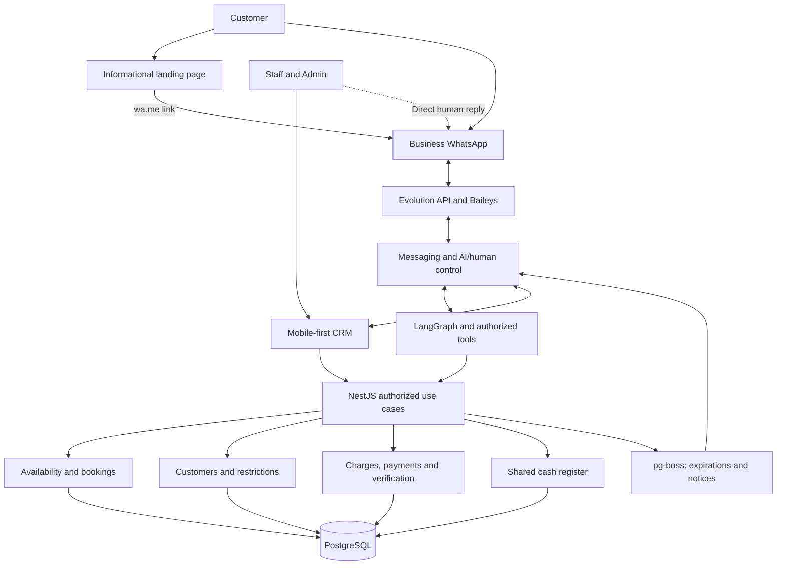
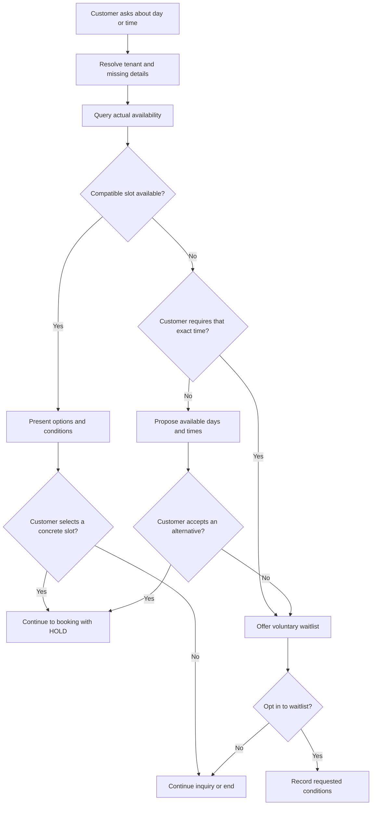
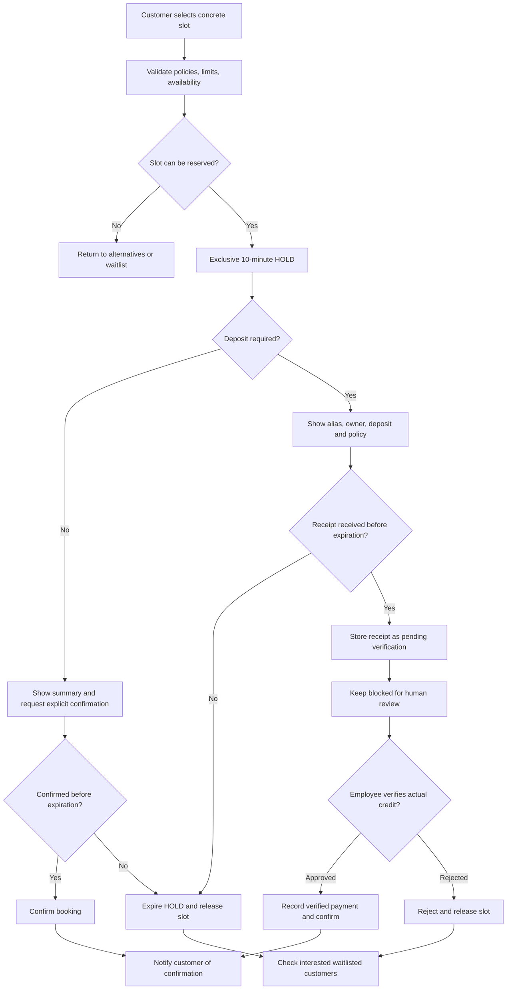
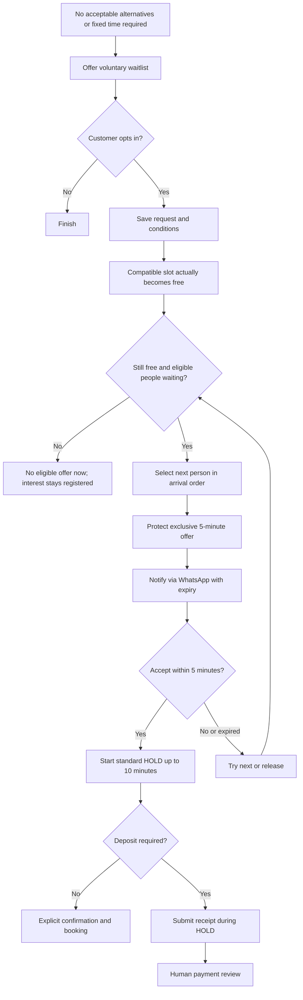
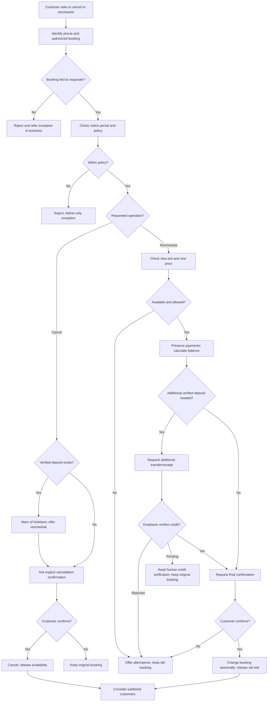
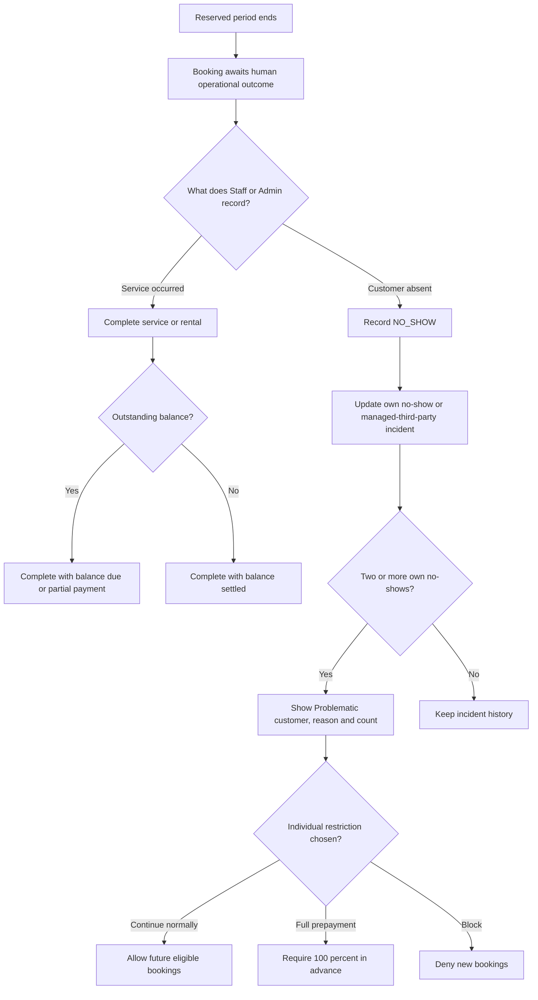
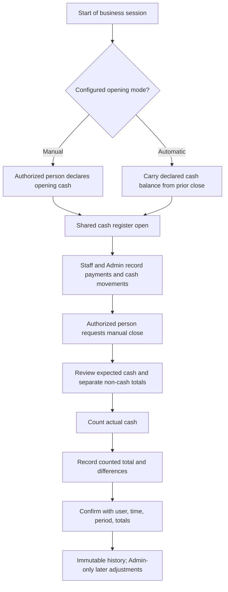
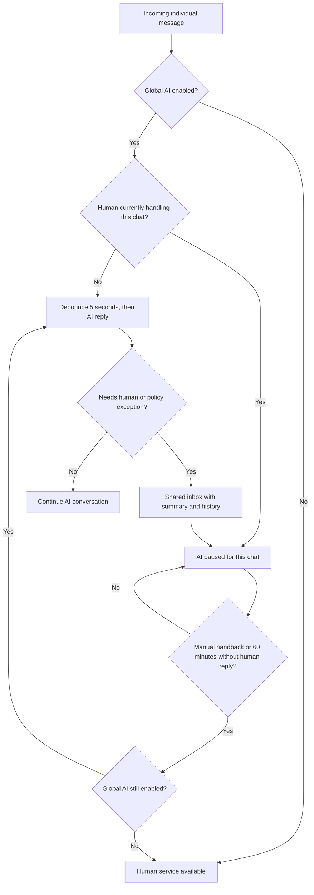

# UC-01 — Main Functional Flows

> **Status:** In review · **Scope:** Main MVP use cases for barbershops/beauty and sports clubs/courts.  
> **Related:** [Actors, permissions and use-case index](./actors.md).  
> **Boundary:** These are functional scenarios, **not** final database states, APIs, UI designs, or implementation contracts. Prior `rules.md`, `mvp.md` and `architecture-bootcamp.md` may contain superseded decisions.

## Shared Rules (Apply to All Cases)

- **Channels:** Customer self-service is through **individual WhatsApp chats** only; the public landing is informational and links to `wa.me`. Authenticated Staff/Admin use the **mobile-first CRM**, including when WhatsApp is offline.
- **Authority:** WhatsApp/AI and CRM call the **same tenant-scoped booking core**. The AI executes authorized customer-context tools, never Staff/Admin privileges. [Permission matrix](./actors.md#2-permissions-matrix).
- **Exclusivity:** Availability inquiries do not reserve a slot; bookings, HOLDs and exclusive waitlist offers must prevent overlapping allocations for the same resource/time.
- **Initial HOLD:** **10 minutes** after selecting a concrete slot (with or without deposit); no hold for information-only inquiries. A CRM employee can book/confirm directly.
- **Deposit:** Timely transfer receipt → `PENDING_PAYMENT_REVIEW`, with the slot **blocked until human verification and no automatic review timeout**. A receipt image never proves credit. No-deposit bookings require explicit customer confirmation during HOLD.
- **Waitlist:** Voluntary; propose alternatives first unless a specific unavailable time is non-negotiable. Upon a real release, give the next eligible requester **5 minutes of exclusive priority**; acceptance starts a new standard HOLD.
- **Operational truth:** Time passing never proves attendance or payment. Human-recorded completion, outstanding balance and cash closing are independent.
- **Cross-cutting:** Tenant isolation, business-local timezone, audit for sensitive changes and explicit/revocable consent for proactive messages.

**Conceptual labels:** `HOLD`, `PENDING_PAYMENT_REVIEW`, `CONFIRMED`, `CANCELLED`, `COMPLETED`, `NO_SHOW`, `EXPIRED`. These **do not** prescribe persisted enums or exact transition contracts.

## Channel and System Overview

**Continuity:** WhatsApp/Evolution failure interrupts customer self-service, **not** CRM operations. Google Business Profile may have a manually configured WhatsApp link; no Google Business Profile API integration is included.

## Use-Case Index

| Case | Goal | Case | Goal |
|---|---|---|---|
| [CU-01](#cu-01) | Check availability | [CU-09](#cu-09) | Reschedule booking |
| [CU-02](#cu-02) | Book without deposit | [CU-10](#cu-10) | Complete / no-show |
| [CU-03](#cu-03) | Book with deposit | [CU-11](#cu-11) | Record payments |
| [CU-04](#cu-04) | Book for others | [CU-12](#cu-12) | Manage incidents |
| [CU-05](#cu-05) | Join waitlist | [CU-13](#cu-13) | Open/close cash |
| [CU-06](#cu-06) | Accept waitlist offer | [CU-14](#cu-14) | Human handoff |
| [CU-07](#cu-07) | Review upcoming bookings | [CU-15](#cu-15) | Configure operations |
| [CU-08](#cu-08) | Cancel booking | [CU-16](#cu-16) | Send authorized notice |

## CU-01 — Consult Business Information and Availability

**Actor/channel:** Customer → WhatsApp; AI and availability core assist. **Trigger:** Service, rental or time inquiry. **Preconditions:** Tenant and configured offerings can be identified.

**Main flow**
1. Customer states the service/resource and preferred time; AI asks only for missing details.
2. System queries live availability for a named professional/court or any compatible option.
3. AI presents available times, price/duration and conditions; a selected concrete slot proceeds to [CU-02](#cu-02) or [CU-03](#cu-03).

**Alternatives:** If preferred slot is unavailable, propose alternatives first; if the time is explicitly fixed, offer [CU-05](#cu-05) immediately. If the customer selects nothing, end inquiry **without HOLD**. On query failure, do not invent slots; offer [CU-14](#cu-14).

**Result:** Accurate information or transition to booking/waitlist; no slot is occupied by a query.

**Example:** If Friday 22:00 is the team's *only* acceptable time and it is full, offer waitlist directly.

## CU-02 — Create a Booking Without a Deposit

**Actor/channel:** Customer → WhatsApp, or Staff/Admin → CRM. **Trigger:** Concrete slot chosen. **Preconditions:** Configured service, allowed requester, unoccupied slot.

**Main flow**
1. Validate tenant, customer limits/restrictions, booking policy and availability; create exclusive **10-minute HOLD** for WhatsApp.
2. Show price, service/resource, date/time and conditions; customer explicitly confirms before expiry.
3. Confirm and notify; no payment or human approval is inferred.

**Alternatives:** Slot conflict → alternatives/[CU-05](#cu-05). No confirmation by deadline → expire/release, then consider [CU-06](#cu-06). An individually restricted customer may be denied or directed to a **100% prepayment** path. Staff/Admin can create a walk-in booking immediately through CRM, with **name required and phone optional**, using the same occupancy check.

**Result:** Confirmed exclusive booking, or released HOLD without confirmation. Requester controls future WhatsApp management through the originating number.

**Diagram:** Shared with [CU-03](#booking-deposit-diagram).

## CU-03 — Create a Booking With a Transfer Deposit

**Actor/channel:** Customer → WhatsApp; Staff/Admin verify via CRM and bank/wallet. **Trigger:** Chosen slot requires deposit. **Preconditions:** Deposit rule and receiving alias configured; slot and requester eligible.

**Main flow**
1. Validate and create a **10-minute HOLD**; display price, required deposit, bank alias/account holder and cancellation policy **before transfer**.
2. Customer sends transfer receipt **within HOLD**; register it as **pending**, keeping the slot blocked **without automatic review expiry**.
3. Staff/Admin verifies **actual credit** in the business account. Upon approval, record verified payment/verifier and confirm the booking.

**Alternatives:** No timely receipt → HOLD expires and slot is released. Rejected/uncredited receipt → employee rejects, releases and notifies; consider [CU-06](#cu-06). Pending review → retain block. Late/unmatched transfer → **human financial incident**, never automatic reconfirmation. CRM may record ordinary cash/bank-verified payments without an uploaded image.

**Rules/result:** Deposit may be fixed or percentage, with business default and service/resource overrides; multiple aliases with **one default**, no automatic rotation. **Only human credit verification confirms paid deposits.** Pending review can block indefinitely; it must remain visible to staff.

**Example:** Receipt received with 3 minutes left in HOLD continues blocking after those 3 minutes, pending human verification.

### Shared Diagram — With / Without Deposit

## CU-04 — Create Bookings for Other Attendees

**Actor/channel:** Customer requester → WhatsApp; Staff/Admin → CRM. **Trigger:** Booking for friends/third parties. **Preconditions:** Requester identified; each slot eligible under standard booking rules.

**Main flow**
1. Ask for necessary attendee details (e.g., name), **not a mandatory phone number** per attendee.
2. Create **separate bookings** for separate attendees/slots, each validated and associated with the requester.
3. The requesting WhatsApp number manages those bookings, even if the attendee differs.

**Alternatives:** Sequential haircuts → independent times. Haircut+beard / manicure combo → **one preconfigured service**, with its own duration/price. Court+barbecue → **separate requests/bookings**, barbecue may be free; **no atomic multi-resource booking**. A friend’s no-show becomes a managed-third-party incident, not automatically the requester's own no-show ([CU-10](#cu-10)).

**Result:** Correctly associated bookings; limits for future bookings made for third parties remain **to be defined**, not bypassed.

## CU-05 — Join a Voluntary Waitlist

**Actor/channel:** Customer → WhatsApp. **Trigger:** No acceptable availability. **Preconditions:** Availability checked, alternatives declined or an explicitly fixed day/time.

**Main flow**
1. Offer available alternatives **unless** customer cannot consider another slot.
2. Ask for explicit opt-in to be notified and record preferred time, resource or compatible options under the requester's tenant/number.
3. When a compatible slot is **actually released**, attempt [CU-06](#cu-06).

**Alternatives:** Customer accepts alternative → regular booking, no waitlist. Declines opt-in → nothing registered. Duplicate interest → avoid duplicate requester/conditions entries.

**Result:** Registered interest and consent, **not** a reserved or guaranteed slot. Consent for waitlist notices is distinct from general reminders; waitlist expiration/caps remain undecided.

## CU-06 — Receive and Accept an Exclusive Slot Offer

**Actor/channel:** System event → WhatsApp; customer responds. **Trigger:** Compatible slot released by cancellation, rescheduling, expired HOLD, rejected payment receipt or lifted block. **Preconditions:** Slot truly free; eligible opted-in requester exists.

**Main flow**
1. Select first eligible requester **in arrival order**; protect an exclusive **5-minute offer**, and notify with expiry.
2. Customer accepts within 5 minutes; convert the opportunity into a normal **up-to-10-minute HOLD**.
3. Complete [CU-02](#cu-02) (explicit confirmation) or [CU-03](#cu-03) (receipt and human verification).

**Alternatives:** Decline/no response/expiry → next eligible requester or general availability. No eligible interest → do not retain a hold. Failed notification → **never block indefinitely**; exact retries/advancement deferred. Race/conflict → never displace a confirmed booking or create parallel exclusive offers.

**Result:** One protected chance, **not** guaranteed confirmation; no automatic five-minute renewal.

## CU-07 — Consult the Requester's Future Bookings

**Actor/channel:** Customer → WhatsApp. **Trigger:** Request for upcoming bookings. **Preconditions:** Business tenant and incoming sender number identified.

**Main flow**
1. Query **future/active bookings managed by the sender number in this tenant**.
2. Show matching details and allow selection for [CU-08](#cu-08) or [CU-09](#cu-09).

**Alternatives:** No matches → say so without showing others. Another sender number → refuse access and refer exceptional cases to staff. Historical self-service browsing is not part of the approved scope.

**Result:** Authorized read-only view. An attendee's name alone conveys **no** booking management rights.

## CU-08 — Cancel a Booking

**Actor/channel:** Customer → WhatsApp; Staff/Admin → CRM. **Trigger:** Cancellation requested. **Preconditions:** Existing booking, authorized requester, applicable notice policy.

**Main flow**
1. Resolve booking; check originating requester number within the tenant (or authenticated staff permission) and minimum notice, including service/resource overrides.
2. For a **voluntary cancellation with verified deposit**, warn of forfeiture and offer rescheduling before proceeding.
3. Request **explicit confirmation**; cancel, release slot and consider [CU-06](#cu-06). Notify customer.

**Alternatives:** Outside policy → AI declines; only **Admin** may approve an audited exception. Different sender → refer to business. Customer declines confirmation → retain booking. **Business-caused cancellation** must not automatically forfeit deposit; refund/legal questions require human handling.

**Result:** Authorized confirmed cancellation and released slot, or unchanged booking.

**Diagram:** Shared with [CU-09](#change-booking-diagram).

## CU-09 — Reschedule a Booking

**Actor/channel:** Customer → WhatsApp; Staff/Admin → CRM. **Trigger:** Change to date/time or service/resource. **Preconditions:** Authorized booking, known payments and policy; new availability checked.

**Main flow**
1. Check notice window and configured rescheduling limit (**unlimited by default**); query candidate slot without releasing old one.
2. Preserve verified payments; compute new price, outstanding balance and any additional required deposit.
3. If more deposit is required, obtain **human-verified credit** before applying the change. Ask for explicit confirmation.
4. Atomically move booking and release old slot; consider [CU-06](#cu-06) and notify customer.

**Alternatives:** Policy violation → Admin-only documented exception. Unavailable slot, unverified extra deposit, declined confirmation or transaction conflict → **original booking stays intact**. Smaller deposit requirement → verified funds reduce final remaining balance, no automatic refund (e.g., new total $15,000, paid $8,000 → $7,000 due). Amount paid greater than new total → manual resolution.

**Result:** New booking conditions and accurate balance, or original booking preserved.

### Shared Diagram — Cancel / Reschedule

**Diagram note:** Pending supplemental transfer review **does not complete rescheduling or release the original booking**. Its exact later state handling is deferred.

## CU-10 — Complete a Service/Rental or Record a No-Show

**Actor/channel:** Staff/Admin → CRM. **Trigger:** Personnel record what occurred after a reserved time. **Preconditions:** Booking belongs to their tenant.

**Main flow**
1. Mark service/rental **completed** or record an actual **`NO_SHOW`**, identifying the attendee when different from the requester.
2. Maintain payment balance independently; **Complete and collect payment** may record an actual receipt via [CU-11](#cu-11).
3. Record responsible employee and relevant audit details.

**Alternatives:** Completed but unpaid/part-paid → preserve debt. Friend absent → managed-third-party incident, separate from own no-shows. Erroneous absence → Staff/Admin may correct with audit. Valid cancellation or expired HOLD → **never** a no-show.

**Result:** Human-attested operational outcome; no automatic completion, attendance or payment from elapsed time. From **two own no-shows**, show internal **“Problematic customer”** label; sanctions require manual [CU-12](#cu-12).

## CU-11 — Record, Verify or Correct a Payment

**Actor/channel:** Staff/Admin → CRM; customer may provide evidence via WhatsApp. **Trigger:** Receipt, collection or correction. **Preconditions:** Tenant-scoped booking/charge; payment permission.

**Main flow**
1. Review price, verified deposits and due amount; register cash or transfer, including **partial/mixed methods**.
2. For transfer, verify **bank/wallet credit**; for cash, confirm physical receipt. Record amount, method, date/time and employee.
3. Update remaining balance without double-counting a deposit; optionally complete service through [CU-10](#cu-10).

**Alternatives:** WhatsApp image → review pending, **not paid** ([CU-03](#cu-03)). During open cash session, Staff/Admin correct with audit; **after close, Admin alone** records a later adjustment without rewriting closure. Agreed price changes require Admin, reason and customer acceptance if increased. Manual refund, when warranted, is recorded by Admin; no automated bank refund.

**Result:** Verified collected money and remaining debt are traceable. Only service/rental charges are in scope; no POS/product sales or inventory.

## CU-12 — Manage Customer Incidents and Individual Restrictions

**Actor/channel:** Staff/Admin → CRM. **Trigger:** Review absences or apply/remove a customer-specific restriction. **Preconditions:** Same tenant, authorized personnel.

**Main flow**
1. Show **own no-shows** separately from **incidents in bookings managed for other attendees**.
2. At **two own no-shows**, show the internal **“Problematic customer”** classification with reason and count.
3. Staff/Admin may continue normally, require **100% advance payment**, or block new bookings; record the actor and reason.
4. Backend/AI enforce explicit restriction without disclosing the internal label to customer.

**Alternatives:** No decision → **no automatic sanction**. Corrected absence → recalculate with audit; do not merge people by name. Blocked customer → decline booking without insulting label. Third-party incident aggregation specifics remain undecided.

**Result:** Tenant-specific, manually controlled measures and separated incident history.

## CU-13 — Open and Close the Shared Cash Register

**Actor/channel:** Admin or specifically authorized Staff → CRM. **Trigger:** Cash opening or closing. **Preconditions:** One shared logical register per tenant; correct privilege.

**Main flow**
1. Open **manually** with declared cash or **automatically** with cash declared at previous close, according to tenant setting.
2. Staff/Admin record booking-related receipts, cash-ins/outs (reason and employee) and transfers **separately from physical cash**.
3. Authorized person requests **manual close**, reviews expected physical cash, counts actual cash and records discrepancies.
4. Confirm immutable close with responsible person, period, timestamp and totals.

**Alternatives:** Difference → still allow recorded close. Unpaid bookings → do not block close or count unreceived money. Post-close adjustment → **Admin-only audited subsequent entry**, never rewrite closed session. Session boundaries/late reconciliation remain deferred.

**Result:** Shared cash history, individual operator accountability. **Automatic opening is configurable; closing is always manual.** Excludes bar/shop POS sales.

## CU-14 — Take Over and Return a WhatsApp Conversation

**Actor/channel:** Staff/Admin → CRM inbox or direct business WhatsApp. **Trigger:** Human requested, AI cannot resolve, or staff chooses takeover. **Preconditions:** Same tenant; global AI status known.

**Main flow**
1. Escalation enters a **shared CRM inbox** with conversation history and summary.
2. Staff/Admin takes chat; AI **pauses only in that conversation**. Human replies from CRM or supported direct WhatsApp.
3. AI resumes on **manual handback** or **60 minutes without a human reply**, **only if globally enabled**.

**Alternatives:** Each human reply resets the timer. Admin alone controls global AI on/off (temporarily or indefinitely). Direct WhatsApp detection requires pilot validation; **explicit CRM takeover is reliable fallback**, and bot messages must not count as human. AI resuming never verifies or approves a payment. Messaging outage does not stop CRM booking operations.

**Result:** Human/AI handoff without overlapping answers. AI supports text/images in individual chats; no voice notes or groups in MVP. Incoming messages are grouped after **5 seconds of inactivity** before an AI response.

## CU-15 — Configure and Supervise Business Operations

**Actor/channel:** Admin → CRM; Staff with delegated operational-hours/availability permission. **Trigger:** Configuration change or day overview. **Preconditions:** Correct tenant and privilege.

**Main flow**
1. Admin configures services/combos, compatible professionals/resources, prices, duration, business hours, deposit rules/aliases, notice periods, booking limits, personnel and global AI setting.
2. Authorized Staff can change **operational hours/availability blocks only** when delegated; commercial policy, prices, aliases and staff privileges remain Admin-only.
3. CRM provides mobile-first **today overview**: bookings, collected money, pending payment reviews, unresolved operational items and links to agenda/cash; customer incidents have a separate view.

**Alternatives:** Reject unauthorized settings. Changes to existing agreed price require Admin reason and **customer acceptance when increasing**. Availability conflicts must preserve confirmed bookings; exact change policy is deferred. Multiple Admins allowed; disabling personnel must preserve historical attribution.

**Result:** Authorized tenant configuration and operational supervision. Landing remains informational; any Google Business Profile WhatsApp link is configured manually without API integration.

## CU-16 — Send an Authorized Reminder or Waitlist Notice

**Actor/channel:** System automation → customer via WhatsApp. **Trigger:** Due reminder or valid waitlist release. **Preconditions:** Active relevant booking/waitlist interest, tenant-local timing, explicit valid consent.

**Main flow**
1. Before sending, re-check booking/offer validity and **unrevoked consent**.
2. Send booking reminder or [CU-06](#cu-06) offer and record attempt/delivery/failure.

**Alternatives:** No/removal of consent → send nothing. Cancelled booking → no reminder. Waitlist consent is **separate** from reminder consent. WhatsApp failure → log/retry durably; do not alter booking/payment or block offers indefinitely (precise delivery policy deferred).

**Result:** Authorized proactive messaging only. Default **one reminder on booking day**, with configurable advance time. Use durable/idempotent `pg-boss` work; late jobs never invalidate a confirmed booking.

## Cross-Cutting Verification Examples

| Scenario | Expected behavior | Case |
|---|---|---|
| Two people target the same court/time | At most one protected allocation; other sees alternatives/waitlist | [CU-02](#cu-02), [CU-03](#cu-03) |
| Receipt arrives just before HOLD expiry | Remains blocked for human payment verification | [CU-03](#cu-03) |
| Fixed Friday 22:00 slot is unavailable | Direct waitlist option | [CU-01](#cu-01), [CU-05](#cu-05) |
| Waitlisted customer accepts exclusive offer | Five-minute offer converts to normal HOLD, **not** confirmation | [CU-06](#cu-06) |
| Change requires more deposit | Verify actual extra credit before rescheduling; preserve original meanwhile | [CU-09](#cu-09) |
| Cash counted below expected | Manual close allowed with documented variance | [CU-13](#cu-13) |
| Human stops responding for 60 minutes | Resume AI only if global mode remains enabled | [CU-14](#cu-14) |

## Deferred Decisions — Do Not Infer as Approved

1. Exact persisted states/transitions, late events and concurrency details for HOLDs, five-minute offers and human payment review.
2. Waitlist expiry, caps, repeated offers and **failed delivery** handling.
3. Default notice periods, future-booking limits and counting rules for bookings/absences involving third parties.
4. Late/unmatched transfers, no-image deposit evidence, indefinite-review abuse mitigation, legal refunds/business cancellations and overpayments.
5. Cash-session boundaries, delegated cash/schedule permissions, withdrawals and reconciliation after close.
6. How a barbecue area is configured for a specific club; **no required atomic multi-resource booking**.
7. Reliability/fallback for detecting direct human WhatsApp replies through Evolution/Baileys.
8. Updating older `rules.md`, `mvp.md` and `architecture-bootcamp.md` is **another task**.

## UC-01 Acceptance Check

- [x] Each `CU-XX` states actor, entry channel, trigger/precondition, path, exceptions and observable result.
- [x] All 16 cases link to the catalog in [actors.md](./actors.md); shared diagrams clarify key branching.
- [x] Both verticals use the same core, with no customer booking through landing.
- [x] Customer permissions, tenant isolation, deposit verification and waitlist exclusivity are explicit.
- [x] Pending implementation decisions are separated from approved MVP behavior.
