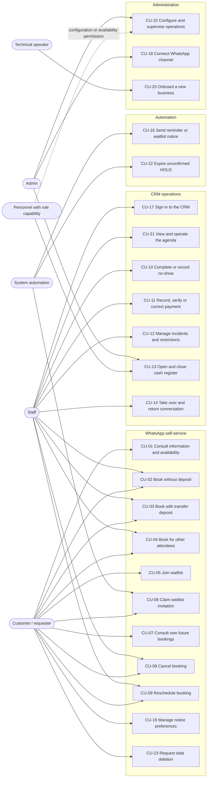
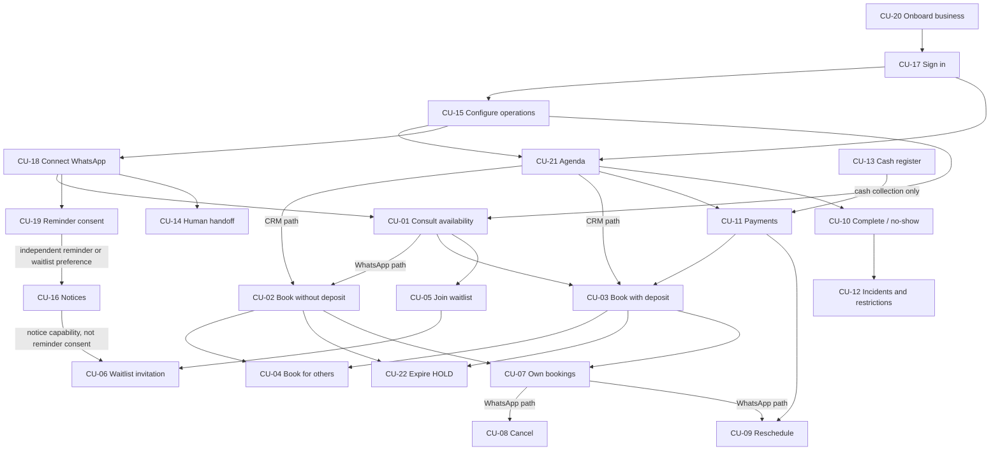

# UC-02 — Prioritized Use Cases and Functional Specifications

> **Status:** In Review
> **Objective:** Specify, case by case, what the MVP must do and under which conditions, and propose an implementation order, building on the actors and flows of UC-01.
> **Scope:** Detailed functional specification of CU-01 to CU-16 and of seven proposed cases (CU-17 to CU-23); MVP obligation and proposed implementation priority; functional dependencies; delivery by MVP stage.
> **Out of scope:** Actors and narrative flows (UC-01); canonical [business rules](../uc-03/business-rules.md) and [invariants](../uc-03/invariants.md); technical schema, endpoints and implementation. Product-owner decisions of 2026-11-04 remain in review, not team-approved or implemented.
> **References:** [UC-01 actors and catalog](../uc-01/actors.md) and [UC-01 flows](../uc-01/flows.md); [MVP definition](../mvp.md) v0.3; [target architecture](../../design-docs/target-architecture.md) v1.2 (proposed, not the implemented [`ARCHITECTURE.md`](../../../ARCHITECTURE.md)); [use case template](../../references/use-case-template.md).

## Confirmed Decisions

- UC-02 **adds no product decisions**. It inherits the [UC-01 Confirmed Decisions](../uc-01/actors.md#confirmed-decisions) and the scope of `mvp.md` v0.3.
- CU-01 to CU-16 keep their UC-01 identifiers and meaning.
- Every case in the catalog is required by `mvp.md` v0.3: a required capability (§5.1) or an acceptance criterion (§12) depends on it ([§3](#3-prioritized-catalog)).

## Open Questions

- **Implementation priority (P0–P2), stage mapping and cut order are proposals** pending team approval ([§3](#3-prioritized-catalog), [§5](#5-delivery-by-mvp-stage)).
- **CU-17 to CU-23 are proposed additions**; their justification and what remains to be agreed is in [§2.1](#21-proposed-cases-cu-17-to-cu-23). The actors of CU-18 and CU-20 are not defined in UC-01.
- Steps marked *(proposal)* are interpretations needed to write a complete flow; they are not agreed behavior.
- Canonical rules and invariants belong to UC-03; only genuinely unresolved questions remain pending.
- Questions that affect a single case are listed inside that case.

## 1. How to Read This Document

| Document | Owns |
|---|---|
| [actors.md](../uc-01/actors.md) | Actors, channels, the [permissions matrix](../uc-01/actors.md#2-permissions-matrix), the CU-01 to CU-16 catalog and vertical differences. |
| [flows.md](../uc-01/flows.md) | Narrative summary of each case, [shared rules](../uc-01/flows.md#shared-rules-apply-to-all-cases), diagrams and [verification examples](../uc-01/flows.md#cross-cutting-verification-examples). |
| **This document** | Per case: numbered main flow, identified alternatives (`A1`, `A2`…), postconditions and open questions. Across cases: MVP obligation, implementation priority, dependencies and delivery order. |

- Each specification links to its UC-01 summary and diagram; canonical business rules are in [UC-03](../uc-03/business-rules.md). Raise inconsistencies in review.
- State names (`HOLD`, `PENDING_PAYMENT_REVIEW`, `CONFIRMED`, `EXPIRED`, `CANCELLED`, `COMPLETED`, `NO_SHOW`) are the conceptual labels of [flows.md](../uc-01/flows.md#shared-rules-apply-to-all-cases), not persisted enums.
- Markers: *(proposal)* = not agreed; *pending (UC-03)* = to be decided by business rules/invariants; *pending (team)* = product decision not yet assigned to a task.
- Specifications follow §4 of the [use case template](../../references/use-case-template.md).

### 1.1 Priority Columns

| Column | Values | Meaning |
|---|---|---|
| **MVP obligation** | Required · Could · Out of MVP | Required: a capability in `mvp.md` §5.1 and/or an acceptance criterion in §12 depends on it. Could: a sub-feature that UC-01 or `mvp.md` treats as conditional. Out of MVP: [§7](#7-excluded-and-deferred-use-cases). |
| **Implementation priority** *(proposal)* | P0 · P1 · P2 | Order of implementation inside the MVP, independent of obligation. |

| Priority | Criteria |
|---|---|
| **P0** | Foundation that other cases need, or the highest correctness risk (tenant isolation, overlapping occupancy). Without it, nothing else can be demonstrated. |
| **P1** | Delivers the core MVP promise: WhatsApp booking with or without a transfer deposit, CRM operation, payments and reminders. Other P1/P2 cases depend on it. |
| **P2** | Proposed later MVP capability; P2 cases may depend on one another and their prerequisites must be delivered first. Model their data from P0 where needed ([§5.1](#51-use-cases-per-stage)). |

## 2. Catalog Overview

### 2.1 Proposed Cases (CU-17 to CU-23)

UC-01 assumes these behaviors (as preconditions or alternatives) but does not catalog them. They are proposed so that every `mvp.md` capability has an owner case. None introduces a new product decision; the parts that do need agreement are listed.

| Case | Gap in UC-01 | Source | Overlap check | Still a proposal |
|---|---|---|---|---|
| [CU-17](#cu-17) Sign in to the CRM | ACT-03/ACT-05 use an "authenticated CRM", but no case covers access or tenant context. | `mvp.md` §5.1 Tenants and identity; §12 #1 | Other CRM cases take it as a precondition; none describes it. | Not revealing whether an account exists (A1). |
| [CU-18](#cu-18) Connect the WhatsApp channel | EXT-02 is mandatory, but no case connects or monitors it. | `mvp.md` §5.1 WhatsApp | CU-15 configures the AI mode, not the connection. | **Actor (Admin)**; rejecting a number already linked to another tenant (A4). |
| [CU-19](#cu-19) Manage reminder/waitlist preferences | One four-option question obtains independent reusable preferences; CU-05 enrolls specific interest. | UC-03 BR-NOT-09 | CU-16 consumes current scope; no repeated consent question in CU-05. | Recording in-person consent from CRM remains a proposal; question/timing resolved. |
| [CU-20](#cu-20) Onboard a new business | No case creates a tenant or its first Admin. | `mvp.md` §5.1 Tenants and identity; ACT-06 | CU-15 configures an existing tenant; CU-20 only creates it. | **Actor (technical operator)**; minimum setup to accept bookings. |
| [CU-21](#cu-21) View and operate the agenda | Several CRM cases start "from the agenda", which is not specified. | `mvp.md` §7.1 | CU-15's "today overview" is a summary; CU-21 is the operational schedule. | What is highlighted (A1). |
| [CU-22](#cu-22) Expire an unconfirmed HOLD | Expiry appears as an alternative in CU-02, CU-03 and CU-06. | flows.md CU-02, CU-03; `mvp.md` §6.3.6 | Consolidates those alternatives into one system-initiated case with its own trigger; adds no behavior. | Concurrency details, *pending (UC-03)*. |
| [CU-23](#cu-23) Request deletion of customer data | UC-03 §18 defines the rules, but no case owned the flow. | UC-03 BR-DAT-01–08 | CU-19 manages notice preferences, not deletion. | Advance alert timing; legal validation (P-32). |

### 2.2 General Use Case Diagram

Admin has protected full access; personnel actions require tenant role permissions, not individual privileges ([ACT-04](../uc-01/actors.md#11-human-actors)). Staff is editable and custom roles are possible. The AI acts on behalf of the customer. CU-18 and CU-20 show proposed actors.

## 3. Prioritized Catalog

All 23 cases are **Required** by `mvp.md` v0.3 and UC-03. The implementation priority is a **proposal**.

| ID | Use case | Primary actor | Channel | MVP obligation (`mvp.md`) | Stage (§11) | Priority *(proposal)* | Why this priority |
|---|---|---|---|---|---|---|---|
| [CU-20](#cu-20) | Onboard a new business | Technical operator *(proposal)*; first Admin | Tooling / CRM | Required — §5.1 Tenants; §12 #1, #2 | 1 | **P0** | First prerequisite of everything. |
| [CU-17](#cu-17) | Sign in to the CRM and work within a business | Staff/Admin | CRM | Required — §5.1 Tenants; §12 #1, #5 | 1 → 2 | **P0** | Tenant context for every CRM case; isolation risk. |
| [CU-15](#cu-15) | Configure and supervise business operations | Admin; Authorized Staff | CRM | Required — §5.1 Permissions, Catalog, Availability; Could — today overview | 1 → 2 | **P0** | Catalog, hours and policies feed every booking. |
| [CU-21](#cu-21) | View and operate the agenda | Staff/Admin | CRM | Required — §7.1; §12 #5 | 2 | **P0** | CRM entry point; proves the core without WhatsApp. |
| [CU-02](#cu-02) | Create a booking without a deposit | Customer; Staff/Admin | WhatsApp / CRM | Required — §5.1 Bookings; §12 #3, #5, #6 | 1 → 2 → 4 | **P0** | Core booking; highest risk (overlapping occupancy). |
| [CU-22](#cu-22) | Expire an unconfirmed HOLD | System | Scheduled job | Required — §6.3.6; §12 #6 | 1 | **P0** | Without it, HOLDs keep slots blocked. |
| [CU-11](#cu-11) | Record, verify or correct a payment | Staff/Admin | CRM | Required — §5.1 Payments; §12 #11 | 3 | **P1** | Needed by CU-03, CU-09, CU-10 and CU-13. |
| [CU-03](#cu-03) | Create a booking with a transfer deposit | Customer; Staff/Admin (CRM booking, verification) | WhatsApp / CRM | Required — §5.1 Holds and deposits; §12 #4 | 3 → 4 | **P1** | Core value; carries the accepted review risk. |
| [CU-10](#cu-10) | Complete a service/rental or record a no-show | Staff/Admin | CRM | Required — §5.1 Bookings; §12 #10 | 3 | **P1** | Daily close of bookings; feeds CU-12. |
| [CU-08](#cu-08) | Cancel a booking | Customer; Staff/Admin | WhatsApp / CRM | Required — §5.1 Bookings; §12 #8 | 2 → 3 → 4 | **P1** | Main source of released slots. |
| [CU-09](#cu-09) | Reschedule a booking | Customer; Staff/Admin | WhatsApp / CRM | Required — §5.1 Bookings; §12 #8 | 2 → 3 → 4 | **P1** | Most complex flow (atomic move, deposits). |
| [CU-18](#cu-18) | Connect and monitor the business WhatsApp channel | Admin *(proposal)* | CRM | Required — §5.1 WhatsApp; §12 #3 | 4 | **P1** | Prerequisite of every WhatsApp case. |
| [CU-01](#cu-01) | Consult business information and availability | Customer | WhatsApp | Required — §5.1 Bookings, AI; §12 #3, #9 | 4 | **P1** | Entry point of self-service. |
| [CU-07](#cu-07) | Consult the requester's future bookings | Customer | WhatsApp | Required — §5.1 Bookings; §12 #7 | 4 | **P1** | Needed for customer cancel/reschedule. |
| [CU-14](#cu-14) | Take over and return a conversation | Staff/Admin | CRM / direct WhatsApp | Required — CRM takeover (§12 #13); Could — direct WhatsApp detection | 4 | **P1** | Safety net when the AI cannot resolve. |
| [CU-19](#cu-19) | Manage independent notice preferences in one question | Customer | WhatsApp | Required — §8.3; §12 #12 | 4 | **P1** | Reusable preferences gate both notice kinds independently; CU-05 records voluntary specific interest. |
| [CU-16](#cu-16) | Send a consented reminder or waitlist notice | System | WhatsApp | Required — §5.1 Notifications; §12 #12 | 4 | **P1** (reminder) · **P2** (waitlist notice) | Reminder is core; the waitlist notice follows CU-06. |
| [CU-04](#cu-04) | Create bookings for other attendees | Customer requester; Staff/Admin | WhatsApp / CRM | Required — §5.1 Customers; §12 #7, #10 | 1 (data) → 4 | **P2** | Extends CU-02/CU-03; its data is needed from P0. |
| [CU-12](#cu-12) | Manage customer incidents and restrictions | Staff/Admin | CRM | Required — §5.1 Customers; §12 #10 | 3 | **P2** | Needs no-show history from CU-10. |
| [CU-13](#cu-13) | Open and close the shared cash register | Admin / permitted personnel | CRM | Required — §5.1 Cash register; §12 #11; Could — automatic opening | 3 | **P1** | Cash collection in CU-11 requires an open session. |
| [CU-05](#cu-05) | Join a voluntary waitlist | Customer | WhatsApp | Required — §5.1 Waitlist; §12 #9 | 3 → 4 | **P2** | Prerequisite for eligible offers in CU-06. |
| [CU-06](#cu-06) | Receive invitation and claim a slot | System; Customer responds | WhatsApp | Required — §5.1 Waitlist; §12 #6, #9 | 3 → 4 | **P2** | Progressive/broadcast races require a single atomic winner; initial priority has distinct occupancy. |
| [CU-23](#cu-23) | Request deletion of customer data | Customer; System | WhatsApp / scheduled job | Required — UC-03 §18 | 4 | **P2** | Needs the WhatsApp channel; must exist before real customers. |

Cash requires an open session; verified transfers do not. Priorities remain proposals for team review.

## 4. Functional Dependencies

Two kinds of relation are kept apart: a **prerequisite** (B cannot be performed unless A exists or has happened) and a **triggering event** (an outcome of A starts or continues B at runtime).

### 4.1 Prerequisites

`A → B` means **B requires A**. The graph has no cycles.

| Prerequisite | Why |
|---|---|
| CU-20 → CU-17 → every CRM case | No tenant context or role exists without an onboarded business and an active membership. |
| CU-15 → CU-01, CU-21 | Availability, prices, deposit rules and aliases come from configuration; the AI must not invent them. |
| CU-18 → every WhatsApp case | The tenant of an incoming message comes from the validated channel connection. |
| CU-11 → CU-03, CU-09 | Verification records actual credit; an eligible reschedule of a confirmed booking whose credited deposit does not cover the destination moves before supplemental verification. |
| CU-07 → CU-08, CU-09 (WhatsApp) | The customer can act only on bookings the system shows as theirs. From the CRM, the agenda (CU-21) is the entry point. |
| CU-10 → CU-12 | The internal indicator derives from the requester's current no-show bookings. |
| CU-13 → CU-11 | Only cash collection requires an open cash session. |
| CU-19 → CU-16 (scope-specific) | One combined question stores independent reusable reminder/waitlist preferences. Reminder consent is never a prerequisite for a waitlist notice. |
| CU-05, CU-16 → CU-06 | Specific voluntary interest, current waitlist preference and notice capability; no second consent prompt. |

### 4.2 Triggering Events

These are runtime chains, not dependencies. Some of them loop (a released slot becomes an offer, the offer a HOLD, the HOLD may expire and release the slot again); that is expected behavior, not a circular dependency.

| Event | Raised by | Starts or continues |
|---|---|---|
| A slot is actually released | CU-08, CU-09 (old slot), CU-22, initial evidence rejection only when cancellation is permitted (CU-03 A3), CU-15 (lifted block) | CU-06, if an eligible waitlist entry exists |
| Timely evidence is routed to human review, or a receipt is recorded as pending from the CRM | CU-03 step 5; CU-03 CRM step 2b | Review in CU-11 (A1) |
| An offer is created | CU-06 step 2 | Notice in CU-16 |
| An offer is accepted | CU-06 step 4 | CU-02 step 3 or CU-03 step 3 |
| A HOLD deadline is reached | CU-02, CU-03, CU-06 | CU-22 |
| A booking is confirmed or moved | CU-02, CU-03, CU-09 | State-aware notice/reminder scheduling; first four-option preference question if no recorded choice, no repeated prompts |
| No acceptable slot, or a fixed time | CU-01 A2/A3 | CU-05 |
| The AI cannot resolve, a tool fails, or a human is requested | Any WhatsApp case | CU-14 |
| A no-show is recorded or corrected | CU-10 | Label recalculated, visible in CU-12 |

## 5. Delivery by MVP Stage

*Proposal for team approval.*

### 5.1 Use Cases per Stage

Follows `mvp.md` v0.3 §11. A case that spans several stages is listed where each part becomes demonstrable.

| Stage | Use cases (part) | Demonstrable result |
|---|---|---|
| **1. Core booking domain** | CU-20; CU-17 (memberships, roles); CU-15 (catalog and hours as data); CU-02 (conflict-safe booking); CU-22; CU-04 (requester/attendee data) | Two isolated tenants; bookings and HOLDs that cannot overlap; idempotent expiry. |
| **2. Business-facing web** | CU-17 (CRM sign-in); CU-15 (CRM configuration); CU-21; CU-02 (walk-in); CU-08, CU-09 (CRM, without deposit workflow; enforce applicable configured policies) | Staff run the agenda of both verticals manually; the landing links to WhatsApp. |
| **3. Deposits and operations** | CU-03 (review queue, verification, CRM booking with deposit); CU-08, CU-09 (notice, exceptions, deposits); CU-10; CU-11; CU-12; CU-13; CU-05, CU-06 (mechanics) | Transfer review, partial/mixed payments, cash close with difference, no-show label and restrictions, exclusive offers. |
| **4. WhatsApp + AI** | CU-18; CU-01; CU-02, CU-03, CU-04, CU-07, CU-08, CU-09 (WhatsApp); CU-05, CU-06 (conversation); CU-14; CU-16; CU-19; CU-23 | End-to-end conversational booking with and without deposit, handoff, reminders and waitlist messages. |
| **5. Pilot validation** | All | `mvp.md` §12 acceptance criteria. |

**For DOM-01:** consider requester/attendee distinction, restrictions, verification and occupancy from stage 1. Offer and booking claims are distinct; see [UC-03](../uc-03/business-rules.md) for occupancy rules.

### 5.2 Cut Order if the Schedule Slips

Only **sub-features** are listed: dropping a whole case would break an `mvp.md` §12 criterion and requires changing `mvp.md` first. From first to cut to last:

1. CU-14 — detection of direct human replies from the WhatsApp app (explicit CRM takeover stays).
2. CU-13 — automatic cash opening (manual opening stays).
3. CU-15 — the "today overview" (the agenda in CU-21 stays).
4. CU-04 — several attendees in one conversation (one attendee per request stays).
5. CU-06 — any proposed cut to the agreed one failed-send retry requires a new product decision; it is not an implicit optional behavior.

## 6. Functional Specifications

Each case links to its UC-01 summary and diagram; what follows adds numbered steps, identified alternatives, postconditions and open questions. Authorization refers to rows of the [permissions matrix](../uc-01/actors.md#2-permissions-matrix).

**Shared precondition for every CRM case:** personnel have an active membership in the validated tenant and the applicable permission through their sole tenant role. Staff/Admin labels in flows and authorization sections are shorthand, never unconditional grants; the backend checks effective permissions for each action. Admin-only role management, commercial exceptions, agreed-price changes, refunds, post-close physical-cash adjustments and global AI control remain protected.

### CU-01 — Consult Business Information and Availability

**UC-01:** [summary and diagram](../uc-01/flows.md#cu-01) · **Priority:** P1 *(proposal)*

- **Primary actor:** Customer.
- **Participants:** AI agent; availability core.
- **Channel:** WhatsApp.
- **Trigger:** The customer asks about services, prices, hours, a resource or a time.
- **Preconditions:** The message arrives through the tenant's validated connection ([CU-18](#cu-18)); catalog and hours are configured ([CU-15](#cu-15)); the conversation is not under human takeover ([CU-14](#cu-14)).

#### Main Flow
1. The customer writes one or more messages; they are grouped as described in UC-01 before the AI replies.
2. The AI identifies service or resource, day and time, and asks only for missing details.
3. Query actual availability in tenant timezone. Any-resource assignment uses the tenant's active preference-order or rotation mode; apply configured booking lead time (default 0), never past-start slots.
4. The AI presents the options with price, duration and the applicable conditions, all taken from configuration.
5. The customer selects a concrete slot; the flow continues in [CU-02](#cu-02) or [CU-03](#cu-03). The backend, not the AI, decides whether a deposit applies.

#### Alternatives and Exceptions
- **A1 — Information only:** At step 2, if no availability check is needed (address, hours, prices), the AI answers from configuration and the case ends.
- **A2 — Preferred slot unavailable, flexible customer:** At step 3, the AI proposes alternatives first. If one is accepted, resume at step 5; if the customer rejects them all, the AI offers [CU-05](#cu-05).
- **A3 — Fixed time:** At step 3, if the customer can only make that specific time, the AI offers [CU-05](#cu-05) directly, without proposing alternatives.
- **A4 — No selection:** At step 4, the case ends **without a HOLD**.
- **A5 — Query failure:** At step 3, the AI invents no slots, says so and offers [CU-14](#cu-14).

#### Outcome / Postconditions
- **Success:** Accurate information, or a selected slot passed to booking. A query never occupies a slot.
- **Failure:** Nothing changes.

#### Authorization
- Matrix row "View catalog and availability". Restrictions apply only when booking.

#### Open Questions
- Only the physical concurrent implementation of resource rotation remains technical design; the two configurable modes are agreed (BR-DISP-05).

---

### CU-02 — Create a Booking Without a Deposit

**UC-01:** [summary](../uc-01/flows.md#cu-02) and [shared diagram](../uc-01/flows.md#booking-deposit-diagram) · **Priority:** P0 *(proposal)*

- **Primary actor:** Customer (WhatsApp), or Staff/Admin on behalf of a customer (CRM).
- **Participants:** AI agent; booking core.
- **Channel:** WhatsApp / CRM.
- **Trigger:** A concrete slot is selected and the backend determines that no deposit is required.
- **Preconditions:** Slot selected in [CU-01](#cu-01) (WhatsApp) or in the agenda [CU-21](#cu-21) (CRM).

#### Main Flow (WhatsApp)
1. The backend validates customer restriction, future-booking limit, booking policy and availability.
2. The system creates the exclusive **10-minute HOLD**.
3. The AI shows the summary (service/resource, attendee, date/time, price, cancellation notice) and asks for explicit confirmation.
4. The customer confirms before the HOLD expires.
5. Confirm and notify; if no recorded preferences, ask the optional four-option question in [CU-19](#cu-19). Never re-prompt recorded refusal/choices. CRM confirmation is transactional, not reminder consent.

#### Alternatives and Exceptions
- **A1 — Concurrent conflict:** At step 2, if the slot was taken by another booking, HOLD or offer, no HOLD is created and the AI returns to CU-01 A2.
- **A2 — No confirmation in time:** At step 4, [CU-22](#cu-22) expires the HOLD.
- **A3 — Customer declines:** At step 4, the HOLD is released at once and [CU-06](#cu-06) may start *(proposal: recorded as a customer cancellation)*.
- **A4 — Full prepayment restriction:** At step 1, the flow switches to [CU-03](#cu-03) with a 100% requirement.
- **A5 — Blocked customer:** WhatsApp creation is denied without exposing the internal label. CRM personnel with booking-creation permission may create an exceptional booking after an internal warning; record actor/exception and leave restriction active. No extra exception permission or unblock step; other policies still apply.
- **A6 — Future-booking limit reached:** At step 1, the booking is declined and the limit explained.
- **A7 — CRM walk-in:** Staff/Admin enter name (required), phone (optional), service, resource, date and time. The same occupancy check runs and the booking is confirmed directly, without a HOLD, with origin CRM. If the backend determines that a deposit is required, the booking follows the [CU-03 CRM flow](#cu-03-crm).
- **A8 — Booking for someone else:** At step 1, see [CU-04](#cu-04).
- **A9 — Outside regular hours:** Authorized availability roles may establish exceptional openings, available in CRM and WhatsApp, without overriding explicit blocks or active claims. Booking records the authorizing actor; see [UC-03](../uc-03/business-rules.md).

#### Outcome / Postconditions
- **Success:** A confirmed booking occupies the resource; it is linked to the requester's number (WhatsApp) or customer record (CRM), with its origin.
- **Failure:** No booking, or the HOLD is released and the resource is free.

#### Authorization
- Matrix row "Create bookings for oneself or others": customer within their own context; CRM personnel with the applicable tenant-role booking permission.
- Matrix row "Book outside regular hours (CRM)": the applicable tenant-role capability and authorized availability (A9).

#### Open Questions
- P-16 is resolved by A5, not deferred.

---

### CU-03 — Create a Booking With a Transfer Deposit

**UC-01:** [summary](../uc-01/flows.md#cu-03) and [shared diagram](../uc-01/flows.md#booking-deposit-diagram) · **Priority:** P1 *(proposal)*

- **Primary actor:** Customer (WhatsApp), or Staff/Admin on behalf of a customer (CRM).
- **Participants:** AI agent (WhatsApp); Staff/Admin (verification); business bank/wallet account (EXT-03).
- **Channel:** WhatsApp (customer); CRM (booking on behalf of the customer, verification).
- **Trigger:** The selected slot requires a deposit, by policy or because of a full-prepayment restriction.
- **Preconditions:** Deposit rule and a default receiving alias configured ([CU-15](#cu-15)); eligible requester.

#### Main Flow (WhatsApp)
1. The backend validates as in CU-02 step 1 and computes the required deposit.
2. The system creates the exclusive **10-minute HOLD**.
3. After HOLD acquisition, show price, required deposit, modality-selected receiver/account and cancellation conditions. Never request a transfer merely for a waitlist invitation; freeze issued instructions.
4. Request PDF/image evidence before HOLD expiry; only on explicit inability to attach it accept transfer details by text within that same deadline. No AI interpretation verifies funds.
5. Record evidence and receipt time. Screen image/PDF relevance under [BR-SEN-14–16](../uc-03/business-rules.md#9-deposits-sen): plausible, second clearly unrelated, uncertain or failed screening routes to human review; the first clearly unrelated file requests replacement. Explicit-inability text fallback goes directly to human review. Pending review occupies without inactivity timeout, appears in CRM, and the customer is told confirmation follows verification.
6. Staff/Admin check the actual credit in the bank/wallet account ([CU-11](#cu-11)).
7. Record verified Payment, actor and time, with explicit manual allocation to the active booking in the same human action (BR-SEN-07). Confirm only at the required threshold. If insufficient, preserve occupied/unconfirmed partial-deposit waiting without automatic release; show missing amount/contact action and allow completion through more payments.

#### Main Flow (CRM)

Staff/Admin book on behalf of the customer **without the 10-minute conversational HOLD**.

1. From the agenda ([CU-21](#cu-21)), Staff/Admin enter the booking as in CU-02 A7; the backend validates as in CU-02 step 1 and computes the required deposit.
2. The result depends on what the customer has provided, recorded through [CU-11](#cu-11):
   - **a. Verified cash/transfer:** record funds and manual allocations; threshold met confirms directly, insufficient verified deposit retains an occupied/unconfirmed booking without automatic timeout. Cash requires an open session.
   - **b. A transfer receipt not yet verified:** the receipt is recorded as pending; the booking enters `PENDING_PAYMENT_REVIEW` and blocks the slot until human review, continuing at step 6 of the WhatsApp flow.
   - **c. No payment and no receipt:** the booking is not confirmed and does not occupy the slot. Only an Admin may authorize the exception and confirm it without the deposit. The booking records that no deposit was paid and the outstanding balance, so the full price is still collected; a reason is optional.
3. The occupancy check runs when the booking is created; the booking has origin CRM.

#### Alternatives and Exceptions
- **A1 — No qualifying evidence in time:** [CU-22](#cu-22) expires the HOLD after the applicable screening and state checks; unresolved screening of timely evidence prevents release.
- **A2 — Receipt after expiry:** At step 4, the booking is not reactivated; the receipt becomes a financial incident (CU-11 A8) and the customer is told the slot was released.
- **A3 — Initial evidence rejected by a human:** With no verified partial deposit, first rejection opens 15-minute correction; timely distinct evidence follows screening and review safeguards. Second distinct human rejection/expiry may cancel only before start after current-state/evidence/funds/review checks. Verified partial funds instead retain occupied/unconfirmed capacity for manual handling; started slots and supplemental reschedule collection also never auto-release. Technical duplicates and AI discards do not count as human rejections. See BR-SEN-10–11, BR-SEN-14–16.
- **A4 — Clearly unrelated or uncertain file:** First clearly unrelated file prompts an explanation and replacement; second prompts explanation of failed attempts and human review. Uncertain/failed screening also routes to human review, not an unrelated classification or bank-credit finding. No retry renews the existing deadline; a timely second file reaches review even when screening completes later.
- **A5 — Amount below required deposit:** Retain verified funds/occupied unconfirmed slot, allow additional payments, show missing amount. No automatic missing-remainder or rejected-subsequent-evidence release. Personnel may release manually under applicable permission/policy; explicitly confirmed authorized customer cancellation releases via CU-08.
- **A6 — Full prepayment:** Same flow with 100% of the price.
- **A7 — Customer withdraws:** At steps 3–4, the customer may cancel the HOLD with nothing to forfeit *(proposal)*.
- **A8 — CRM, slot taken:** At CRM step 3, if the booking would overlap an occupying booking, HOLD or offer, nothing is created.
- **A9 — CRM, amount below required deposit:** Same as A5, without conversational HOLD.

#### Outcome / Postconditions
- **Success:** A confirmed booking with a verified deposit linked to it or, from the CRM by Admin exception, without it, recording that no deposit was paid and the outstanding balance.
- **Failure:** Release occurs only under the applicable expiry or rejection path; verified partial payments remain. Without payment, receipt or exception, the CRM booking does not occupy the slot.

#### Authorization
- Matrix row "Verify bank-transfer receipt": Staff/Admin only. The AI never marks a payment as verified.
- Matrix row "Authorize exceptions to commercial policies": Admin only, to confirm a CRM booking without its required deposit (CRM step 2c).

#### Open Questions
- The MVP accepts human supervision as the abuse control (P-24). Text fallback, partial money protection and cancellation independent of review are resolved; do not infer a new timeout.

---

### CU-04 — Create Bookings for Other Attendees

**UC-01:** [summary](../uc-01/flows.md#cu-04) · **Priority:** P2 *(proposal)*

- **Primary actor:** Customer requester (WhatsApp); Staff/Admin (CRM).
- **Participants:** AI agent.
- **Channel:** WhatsApp / CRM.
- **Trigger:** The requester books for friends, family or a team.
- **Preconditions:** Requester identified (sender number or CRM customer record).

#### Main Flow
1. The AI asks for each attendee's name; a phone per attendee is not required.
2. Each attendee/slot becomes a separate booking through [CU-02](#cu-02) or [CU-03](#cu-03), validated on its own.
3. Every booking is linked to the requester, whose number manages them.

#### Alternatives and Exceptions
- **A1 — Sequential appointments:** One booking may fail without cancelling the others; the AI reports which were created.
- **A2 — Combined service:** A preconfigured combination is one service, not two bookings.
- **A3 — Court plus barbecue area:** Separate bookings, with no atomic multi-resource booking; if one fails, the other remains.
- **A4 — The attendee writes from their own number:** The attendee cannot manage the booking (CU-07 A2).

#### Outcome / Postconditions
- **Success:** Bookings carry requester and attendee; the attendee gains no management rights.
- **Failure:** Failed bookings are not created; successful ones remain.

#### Authorization
- Matrix row "Create bookings for oneself or others"; [authorization invariant 1](../uc-01/actors.md#authorization-invariants).

#### Open Questions
- Resolved: attendee name only mandatory, no separate phone/account; each future occupying booking counts against the requester/tenant limit if enabled, including third parties.

---

### CU-05 — Join a Voluntary Waitlist

**UC-01:** [summary](../uc-01/flows.md#cu-05) · **Priority:** P2 *(proposal)*

- **Primary actor:** Customer.
- **Participants:** AI agent.
- **Channel:** WhatsApp.
- **Trigger:** No acceptable availability in CU-01.
- **Preconditions:** Availability checked; alternatives declined or a fixed time required.

#### Main Flow
1. The AI offers alternatives, unless the time is non-negotiable.
2. The AI offers the waitlist and explains that it neither reserves nor guarantees a slot.
3. Record explicit interest, requested range, arrival and optional compatible resource; reuse current waitlist preference. If unknown, use CU-19's combined question rather than a second prompt; reminder preference does not authorize waitlist notices.
4. The AI confirms the registration.

#### Alternatives and Exceptions
- **A1 — Alternative accepted:** At step 1, continue in CU-02/CU-03; no entry is created.
- **A2 — Opt-in declined:** At step 3, nothing is recorded.
- **A3 — Duplicate interest:** At step 3, the existing entry is kept with its original arrival order.
- **A4 — Blocked customer:** At step 2, the waitlist is not offered and nothing is recorded; the AI replies as it does when they cannot book, without revealing the label (BR-WL-16).
- **A5 — Queue full:** At step 3, a queue already holds the MVP limit of 10 people (BR-WL-14); nothing is recorded. The AI says it is full and offers other times, with no reserve list.

#### Outcome / Postconditions
- **Success:** A registered interest with consent; no slot is reserved.
- **Failure:** Nothing is recorded.

#### Authorization
- Matrix row "Join waitlist / receive invitation".

#### Open Questions
- Expire when requested range has no future slots; close on fulfilled booking/customer withdrawal, not unanswered/failed delivery. Physical round storage is ERD T-01/T-05.

---

### CU-06 — Receive a Waitlist Invitation and Claim a Slot

**UC-01:** [summary and diagram](../uc-01/flows.md#cu-06) · **Priority:** P2 *(proposal)*

- **Primary actor:** System (initiates); Customer (responds).
- **Participants:** AI agent; notification job ([CU-16](#cu-16)).
- **Channel:** WhatsApp.
- **Trigger:** A compatible slot is actually released ([§4.2](#42-triggering-events)).
- **Preconditions:** The slot is still free; an eligible opted-in entry exists with valid consent; the connection is ACTIVE.

#### Main Flow
1. Determine eligible people for the released slot and selected mode: 1–4 progressive, 5+ simultaneous.
2. Progressive: first gets an exclusive five-minute claim, then invite another every five minutes while earlier recipients remain eligible; later invitees get no exclusive window. Simultaneous: notify all without any invitation-owned occupancy claim.
3. CU-16 sends audience-appropriate wording from UC-01, making competition explicit and prohibiting transfer before HOLD acquisition. A notice is not a booking guarantee.
4. A notified customer claims, including after their original priority. Atomically recheck current eligibility, limits, future start and all protected occupancy; first successful transaction wins, not first incoming timestamp.
5. Close any initial exclusive-priority claim and create one distinct booking-owned ten-minute HOLD, linking the winning invitation to the booking. Only the winner receives payment instructions; continue CU-02/03. Never mutate claim ownership or create multiple winning HOLDs.

#### Alternatives and Exceptions
- **A1 — No reply / priority ends:** Initial exclusive claim ends; progressive invitations expand every five minutes without removing earlier recipients. Outside initial priority, invitations create no occupancy and do not freeze public availability. No arbitrary three-offer cap; do not invite for past-start slots.
- **A2 — No eligible entry:** At step 1, nothing is held.
- **A3 — Notice fails:** Confirmed failure gets one still-valid retry; second failure advances without deleting the recipient entry, extending priority or creating another invitation. Unknown outcome is reconciled or flagged in CRM without automatic resend. No indefinite blocking.
- **A4 — Requester no longer eligible:** At step 1, an entry whose requester became `BLOCKED` or reached the future-booking limit is skipped *(proposal)*.
- **A5 — Accepted but not completed:** After step 5, [CU-22](#cu-22) may expire the HOLD; a new round starts with the current queue, excluding that person from it.
- **A6 — Queue changes during a round:** The mode stays fixed; late enrollees join last, and a priority holder who declines or leaves ends priority at once (BR-WL-15).

#### Outcome / Postconditions
- **Success:** Exactly one winning HOLD, not confirmed booking; only winner receives payment instructions.
- **Failure:** Explain the taken slot and offer alternatives/continued waiting; previously invited customers can still claim a free valid slot. Expired booking HOLDs are never revived.

#### Authorization
- System-initiated; the customer acts only on their own offer.

#### Open Questions
- Exact storage/concurrency of cohorts, progressive rounds and historical invitation validity remains ERD T-01/T-05. Behavior, thresholds and confirmed-failure retry are agreed.

---

### CU-07 — Consult the Requester's Future Bookings

**UC-01:** [summary](../uc-01/flows.md#cu-07) · **Priority:** P1 *(proposal)*

- **Primary actor:** Customer.
- **Participants:** AI agent.
- **Channel:** WhatsApp.
- **Trigger:** The customer asks for upcoming bookings, or wants to cancel or reschedule one.
- **Preconditions:** Tenant and sender number identified.

#### Main Flow
1. The system queries the future, active bookings managed by the sender number in this tenant (held, under payment review or confirmed).
2. The AI lists service/resource, attendee, date/time and payment status.
3. The customer may pick one and continue in [CU-08](#cu-08) or [CU-09](#cu-09).

#### Alternatives and Exceptions
- **A1 — No bookings:** The AI says so without showing anyone else's.
- **A2 — Another number:** Access is refused and the business is suggested.
- **A3 — History:** Past bookings are not part of self-service.

#### Outcome / Postconditions
- **Success:** An authorized, read-only view.
- **Failure:** No data is disclosed.

#### Authorization
- Matrix row "View the requester's future bookings"; [authorization invariant 1](../uc-01/actors.md#authorization-invariants).

---

### CU-08 — Cancel a Booking

**UC-01:** [summary](../uc-01/flows.md#cu-08) and [shared diagram](../uc-01/flows.md#change-booking-diagram) · **Priority:** P1 *(proposal)*

- **Primary actor:** Customer (WhatsApp); Staff/Admin (CRM).
- **Participants:** AI agent; Admin (exceptions).
- **Channel:** WhatsApp / CRM.
- **Trigger:** A cancellation is requested.
- **Preconditions:** Authorized active booking, including pending review/partial-deposit waiting. Existing HOLD withdrawal remains separately marked as a proposal in CU-02; current policies/permissions apply.

#### Main Flow (WhatsApp)
1. The AI resolves the booking among those managed by the sender number ([CU-07](#cu-07)).
2. The backend checks ownership and minimum notice, including service/resource overrides.
3. Explain cancellation conditions under the tenant's deposit policy, without automatic forfeiture/refund. Financial review is separate from release; offer rescheduling/verified credit without requiring it to finish first.
4. Ask explicit confirmation to cancel and release the slot.
5. Cancel/release immediately once authorized and confirmed, void old reminders, notify customer and consider CU-06. Continue outstanding review independently; verified funds may be manually credited to another booking or resolved by personnel/Admin refund. No late credit recovers the slot.

#### Alternatives and Exceptions
- **A1 — Outside the notice window:** At step 3, the AI warns of the configured consequence; on acceptance the cancellation proceeds without Admin and counts as a late cancellation (BR-CAN-14). Only an Admin can approve an audited exception to the consequence.
- **A2 — Different number:** At step 1, refused and referred to the business.
- **A3 — Customer does not confirm:** At step 4, the booking is unchanged or the customer chooses CU-09.
- **A4 — HOLD not yet paid:** At step 3, there is nothing to forfeit.
- **A5 — CRM, at the customer's request:** Personnel cancel under the same rule; a late change counts, and only an Admin authorizes an exception to its consequence.
- **A6 — Operational business-caused cancellation:** Personnel with cancellation permission may cancel with reason, release and notify/offer another date, even near start. This is not authority to grant customer policy exceptions. Review/refund remains separate/manual; Admin authorizes refunds.

#### Outcome / Postconditions
- **Success:** An authorized, confirmed cancellation; the slot is released.
- **Failure:** The booking is unchanged.

#### Authorization
- Matrix rows "Cancel or reschedule a booking" and "Authorize exceptions to commercial policies".

#### Open Questions
- Legal refund obligations/definitive retained-funds reporting remain P-07/P-26. Cancellation during review and receipt preservation are resolved above.

---

### CU-09 — Reschedule a Booking

**UC-01:** [summary](../uc-01/flows.md#cu-09) and [shared diagram](../uc-01/flows.md#change-booking-diagram) · **Priority:** P1 *(proposal)*

- **Primary actor:** Customer (WhatsApp); Staff/Admin (CRM).
- **Participants:** AI agent; Staff/Admin (extra deposit verification); Admin (exceptions).
- **Channel:** WhatsApp / CRM.
- **Trigger:** A change of date/time, service or resource is requested.
- **Preconditions:** A confirmed booking, managed by the requester (WhatsApp) or by tenant personnel (CRM).

#### Main Flow
1. The backend checks ownership, notice window and reschedule limit (unlimited by default).
2. The candidate slot is checked without releasing the current one.
3. Verified payments are kept; the new price, balance and any additional deposit are computed.
4. The customer explicitly confirms the new conditions. If policy requires prior human approval, do not occupy the target while awaiting it.
5. For an allowed move whose credited deposit does not cover the destination, atomically move the confirmed booking and release the old slot, preserving verified payments and allocations; record the change request, booking event and financial consequences.
6. Request and verify any additional deposit afterwards ([CU-11](#cu-11)); reschedule reminders, notify the customer and consider [CU-06](#cu-06) for the old slot. `FULL_PREPAYMENT` remains applicable unless Admin authorizes an exception.

#### Alternatives and Exceptions
- **A1 — Outside the notice window:** At step 4, the AI warns of the configured consequence; on acceptance the move proceeds without Admin and counts as a late reschedule (BR-CAN-14). If the deposit is lost under tenant policy, personnel resolve the case and the AI only communicates the policy and next steps.
- **A1b — Over the limit, or an exception to the late consequence:** Only an Admin can approve a documented exception.
- **A2 — Candidate slot unavailable:** At step 2, alternatives are offered; the original booking stays intact.
- **A3 — Extra deposit rejected, unpaid or pending:** After the eligible move, the new booking remains confirmed; resolve manually, without automatic cancellation or restoring the old slot. The initial-evidence rejection window does not apply.
- **A4 — Lower deposit or price:** At step 3, retained valid allocations reduce the balance; excess is resolved manually under BR-COB-15/17. Nothing is refunded automatically.
- **A5 — Paid more than the new total:** At step 3, resolved manually by an Admin.
- **A6 — Declined confirmation or concurrent conflict:** Before the move, the original booking stays intact.
- **A7 — Professional changes after deposit:** Preserve client credit and original receiving account history; charge only the remaining amount under the booking's modality. Business/professionals compensate manually, never block an otherwise valid move, auto-refund/transfer or charge the deposit twice.

#### Outcome / Postconditions
- **Success:** New conditions, an accurate balance and preserved payments.
- **Failure before the move:** The original booking is unchanged. A later supplemental-payment failure does not undo the move.

#### Authorization
- Matrix rows "Cancel or reschedule a booking" and "Authorize exceptions to commercial policies".

---

### CU-10 — Complete a Service/Rental or Record a No-Show

**UC-01:** [summary and diagram](../uc-01/flows.md#cu-10) · **Priority:** P1 *(proposal)*

- **Primary actor:** Staff/Admin.
- **Channel:** CRM.
- **Trigger:** Personnel record/correct actual attendance.
- **Preconditions:** Tenant booking; manual completion from start, no-show from start + 15 minutes; applicable record/correction permission.

#### Main Flow
1. From the agenda ([CU-21](#cu-21)), the employee picks a quick action: complete, complete and collect (amount prefilled), complete with balance due, or record no-show.
2. For a no-show, the employee identifies who was absent when the attendee differs from the requester.
3. The balance stays independent; "complete and collect" records the payment through [CU-11](#cu-11).
4. The responsible employee and time are recorded.

#### Alternatives and Exceptions
- **A1 — Completed but unpaid or partly paid:** The debt is kept and visible.
- **A2 — A third-party attendee was absent:** The booking's `NO_SHOW` counts against its requester; no duplicate no-show incident is created.
- **A3 — Erroneous outcome:** Correct NO_SHOW ↔ COMPLETED with permission, mandatory reason, actor/time/prior/new state and destination timing guard. Recalculate count without automatically changing money or displacing a reused walk-in.
- **A4 — Valid cancellation or expired HOLD:** Never recorded as a no-show.
- **A5 — Early completion or no-show:** Leftover time is not exposed publicly or to waitlist. Personnel with booking permission may explicitly create a CRM walk-in (name required, phone optional), atomically adjusting prior occupancy and creating the new booking without overlap, preserving history. No automatic payment recalculation or refund; later no-show correction cannot displace the walk-in.

#### Outcome / Postconditions
- **Success:** A human-attested outcome; time passing never completes a booking or proves payment.
- **Failure:** The booking stays confirmed and pending operational close.

#### Authorization
- Matrix rows "Record service/rental completion" and "Record or correct `NO_SHOW`".

#### Open Questions
- P-05/P-06 are resolved by the timing and bidirectional-correction guards above.

---

### CU-11 — Record, Verify or Correct a Payment

**UC-01:** [summary](../uc-01/flows.md#cu-11) · **Priority:** P1 *(proposal)*

- **Primary actor:** Staff/Admin.
- **Participants:** Customer (may send evidence by WhatsApp); business bank/wallet account.
- **Channel:** CRM.
- **Trigger:** A receipt to review, a payment to collect, or a correction.
- **Preconditions:** Tenant-scoped, verifiable commercial funds; a payment may have zero allocations.

#### Main Flow
1. The employee reviews price, verified payments and amount due.
2. The employee selects cash or transfer collection, including partial and mixed methods; evidence awaiting verification belongs to `PaymentReview`, not a pending `Payment`.
3. For a transfer, the employee verifies the credit in the bank/wallet account; for cash, confirms physical receipt in an open session. Record the verified `Payment` with amount, method, date/time and employee. A cash payment and its linked cash movement represent the same money, not two incomes.
4. Explicitly allocate verified funds to one or more charges, including across bookings, in partial amounts; never allocate automatically. For a transfer verified, or cash recorded, for a specific active booking, confirm allocation to its charge in that same human action (BR-SEN-07). No charge balance becomes negative and no allocation exceeds available funds or debt. Preserve corrections, with atomic and idempotent operations.

#### Alternatives and Exceptions
- **A1 — Pending receipt:** The `PaymentReview` from CU-03 step 5 (WhatsApp) or CRM step 2b is approved after human credit verification (CU-03 step 7) or rejected (CU-03 A3). Approval can link one verified `Payment`; for an active booking, explicit manual allocation occurs in the same action under BR-SEN-07.
- **A2 — Payment without an image:** Cash or a bank-verified transfer can be recorded with no attachment.
- **A3 — Recording error:** Correction-capable personnel append mandatory reason/actor/time and linked immutable financial history, recomputing funds/valid allocations/debt. No fictitious refund, physical movement for nonexistent funds or automatic reservation cancellation. Transfers require no session; physical-cash correction uses its open session, with post-close Admin boundary in A4. Ledger representation remains T-03, not permission to overwrite originals.
- **A4 — Correction after the cash close:** For physical-cash corrections only, an Admin appends a separate audited `CashAdjustment`; original payment and closed session are not rewritten. `CashAdjustment` is not a general financial log and `AuditEvent` does not replace a financial ledger.
- **A5 — Change to an agreed price:** Admin only, with a reason, and customer acceptance if it increases.
- **A6 — Refund:** Admin authorizes a separate linked `Refund`; only execution reduces retained funds, never exceeding available funds. Cash requires an open session and cash movement; transfer is a bank outflow, not a cash movement. Preserve the original payment and allocation history.
- **A7 — Overpayment:** Excess stays unallocated for manual application to another obligation or Admin-authorized refund.
- **A8 — Late transfer:** Verified commercial money may remain unallocated, with origin and reason recorded; never reconfirms a booking. Personal or wholly unknown-origin transfers are not `Payment`.
- **A9 — Repeated submission:** A retry of the same operation is not counted twice. Two separate manual entries that may be the same money are kept and flagged for human review *(proposal)*.

#### Outcome / Postconditions
- **Success:** Money collected and remaining debt are traceable to an employee, method and time.
- **Failure:** The balance does not change.

#### Authorization
- Matrix rows "Verify bank-transfer receipt", "Record partial or mixed-method payment", "Correct a payment recording error" and "Adjust a transaction after cash close".

#### Open Questions
- Final resolution of late verified commercial transfers and applicable legal refunds — *pending (UC-03)*.

---

### CU-12 — Manage Customer Incidents and Individual Restrictions

**UC-01:** [summary](../uc-01/flows.md#cu-12) · **Priority:** P2 *(proposal)*

- **Primary actor:** Staff/Admin.
- **Channel:** CRM.
- **Trigger:** Personnel review absences, or apply or remove a restriction.
- **Preconditions:** The customer belongs to the tenant.

#### Main Flow
1. The CRM counts current `NO_SHOW` bookings by requester, regardless of attendee; `BookingEvent` records changes, and `CustomerIncident` covers other operational incidents only.
2. From two no-shows, the CRM shows an internal indicator with reason and count.
3. The employee chooses: continue normally, require 100% advance payment, or block new bookings; actor and reason are recorded.
4. Enforce BLOCKED on WhatsApp without exposing labels; booking-capable CRM personnel may create exceptional bookings with warning/actor record without lifting the restriction. FULL_PREPAYMENT and other policies remain applicable.

#### Alternatives and Exceptions
- **A1 — No decision:** No automatic sanction; the label restricts nothing.
- **A2 — Corrected absence:** The count is recalculated with audit; the label may disappear.
- **A3 — Removing a restriction:** Staff/Admin remove it with a reason.
- **A4 — Same name, different person:** Customers are never merged by name.

#### Outcome / Postconditions
- **Success:** A tenant-specific, manually decided measure with an audit trail.
- **Failure:** The restriction is unchanged.

#### Authorization
- Matrix row "Apply/remove an individual customer restriction"; the general restriction policy is Admin-only.

#### Open Questions
- Handling of other operational incidents remains subject to review.

---

### CU-13 — Open and Close the Shared Cash Register

**UC-01:** [summary and diagram](../uc-01/flows.md#cu-13) · **Priority:** P1 *(proposal)*

- **Primary actor:** Personnel whose tenant role permits opening/closing cash sessions; Admin has full access.
- **Participants:** Staff (payments and cash movements during the session).
- **Channel:** CRM.
- **Trigger:** Start or end of a cash session.
- **Preconditions:** One logical register per tenant; the actor holds the privilege.

#### Main Flow
1. At most one session is open per tenant. Open manually before cash collection, or automatically at first collection if configured. Declare the first opening balance explicitly and reconcile later openings with the previous close; retain auditability.
2. During the session, booking payments and cash-in/cash-out movements with a reason are recorded; transfers stay apart from physical cash.
3. An authorized person requests the manual close and reviews expected cash and non-cash totals.
4. The person counts the cash; counted amount and difference are recorded.
5. The close is confirmed with responsible person, period, time and totals, and becomes immutable.

#### Alternatives and Exceptions
- **A1 — Difference:** The close is allowed and the difference recorded.
- **A2 — Unpaid bookings:** They do not block the close; money not received is never counted.
- **A3 — Post-close adjustment:** Admin only, as a new audited entry ([CU-11](#cu-11) A4).
- **A4 — Unauthorized employee:** Manual opening or closing is refused. Cash requires an open session; verified transfer does not. Serialize collection against close: it enters before close or needs a new valid session. Late transfer verification does not change a closed session.

#### Outcome / Postconditions
- **Success:** Shared cash history with individual accountability.
- **Failure:** The session stays open *(proposal: no partial close is stored)*.

#### Authorization
- Matrix rows "Open or close the cash register" and "Register cash-in/cash-out with a reason".

#### Open Questions
- Midnight does not close a session or block collections; it remains open until manual close, with actual movement timestamps and visible opening time. Reporting cutoffs remain technical design.

---

### CU-14 — Take Over and Return a WhatsApp Conversation

**UC-01:** [summary and diagram](../uc-01/flows.md#cu-14) · **Priority:** P1 *(proposal)*

- **Primary actor:** Staff/Admin.
- **Participants:** AI agent; customer.
- **Channel:** CRM shared inbox; direct business WhatsApp.
- **Trigger:** The customer asks for a human, the AI cannot resolve, or an employee decides to take over.
- **Preconditions:** The conversation belongs to the tenant.

#### Main Flow
1. The escalation enters the shared CRM inbox with history and a summary.
2. An employee takes the conversation; the AI pauses only in it.
3. The employee replies from the CRM, or from the business WhatsApp app where direct replies can be detected.
4. The AI resumes on manual handback or after 60 minutes without a human reply, only if global AI is enabled.

#### Alternatives and Exceptions
- **A1 — Human keeps replying:** Each human reply restarts the 60 minutes.
- **A2 — Global AI disabled:** Messages wait for humans.
- **A3 — Direct reply not detected:** Explicit CRM takeover is the reliable fallback; bot messages never count as human replies.
- **A4 — Payment under review when the AI resumes:** The AI never verifies or approves it.
- **A5 — Messaging outage:** CRM operations continue.

#### Outcome / Postconditions
- **Success:** Handoff without overlapping answers.
- **Failure:** If the takeover cannot be recorded, the AI stays active and the employee is warned *(proposal)*.

#### Authorization
- Matrix rows "Take over / hand back an individual conversation" and "Change global AI mode".

---

### CU-15 — Configure and Supervise Business Operations

**UC-01:** [summary](../uc-01/flows.md#cu-15) · **Priority:** P0 *(proposal)*

- **Primary actor:** Admin; personnel with applicable configuration or availability role permissions.
- **Channel:** CRM.
- **Trigger:** A configuration change, or the daily overview.
- **Preconditions:** Signed in to the tenant ([CU-17](#cu-17)) with the right role or privilege.

#### Main Flow
1. Personnel with applicable configuration permissions manage catalog, compatible resources, catalog prices, hours, deposit rules and aliases, notice periods, limits and personnel accounts. Admin alone manages roles, role permissions and global AI.
2. Personnel with the applicable role permission manage operational hours and blocks; authorized exceptional openings are available to CRM and WhatsApp without overriding explicit blocks or active claims. Non-delegable operations, including commercial exceptions and agreed-price changes, remain Admin-only. Receiving accounts may rotate optionally; each payment instruction retains its selected account. Policy fields resolve Resource > Service > Tenant with explicit inherit, set or disable.
3. The CRM shows the "today overview" with links to the agenda ([CU-21](#cu-21)) and cash ([CU-13](#cu-13)).

Configuration includes preference-order/resource rotation, booking lead time (default 0), future limit (default disabled), three collection modes (default all professional), professional account/business fallback and sequential business-account rotation. Issued instructions and agreed booking mode/history survive later configuration changes; no automated distribution/commissions.

#### Alternatives and Exceptions
- **A1 — Unauthorized setting:** Rejected.
- **A2 — Price change on an agreed booking:** Admin only, with a reason, and customer acceptance if it increases.
- **A3 — Availability change that conflicts with confirmed bookings:** Confirmed bookings are preserved; the detailed policy is deferred in UC-01.
- **A4 — Disabling a member:** Historical attribution is preserved.
- **A5 — Lifting a block:** May release slots ([§4.2](#42-triggering-events)).

#### Outcome / Postconditions
- **Success:** Authorized configuration and an operational overview.
- **Failure:** The configuration is unchanged.

#### Authorization
- Matrix rows "Configure catalog, prices, deposits, commercial policies", "Adjust operational schedules / availability blocks", "Manage personnel accounts and receiving aliases", "Manage roles and role permissions" and "Change global AI mode".

---

### CU-16 — Send an Authorized Reminder or Waitlist Notice

**UC-01:** [summary](../uc-01/flows.md#cu-16) · **Priority:** P1 reminder, P2 waitlist notice *(proposal)*

- **Primary actor:** System automation.
- **Participants:** Customer; WhatsApp/Evolution.
- **Channel:** WhatsApp.
- **Trigger:** A reminder is due, or an offer was created ([CU-06](#cu-06)).
- **Preconditions:** An active booking or offer; timing in the tenant's timezone; valid consent of the right type ([CU-19](#cu-19) or [CU-05](#cu-05)).

#### Main Flow
1. Before sending, the job re-checks that the booking is still confirmed for the same slot (or the offer still active), consent is unrevoked, the connection is ACTIVE and a phone is present.
2. The job sends the reminder or the offer notice.
3. A `Notification` represents the logical notice; each `NotificationAttempt` records one attempt and result, optionally linked to a message. Retries do not create another logical notice; provider acceptance does not prove delivery.

#### Alternatives and Exceptions
- **A1 — No consent, or revoked:** Nothing is sent.
- **A2 — Booking cancelled, expired or moved:** No reminder for the old slot.
- **A3 — Confirmed send failure:** One valid retry, then stop/advance eligible waitlist recipient as appropriate. Sent/delivered/read are not failures. An interrupted unknown outcome is recovered by provider correlation where supported, otherwise flagged in CRM without automatic resend; no priority extension or indefinite block. Durable intentions survive restart, with current authorization/validity rechecks.
- **A4 — Past due at confirmation:** If start minus lead time is at or before confirmation, omit the reminder, without an attempt; confirmation is a separate notice. Rescheduling invalidates the old reminder and only schedules a future one. Calendar rules use the tenant timezone and instants use UTC, including day crossings.

#### Outcome / Postconditions
- **Success:** At most one logical reminder per booking slot, with its attempts recorded. WhatsApp delivery itself is not guaranteed exactly once.
- **Failure/uncertainty:** Record confirmed failure or unknown outcome distinctly; unknown does not assert nothing was sent and never triggers blind resend.

#### Authorization
- System-initiated, within the consent recorded by the customer.

#### Open Questions
- Retry/uncertainty policy is agreed; provider status-recovery/deduplication capabilities remain unvalidated. No age-based purge in the MVP; 90 days is the suggested value for technical attempt details ([TD-01](../../exec-plans/tech-debt-tracker.md)).

---

### CU-17 — Sign In to the CRM and Work Within a Business

**Proposed case** ([§2.1](#21-proposed-cases-cu-17-to-cu-23)) · **Priority:** P0 *(proposal)*

- **Primary actor:** Staff/Admin.
- **Channel:** CRM.
- **Trigger:** An employee opens the CRM.
- **Preconditions:** A user account with at least one active membership ([CU-15](#cu-15) or [CU-20](#cu-20)).

#### Main Flow
1. The employee authenticates.
2. The system resolves the user's active memberships; with several, the employee selects the business.
3. The system establishes a validated tenant context with that membership's role and privileges.
4. The CRM offers only the actions the role allows.

#### Alternatives and Exceptions
- **A1 — Invalid credentials:** Access is denied without revealing whether the account exists *(proposal)*.
- **A2 — Disabled or missing membership:** Access to that business is denied.
- **A3 — Business selected by URL or subdomain without a membership:** Denied; selecting a business is not authorization ([target architecture §8.2](../../design-docs/target-architecture.md#82-tenant-boundary-and-authentication)).
- **A4 — Switching business:** A new tenant context; nothing from the previous one remains visible.
- **A5 — Session expired:** The employee authenticates again.

#### Outcome / Postconditions
- **Success:** A session scoped to one tenant and one role.
- **Failure:** No tenant data is shown.

#### Open Questions
- Authentication method and account recovery — CON-XX, not this document.

---

### CU-18 — Connect and Monitor the Business WhatsApp Channel

**Proposed case** ([§2.1](#21-proposed-cases-cu-17-to-cu-23)) · **Priority:** P1 *(proposal)*

- **Primary actor:** Admin *(proposal; UC-01 does not name the actor)*.
- **Participants:** Evolution API + Baileys (EXT-02); technical operator (technical support only).
- **Channel:** CRM.
- **Trigger:** First setup, reconnection or an incident.
- **Preconditions:** The installation has a working Evolution API service.

#### Main Flow
1. The Admin requests the connection from the CRM.
2. The system creates or reuses the tenant's channel connection and shows a QR code.
3. The Admin scans it with the business phone.
4. The connection is recorded as the tenant's validated channel; incoming messages are attributed to this tenant.
5. The CRM shows the connection status.

#### Alternatives and Exceptions
- **A1 — QR expired:** A new one is generated.
- **A2 — Disconnection:** The status shows it; customer self-service is unavailable while the CRM and core keep working.
- **A3 — Channel paused during an incident:** No proactive messages are sent and the AI stops replying. The connection keeps its number. Incoming messages are still stored in the CRM inbox, which shows that the channel is paused; personnel reply from the business phone ([BR-NOT-05](../uc-03/business-rules.md#14-notifications-and-consent-not)).
- **A4 — Number or provider instance in use by another tenant:** Rejected *(proposal)* if the other connection is active or paused, because an incoming message must resolve to one tenant. An owner with two businesses needs two numbers.
- **A5 — Connection retired:** The number and instance are freed for another tenant, and later messages to that connection are not processed. History is retained.

#### Outcome / Postconditions
- **Success:** One validated connection per tenant, with visible status.
- **Failure:** No connection; WhatsApp cases are unavailable.

#### Open Questions
- Who connects the channel: Admin, technical operator or both — *pending (team)*.

---

### CU-19 — Manage Reminder and Waitlist Preferences

**Proposed case** ([§2.1](#21-proposed-cases-cu-17-to-cu-23)) · **Priority:** P1 *(proposal)*

- **Primary actor:** Customer.
- **Participants:** AI agent.
- **Channel:** WhatsApp.
- **Trigger:** First booking confirmation (or first waitlist flow) without recorded preferences, or a customer chat request to change them. Existing choices/refusal are not prompted again per operation.
- **Preconditions:** Requester identified in the tenant.

#### Main Flow
1. Ask the single Spanish question defined in BR-NOT-09, explaining that preferences can change anytime in chat.
2. Offer “Sí, ambos”, “Solo recordatorios de turnos”, “Solo lista de espera” and “No recibir avisos”. This does not block booking.
3. Persist separate customer reminder/waitlist preferences, including refusal, with scope-specific transactional grant/revocation audit. Reuse for subsequent bookings/enrollments without asking twice; specific waitlist conditions still require voluntary enrollment.
4. Chat preference changes gate queued notices and active entries immediately. Entry provenance does not override current revocation; no per-message/retry consent audit.

#### Alternatives and Exceptions
- **A1 — No answer:** Treated as no consent.
- **A2 — Phone known but no consent:** No reminders; having a number is not consent.
- **A3 — Waitlist notices:** Use the independent waitlist choice from the same answer plus CU-05's specific enrollment, never reminder consent or another repeated question.
- **A4 — Consent stated in person:** Staff record it in the CRM *(proposal)*.

#### Outcome / Postconditions
- **Success:** An auditable, revocable consent state.
- **Failure:** No reminders are sent.

#### Open Questions
- Timing/question are agreed; recording in-person consent through CRM remains a proposal. Physical preference/provenance representation stays within the existing 38 entities (ERD T-05).

---

### CU-20 — Onboard a New Business

**Proposed case** ([§2.1](#21-proposed-cases-cu-17-to-cu-23)) · **Priority:** P0 *(proposal)*

- **Primary actor:** Technical operator (ACT-06) *(proposal)*; then the first Admin.
- **Channel:** Operational tooling (a script or seed is enough in the MVP *(proposal)*), then the CRM.
- **Trigger:** A new business joins an installation, shared or dedicated.
- **Preconditions:** The installation is running.

#### Main Flow
1. The operator creates the tenant with name, unique identifier and timezone.
2. The operator creates the first Admin's account and membership.
3. The first Admin signs in ([CU-17](#cu-17)), configures the business ([CU-15](#cu-15)) and connects WhatsApp ([CU-18](#cu-18)).
4. The tenant accepts bookings once it has at least one service, one compatible resource and business hours *(proposal)*.

#### Alternatives and Exceptions
- **A1 — Identifier already in use:** Rejected.
- **A2 — Dedicated installation:** Same flow, with a single tenant.
- **A3 — After onboarding:** The operator keeps no business authorization over bookings, customers or payments ([ACT-06](../uc-01/actors.md#11-human-actors)).

#### Outcome / Postconditions
- **Success:** An isolated tenant with its first Admin.
- **Failure:** Nothing is created.

#### Open Questions
- Who onboards a business, and whether the operator's role ends after creating the first Admin — *pending (team)*. Self-signup and SaaS billing are out of the MVP (`mvp.md` §5.3).

---

### CU-21 — View and Operate the Agenda

**Proposed case** ([§2.1](#21-proposed-cases-cu-17-to-cu-23)) · **Priority:** P0 *(proposal)*

- **Primary actor:** Staff/Admin.
- **Channel:** CRM (mobile-first).
- **Trigger:** An employee opens the agenda.
- **Preconditions:** Signed in to the tenant ([CU-17](#cu-17)).

#### Main Flow
1. The employee selects a day or week and one or more resources.
2. The system shows bookings with their state, requester and attendee, balance, and availability blocks.
3. From a booking or a free slot, the employee starts [CU-02](#cu-02) (walk-in), [CU-03](#cu-03-crm) (with a deposit), [CU-08](#cu-08), [CU-09](#cu-09), [CU-10](#cu-10) or [CU-11](#cu-11).

#### Alternatives and Exceptions
- **A1 — Highlights:** Bookings pending operational close and pending payment reviews are highlighted *(proposal)*.
- **A2 — Vertical-specific view:** A court grid or a calendar by professional over the same booking data ([vertical differences](../uc-01/actors.md#4-differences-between-the-two-mvp-verticals)).
- **A3 — WhatsApp disconnected:** The agenda works the same.

#### Outcome / Postconditions
- **Success:** A tenant-scoped view of the full schedule.

#### Authorization
- Matrix row "View the business's full schedule".

---

### CU-22 — Expire an Unconfirmed HOLD

**Proposed case** ([§2.1](#21-proposed-cases-cu-17-to-cu-23)): consolidates the expiry alternatives of CU-02, CU-03 and CU-06 · **Priority:** P0 *(proposal)*

- **Primary actor:** System (scheduled job).
- **Channel:** Internal; the customer may be notified by WhatsApp.
- **Trigger:** A HOLD's deadline is reached.
- **Preconditions:** A booking was created as a HOLD ([CU-02](#cu-02), [CU-03](#cu-03), or after [CU-06](#cu-06)).

#### Main Flow
1. At the deadline, the job checks the current state of the booking.
2. If still an unconfirmed HOLD with no timely evidence awaiting screening or human review and no verified partial deposit, it becomes EXPIRED and releases. Recheck current state, evidence and funds atomically; verified partial waiting uses BR-SEN-11 instead, never auto-release. A first unrelated result does not renew the deadline; see BR-SEN-16.
3. The customer is notified, best effort.
4. [CU-06](#cu-06) may start for the released slot.

#### Alternatives and Exceptions
- **A1 — Already confirmed, under review or cancelled, or timely screening unresolved:** The job does not release the slot against that condition.
- **A2 — Job lost or delayed:** An eligible expired HOLD must still expire later, subject to the evidence and funds safeguards (`mvp.md` §6.3.14).
- **A3 — Receipt or confirmation at the deadline:** Apply the recorded receipt time and applicable deadline with current-state checks; exact boundary/concurrency details remain pending (UC-03).

#### Outcome / Postconditions
- **Success:** The slot is free and the booking is `EXPIRED`, which is never a no-show.

#### Authorization
- System-initiated; no human or AI action.

---

### CU-23 — Request Deletion of Customer Data

**Proposed case** ([§2.1](#21-proposed-cases-cu-17-to-cu-23)): gives UC-03 §18 an owner case · **Priority:** P2 *(proposal)*

- **Primary actor:** Customer; System executes the deletion.
- **Participants:** AI agent; personnel resolve bookings and money.
- **Channel:** WhatsApp; internal scheduled job.
- **Trigger:** The customer asks to delete their data.
- **Preconditions:** The request comes from the customer's own number in that tenant.

#### Main Flow
1. The AI asks for explicit confirmation and explains that verified payments and their receipts are kept.
2. On confirmation, the data is blocked: no more notices and no operational use, except for personnel resolving that customer's bookings and pending money. The customer's active waitlist entries close. The grace period of 30 days starts and is audited.
3. The CRM alerts personnel in advance if the customer has future bookings or pending money, so they resolve them before day 30.
4. On day 30, the job deletes conversations, rejected receipts and receipts with no payment, plus phone and preferences. It also deletes the name, unless the customer has verified payments.
5. The customer is told what was deleted, what is kept and why.

#### Alternatives and Exceptions
- **A1 — Withdrawal:** Within the 30 days, the customer withdraws by chat and recovers their profile; nothing is deleted. Closed waitlist entries are not restored (BR-DAT-09).
- **A2 — Another number:** At the trigger, the request is refused and referred to the business.
- **A3 — Bookings or money unresolved on day 30:** Deletion runs anyway; payments are kept and an active future booking stays without phone, and without name unless the customer has verified payments (BR-DAT-08).
- **A4 — Pending payment review:** A receipt under a pending `PaymentReview` is kept until it is decided (BR-DAT-03).
- **A5 — Customer returns later:** They start with no restriction or history; accepted for the MVP (BR-DAT-07, TD-02).

#### Outcome / Postconditions
- **Success:** Requested data removed; financial records intact.
- **Failure:** The job retries idempotently; the request stays pending.

#### Authorization
- Matrix row "Request deletion of own data".

#### Open Questions
- Legal validation of the 30-day window before real customers (P-32). Advance alert timing and anonymization mechanics are ERD T-04.

## 7. Excluded and Deferred Use Cases

| ID | Use case | Status | Source |
|---|---|---|---|
| X-01 | Book, cancel or reschedule from the public landing page | **Out of MVP.** The landing is informational. | `mvp.md` §5.3; [UC-01 Confirmed Decisions](../uc-01/actors.md#confirmed-decisions) |
| X-02 | Automatic deposit confirmation through Mercado Pago | **Out of MVP.** Future adapter. | `mvp.md` §5.3; actors.md EXT-05 |
| X-03 | Sell bar/shop products; inventory; POS | **Out of MVP.** | `mvp.md` §5.3 |
| X-04 | Book several resources atomically (court + barbecue area) | **Out of MVP.** | `mvp.md` §5.3; actors.md §4 |
| X-05 | Recurring bookings, memberships, group capacity | **Out of MVP.** | `mvp.md` §5.3 |
| X-06 | Google Calendar sync, ecommerce/CRM integrations, public third-party booking API | **Deferred.** | `mvp.md` §5.3; actors.md EXT-06 |
| X-07 | Voice notes and group chats with the AI | **Out of MVP.** | `mvp.md` §5.3 |
| X-08 | Self-service history of past bookings | **Out of MVP.** | flows.md CU-07 |
| X-09 | Automated bank refunds | **Out of MVP.** Refunds are manual (CU-11 A6). | `mvp.md` §5.3 |
| X-10 | Export or migrate a tenant between installations | **Deferred.** | `mvp.md` §6.2 |
| X-11 | Business self-signup and SaaS billing | **Out of MVP.** | `mvp.md` §5.3 |

**Note on the UC-02 issue:** its scope mentions "reservas públicas". Public booking is excluded (X-01); public **information** is covered by the landing and by CU-01 over WhatsApp.

## 8. UC-02 Acceptance Checklist

- [x] Main use cases identified (CU-01 to CU-23) and excluded ones listed (§7).
- [x] Each case has a primary actor and channel consistent with UC-01; proposed actors are marked.
- [x] Main flows documented with numbered steps.
- [x] Relevant alternatives and exceptions documented, with where each occurs.
- [x] MVP obligation and proposed implementation priority for every case (§3, §5).
- [x] Prerequisites and triggering events identified separately (§4).
- [x] Nothing pending in UC-01 or UC-03 is presented as confirmed.
- [ ] Reviewed and approved by the team.
