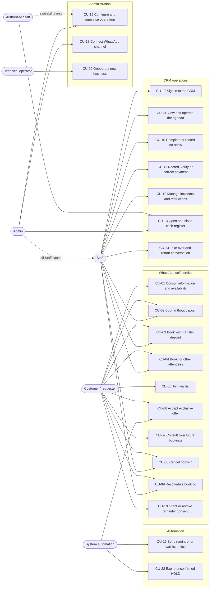
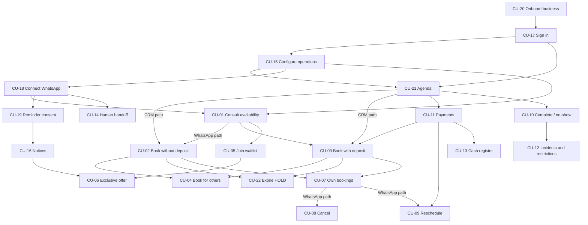

# UC-02 — Prioritized Use Cases and Functional Specifications

> **Status:** In Review
> **Objective:** Specify, case by case, what the MVP must do and under which conditions, and propose an implementation order, building on the actors and flows of UC-01.
> **Scope:** Detailed functional specification of CU-01 to CU-16 and of six proposed cases (CU-17 to CU-22); MVP obligation and proposed implementation priority; functional dependencies; delivery by MVP stage.
> **Out of scope:** Actors, permissions and narrative flows (UC-01, not repeated here); business rules, state transitions and invariants (UC-03, pending); entities and relations (DOM-01, DOM-02); endpoints and contracts (CON-XX); implementation.
> **References:** [UC-01 actors and catalog](../uc-01/actors.md) and [UC-01 flows](../uc-01/flows.md); [MVP definition](../mvp.md) v0.2; [target architecture](../../design-docs/target-architecture.md) v1.1 (proposed, not the implemented [`ARCHITECTURE.md`](../../../ARCHITECTURE.md)); [use case template](../../references/use-case-template.md).

## Confirmed Decisions

- UC-02 **adds no product decisions**. It inherits the [UC-01 Confirmed Decisions](../uc-01/actors.md#confirmed-decisions) and the scope of `mvp.md` v0.2.
- CU-01 to CU-16 keep their UC-01 identifiers and meaning.
- Every case in the catalog is required by `mvp.md` v0.2: a required capability (§5.1) or an acceptance criterion (§12) depends on it ([§3](#3-prioritized-catalog)).

## Open Questions

- **Implementation priority (P0–P2), stage mapping and cut order are proposals** pending team approval ([§3](#3-prioritized-catalog), [§5](#5-delivery-by-mvp-stage)).
- **CU-17 to CU-22 are proposed additions**; their justification and what remains to be agreed is in [§2.1](#21-proposed-cases-cu-17-to-cu-22). The actors of CU-18 and CU-20 are not defined in UC-01.
- Steps marked *(proposal)* are interpretations needed to write a complete flow; they are not agreed behavior.
- Formal business rules, state transitions and invariants belong to **UC-03 (#4), still pending**. Where a case depends on them, it says *pending (UC-03)* and does not anticipate the decision.
- Questions that affect a single case are listed inside that case.

## 1. How to Read This Document

| Document | Owns |
|---|---|
| [actors.md](../uc-01/actors.md) | Actors, channels, the [permissions matrix](../uc-01/actors.md#2-permissions-matrix), the CU-01 to CU-16 catalog and vertical differences. |
| [flows.md](../uc-01/flows.md) | Narrative summary of each case, [shared rules](../uc-01/flows.md#shared-rules-apply-to-all-cases), diagrams and [verification examples](../uc-01/flows.md#cross-cutting-verification-examples). |
| **This document** | Per case: numbered main flow, identified alternatives (`A1`, `A2`…), postconditions and open questions. Across cases: MVP obligation, implementation priority, dependencies and delivery order. |

- Each specification links to its UC-01 summary and diagram instead of copying them. **If this document and UC-01 disagree, UC-01 prevails** and the difference is raised in review.
- State names (`HOLD`, `PENDING_PAYMENT_REVIEW`, `CONFIRMED`, `EXPIRED`, `CANCELLED`, `COMPLETED`, `NO_SHOW`) are the conceptual labels of [flows.md](../uc-01/flows.md#shared-rules-apply-to-all-cases), not persisted enums.
- Markers: *(proposal)* = not agreed; *pending (UC-03)* = to be decided by business rules/invariants; *pending (team)* = product decision not yet assigned to a task.
- Specifications follow §4 of the [use case template](../../references/use-case-template.md).

### 1.1 Priority Columns

| Column | Values | Meaning |
|---|---|---|
| **MVP obligation** | Required · Could · Out of MVP | Required: a capability in `mvp.md` §5.1 and/or an acceptance criterion in §12 depends on it. Could: a sub-feature that UC-01 or `mvp.md` treats as conditional. Out of MVP: [§7](#7-excluded-and-deferred-use-cases). |
| **Implementation priority** *(proposal)* | P0 · P1 · P2 | Order of implementation inside the MVP, independent of obligation. |

| Priority | Criteria |
|---|---|
| **P0** | Foundation that other cases need, or the highest correctness risk (tenant isolation, overlapping occupancy). Without it, nothing else can be demonstrated. |
| **P1** | Delivers the core MVP promise: WhatsApp booking with or without a transfer deposit, CRM operation, payments and reminders. Other P1/P2 cases depend on it. |
| **P2** | Completes the MVP scope, but no other case depends on it. Its data must still be considered from P0 when it affects the model ([§5.1](#51-use-cases-per-stage)). |

## 2. Catalog Overview

### 2.1 Proposed Cases (CU-17 to CU-22)

UC-01 assumes these behaviors (as preconditions or alternatives) but does not catalog them. They are proposed so that every `mvp.md` capability has an owner case. None introduces a new product decision; the parts that do need agreement are listed.

| Case | Gap in UC-01 | Source | Overlap check | Still a proposal |
|---|---|---|---|---|
| [CU-17](#cu-17) Sign in to the CRM | ACT-03/ACT-05 use an "authenticated CRM", but no case covers access or tenant context. | `mvp.md` §5.1 Tenants and identity; §12 #1 | Other CRM cases take it as a precondition; none describes it. | Not revealing whether an account exists (A1). |
| [CU-18](#cu-18) Connect the WhatsApp channel | EXT-02 is mandatory, but no case connects or monitors it. | `mvp.md` §5.1 WhatsApp | CU-15 configures the AI mode, not the connection. | **Actor (Admin)**; rejecting a number already linked to another tenant (A4). |
| [CU-19](#cu-19) Grant or revoke reminder consent | CU-16 requires consent and ACT-01/SYS-01 "manage" it, but no case obtains it. | `mvp.md` §8.3; actors.md §5 | CU-16 consumes consent; CU-05 handles waitlist consent separately. | When consent is asked; recording it from the CRM. |
| [CU-20](#cu-20) Onboard a new business | No case creates a tenant or its first Admin. | `mvp.md` §5.1 Tenants and identity; ACT-06 | CU-15 configures an existing tenant; CU-20 only creates it. | **Actor (technical operator)**; minimum setup to accept bookings. |
| [CU-21](#cu-21) View and operate the agenda | Several CRM cases start "from the agenda", which is not specified. | `mvp.md` §7.1 | CU-15's "today overview" is a summary; CU-21 is the operational schedule. | What is highlighted (A1). |
| [CU-22](#cu-22) Expire an unconfirmed HOLD | Expiry appears as an alternative in CU-02, CU-03 and CU-06. | flows.md CU-02, CU-03; `mvp.md` §6.3.6 | Consolidates those alternatives into one system-initiated case with its own trigger; adds no behavior. | Concurrency details, *pending (UC-03)*. |

### 2.2 General Use Case Diagram

Admin can do everything Staff can (dotted arrow); Authorized Staff hold the delegated privileges of [ACT-04](../uc-01/actors.md#11-human-actors). The AI agent is not drawn: it runs the WhatsApp cases **on behalf of the customer** ([SYS-01](../uc-01/actors.md#12-internal-automated-component)). CU-18 and CU-20 show their proposed actors.

## 3. Prioritized Catalog

All 22 cases are **Required** by `mvp.md` v0.2. The implementation priority is a **proposal**.

| ID | Use case | Primary actor | Channel | MVP obligation (`mvp.md`) | Stage (§11) | Priority *(proposal)* | Why this priority |
|---|---|---|---|---|---|---|---|
| [CU-20](#cu-20) | Onboard a new business | Technical operator *(proposal)*; first Admin | Tooling / CRM | Required — §5.1 Tenants; §12 #1, #2 | 1 | **P0** | First prerequisite of everything. |
| [CU-17](#cu-17) | Sign in to the CRM and work within a business | Staff/Admin | CRM | Required — §5.1 Tenants; §12 #1, #5 | 1 → 2 | **P0** | Tenant context for every CRM case; isolation risk. |
| [CU-15](#cu-15) | Configure and supervise business operations | Admin; Authorized Staff | CRM | Required — §5.1 Permissions, Catalog, Availability; Could — today overview | 1 → 2 | **P0** | Catalog, hours and policies feed every booking. |
| [CU-21](#cu-21) | View and operate the agenda | Staff/Admin | CRM | Required — §7.1; §12 #5 | 2 | **P0** | CRM entry point; proves the core without WhatsApp. |
| [CU-02](#cu-02) | Create a booking without a deposit | Customer; Staff/Admin | WhatsApp / CRM | Required — §5.1 Bookings; §12 #3, #5, #6 | 1 → 2 → 4 | **P0** | Core booking; highest risk (overlapping occupancy). |
| [CU-22](#cu-22) | Expire an unconfirmed HOLD | System | Scheduled job | Required — §6.3.6; §12 #6 | 1 | **P0** | Without it, HOLDs keep slots blocked. |
| [CU-11](#cu-11) | Record, verify or correct a payment | Staff/Admin | CRM | Required — §5.1 Payments; §12 #11 | 3 | **P1** | Needed by CU-03, CU-09, CU-10 and CU-13. |
| [CU-03](#cu-03) | Create a booking with a transfer deposit | Customer; Staff/Admin (CRM booking, verification) | WhatsApp / CRM | Required — §5.1 Holds and deposits; §12 #4 | 3 → 4 | **P1** | Core value; carries the accepted review risk. |
| [CU-10](#cu-10) | Complete a service/rental or record a no-show | Staff/Admin | CRM | Required — §5.1 Bookings; §12 #10 | 3 | **P1** | Daily close of bookings; feeds CU-12. |
| [CU-08](#cu-08) | Cancel a booking | Customer; Staff/Admin | WhatsApp / CRM | Required — §5.1 Bookings; §12 #8 | 2 → 3 → 4 | **P1** | Main source of released slots. |
| [CU-09](#cu-09) | Reschedule a booking | Customer; Staff/Admin | WhatsApp / CRM | Required — §5.1 Bookings; §12 #8 | 2 → 3 → 4 | **P1** | Most complex flow (atomic move, deposits). |
| [CU-18](#cu-18) | Connect and monitor the business WhatsApp channel | Admin *(proposal)* | CRM | Required — §5.1 WhatsApp; §12 #3 | 4 | **P1** | Prerequisite of every WhatsApp case. |
| [CU-01](#cu-01) | Consult business information and availability | Customer | WhatsApp | Required — §5.1 Bookings, AI; §12 #3, #9 | 4 | **P1** | Entry point of self-service. |
| [CU-07](#cu-07) | Consult the requester's future bookings | Customer | WhatsApp | Required — §5.1 Bookings; §12 #7 | 4 | **P1** | Needed for customer cancel/reschedule. |
| [CU-14](#cu-14) | Take over and return a conversation | Staff/Admin | CRM / direct WhatsApp | Required — CRM takeover (§12 #13); Could — direct WhatsApp detection | 4 | **P1** | Safety net when the AI cannot resolve. |
| [CU-19](#cu-19) | Grant or revoke reminder consent | Customer | WhatsApp | Required — §8.3; §12 #12 | 4 | **P1** | CU-16 cannot send without it. |
| [CU-16](#cu-16) | Send a consented reminder or waitlist notice | System | WhatsApp | Required — §5.1 Notifications; §12 #12 | 4 | **P1** (reminder) · **P2** (waitlist notice) | Reminder is core; the waitlist notice follows CU-06. |
| [CU-04](#cu-04) | Create bookings for other attendees | Customer requester; Staff/Admin | WhatsApp / CRM | Required — §5.1 Customers; §12 #7, #10 | 1 (data) → 4 | **P2** | Extends CU-02/CU-03; its data is needed from P0. |
| [CU-12](#cu-12) | Manage customer incidents and restrictions | Staff/Admin | CRM | Required — §5.1 Customers; §12 #10 | 3 | **P2** | Needs no-show history from CU-10. |
| [CU-13](#cu-13) | Open and close the shared cash register | Admin / Authorized Staff | CRM | Required — §5.1 Cash register; §12 #11; Could — automatic opening | 3 | **P2** | No case depends on it (see exception below). |
| [CU-05](#cu-05) | Join a voluntary waitlist | Customer | WhatsApp | Required — §5.1 Waitlist; §12 #9 | 3 → 4 | **P2** | Recovers released slots; nothing depends on it. |
| [CU-06](#cu-06) | Receive and accept an exclusive slot offer | System; Customer responds | WhatsApp | Required — §5.1 Waitlist; §12 #6, #9 | 3 → 4 | **P2** | Feature last; its occupancy must be considered in the model from P0. |

**Exception to watch:** if the team decides that a payment can only be recorded with an open cash session *pending (UC-03)*, CU-13 moves to P1 together with CU-11.

## 4. Functional Dependencies

Two kinds of relation are kept apart: a **prerequisite** (B cannot be performed unless A exists or has happened) and a **triggering event** (an outcome of A starts or continues B at runtime).

### 4.1 Prerequisites

`A → B` means **B requires A**. The graph has no cycles.

| Prerequisite | Why |
|---|---|
| CU-20 → CU-17 → every CRM case | No tenant context or role exists without an onboarded business and an active membership. |
| CU-15 → CU-01, CU-21 | Availability, prices, deposit rules and aliases come from configuration; the AI must not invent them. |
| CU-18 → every WhatsApp case | The tenant of an incoming message comes from the validated channel connection. |
| CU-11 → CU-03, CU-09 | A deposit, or an extra deposit when rescheduling, is confirmed only by the human verification in CU-11. |
| CU-07 → CU-08, CU-09 (WhatsApp) | The customer can act only on bookings the system shows as theirs. From the CRM, the agenda (CU-21) is the entry point. |
| CU-10 → CU-12 | The "Problematic customer" label is derived from recorded own no-shows. |
| CU-19 → CU-16 | A reminder is never sent without recorded, unrevoked consent. |
| CU-05, CU-16 → CU-06 | An offer needs an opted-in waitlist entry and a way to notify it. |

### 4.2 Triggering Events

These are runtime chains, not dependencies. Some of them loop (a released slot becomes an offer, the offer a HOLD, the HOLD may expire and release the slot again); that is expected behavior, not a circular dependency.

| Event | Raised by | Starts or continues |
|---|---|---|
| A slot is actually released | CU-08 (cancellation), CU-09 (old slot), CU-22 (expiry), CU-11 (rejected receipt, see CU-03 A3), CU-15 (lifted block) | CU-06, if an eligible waitlist entry exists |
| A receipt arrives within the HOLD, or is recorded as pending from the CRM | CU-03 step 5; CU-03 CRM step 2b | Review in CU-11 (A1) |
| An offer is created | CU-06 step 2 | Notice in CU-16 |
| An offer is accepted | CU-06 step 4 | CU-02 step 3 or CU-03 step 3 |
| A HOLD deadline is reached | CU-02, CU-03, CU-06 | CU-22 |
| A booking is confirmed or moved | CU-02, CU-03, CU-09 | Reminder scheduling for CU-16; consent request in CU-19 if never asked *(proposal)* |
| No acceptable slot, or a fixed time | CU-01 A2/A3 | CU-05 |
| The AI cannot resolve, a tool fails, or a human is requested | Any WhatsApp case | CU-14 |
| A no-show is recorded or corrected | CU-10 | Label recalculated, visible in CU-12 |

## 5. Delivery by MVP Stage

*Proposal for team approval.*

### 5.1 Use Cases per Stage

Follows `mvp.md` v0.2 §11. A case that spans several stages is listed where each part becomes demonstrable.

| Stage | Use cases (part) | Demonstrable result |
|---|---|---|
| **1. Core booking domain** | CU-20; CU-17 (memberships, roles); CU-15 (catalog and hours as data); CU-02 (conflict-safe booking); CU-22; CU-04 (requester/attendee data) | Two isolated tenants; bookings and HOLDs that cannot overlap; idempotent expiry. |
| **2. Business-facing web** | CU-17 (CRM sign-in); CU-15 (CRM configuration); CU-21; CU-02 (walk-in); CU-08, CU-09 (CRM, without policies) | Staff run the agenda of both verticals manually; the landing links to WhatsApp. |
| **3. Deposits and operations** | CU-03 (review queue, verification, CRM booking with deposit); CU-08, CU-09 (notice, exceptions, deposits); CU-10; CU-11; CU-12; CU-13; CU-05, CU-06 (mechanics) | Transfer review, partial/mixed payments, cash close with difference, no-show label and restrictions, exclusive offers. |
| **4. WhatsApp + AI** | CU-18; CU-01; CU-02, CU-03, CU-04, CU-07, CU-08, CU-09 (WhatsApp); CU-05, CU-06 (conversation); CU-14; CU-16; CU-19 | End-to-end conversational booking with and without deposit, handoff, reminders and waitlist messages. |
| **5. Pilot validation** | All | `mvp.md` §12 acceptance criteria. |

**For DOM-01:** some data belongs to later cases but should be considered in the model from stage 1, to avoid migrating live data: the requester/attendee distinction (CU-04), the restriction field (CU-12), the payment method vs. verification split (CU-11), and occupancy during payment review and exclusive offers (CU-03, CU-06). How that occupancy is represented is *pending (UC-03)*.

### 5.2 Cut Order if the Schedule Slips

Only **sub-features** are listed: dropping a whole case would break an `mvp.md` §12 criterion and requires changing `mvp.md` first. From first to cut to last:

1. CU-14 — detection of direct human replies from the WhatsApp app (explicit CRM takeover stays).
2. CU-13 — automatic cash opening (manual opening stays).
3. CU-15 — the "today overview" (the agenda in CU-21 stays).
4. CU-04 — several attendees in one conversation (one attendee per request stays).
5. CU-06 — retries after a failed waitlist notice (moving to the next requester stays).

## 6. Functional Specifications

Each case links to its UC-01 summary and diagram; what follows adds numbered steps, identified alternatives, postconditions and open questions. Authorization refers to rows of the [permissions matrix](../uc-01/actors.md#2-permissions-matrix).

### CU-01 — Consult Business Information and Availability

**UC-01:** [summary and diagram](../uc-01/flows.md#cu-01) · **Priority:** P1 *(proposal)*

- **Primary actor:** Customer.
- **Participants:** AI agent; availability core.
- **Channel:** WhatsApp.
- **Trigger:** The customer asks about services, prices, hours, a resource or a time.
- **Preconditions:** The message arrives through the tenant's validated connection ([CU-18](#cu-18)); catalog and hours are configured ([CU-15](#cu-15)); the conversation is not under human takeover ([CU-14](#cu-14)).

#### Main Flow
1. The customer writes one or more messages; they are grouped as described in UC-01 before the AI replies.
2. The AI identifies service or resource, day and time, and asks only for missing details.
3. The system queries live availability, in the tenant's timezone, for the named resource or any compatible one.
4. The AI presents the options with price, duration and the applicable conditions, all taken from configuration.
5. The customer selects a concrete slot; the flow continues in [CU-02](#cu-02) or [CU-03](#cu-03). The backend, not the AI, decides whether a deposit applies.

#### Alternatives and Exceptions
- **A1 — Information only:** At step 2, if no availability check is needed (address, hours, prices), the AI answers from configuration and the case ends.
- **A2 — Preferred slot unavailable, flexible customer:** At step 3, the AI proposes alternatives first. If one is accepted, resume at step 5; if the customer rejects them all, the AI offers [CU-05](#cu-05).
- **A3 — Fixed time:** At step 3, if the customer can only make that specific time, the AI offers [CU-05](#cu-05) directly, without proposing alternatives.
- **A4 — No selection:** At step 4, the case ends **without a HOLD**.
- **A5 — Query failure:** At step 3, the AI invents no slots, says so and offers [CU-14](#cu-14).

#### Outcome / Postconditions
- **Success:** Accurate information, or a selected slot passed to booking. A query never occupies a slot.
- **Failure:** Nothing changes.

#### Authorization
- Matrix row "View catalog and availability". Restrictions apply only when booking.

#### Open Questions
- How the resource is assigned when the customer accepts "any compatible one" — *pending (UC-03)*.

---

### CU-02 — Create a Booking Without a Deposit

**UC-01:** [summary](../uc-01/flows.md#cu-02) and [shared diagram](../uc-01/flows.md#booking-deposit-diagram) · **Priority:** P0 *(proposal)*

- **Primary actor:** Customer (WhatsApp), or Staff/Admin on behalf of a customer (CRM).
- **Participants:** AI agent; booking core.
- **Channel:** WhatsApp / CRM.
- **Trigger:** A concrete slot is selected and the backend determines that no deposit is required.
- **Preconditions:** Slot selected in [CU-01](#cu-01) (WhatsApp) or in the agenda [CU-21](#cu-21) (CRM).

#### Main Flow (WhatsApp)
1. The backend validates customer restriction, future-booking limit, booking policy and availability.
2. The system creates the exclusive **10-minute HOLD**.
3. The AI shows the summary (service/resource, attendee, date/time, price, cancellation notice) and asks for explicit confirmation.
4. The customer confirms before the HOLD expires.
5. The booking is confirmed and the customer notified. If reminder consent was never asked, [CU-19](#cu-19) follows *(proposal)*.

#### Alternatives and Exceptions
- **A1 — Concurrent conflict:** At step 2, if the slot was taken by another booking, HOLD or offer, no HOLD is created and the AI returns to CU-01 A2.
- **A2 — No confirmation in time:** At step 4, [CU-22](#cu-22) expires the HOLD.
- **A3 — Customer declines:** At step 4, the HOLD is released at once and [CU-06](#cu-06) may start *(proposal: recorded as a customer cancellation)*.
- **A4 — Full prepayment restriction:** At step 1, the flow switches to [CU-03](#cu-03) with a 100% requirement.
- **A5 — Blocked customer:** At step 1, the booking is declined without revealing the internal label; human contact is offered.
- **A6 — Future-booking limit reached:** At step 1, the booking is declined and the limit explained.
- **A7 — CRM walk-in:** Staff/Admin enter name (required), phone (optional), service, resource, date and time. The same occupancy check runs and the booking is confirmed directly, without a HOLD, with origin CRM. If the backend determines that a deposit is required, the booking follows the [CU-03 CRM flow](#cu-03-crm).
- **A8 — Booking for someone else:** At step 1, see [CU-04](#cu-04).
- **A9 — Outside regular hours (CRM):** Only an Admin, or Staff with the delegated availability privilege ([ACT-04](../uc-01/actors.md#11-human-actors)), may book outside the resource's regular hours, and only if the booking overlaps no occupying booking, HOLD or offer. The booking records who authorized the exception. Other Staff members book only within regular hours. Whether such a booking may fall on an availability block — *pending (UC-03)*.

#### Outcome / Postconditions
- **Success:** A confirmed booking occupies the resource; it is linked to the requester's number (WhatsApp) or customer record (CRM), with its origin.
- **Failure:** No booking, or the HOLD is released and the resource is free.

#### Authorization
- Matrix row "Create bookings for oneself or others": customer within their own context; any Staff/Admin of the tenant in the CRM.
- Matrix row "Book outside regular hours (CRM)": Admin, or Staff with the availability privilege (A9).

#### Open Questions
- Whether Staff can book in the CRM for a `BLOCKED` customer without lifting the restriction — *pending (UC-03)*.

---

### CU-03 — Create a Booking With a Transfer Deposit

**UC-01:** [summary](../uc-01/flows.md#cu-03) and [shared diagram](../uc-01/flows.md#booking-deposit-diagram) · **Priority:** P1 *(proposal)*

- **Primary actor:** Customer (WhatsApp), or Staff/Admin on behalf of a customer (CRM).
- **Participants:** AI agent (WhatsApp); Staff/Admin (verification); business bank/wallet account (EXT-03).
- **Channel:** WhatsApp (customer); CRM (booking on behalf of the customer, verification).
- **Trigger:** The selected slot requires a deposit, by policy or because of a full-prepayment restriction.
- **Preconditions:** Deposit rule and a default receiving alias configured ([CU-15](#cu-15)); eligible requester.

#### Main Flow (WhatsApp)
1. The backend validates as in CU-02 step 1 and computes the required deposit.
2. The system creates the exclusive **10-minute HOLD**.
3. Before any transfer, the AI shows price, deposit, alias and holder, and the cancellation and forfeiture conditions.
4. The customer transfers and sends the receipt **before the HOLD expires**.
5. The receipt is attached as a transfer pending review; the booking moves to `PENDING_PAYMENT_REVIEW`, stays blocked with no review timeout, appears in the CRM review queue, and the customer is told that confirmation follows verification.
6. Staff/Admin check the actual credit in the bank/wallet account ([CU-11](#cu-11)).
7. On approval, the payment is recorded as verified with verifier and time, the booking is confirmed and the customer notified.

#### Main Flow (CRM)

Staff/Admin book on behalf of the customer **without the 10-minute conversational HOLD**.

1. From the agenda ([CU-21](#cu-21)), Staff/Admin enter the booking as in CU-02 A7; the backend validates as in CU-02 step 1 and computes the required deposit.
2. The result depends on what the customer has provided, recorded through [CU-11](#cu-11):
   - **a. Cash received, or a transfer whose credit the employee verified in the account:** the payment is recorded as verified and the booking is confirmed directly.
   - **b. A transfer receipt not yet verified:** the receipt is recorded as pending; the booking enters `PENDING_PAYMENT_REVIEW` and blocks the slot until human review, continuing at step 6 of the WhatsApp flow.
   - **c. No payment and no receipt:** the booking is not confirmed and does not occupy the slot. Only an Admin may authorize the exception and confirm it without the deposit. The booking records that no deposit was paid and the outstanding balance, so the full price is still collected; a reason is optional.
3. The occupancy check runs when the booking is created; the booking has origin CRM.

#### Alternatives and Exceptions
- **A1 — No receipt in time:** At step 4, [CU-22](#cu-22) expires the HOLD.
- **A2 — Receipt after expiry:** At step 4, the booking is not reactivated; the receipt becomes a financial incident (CU-11 A8) and the customer is told the slot was released.
- **A3 — Rejected or not credited:** At step 6, the payment is rejected, the slot released, the customer notified and [CU-06](#cu-06) may start.
- **A4 — Unreadable or non-receipt attachment:** At step 5, the AI asks again; the HOLD deadline does not change *(proposal)*.
- **A5 — Amount below the required deposit:** At step 6, Staff/Admin decide — *pending (UC-03)*.
- **A6 — Full prepayment:** Same flow with 100% of the price.
- **A7 — Customer withdraws:** At steps 3–4, the customer may cancel the HOLD with nothing to forfeit *(proposal)*.
- **A8 — CRM, slot taken:** At CRM step 3, if the booking would overlap an occupying booking, HOLD or offer, nothing is created.
- **A9 — CRM, amount below the required deposit:** At CRM step 2, as in A5 — *pending (UC-03)*.

#### Outcome / Postconditions
- **Success:** A confirmed booking with a verified deposit linked to it or, from the CRM by Admin exception, without it, recording that no deposit was paid and the outstanding balance.
- **Failure:** The slot is released and nothing counts as verified; a late receipt remains as an incident. From the CRM, without payment, receipt or exception, no booking occupies the slot.

#### Authorization
- Matrix row "Verify bank-transfer receipt": Staff/Admin only. The AI never marks a payment as verified.
- Matrix row "Authorize exceptions to commercial policies": Admin only, to confirm a CRM booking without its required deposit (CRM step 2c).

#### Open Questions
- What happens when the start time arrives while still under review, and how to limit abuse of indefinite review (accepted risk, `mvp.md` §9.2) — *pending (UC-03)*.
- Deposit evidence without an image — *pending (UC-03)*.

---

### CU-04 — Create Bookings for Other Attendees

**UC-01:** [summary](../uc-01/flows.md#cu-04) · **Priority:** P2 *(proposal)*

- **Primary actor:** Customer requester (WhatsApp); Staff/Admin (CRM).
- **Participants:** AI agent.
- **Channel:** WhatsApp / CRM.
- **Trigger:** The requester books for friends, family or a team.
- **Preconditions:** Requester identified (sender number or CRM customer record).

#### Main Flow
1. The AI asks for each attendee's name; a phone per attendee is not required.
2. Each attendee/slot becomes a separate booking through [CU-02](#cu-02) or [CU-03](#cu-03), validated on its own.
3. Every booking is linked to the requester, whose number manages them.

#### Alternatives and Exceptions
- **A1 — Sequential appointments:** One booking may fail without cancelling the others; the AI reports which were created.
- **A2 — Combined service:** A preconfigured combination is one service, not two bookings.
- **A3 — Court plus barbecue area:** Separate bookings, with no atomic multi-resource booking; if one fails, the other remains.
- **A4 — The attendee writes from their own number:** The attendee cannot manage the booking (CU-07 A2).

#### Outcome / Postconditions
- **Success:** Bookings carry requester and attendee; the attendee gains no management rights.
- **Failure:** Failed bookings are not created; successful ones remain.

#### Authorization
- Matrix row "Create bookings for oneself or others"; [authorization invariant 1](../uc-01/actors.md#authorization-invariants).

#### Open Questions
- How bookings for third parties count toward the future-booking limit — *pending (UC-03)*.
- Minimum attendee data and how a third party's no-show is counted — *pending (UC-03)*.

---

### CU-05 — Join a Voluntary Waitlist

**UC-01:** [summary](../uc-01/flows.md#cu-05) · **Priority:** P2 *(proposal)*

- **Primary actor:** Customer.
- **Participants:** AI agent.
- **Channel:** WhatsApp.
- **Trigger:** No acceptable availability in CU-01.
- **Preconditions:** Availability checked; alternatives declined or a fixed time required.

#### Main Flow
1. The AI offers alternatives, unless the time is non-negotiable.
2. The AI offers the waitlist and explains that it neither reserves nor guarantees a slot.
3. The customer opts in; the requested conditions, arrival time and a waitlist-specific consent are recorded under the requester and tenant.
4. The AI confirms the registration.

#### Alternatives and Exceptions
- **A1 — Alternative accepted:** At step 1, continue in CU-02/CU-03; no entry is created.
- **A2 — Opt-in declined:** At step 3, nothing is recorded.
- **A3 — Duplicate interest:** At step 3, the existing entry is kept with its original arrival order.
- **A4 — Blocked customer:** At step 2, the waitlist is not offered *(proposal)*.

#### Outcome / Postconditions
- **Success:** A registered interest with consent; no slot is reserved.
- **Failure:** Nothing is recorded.

#### Authorization
- Matrix row "Join waitlist / receive exclusive offer".

#### Open Questions
- Waitlist expiry, queue limits and repeated offers — *pending (UC-03)*.

---

### CU-06 — Receive and Accept an Exclusive Slot Offer

**UC-01:** [summary and diagram](../uc-01/flows.md#cu-06) · **Priority:** P2 *(proposal)*

- **Primary actor:** System (initiates); Customer (responds).
- **Participants:** AI agent; notification job ([CU-16](#cu-16)).
- **Channel:** WhatsApp.
- **Trigger:** A compatible slot is actually released ([§4.2](#42-triggering-events)).
- **Preconditions:** The slot is still free; an eligible opted-in entry exists with valid consent; the channel is enabled.

#### Main Flow
1. The system selects the first eligible entry in arrival order.
2. The system protects the slot with an exclusive **5-minute offer** for that requester.
3. A notice with the expiry time is sent through [CU-16](#cu-16).
4. The customer accepts within 5 minutes.
5. The offer becomes a standard **HOLD of up to 10 minutes**, continuing at CU-02 step 3 or CU-03 step 3.

#### Alternatives and Exceptions
- **A1 — Declined, no reply or expired:** At step 4, the offer ends and the next eligible entry is tried; if none remains, the slot returns to general availability.
- **A2 — No eligible entry:** At step 1, nothing is held.
- **A3 — Notice fails:** At step 3, the offer never blocks the slot indefinitely; the system moves on or releases.
- **A4 — Requester no longer eligible:** At step 1, an entry whose requester became `BLOCKED` or reached the future-booking limit is skipped *(proposal)*.
- **A5 — Accepted but not completed:** After step 5, [CU-22](#cu-22) may expire the HOLD, and this case may start again.

#### Outcome / Postconditions
- **Success:** One protected chance that becomes a HOLD; acceptance is not a confirmation and an offer is never renewed.
- **Failure:** The slot goes to the next requester or back to general availability.

#### Authorization
- System-initiated; the customer acts only on their own offer.

#### Open Questions
- How an offer occupies the slot — *pending (UC-03)*; it affects DOM-01.
- Retries and queue advance after a failed notice — *pending (UC-03)*.

---

### CU-07 — Consult the Requester's Future Bookings

**UC-01:** [summary](../uc-01/flows.md#cu-07) · **Priority:** P1 *(proposal)*

- **Primary actor:** Customer.
- **Participants:** AI agent.
- **Channel:** WhatsApp.
- **Trigger:** The customer asks for upcoming bookings, or wants to cancel or reschedule one.
- **Preconditions:** Tenant and sender number identified.

#### Main Flow
1. The system queries the future, active bookings managed by the sender number in this tenant (held, under payment review or confirmed).
2. The AI lists service/resource, attendee, date/time and payment status.
3. The customer may pick one and continue in [CU-08](#cu-08) or [CU-09](#cu-09).

#### Alternatives and Exceptions
- **A1 — No bookings:** The AI says so without showing anyone else's.
- **A2 — Another number:** Access is refused and the business is suggested.
- **A3 — History:** Past bookings are not part of self-service.

#### Outcome / Postconditions
- **Success:** An authorized, read-only view.
- **Failure:** No data is disclosed.

#### Authorization
- Matrix row "View the requester's future bookings"; [authorization invariant 1](../uc-01/actors.md#authorization-invariants).

---

### CU-08 — Cancel a Booking

**UC-01:** [summary](../uc-01/flows.md#cu-08) and [shared diagram](../uc-01/flows.md#change-booking-diagram) · **Priority:** P1 *(proposal)*

- **Primary actor:** Customer (WhatsApp); Staff/Admin (CRM).
- **Participants:** AI agent; Admin (exceptions).
- **Channel:** WhatsApp / CRM.
- **Trigger:** A cancellation is requested.
- **Preconditions:** An active booking (held, under payment review or confirmed) *(proposal: which of these can be cancelled is pending (UC-03))*.

#### Main Flow (WhatsApp)
1. The AI resolves the booking among those managed by the sender number ([CU-07](#cu-07)).
2. The backend checks ownership and minimum notice, including service/resource overrides.
3. If a verified deposit exists, the AI warns that it will be forfeited and offers [CU-09](#cu-09).
4. The customer explicitly confirms.
5. The booking is cancelled, the slot released, its reminders voided, the customer notified, and [CU-06](#cu-06) may start.

#### Alternatives and Exceptions
- **A1 — Outside the notice window:** At step 2, the AI declines and explains; only an Admin can approve an audited exception from the CRM.
- **A2 — Different number:** At step 1, refused and referred to the business.
- **A3 — Customer does not confirm:** At step 4, the booking is unchanged or the customer chooses CU-09.
- **A4 — HOLD not yet paid:** At step 3, there is nothing to forfeit.
- **A5 — CRM, at the customer's request:** Staff/Admin cancel within policy; outside it, only an Admin authorizes (`mvp.md` §6.3.9).
- **A6 — Business-caused cancellation:** The deposit is not forfeited automatically; any refund is handled manually by an Admin in [CU-11](#cu-11) and the customer is notified.

#### Outcome / Postconditions
- **Success:** An authorized, confirmed cancellation; the slot is released.
- **Failure:** The booking is unchanged.

#### Authorization
- Matrix rows "Cancel or reschedule a booking" and "Authorize exceptions to commercial policies".

#### Open Questions
- How a forfeited deposit appears in cash; legally required refunds — *pending (UC-03)*.
- Whether a booking under payment review can be cancelled by the customer, and what happens to the receipt — *pending (UC-03)*.

---

### CU-09 — Reschedule a Booking

**UC-01:** [summary](../uc-01/flows.md#cu-09) and [shared diagram](../uc-01/flows.md#change-booking-diagram) · **Priority:** P1 *(proposal)*

- **Primary actor:** Customer (WhatsApp); Staff/Admin (CRM).
- **Participants:** AI agent; Staff/Admin (extra deposit verification); Admin (exceptions).
- **Channel:** WhatsApp / CRM.
- **Trigger:** A change of date/time, service or resource is requested.
- **Preconditions:** A confirmed booking, managed by the requester (WhatsApp) or by tenant personnel (CRM).

#### Main Flow
1. The backend checks ownership, notice window and reschedule limit (unlimited by default).
2. The candidate slot is checked without releasing the current one.
3. Verified payments are kept; the new price, balance and any additional deposit are computed.
4. If more deposit is required, it is transferred and verified by Staff/Admin ([CU-11](#cu-11)) before the change.
5. The customer explicitly confirms the new conditions.
6. The booking moves to the new slot and the old one is released in one step; reminders are rescheduled, the customer notified, and [CU-06](#cu-06) may start for the old slot.

#### Alternatives and Exceptions
- **A1 — Outside the notice window or over the limit:** At step 1, declined; only an Admin can approve a documented exception.
- **A2 — Candidate slot unavailable:** At step 2, alternatives are offered; the original booking stays intact.
- **A3 — Extra deposit rejected or still pending:** At step 4, the original booking stays intact and the change is not applied.
- **A4 — Lower deposit or price:** At step 3, verified funds reduce the balance; nothing is refunded automatically.
- **A5 — Paid more than the new total:** At step 3, resolved manually by an Admin.
- **A6 — Declined confirmation or concurrent conflict:** At steps 5–6, the original booking stays intact.

#### Outcome / Postconditions
- **Success:** New conditions, an accurate balance and preserved payments.
- **Failure:** The original booking is unchanged.

#### Authorization
- Matrix rows "Cancel or reschedule a booking" and "Authorize exceptions to commercial policies".

#### Open Questions
- Whether the same booking is modified or replaced by a linked one — *pending (UC-03)*; it affects DOM-01.
- Whether the target slot is protected while an extra deposit is under review — *pending (UC-03)*.

---

### CU-10 — Complete a Service/Rental or Record a No-Show

**UC-01:** [summary and diagram](../uc-01/flows.md#cu-10) · **Priority:** P1 *(proposal)*

- **Primary actor:** Staff/Admin.
- **Channel:** CRM.
- **Trigger:** After the booked time, personnel record what happened.
- **Preconditions:** A confirmed booking of the tenant *(proposal: only after its start time; pending (UC-03))*.

#### Main Flow
1. From the agenda ([CU-21](#cu-21)), the employee picks a quick action: complete, complete and collect (amount prefilled), complete with balance due, or record no-show.
2. For a no-show, the employee identifies who was absent when the attendee differs from the requester.
3. The balance stays independent; "complete and collect" records the payment through [CU-11](#cu-11).
4. The responsible employee and time are recorded.

#### Alternatives and Exceptions
- **A1 — Completed but unpaid or partly paid:** The debt is kept and visible.
- **A2 — A third-party attendee was absent:** Recorded as a managed-third-party incident, not as the requester's own no-show.
- **A3 — Erroneous no-show:** Corrected to completed with audit; the count is recalculated.
- **A4 — Valid cancellation or expired HOLD:** Never recorded as a no-show.

#### Outcome / Postconditions
- **Success:** A human-attested outcome; time passing never completes a booking or proves payment.
- **Failure:** The booking stays confirmed and pending operational close.

#### Authorization
- Matrix rows "Record service/rental completion" and "Record or correct `NO_SHOW`".

#### Open Questions
- Whether a completed booking can be corrected to a no-show — *pending (UC-03)*.
- Whether completed/no-show bookings keep occupying the rest of the slot — *pending (UC-03)*.

---

### CU-11 — Record, Verify or Correct a Payment

**UC-01:** [summary](../uc-01/flows.md#cu-11) · **Priority:** P1 *(proposal)*

- **Primary actor:** Staff/Admin.
- **Participants:** Customer (may send evidence by WhatsApp); business bank/wallet account.
- **Channel:** CRM.
- **Trigger:** A receipt to review, a payment to collect, or a correction.
- **Preconditions:** A booking with a charge in the tenant.

#### Main Flow
1. The employee reviews price, verified payments and amount due.
2. The employee records a cash or transfer payment, including partial and mixed methods.
3. For a transfer, the employee verifies the credit in the bank/wallet account; for cash, confirms physical receipt. Amount, method, date/time and employee are recorded.
4. The balance is updated without counting the deposit twice; optionally, the booking is completed through [CU-10](#cu-10).

#### Alternatives and Exceptions
- **A1 — Pending receipt:** The pending transfer from CU-03 step 5 (WhatsApp) or CRM step 2b is verified (CU-03 step 7) or rejected (CU-03 A3).
- **A2 — Payment without an image:** Cash or a bank-verified transfer can be recorded with no attachment.
- **A3 — Correction during an open cash session:** Corrected with audit; nothing is deleted silently.
- **A4 — Correction after the cash close:** Only an Admin records a new audited adjustment; the closed session is not rewritten.
- **A5 — Change to an agreed price:** Admin only, with a reason, and customer acceptance if it increases.
- **A6 — Refund:** An Admin records a manual refund; no automated bank refunds.
- **A7 — Overpayment:** Resolved manually by an Admin.
- **A8 — Late or unmatched transfer:** Recorded as a financial incident linked to the customer or booking when identifiable; never reconfirms a booking.
- **A9 — Repeated submission:** A retry of the same operation is not counted twice. Two separate manual entries that may be the same money are kept and flagged for human review *(proposal)*.

#### Outcome / Postconditions
- **Success:** Money collected and remaining debt are traceable to an employee, method and time.
- **Failure:** The balance does not change.

#### Authorization
- Matrix rows "Verify bank-transfer receipt", "Record partial or mixed-method payment", "Correct payment while its cash session is open" and "Adjust a transaction after cash close".

#### Open Questions
- Whether recording a payment requires an open cash session, and how late-verified transfers enter cash — *pending (UC-03)*.
- Final resolution of late or unmatched transfers — *pending (UC-03)*.

---

### CU-12 — Manage Customer Incidents and Individual Restrictions

**UC-01:** [summary](../uc-01/flows.md#cu-12) · **Priority:** P2 *(proposal)*

- **Primary actor:** Staff/Admin.
- **Channel:** CRM.
- **Trigger:** Personnel review absences, or apply or remove a restriction.
- **Preconditions:** The customer belongs to the tenant.

#### Main Flow
1. The CRM shows own no-shows separately from incidents in bookings managed for other attendees.
2. From two own no-shows, the CRM shows the internal "Problematic customer" label with reason and count.
3. The employee chooses: continue normally, require 100% advance payment, or block new bookings; actor and reason are recorded.
4. The backend enforces the restriction and the AI applies it without disclosing the label. Whether Staff can still book a blocked customer in the CRM is *pending (UC-03)*.

#### Alternatives and Exceptions
- **A1 — No decision:** No automatic sanction; the label restricts nothing.
- **A2 — Corrected absence:** The count is recalculated with audit; the label may disappear.
- **A3 — Removing a restriction:** Staff/Admin remove it with a reason.
- **A4 — Same name, different person:** Customers are never merged by name.

#### Outcome / Postconditions
- **Success:** A tenant-specific, manually decided measure with an audit trail.
- **Failure:** The restriction is unchanged.

#### Authorization
- Matrix row "Apply/remove an individual customer restriction"; the general restriction policy is Admin-only.

#### Open Questions
- How third-party incidents are aggregated — *pending (UC-03)*.

---

### CU-13 — Open and Close the Shared Cash Register

**UC-01:** [summary and diagram](../uc-01/flows.md#cu-13) · **Priority:** P2 *(proposal)*

- **Primary actor:** Admin, or Staff with the cash privilege.
- **Participants:** Staff (payments and cash movements during the session).
- **Channel:** CRM.
- **Trigger:** Start or end of a cash session.
- **Preconditions:** One logical register per tenant; the actor holds the privilege.

#### Main Flow
1. The session opens manually, with declared opening cash, or automatically, carrying the cash declared at the previous close.
2. During the session, booking payments and cash-in/cash-out movements with a reason are recorded; transfers stay apart from physical cash.
3. An authorized person requests the manual close and reviews expected cash and non-cash totals.
4. The person counts the cash; counted amount and difference are recorded.
5. The close is confirmed with responsible person, period, time and totals, and becomes immutable.

#### Alternatives and Exceptions
- **A1 — Difference:** The close is allowed and the difference recorded.
- **A2 — Unpaid bookings:** They do not block the close; money not received is never counted.
- **A3 — Post-close adjustment:** Admin only, as a new audited entry ([CU-11](#cu-11) A4).
- **A4 — Unauthorized employee:** Opening or closing is refused; recording payments is still allowed.

#### Outcome / Postconditions
- **Success:** Shared cash history with individual accountability.
- **Failure:** The session stays open *(proposal: no partial close is stored)*.

#### Authorization
- Matrix rows "Open or close the cash register" and "Register cash-in/cash-out with a reason".

#### Open Questions
- Session boundaries and day changes — *pending (UC-03)*.

---

### CU-14 — Take Over and Return a WhatsApp Conversation

**UC-01:** [summary and diagram](../uc-01/flows.md#cu-14) · **Priority:** P1 *(proposal)*

- **Primary actor:** Staff/Admin.
- **Participants:** AI agent; customer.
- **Channel:** CRM shared inbox; direct business WhatsApp.
- **Trigger:** The customer asks for a human, the AI cannot resolve, or an employee decides to take over.
- **Preconditions:** The conversation belongs to the tenant.

#### Main Flow
1. The escalation enters the shared CRM inbox with history and a summary.
2. An employee takes the conversation; the AI pauses only in it.
3. The employee replies from the CRM, or from the business WhatsApp app where direct replies can be detected.
4. The AI resumes on manual handback or after 60 minutes without a human reply, only if global AI is enabled.

#### Alternatives and Exceptions
- **A1 — Human keeps replying:** Each human reply restarts the 60 minutes.
- **A2 — Global AI disabled:** Messages wait for humans.
- **A3 — Direct reply not detected:** Explicit CRM takeover is the reliable fallback; bot messages never count as human replies.
- **A4 — Payment under review when the AI resumes:** The AI never verifies or approves it.
- **A5 — Messaging outage:** CRM operations continue.

#### Outcome / Postconditions
- **Success:** Handoff without overlapping answers.
- **Failure:** If the takeover cannot be recorded, the AI stays active and the employee is warned *(proposal)*.

#### Authorization
- Matrix rows "Take over / hand back an individual conversation" and "Change global AI mode".

---

### CU-15 — Configure and Supervise Business Operations

**UC-01:** [summary](../uc-01/flows.md#cu-15) · **Priority:** P0 *(proposal)*

- **Primary actor:** Admin; Staff with the availability privilege (operational hours and blocks only).
- **Channel:** CRM.
- **Trigger:** A configuration change, or the daily overview.
- **Preconditions:** Signed in to the tenant ([CU-17](#cu-17)) with the right role or privilege.

#### Main Flow
1. The Admin configures the items listed in UC-01 (catalog, compatible resources, prices, hours, deposit rules and aliases, notice periods, limits, personnel and privileges, global AI).
2. Staff with the delegated privilege change operational hours and availability blocks only; the same privilege allows booking outside regular hours ([CU-02](#cu-02) A9).
3. The CRM shows the "today overview" with links to the agenda ([CU-21](#cu-21)) and cash ([CU-13](#cu-13)).

#### Alternatives and Exceptions
- **A1 — Unauthorized setting:** Rejected.
- **A2 — Price change on an agreed booking:** Admin only, with a reason, and customer acceptance if it increases.
- **A3 — Availability change that conflicts with confirmed bookings:** Confirmed bookings are preserved; the detailed policy is deferred in UC-01.
- **A4 — Disabling a member:** Historical attribution is preserved.
- **A5 — Lifting a block:** May release slots ([§4.2](#42-triggering-events)).

#### Outcome / Postconditions
- **Success:** Authorized configuration and an operational overview.
- **Failure:** The configuration is unchanged.

#### Authorization
- Matrix rows "Configure catalog, prices, deposits, commercial policies", "Adjust operational schedules / availability blocks", "Manage staff, aliases, and permissions" and "Change global AI mode".

---

### CU-16 — Send an Authorized Reminder or Waitlist Notice

**UC-01:** [summary](../uc-01/flows.md#cu-16) · **Priority:** P1 reminder, P2 waitlist notice *(proposal)*

- **Primary actor:** System automation.
- **Participants:** Customer; WhatsApp/Evolution.
- **Channel:** WhatsApp.
- **Trigger:** A reminder is due, or an offer was created ([CU-06](#cu-06)).
- **Preconditions:** An active booking or offer; timing in the tenant's timezone; valid consent of the right type ([CU-19](#cu-19) or [CU-05](#cu-05)).

#### Main Flow
1. Before sending, the job re-checks that the booking is still confirmed for the same slot (or the offer still active), consent is unrevoked, the channel enabled and a phone present.
2. The job sends the reminder or the offer notice.
3. The job records the attempt and its result.

#### Alternatives and Exceptions
- **A1 — No consent, or revoked:** Nothing is sent.
- **A2 — Booking cancelled, expired or moved:** No reminder for the old slot.
- **A3 — Delivery failure:** Recorded and retried within limits; booking and payments do not change, and an offer is not blocked indefinitely.
- **A4 — Job runs late:** It never modifies a confirmed booking.

#### Outcome / Postconditions
- **Success:** At most one logical reminder per booking slot, with its attempts recorded. WhatsApp delivery itself is not guaranteed exactly once.
- **Failure:** Nothing is sent; the reason is recorded.

#### Authorization
- System-initiated, within the consent recorded by the customer.

#### Open Questions
- Retry policy for failed notices — *pending (UC-03)*.

---

### CU-17 — Sign In to the CRM and Work Within a Business

**Proposed case** ([§2.1](#21-proposed-cases-cu-17-to-cu-22)) · **Priority:** P0 *(proposal)*

- **Primary actor:** Staff/Admin.
- **Channel:** CRM.
- **Trigger:** An employee opens the CRM.
- **Preconditions:** A user account with at least one active membership ([CU-15](#cu-15) or [CU-20](#cu-20)).

#### Main Flow
1. The employee authenticates.
2. The system resolves the user's active memberships; with several, the employee selects the business.
3. The system establishes a validated tenant context with that membership's role and privileges.
4. The CRM offers only the actions the role allows.

#### Alternatives and Exceptions
- **A1 — Invalid credentials:** Access is denied without revealing whether the account exists *(proposal)*.
- **A2 — Disabled or missing membership:** Access to that business is denied.
- **A3 — Business selected by URL or subdomain without a membership:** Denied; selecting a business is not authorization ([target architecture §8.2](../../design-docs/target-architecture.md#82-tenant-boundary-and-authentication)).
- **A4 — Switching business:** A new tenant context; nothing from the previous one remains visible.
- **A5 — Session expired:** The employee authenticates again.

#### Outcome / Postconditions
- **Success:** A session scoped to one tenant and one role.
- **Failure:** No tenant data is shown.

#### Open Questions
- Authentication method and account recovery — CON-XX, not this document.

---

### CU-18 — Connect and Monitor the Business WhatsApp Channel

**Proposed case** ([§2.1](#21-proposed-cases-cu-17-to-cu-22)) · **Priority:** P1 *(proposal)*

- **Primary actor:** Admin *(proposal; UC-01 does not name the actor)*.
- **Participants:** Evolution API + Baileys (EXT-02); technical operator (technical support only).
- **Channel:** CRM.
- **Trigger:** First setup, reconnection or an incident.
- **Preconditions:** The installation has a working Evolution API service.

#### Main Flow
1. The Admin requests the connection from the CRM.
2. The system creates or reuses the tenant's channel connection and shows a QR code.
3. The Admin scans it with the business phone.
4. The connection is recorded as the tenant's validated channel; incoming messages are attributed to this tenant.
5. The CRM shows the connection status.

#### Alternatives and Exceptions
- **A1 — QR expired:** A new one is generated.
- **A2 — Disconnection:** The status shows it; customer self-service is unavailable while the CRM and core keep working.
- **A3 — Channel disabled during an incident:** No proactive messages are sent and the AI stops replying.
- **A4 — Number already linked to another tenant:** Rejected *(proposal)*.

#### Outcome / Postconditions
- **Success:** One validated connection per tenant, with visible status.
- **Failure:** No connection; WhatsApp cases are unavailable.

#### Open Questions
- Who connects the channel: Admin, technical operator or both — *pending (team)*.

---

### CU-19 — Grant or Revoke Reminder Consent

**Proposed case** ([§2.1](#21-proposed-cases-cu-17-to-cu-22)) · **Priority:** P1 *(proposal)*

- **Primary actor:** Customer.
- **Participants:** AI agent.
- **Channel:** WhatsApp.
- **Trigger:** A booking was confirmed and consent was never asked *(proposal)*; or the customer asks to stop reminders.
- **Preconditions:** Requester identified in the tenant.

#### Main Flow
1. The AI asks whether the customer wants a reminder; consent is never presumed.
2. The customer answers.
3. The decision is recorded with time and channel, for that requester in that tenant.
4. If the customer later asks to stop, the revocation is recorded and pending reminders are not sent.

#### Alternatives and Exceptions
- **A1 — No answer:** Treated as no consent.
- **A2 — Phone known but no consent:** No reminders; having a number is not consent.
- **A3 — Waitlist notices:** They use the separate consent of [CU-05](#cu-05).
- **A4 — Consent stated in person:** Staff record it in the CRM *(proposal)*.

#### Outcome / Postconditions
- **Success:** An auditable, revocable consent state.
- **Failure:** No reminders are sent.

#### Open Questions
- Whether consent is per customer or per booking, and the exact moment it is asked — *pending (UC-03)*.

---

### CU-20 — Onboard a New Business

**Proposed case** ([§2.1](#21-proposed-cases-cu-17-to-cu-22)) · **Priority:** P0 *(proposal)*

- **Primary actor:** Technical operator (ACT-06) *(proposal)*; then the first Admin.
- **Channel:** Operational tooling (a script or seed is enough in the MVP *(proposal)*), then the CRM.
- **Trigger:** A new business joins an installation, shared or dedicated.
- **Preconditions:** The installation is running.

#### Main Flow
1. The operator creates the tenant with name, unique identifier and timezone.
2. The operator creates the first Admin's account and membership.
3. The first Admin signs in ([CU-17](#cu-17)), configures the business ([CU-15](#cu-15)) and connects WhatsApp ([CU-18](#cu-18)).
4. The tenant accepts bookings once it has at least one service, one compatible resource and business hours *(proposal)*.

#### Alternatives and Exceptions
- **A1 — Identifier already in use:** Rejected.
- **A2 — Dedicated installation:** Same flow, with a single tenant.
- **A3 — After onboarding:** The operator keeps no business authorization over bookings, customers or payments ([ACT-06](../uc-01/actors.md#11-human-actors)).

#### Outcome / Postconditions
- **Success:** An isolated tenant with its first Admin.
- **Failure:** Nothing is created.

#### Open Questions
- Who onboards a business, and whether the operator's role ends after creating the first Admin — *pending (team)*. Self-signup and SaaS billing are out of the MVP (`mvp.md` §5.3).

---

### CU-21 — View and Operate the Agenda

**Proposed case** ([§2.1](#21-proposed-cases-cu-17-to-cu-22)) · **Priority:** P0 *(proposal)*

- **Primary actor:** Staff/Admin.
- **Channel:** CRM (mobile-first).
- **Trigger:** An employee opens the agenda.
- **Preconditions:** Signed in to the tenant ([CU-17](#cu-17)).

#### Main Flow
1. The employee selects a day or week and one or more resources.
2. The system shows bookings with their state, requester and attendee, balance, and availability blocks.
3. From a booking or a free slot, the employee starts [CU-02](#cu-02) (walk-in), [CU-03](#cu-03-crm) (with a deposit), [CU-08](#cu-08), [CU-09](#cu-09), [CU-10](#cu-10) or [CU-11](#cu-11).

#### Alternatives and Exceptions
- **A1 — Highlights:** Bookings pending operational close and pending payment reviews are highlighted *(proposal)*.
- **A2 — Vertical-specific view:** A court grid or a calendar by professional over the same booking data ([vertical differences](../uc-01/actors.md#4-differences-between-the-two-mvp-verticals)).
- **A3 — WhatsApp disconnected:** The agenda works the same.

#### Outcome / Postconditions
- **Success:** A tenant-scoped view of the full schedule.

#### Authorization
- Matrix row "View the business's full schedule".

---

### CU-22 — Expire an Unconfirmed HOLD

**Proposed case** ([§2.1](#21-proposed-cases-cu-17-to-cu-22)): consolidates the expiry alternatives of CU-02, CU-03 and CU-06 · **Priority:** P0 *(proposal)*

- **Primary actor:** System (scheduled job).
- **Channel:** Internal; the customer may be notified by WhatsApp.
- **Trigger:** A HOLD's deadline is reached.
- **Preconditions:** A booking was created as a HOLD ([CU-02](#cu-02), [CU-03](#cu-03), or after [CU-06](#cu-06)).

#### Main Flow
1. At the deadline, the job checks the current state of the booking.
2. If it is still a HOLD with no confirmation and no receipt, it becomes `EXPIRED` and the slot is released.
3. The customer is notified, best effort.
4. [CU-06](#cu-06) may start for the released slot.

#### Alternatives and Exceptions
- **A1 — Already confirmed, under review or cancelled:** The job does nothing.
- **A2 — Job lost or delayed:** The HOLD must still expire later; it never occupies a slot indefinitely (`mvp.md` §6.3.14).
- **A3 — Receipt or confirmation at the same moment:** Only one outcome may win — *pending (UC-03)*.

#### Outcome / Postconditions
- **Success:** The slot is free and the booking is `EXPIRED`, which is never a no-show.

#### Authorization
- System-initiated; no human or AI action.

## 7. Excluded and Deferred Use Cases

| ID | Use case | Status | Source |
|---|---|---|---|
| X-01 | Book, cancel or reschedule from the public landing page | **Out of MVP.** The landing is informational. | `mvp.md` §5.3; [UC-01 Confirmed Decisions](../uc-01/actors.md#confirmed-decisions) |
| X-02 | Automatic deposit confirmation through Mercado Pago | **Out of MVP.** Future adapter. | `mvp.md` §5.3; actors.md EXT-05 |
| X-03 | Sell bar/shop products; inventory; POS | **Out of MVP.** | `mvp.md` §5.3 |
| X-04 | Book several resources atomically (court + barbecue area) | **Out of MVP.** | `mvp.md` §5.3; actors.md §4 |
| X-05 | Recurring bookings, memberships, group capacity | **Out of MVP.** | `mvp.md` §5.3 |
| X-06 | Google Calendar sync, ecommerce/CRM integrations, public third-party booking API | **Deferred.** | `mvp.md` §5.3; actors.md EXT-06 |
| X-07 | Voice notes and group chats with the AI | **Out of MVP.** | `mvp.md` §5.3 |
| X-08 | Self-service history of past bookings | **Out of MVP.** | flows.md CU-07 |
| X-09 | Automated bank refunds | **Out of MVP.** Refunds are manual (CU-11 A6). | `mvp.md` §5.3 |
| X-10 | Export or migrate a tenant between installations | **Deferred.** | `mvp.md` §6.2 |
| X-11 | Business self-signup and SaaS billing | **Out of MVP.** | `mvp.md` §5.3 |

**Note on the UC-02 issue:** its scope mentions "reservas públicas". Public booking is excluded (X-01); public **information** is covered by the landing and by CU-01 over WhatsApp.

## 8. UC-02 Acceptance Checklist

- [x] Main use cases identified (CU-01 to CU-22) and excluded ones listed (§7).
- [x] Each case has a primary actor and channel consistent with UC-01; proposed actors are marked.
- [x] Main flows documented with numbered steps.
- [x] Relevant alternatives and exceptions documented, with where each occurs.
- [x] MVP obligation and proposed implementation priority for every case (§3, §5).
- [x] Prerequisites and triggering events identified separately (§4).
- [x] Nothing pending in UC-01 or UC-03 is presented as confirmed.
- [ ] Reviewed and approved by the team.
