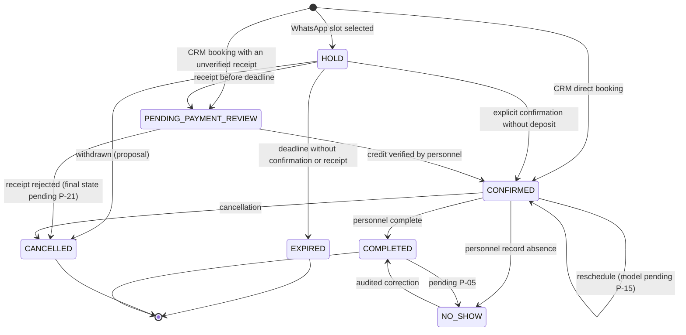
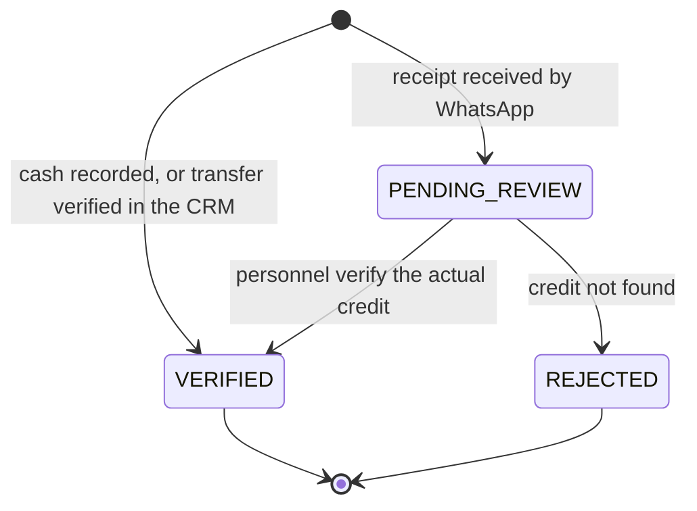

# UC-03 — Domain Invariants

> **Status:** In Review
> **Objective:** State what the system must guarantee **always**, regardless of channel, event order, retries or partial failures, with examples that can become tests.
> **Complements:** [business-rules.md](./business-rules.md) (rules `BR-*` and pending decisions `P-NN`) and [UC-02 use cases](../uc-02/use-cases.md) (`CU-XX`).
> **References:** [UC-01 actors](../uc-01/actors.md) and [UC-01 flows](../uc-01/flows.md); [MVP definition](../mvp.md) v0.2 §6.3; [target architecture](../../design-docs/target-architecture.md) v1.1 §9, §10, §13 (proposed direction, not the implemented [`ARCHITECTURE.md`](../../../ARCHITECTURE.md)).

## 0. What an Invariant Is Here

A condition that **must always hold**. If an operation would break it, the operation fails and nothing changes.

Each invariant states **where it is guaranteed**:

| Tag | Meaning |
|---|---|
| `DB` | PostgreSQL constraint (unique, foreign key, exclusion). Holds even if application code is wrong. |
| `TX` | Checked inside the use case's transaction, against current state. |
| `UC` | Validation of the use case (authorization, policy). |
| `JOB` | Idempotent, state-aware `pg-boss` job. |

When the concrete mechanism depends on a decision that is still open, the invariant states the guarantee, names the pending decision and does not commit to a mechanism. All such cases are listed in [§14](#14-invariants-that-depend-on-pending-decisions).

Examples `EJ-NN` follow *Given / When / Then* and are written to become tests (ARQ §13). Money amounts are illustrative. Example numbers are stable for review; EJ-48 and EJ-49 were added later and sit in §5 and §4.

## 1. Tenant Isolation

| ID | Invariant | Where | Origin |
|---|---|---|---|
| INV-TEN-01 | Every operational record has a non-null tenant. Only the personnel `User` is global, linked through memberships. | DB | BR-TEN-01, BR-IAM-01 |
| INV-TEN-02 | A reference between operational records always points to a record **of the same tenant** (for example, a composite key `(tenant, resource)`). | DB | BR-TEN-03; ARQ §8.2 |
| INV-TEN-03 | No operational read or write runs without a **validated** tenant context (membership or validated channel connection). | UC | BR-TEN-02 |
| INV-TEN-04 | Jobs, conversations, messages, receipts, cash sessions and audit records also carry their tenant; a job never acts on another tenant's data. | DB + JOB | BR-TEN-01; ARQ §8.2 |

**EJ-01 · Tampered ID.** Given a Staff member of tenant A and a booking of tenant B, when they request that booking by its ID, then they get `not_found` (not `forbidden`, so its existence is not confirmed) and no data leaks.

**EJ-02 · Cross reference.** Given a service of A and a resource of B, when a booking combining them is inserted, then the database rejects it even if the use-case validation was skipped.

**EJ-03 · Same number, two tenants.** Given the same number as a customer in A (2 own no-shows, `BLOCKED`) and in B (no history), when it writes to B's WhatsApp, then B treats it as a customer without no-shows or restrictions.

## 2. Booking Lifecycle

The diagram shows confirmed transitions and, labeled as such, proposed and pending ones. The status of each transition is in §2.1–§2.3.

### 2.1 Allowed Transitions

**Status:** *Confirmed* = stated in UC-01 or `mvp.md` v0.2; *Proposal* = UC-03 interpretation awaiting approval; *Pending* = depends on an open `P-NN`.

| Transition | Customer (WhatsApp, via the AI) | Staff | Admin | System (job) | Condition | Status |
|---|---|---|---|---|---|---|
| ∅ → `HOLD` | Yes | No | No | No (an accepted offer creates the HOLD for the customer) | Concrete slot, eligible requester, slot free. | Confirmed (MVP §6.3.3); the CRM never creates a HOLD (BR-SEN-09) |
| ∅ → `CONFIRMED` | No | Yes | Yes, also without the required deposit (records that no deposit was paid and the outstanding balance) | No | CRM booking; slot free; deposit, if required, verified (BR-SEN-09); outside regular hours only Admin or Staff with the availability privilege (BR-DISP-06). | Confirmed (MVP §5.2; UC-01 Confirmed Decisions); `BLOCKED` customers Pending P-16; Admin exception for `FULL_PREPAYMENT` Pending P-17 |
| ∅ → `PENDING_PAYMENT_REVIEW` | No | Yes | Yes | No | CRM booking with a transfer receipt not yet verified; slot free. | Confirmed (UC-01 Confirmed Decisions; BR-SEN-09) |
| `HOLD` → `CONFIRMED` (no deposit) | Yes, explicit confirmation | Proposal | Proposal | No | No deposit required; HOLD still valid. | Confirmed for the customer (MVP §6.3.4); Proposal for personnel |
| `HOLD` → `CONFIRMED` (deposit verified directly) | No | Proposal | Proposal | No | Required amount verified by personnel while the HOLD is valid (e.g., paid at the counter). | Proposal |
| `HOLD` → `PENDING_PAYMENT_REVIEW` | Yes, by sending the receipt | — | — | No | Receipt registered **before** the deadline. | Confirmed (MVP §6.3.5) |
| `HOLD` → `EXPIRED` | No | No | No | **Yes** | Deadline reached and still `HOLD`. | Confirmed (MVP §6.3.6) |
| `HOLD` → `CANCELLED` | Yes | Yes | Yes | No | Withdrawn before confirmation. | Proposal (UC-01 does not cover withdrawing a HOLD) |
| `PENDING_PAYMENT_REVIEW` → `CONFIRMED` | No | Yes | Yes | **No** | Actual credit verified (amount: P-27). | Confirmed (MVP §6.3.5) |
| `PENDING_PAYMENT_REVIEW` → released (rejection) | No | Yes | Yes | **No** | Credit not found; the slot is released. | Confirmed that it releases (MVP §6.3.6); final state Pending P-21 |
| `CONFIRMED` → `CONFIRMED` (reschedule) | Yes, within policy | Yes, within policy | Yes, also out of policy with a reason | No | New slot available; extra deposit verified (BR-CAN-10). | Confirmed (MVP §6.3.9, §6.3.10); model Pending P-15 |
| `CONFIRMED` → `CANCELLED` | Yes, within policy, after the deposit warning | Yes, within policy | Yes, also out of policy with a reason | No | Explicit confirmation from the customer. | Confirmed (MVP §6.3.9) |
| `CONFIRMED` → `COMPLETED` | No | Yes | Yes | **No** | Recorded by personnel. | Confirmed (MVP §6.3.11); timing Pending P-06 |
| `CONFIRMED` → `NO_SHOW` | No | Yes | Yes | **No** | Absent person identified. | Confirmed (MVP §6.3.11); timing Pending P-06 |
| `NO_SHOW` → `COMPLETED` | No | Yes | Yes | No | Audited correction. | Confirmed (actors.md §2) |

### 2.2 Pending Transitions

These are **neither allowed nor forbidden** until their decision is taken. They are not implemented meanwhile.

| Transition or question | Decision |
|---|---|
| `COMPLETED` → `NO_SHOW` (correcting a completion) | P-05 |
| From which moment `COMPLETED` / `NO_SHOW` can be recorded | P-06 |
| ∅ → `CONFIRMED` for a `BLOCKED` customer, or for a `FULL_PREPAYMENT` customer by Admin exception without the 100% | P-16, P-17 |
| Final state of a booking whose receipt was rejected (proposal: `CANCELLED`, reason `PAYMENT_REJECTED`) | P-21 |
| `PENDING_PAYMENT_REVIEW` → `CANCELLED` requested by the customer or by personnel without rejecting the receipt | P-24 |

### 2.3 Confirmed Prohibitions

| Prohibition | Origin |
|---|---|
| `PENDING_PAYMENT_REVIEW` → `EXPIRED` never happens: review has no automatic timeout. | MVP §6.3.5, §9.2 |
| No automatic transition other than `HOLD` → `EXPIRED`: time never confirms, completes, marks a no-show or cancels a confirmed booking. | MVP §6.3.11, §6.3.14; FLW Shared Rules |
| `EXPIRED` and `CANCELLED` never return to an occupying state; a late payment never rebooks. | MVP §6.3.6 |
| The AI never performs a transition that requires verifying a payment or recording an outcome. | SYS-01 |

A transition that appears in none of §2.1–§2.3 is outside the MVP; adding one requires a decision.

### 2.4 Occupying States

| State | Occupies the resource? | Status |
|---|---|---|
| `HOLD` | **Yes** | Confirmed (MVP §6.3.2) |
| `PENDING_PAYMENT_REVIEW` | **Yes**, with no timeout | Confirmed (MVP §6.3.5) |
| `CONFIRMED` | **Yes** | Confirmed (MVP §6.3.2) |
| Active exclusive offer (not a booking state) | **Yes**, for 5 minutes | Confirmed functionally (MVP §6.3.7); mechanism Pending P-18 |
| `COMPLETED`, `NO_SHOW` | — | Pending P-06 |
| `EXPIRED`, `CANCELLED` | No | Confirmed |
| Target slot of a reschedule waiting for an extra deposit | — | Pending P-25 |

| ID | Invariant | Where | Origin |
|---|---|---|---|
| INV-RES-01 | Only the transitions in §2.1 run, by the actors listed. Rows marked *Proposal* run only after approval; §2.2 stays unimplemented until each decision is taken. | UC | MVP §6.3; BR-RES-* |
| INV-RES-02 | `EXPIRED` and `CANCELLED` are terminal. `COMPLETED` is terminal unless P-05 allows correcting it. `NO_SHOW` is terminal except for its audited correction. | UC | BR-RES-12 |
| INV-RES-03 | The **only automatic transition** is `HOLD` → `EXPIRED`. | UC + JOB | BR-RES-13; MVP §6.3.14 |
| INV-RES-04 | Every transition records actor, time, previous state and reason when applicable. | TX | BR-AUD-01 |
| INV-RES-05 | Booking state and payment state are **independent**: `CONFIRMED` and `COMPLETED` may both have a balance due. | UC | BR-RES-10, BR-COB-09 |
| INV-RES-06 | A booking in `PENDING_PAYMENT_REVIEW` never changes state because time passes. | UC + JOB | BR-RES-06 |

**EJ-04 · No automatic close.** Given a `CONFIRMED` booking from 10:00 to 11:00, when it is 11:00 the next day, then it is still `CONFIRMED` and appears as *pending operational close*.

**EJ-05 · Completing is not paying.** Given a $10,000 booking with a $3,000 verified deposit, when Staff complete it with balance due, then it is `COMPLETED` with $7,000 outstanding.

**EJ-06 · Audited correction.** Given a booking in `NO_SHOW`, when Staff correct it to `COMPLETED`, then the requester's own no-show count drops by 1 and the correction records who, when and the previous state.

**EJ-07 · Review does not expire.** Given a booking that entered `PENDING_PAYMENT_REVIEW` at 15:07, when it is 18:00 and nobody has reviewed it, then it is still `PENDING_PAYMENT_REVIEW` and the slot is still blocked.

## 3. Availability and Concurrency

| ID | Invariant | Where | Origin |
|---|---|---|---|
| INV-DISP-01 | Two occupying claims (§2.4) **never** overlap on the same resource of the same tenant. The guarantee is enforced **transactionally** whenever a claim is created or moved. The target architecture points to a database exclusion over `[start, end)` ranges for bookings; the concrete mechanism is not fixed here, because how exclusive offers occupy the slot (P-18) and whether `COMPLETED`/`NO_SHOW` occupy it (P-06) are still open. | TX (database mechanism: pending P-18, P-06) | MVP §6.3.2; ARQ §9.1 |
| INV-DISP-02 | Ranges are `[start, end)`: a booking ending at 11:00 does not overlap one starting at 11:00. | DB + TX | BR-RES-02 |
| INV-DISP-03 | Instants are stored unambiguously; business hours are interpreted in the tenant's timezone. | DB + UC | BR-TEN-04 |
| INV-DISP-04 | No WhatsApp booking falls outside the resource's regular hours or on a block. | UC | BR-DISP-03, BR-DISP-07 |
| INV-DISP-08 | A CRM booking outside the resource's regular hours is created only by an Admin or by Staff with the availability privilege, and records who authorized it. | UC | BR-DISP-06, BR-IAM-05 |
| INV-DISP-05 | A booking's resource is compatible with its service. | UC (+ DB where the relation allows it) | BR-CAT-03 |
| INV-DISP-06 | An availability query **never** creates occupancy. | UC | BR-DISP-04 |
| INV-DISP-07 | No database transaction stays open while waiting for a human, an LLM or WhatsApp delivery. | TX | ARQ §6.5, §9.3 |

**EJ-08 · Race between channels.** Given two simultaneous requests for Court 1 from 19:00 to 20:00 — one by WhatsApp, one by the CRM — when both passed the availability query, then exactly one claim is created and the other gets `conflict`.

**EJ-09 · Borders.** Given a booking from 10:00 to 10:30 with barber Juan, when 10:30 to 11:00 with Juan is requested, then it is accepted.

**EJ-10 · HOLD occupies.** Given a valid HOLD from 18:00 to 19:00, when another customer asks for availability, then 18:00 is not offered.

**EJ-11 · Review occupies.** Given a booking in `PENDING_PAYMENT_REVIEW` for 18:00, when Staff try a walk-in booking at 18:00 on the same resource, then it is rejected with `conflict`.

**EJ-12 · Off-hours only in the CRM.** Given a business that closes at 20:00, when Staff with the availability privilege book 21:00 with the resource free, then it is accepted and records who authorized it; when Staff without that privilege try it, then they get `forbidden`; when the AI lists options, then 21:00 does not appear.

## 4. HOLDs and Deposit Review

| ID | Invariant | Where | Origin |
|---|---|---|---|
| INV-SEN-01 | `HOLD` → `CONFIRMED` without a deposit requires an explicit confirmation recorded **while the HOLD is valid**, checked in the same transaction. | TX | BR-RES-04 |
| INV-SEN-02 | `HOLD` → `PENDING_PAYMENT_REVIEW` happens only if the receipt is registered **while the HOLD is valid**. Expiry and receipt cannot both succeed for the same HOLD. | TX | BR-RES-06 |
| INV-SEN-03 | HOLD expiry is idempotent: if the booking is no longer `HOLD` when the job runs, it does nothing. | JOB | ARQ §10.3 |
| INV-SEN-04 | A receipt or payment that arrives **after** expiry never reactivates the booking or takes the slot; it is recorded as a financial incident. | TX | BR-COB-12 |
| INV-SEN-05 | A deposit becomes verified **only** through a recorded human verification. Nothing created by the AI or by an image is verified. | UC | BR-SEN-07, BR-COB-07 |
| INV-SEN-06 | If the expiry job fails to enqueue, a **durable intention** in PostgreSQL lets it be reconciled: a HOLD never occupies a slot indefinitely. | TX + JOB | ARQ §6.5, §10.3 |
| INV-SEN-07 | The required deposit is computed by the backend; with `FULL_PREPAYMENT` it is 100% of the charge. | UC | BR-SEN-04, BR-SEN-05 |
| INV-SEN-08 | An `EXPIRED` HOLD never counts as a no-show. | UC | BR-RES-16 |
| INV-SEN-09 | A CRM booking that requires a deposit reaches `CONFIRMED` only with the deposit verified or with an Admin exception that records that no deposit was paid and the outstanding balance (reason optional); with an unverified receipt it enters `PENDING_PAYMENT_REVIEW`; otherwise it occupies nothing. | TX + UC | BR-SEN-09 |

**EJ-13 · Timely receipt.** Given a HOLD created at 15:00 (deadline 15:10), when the receipt arrives at 15:07, then the booking is `PENDING_PAYMENT_REVIEW` and the slot is still blocked at 15:30.

**EJ-14 · Late receipt.** Given a HOLD that expired at 15:10 and the slot taken by another customer at 15:11, when the first customer's receipt arrives at 15:12, then a financial incident is recorded, the first booking stays `EXPIRED` and the other booking is untouched.

**EJ-15 · Expiry after the receipt.** Given a receipt registered at 15:09, when the expiry job runs at 15:10, then nothing changes.

**EJ-16 · Expiry after confirmation.** Given a no-deposit HOLD confirmed by the customer at 15:09, when the expiry job runs at 15:10, then nothing changes.

**EJ-17 · Receipt image.** Given a customer who sends a $5,000 transfer screenshot, when the AI interprets it, then there is a `TRANSFER` payment in `PENDING_REVIEW` and the booking balance does not change.

**EJ-18 · Expiry is not absence.** Given a customer with one expired HOLD and one cancellation within policy, then their own no-show count is 0.

**EJ-49 · CRM booking with a deposit.** Given a $10,000 service with a $3,000 deposit, when Staff book it in the CRM and record $3,000 in cash, then it is `CONFIRMED` with no HOLD; when they attach a transfer receipt not yet verified, then it is `PENDING_PAYMENT_REVIEW` and the slot is blocked; when nothing is paid, then it is not confirmed and the slot stays free, unless an Admin confirms it; in that case the booking records that no deposit was paid and a $10,000 balance due, with or without a reason.

## 5. Payments and Balances

The status labels are a proposal (BR-COB-04).

| ID | Invariant | Where | Origin |
|---|---|---|---|
| INV-PAY-01 | Every payment has a **method** and a **verification status**, recorded separately. Only `VERIFIED` payments reduce the balance. | DB + UC | BR-COB-03, BR-COB-04 |
| INV-PAY-02 | A **retry of the same operation** — the same request sent again, a repeated verification of the same pending payment, a duplicated incoming message — never creates a second payment or a second verification. This holds when the operation carries an identifier (an idempotency key, the pending payment's ID, the message ID). | DB + TX | BR-COB-16; ARQ §6.5, §9.3 |
| INV-PAY-03 | A verified transfer records who verified it and when. | DB + UC | BR-COB-05 |
| INV-PAY-04 | The AI cannot create or leave a payment in `VERIFIED`. | UC | BR-COB-07 |
| INV-PAY-05 | Every payment belongs to a booking of the same tenant (its origin). | DB | BR-COB-02 |
| INV-PAY-06 | No payment is ever deleted. While its session is open, Staff/Admin correct it with audit; after the close, only an Admin adds a new adjustment entry. | UC + DB | BR-COB-11 |
| INV-PAY-07 | Balance = charge − verified payments; a deposit is counted exactly once. | UC | BR-COB-03 |
| INV-PAY-08 | Two **separate manual entries** that may be the same money (for example, two cash payments with the same amount on the same booking a few minutes apart) are both kept: the system cannot prove they are duplicates. They are flagged for human review and corrected through INV-PAY-06. | UC | BR-COB-16 (Proposal) |

**EJ-19 · Mixed methods.** Given a $12,000 booking, when a $4,000 transfer deposit is verified and $8,000 is paid in cash, then the balance is $0 and each payment keeps its method and responsible employee.

**EJ-20 · Double verification.** Given a transfer pending review, when two employees press "verify" at the same moment, then there is one verified payment and one transition to `CONFIRMED`.

**EJ-21 · Correction after close.** Given a payment whose cash session is closed, when a Staff member tries to correct it, then they get `forbidden`; when an Admin does, then a new adjustment is recorded and the closed session is unchanged.

**EJ-48 · Possible manual duplicate.** Given Staff recorded $5,000 in cash on a booking at 18:00, when another employee records $5,000 in cash on the same booking at 18:02, then both payments exist, they are flagged as a possible duplicate, and the balance reflects both until someone corrects one with audit.

## 6. Cancellation, Rescheduling and Ownership

| ID | Invariant | Where | Origin |
|---|---|---|---|
| INV-CAN-01 | Over WhatsApp, only bookings managed by the sender number in that tenant can be consulted or changed. The attendee's name grants nothing. | UC | BR-CAN-02, BR-CLI-03 |
| INV-CAN-02 | A failed reschedule (no availability, out of policy, extra deposit not verified, conflict) leaves the original booking **intact**. | TX | BR-CAN-08 |
| INV-CAN-03 | A successful reschedule occupies the new slot and releases the old one **in the same transaction**. | TX | BR-CAN-12 |
| INV-CAN-04 | After a reschedule, verified payments stay linked to the booking. | TX | BR-CAN-09 |
| INV-CAN-05 | If more deposit is required, the change is applied only after that difference is verified. Whether the target slot is held meanwhile is pending (P-25). | TX | BR-CAN-10 |
| INV-CAN-06 | Cancelling or rescheduling voids the reminders scheduled for the old slot. | TX + JOB | BR-NOT-03 |
| INV-CAN-07 | An out-of-policy change happens only with a recorded Admin authorization and reason. | UC | BR-CAN-03 |

**EJ-22 · Another number.** Given a booking made from number X for attendee "Lucas", when Lucas writes from number Y asking to cancel it, then the AI refuses and refers him to the business.

**EJ-23 · Outside the notice window.** Given a tenant with 2 hours of notice and a booking at 18:00, when the customer asks to cancel at 17:00, then the AI declines and explains the policy; the booking stays `CONFIRMED`.

**EJ-24 · Deposit warning.** Given a booking with a verified deposit, when the customer asks to cancel within policy, then the AI warns that the deposit is forfeited and offers to reschedule **before** cancelling.

**EJ-25 · Reschedule without room.** Given a booking on Thursday 19:00, when the customer asks for Friday 19:00 and it is taken, then the Thursday booking is unchanged.

**EJ-26 · Cheaper reschedule.** Given $8,000 verified on a booking, when it is rescheduled to a service with a $15,000 total, then $7,000 is due and nothing is refunded.

**EJ-27 · Extra deposit pending.** Given a reschedule that requires $2,000 more deposit, when the customer's receipt is still pending review, then the original booking is unchanged and the change is not applied.

## 7. Waitlist and Exclusive Offers

| ID | Invariant | Where | Origin |
|---|---|---|---|
| INV-WL-01 | There is **at most one active exclusive offer** per released slot, and it never overlaps another occupying claim. | TX (mechanism pending P-18) | BR-WL-07 |
| INV-WL-02 | An offer is created only for a slot that is free at that moment, and it never displaces an occupying claim. | TX | BR-WL-05, BR-WL-07 |
| INV-WL-03 | An offer ends at 5 minutes; its expiry job is idempotent and **never affects the HOLD created by accepting it**. | JOB | BR-WL-08; ARQ §13.3 |
| INV-WL-04 | An acceptance after the offer expired is not accepted. | TX | BR-WL-08 |
| INV-WL-05 | Offers follow arrival order; an entry is skipped only if its requester is no longer eligible (proposal). | UC | BR-WL-06 |
| INV-WL-06 | A waitlist entry exists only with an explicit opt-in and consent, and never occupies a slot. | UC | BR-WL-02, BR-WL-03 |
| INV-WL-07 | A failed notice never extends an offer beyond its 5 minutes. | JOB | BR-WL-10 |

**EJ-28 · One offer at a time.** Given two customers waiting for Court 2 at 22:00, when the slot is released, then only the first one receives an offer.

**EJ-29 · Acceptance.** Given an offer sent at 18:00, when the customer accepts at 18:04, then a HOLD with a 10-minute deadline is created; it is not a confirmation.

**EJ-30 · Late acceptance.** Given an offer that expired at 18:05 and was passed to the next customer, when the first customer accepts at 18:06, then the acceptance is refused and the second customer's offer is unaffected.

**EJ-31 · Offer expiry vs. newer HOLD.** Given an offer accepted at 18:03, which created a HOLD, when the offer's expiry job runs at 18:05, then the HOLD is untouched.

**EJ-32 · Failed notice.** Given an offer whose WhatsApp notice failed, when 5 minutes pass, then the offer ends and the next eligible customer is considered.

## 8. Customers and Restrictions

| ID | Invariant | Where | Origin |
|---|---|---|---|
| INV-CLI-01 | The own no-show count equals the requester's own `NO_SHOW` bookings in that tenant; third-party incidents are counted separately. | UC (derived — proposal) | BR-CLI-06 |
| INV-CLI-02 | The "Problematic customer" label appears if and only if the own count is ≥ 2, and on its own restricts nothing. | UC | BR-CLI-07 |
| INV-CLI-03 | With `BLOCKED`, no new booking is created over WhatsApp. In the CRM, pending P-16. | UC | BR-CLI-09 |
| INV-CLI-04 | With `FULL_PREPAYMENT`, no new booking reaches `CONFIRMED` without 100% verified. | TX | BR-CLI-09 |
| INV-CLI-05 | Every restriction change records actor and reason; only Staff/Admin may make it. | UC | BR-CLI-08 |
| INV-CLI-06 | Internal labels never appear in customer-facing messages. | UC | BR-AGT-03 |

**EJ-33 · Label without sanction.** Given a customer with 2 own no-shows and restriction `NONE`, when they book by WhatsApp, then the normal deposit rule applies and the CRM shows "Problematic customer".

**EJ-34 · Full prepayment.** Given a `FULL_PREPAYMENT` customer and an $8,000 service with a 30% default deposit, when they book by WhatsApp, then $8,000 is required and the booking stays in `HOLD`/`PENDING_PAYMENT_REVIEW` until it is verified.

**EJ-35 · A friend's no-show.** Given a booking made by requester X for attendee "Ana", when Staff record that Ana did not come, then X's own count does not change and a third-party incident is recorded.

## 9. Cash Register

| ID | Invariant | Where | Origin |
|---|---|---|---|
| INV-CAJA-01 | A tenant has **at most one open session** at a time. | DB | BR-CAJA-01 |
| INV-CAJA-02 | Only an Admin, or Staff with the cash privilege, open and close sessions. | UC | BR-CAJA-02 |
| INV-CAJA-03 | A close records responsible person, time, session, expected cash, counted cash and difference. | DB | BR-CAJA-04 |
| INV-CAJA-04 | Expected cash includes only `CASH` money (verified payments and movements); transfers are reported separately. | UC | BR-CAJA-07 |
| INV-CAJA-05 | A closed session is never modified or deleted; later adjustments are new Admin entries. | DB + UC | BR-CAJA-09 |
| INV-CAJA-06 | Every cash-in/cash-out has a responsible person and a reason. | DB | BR-CAJA-05 |
| INV-CAJA-07 | An automatic opening uses the cash declared at the previous close as its opening amount. | UC | BR-CAJA-03 |

**EJ-36 · Close with difference.** Given a session with $2,000 opening cash, $15,000 in cash payments, a $1,000 cash-in and a $500 cash-out, when the person closing counts $17,000, then expected cash is $17,500 and the close is recorded with a −$500 difference and its responsible person.

**EJ-37 · Methods kept apart.** Given a session with $10,000 in cash payments and $20,000 in verified transfers, then expected cash includes only the $10,000 (plus opening and movements) and the $20,000 appear on a separate line.

**EJ-38 · Privilege.** Given a Staff member without the cash privilege, when they try to close the register, then they get `forbidden`; they can still record payments.

**EJ-39 · Automatic opening.** Given a tenant with automatic opening and a previous close with $17,000 counted, when the next session opens, then its opening cash is $17,000.

## 10. Messaging, AI and Handoff

| ID | Invariant | Where | Origin |
|---|---|---|---|
| INV-MSG-01 | An incoming message is persisted before processing, and an Evolution event with the same ID is processed only once. | DB + UC | BR-AGT-05; ARQ §10.2 |
| INV-MSG-02 | The tenant of an incoming message comes from the validated WhatsApp connection, never from the message content. | UC | BR-TEN-02 |
| INV-MSG-03 | Every AI tool call carries the tenant and requester of its conversation; the backend checks them again. | UC | BR-AGT-02 |
| INV-MSG-04 | While a human has taken over a conversation, the AI sends nothing in it. | UC | BR-HND-02; ARQ §13.8 |
| INV-MSG-05 | With global AI disabled, the AI sends nothing in any conversation of the tenant. | UC | BR-HND-04 |
| INV-MSG-06 | Messages sent by the bot never count as human replies, nor restart the 60-minute timer. | UC | BR-HND-05 |
| INV-MSG-07 | Resuming the AI never changes the status of a payment. | UC | BR-HND-06 |

**EJ-40 · Duplicate webhook.** Given an incoming message already processed, when Evolution delivers the same event again, then it is stored once and the AI answers once.

**EJ-41 · Takeover.** Given a conversation taken over by Staff at 10:00, when the customer writes at 10:05, then the AI does not answer and the message waits in the shared inbox.

**EJ-42 · Return after 60 minutes.** Given the last human reply at 10:10 and global AI enabled, when the customer writes at 11:15, then the AI answers. If the human had replied again at 10:50, the AI would stay paused until 11:50.

**EJ-43 · Global AI off.** Given an Admin who disabled global AI, when 60 minutes pass without a human reply, then the AI stays paused.

## 11. Reminders and Notices

| ID | Invariant | Where | Origin |
|---|---|---|---|
| INV-NOT-01 | Each confirmed booking slot has **at most one logical reminder** (deduplication key). This is an internal guarantee: WhatsApp delivery is not exactly once. | DB + JOB | BR-NOT-01; ARQ §10.3 |
| INV-NOT-02 | Before each attempt, the job re-checks: booking `CONFIRMED`, same slot, consent granted and unrevoked, channel enabled, phone present. If anything fails, it does not send. | JOB | BR-NOT-03 |
| INV-NOT-03 | Every attempt and its result are recorded, and none of them changes the booking. | JOB | BR-NOT-04 |
| INV-NOT-04 | A reminder is sent only with reminder consent, and a waitlist notice only with waitlist consent. | JOB | BR-NOT-02, BR-WL-02 |

**EJ-44 · Cancelled booking.** Given a booking with a reminder scheduled for 9:00, when it is cancelled at 8:00, then nothing is sent at 9:00.

**EJ-45 · Retry after a failure.** Given a reminder whose first attempt failed, when a retry succeeds, then there is still one logical reminder with two recorded attempts (failed, sent), and no new reminder is created for that slot. The system does not guarantee that the customer receives exactly one message: if WhatsApp delivered the first attempt without confirming it, the customer may see it twice.

**EJ-46 · WhatsApp down when booking.** Given WhatsApp disconnected, when Staff create a booking in the CRM, then it is confirmed normally and its reminder is scheduled as usual. If the connection is back when the reminder is due, it is sent; if it is still down, the attempt is recorded as failed with its reason and retried within the configured limits.

**EJ-47 · Consent revoked.** Given a customer who revoked reminder consent at 8:00, when the 9:00 reminder job runs, then nothing is sent.

## 12. Audit

| ID | Invariant | Where | Origin |
|---|---|---|---|
| INV-AUD-01 | Every action listed in BR-AUD-01 writes its audit record **in the same transaction** as the change. | TX | BR-AUD-01 |
| INV-AUD-02 | Audit records are never modified or deleted. | DB + UC | BR-AUD-01 |

## 13. Mapping to the Mandatory Architecture Tests

The target architecture v1.1 §13 lists nine outcomes that must be verified.

| ARQ §13 outcome | Invariants | Examples |
|---|---|---|
| 1. No cross-tenant access, even with tampered IDs | INV-TEN-01 to INV-TEN-04 | EJ-01, EJ-02, EJ-03 |
| 2. No overlapping active claims (HOLDs, review, offers) | INV-DISP-01, INV-WL-01 | EJ-08, EJ-10, EJ-11, EJ-28 |
| 3. Expiry never releases confirmed or under-review bookings; offer expiry never bypasses a newer HOLD | INV-SEN-03, INV-RES-06, INV-WL-03 | EJ-07, EJ-15, EJ-16, EJ-31 |
| 4. No deposit paid without human verification; no duplicated payments or confirmations | INV-SEN-05, INV-PAY-02, INV-PAY-04, INV-MSG-01 | EJ-17, EJ-20, EJ-40 |
| 5. CRM and WhatsApp use the same core; the landing never books | BR-CH-02, BR-CH-05 (checked by contract tests) | EJ-08 |
| 6. A requester cannot change another number's bookings, even with a matching attendee name | INV-CAN-01 | EJ-22 |
| 7. Privileged operations restricted; post-close correction Admin-only with immutable history | INV-CAJA-02, INV-CAJA-05, INV-PAY-06 | EJ-21, EJ-38 |
| 8. Takeover prevents competing AI messages; the 60-minute return respects global AI | INV-MSG-04, INV-MSG-05 | EJ-41, EJ-42, EJ-43 |
| 9. CRM and core work with Evolution/AI down; independent installation | BR-CH-06, INV-NOT-03 | EJ-46 (independent installation: operations, outside UC-03) |

## 14. Invariants That Depend on Pending Decisions

The guarantee in the "Holds meanwhile" column is valid today; the rest waits for the decision.

| Invariant | Depends on | Holds meanwhile |
|---|---|---|
| INV-DISP-01 | P-06, P-18, P-25 | `HOLD`, `PENDING_PAYMENT_REVIEW` and `CONFIRMED` never overlap, and an active offer is exclusive; the database mechanism is not fixed. |
| INV-WL-01 | P-18 | At most one exclusive offer per released slot, guaranteed transactionally. |
| INV-RES-01, INV-RES-02 | P-05, P-06, P-16, P-17, P-21, P-24 | Confirmed transitions and prohibitions (§2.1, §2.3). |
| INV-CAN-05 | P-25 | The original booking stays intact until the extra deposit is verified. |
| INV-CLI-01 | Proposal (derived count); P-23 (third parties) | Own no-shows and third-party incidents are counted separately. |
| INV-CLI-03 | P-16 | No new WhatsApp booking for a `BLOCKED` customer. |
| INV-PAY-08 | Proposal | Payments are never deleted (INV-PAY-06). |
| INV-WL-05 | Proposal | Offers follow arrival order. |

**Blocking for DOM-01 or the occupancy model:** P-06, P-08, P-10, P-15, P-18, P-25 (see [business-rules.md §16](./business-rules.md#16-pending-decisions)).
