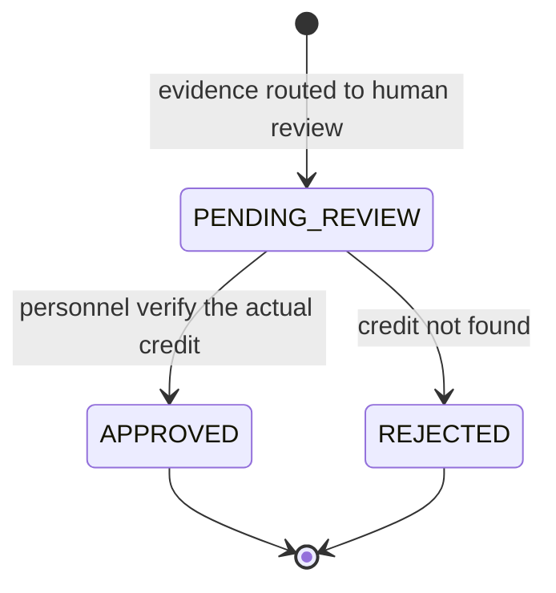

# UC-03 — Domain Invariants

> **Status:** In Review — product-owner agreements through 2026-11-12; not collective team approval or implemented behavior. Current [UC-03 rules](./business-rules.md) supersede incompatible historical handoff portions.
> **Objective:** State what the system must guarantee **always**, regardless of channel, event order, retries or partial failures, with examples that can become tests.
> **Complements:** [business-rules.md](./business-rules.md) (rules `BR-*` and pending decisions `P-NN`) and [UC-02 use cases](../uc-02/use-cases.md) (`CU-XX`).
> **References:** [UC-01 actors](../uc-01/actors.md) and [UC-01 flows](../uc-01/flows.md); [MVP definition](../mvp.md) v0.3 §6.3; [target architecture](../../design-docs/target-architecture.md) v1.2 §9, §10, §13 (proposed direction, not the implemented [`ARCHITECTURE.md`](../../../ARCHITECTURE.md)).

## 0. What an Invariant Is Here

A condition that **must always hold**. If an operation would break it, the operation fails and nothing changes.

Each invariant states **where it is guaranteed**:

| Tag | Meaning |
|---|---|
| `DB` | PostgreSQL constraint (unique, foreign key, exclusion). Holds even if application code is wrong. |
| `TX` | Checked inside the use case's transaction, against current state. |
| `UC` | Validation of the use case (authorization, policy). |
| `JOB` | Idempotent, state-aware `pg-boss` job. |

When the concrete mechanism depends on a decision that is still open, the invariant states the guarantee, names the pending decision and does not commit to a mechanism. All such cases are listed in [§14](#14-invariants-that-depend-on-pending-decisions).

Examples `EJ-NN` follow *Given / When / Then* and are written to become tests (ARQ §13). Money amounts are illustrative. Example numbers are stable for review; EJ-48 and EJ-49 were added later and sit in §5 and §4.

## 1. Tenant Isolation

| ID | Invariant | Where | Origin |
|---|---|---|---|
| INV-TEN-01 | Every operational record has a non-null tenant. Personnel `User` is global and linked through memberships; `Permission` is a global system-defined catalog. Roles and role-permission assignments are tenant-local. | DB | BR-TEN-01, BR-IAM-01; F-001 |
| INV-TEN-02 | A reference between operational records always points to a record **of the same tenant** (for example, a composite key `(tenant, resource)`). | DB | BR-TEN-03; ARQ §8.2 |
| INV-TEN-03 | No operational read or write runs without a **validated** tenant context (membership or validated channel connection). | UC | BR-TEN-02 |
| INV-TEN-04 | Jobs, conversations, messages, receipts, cash sessions and audit records also carry their tenant; a job never acts on another tenant's data. | DB + JOB | BR-TEN-01; ARQ §8.2 |

**EJ-01 · Tampered ID.** Given a Staff member of tenant A and a booking of tenant B, when they request that booking by its ID, then they get `not_found` (not `forbidden`, so its existence is not confirmed) and no data leaks.

**EJ-02 · Cross reference.** Given a service of A and a resource of B, when a booking combining them is inserted, then the database rejects it even if the use-case validation was skipped.

**EJ-03 · Same number, two tenants.** Given the same number as a customer in A (2 no-show bookings, `BLOCKED`) and in B (no history), when it writes to B's WhatsApp, then B treats it as a customer without no-shows or restrictions.

## 2. Booking Lifecycle

The diagram shows product-owner-agreed transitions and explicitly labeled proposals. `PENDING_PAYMENT_REVIEW` is an umbrella conceptual label, not a required enum: distinguish actually pending review, rejected evidence awaiting correction, and verified partial-deposit waiting with no pending review. Only rejected evidence **without verified partial funds** follows the 15-minute/second-distinct-rejection cancellation rule. Partial funds, started slots and supplemental reschedule collection cannot be automatically released by that rule. Explicit authorized cancellation remains possible without waiting for financial resolution.

```mermaid
stateDiagram-v2
    [*] --> HOLD: WhatsApp slot selected
    [*] --> CONFIRMED: CRM direct booking
    [*] --> PENDING_PAYMENT_REVIEW: CRM booking with an unverified receipt
    HOLD --> CONFIRMED: explicit confirmation without deposit
    HOLD --> PENDING_PAYMENT_REVIEW: timely evidence routed to human review
    HOLD --> EXPIRED: deadline after applicable evidence checks
    HOLD --> CANCELLED: withdrawn (proposal)
    PENDING_PAYMENT_REVIEW --> CONFIRMED: credit verified and allocated to required threshold
    PENDING_PAYMENT_REVIEW --> CANCELLED: guarded rejection cancellation without verified partial funds, before start
    PENDING_PAYMENT_REVIEW --> CANCELLED: explicit authorized cancellation; finances resolved separately
    PENDING_PAYMENT_REVIEW --> PENDING_PAYMENT_REVIEW: first human rejection opens correction window; timely evidence follows screening rules
    CONFIRMED --> CONFIRMED: permitted reschedule, then request difference
    CONFIRMED --> CANCELLED: cancellation
    CONFIRMED --> COMPLETED: manual, from start
    CONFIRMED --> NO_SHOW: manual, from start plus 15 minutes
    NO_SHOW --> COMPLETED: audited correction
    COMPLETED --> NO_SHOW: permitted correction with reason, from start plus 15 minutes
    EXPIRED --> [*]
    CANCELLED --> [*]
    COMPLETED --> [*]
    NO_SHOW --> [*]
```

### 2.1 Allowed Transitions

**Status:** Current follow-up rules supersede incompatible historical handoff portions; Proposal still awaits review and Pending depends on an open P-NN. Every personnel action requires its role permission regardless of Staff shorthand; Admin-only commercial exceptions remain non-delegable. No row claims runtime implementation or collective approval.

| Transition | Customer (WhatsApp, via the AI) | Staff | Admin | System (job) | Condition | Status |
|---|---|---|---|---|---|---|
| ∅ → `HOLD` | Yes | No | No | No (an accepted offer creates the HOLD for the customer) | Concrete slot, eligible requester, slot free. | Confirmed (MVP §6.3.3); the CRM never creates a HOLD (BR-SEN-09) |
| ∅ → `CONFIRMED` | No | If role permits | Yes, also existing deposit exception | No | Free slot and applicable funds/policy conditions; BLOCKED CRM customer allowed to booking-capable personnel with warning/attribution, restriction unchanged. | Follow-up P-16; BR-SEN-09 |
| ∅ → `PENDING_PAYMENT_REVIEW` | No | Yes | Yes | No | CRM booking with a transfer receipt not yet verified; slot free. | Confirmed (UC-01 Confirmed Decisions; BR-SEN-09) |
| `HOLD` → `CONFIRMED` (no deposit) | Yes, explicit confirmation | Proposal | Proposal | No | No deposit required; HOLD still valid. | Confirmed for the customer (MVP §6.3.4); Proposal for personnel |
| `HOLD` → `CONFIRMED` (deposit verified directly) | No | Proposal | Proposal | No | Required amount verified and allocated under BR-COB-03 while the HOLD is valid (e.g., paid at the counter). | Proposal |
| `HOLD` → `PENDING_PAYMENT_REVIEW` | Yes, by sending evidence | — | — | No | Timely evidence routed to human review under BR-SEN-12, BR-SEN-14–16; first clearly unrelated file instead prompts replacement. | Product-owner agreement 2026-11-09 |
| `HOLD` → `EXPIRED` | No | No | No | **Yes** | Deadline reached, with no timely screening unresolved or human review and no protected partial funds. | BR-RES-08, BR-SEN-16 |
| `HOLD` → `CANCELLED` | Yes | Yes | Yes | No | Withdrawn before confirmation. | Proposal (UC-01 does not cover withdrawing a HOLD) |
| `PENDING_PAYMENT_REVIEW` → `CONFIRMED` | No | Yes | Yes | **No** | Actual credit verified and allocated under BR-COB-03 to meet threshold; multiple partial payments may satisfy it, not before. | BR-SEN-07, BR-SEN-11 |
| Initial evidence rejection / correction | New evidence or valid manual resolution | Authorized role | Yes | Guarded timeout only | BR-SEN-10 applies only without verified partial deposit; pending review suspends timeout, started slots require manual handling. Partial verified funds invoke BR-SEN-11, never automatic release. | Updated F-018; follow-up P-27 |
| Pending review / partial-deposit waiting → `CANCELLED` | Explicit confirmation; accepted consequence if late | Applicable permission/policy | Yes | No financial timeout | Release immediately upon authorized cancellation; review/refund continues separately. | BR-CAN-04, BR-SEN-11 |
| `CONFIRMED` → `CONFIRMED` (reschedule) | Yes; accepted consequence if late | Authorized role, same rule | Yes, also exceptions to the consequence with a reason | No | With a verified deposit that does not cover the destination, move atomically to free target then request difference unless personnel decide not to collect the supplement under BR-CAN-15, including for `FULL_PREPAYMENT`. Other Admin exceptions remain applicable. Late reschedule with a lost deposit: personnel resolve it (BR-CAN-14). | Product-owner decision F-006, F-010; BR-CAN-14–15; product-owner agreement 2026-11-12 |
| `CONFIRMED` → `CANCELLED` | Explicit confirmation; accepted consequence if late | Same rule, or operational business cause with reason | Also exceptions to the consequence | No | Release without waiting for finances; notify customer. | BR-CAN-03–06, BR-CAN-14 |
| `CONFIRMED` → `COMPLETED` | No | Yes | Yes | **No** | Manual, current instant >= start. | Follow-up P-06 |
| `CONFIRMED` → `NO_SHOW` | No | Yes | Yes | **No** | Manual, current instant >= start + 15 minutes. | Follow-up P-06 |
| `NO_SHOW` ↔ `COMPLETED` | No | Correction permission | Yes | No | Mandatory reason/history, destination timing guard; no financial effect or walk-in eviction. | Follow-up P-05 |

### 2.2 Pending Transitions

P-05, P-06 and P-16, and the customer-cancellation portion of P-24, were resolved in the follow-up conversation and moved into §2.1. Remaining questions in the canonical register do not authorize unspecified transitions. Product-owner agreement is not implementation approval.

### 2.3 Confirmed Prohibitions

| Prohibition | Origin |
|---|---|
| `PENDING_PAYMENT_REVIEW` → `EXPIRED` never happens: review has no automatic timeout. | MVP §6.3.5, §9.2 |
| Time never confirms, completes or marks a no-show. Initial-evidence automatic cancellation never releases verified partial-deposit, actually pending review, started or supplemental-reschedule occupancy. Explicit authorized cancellation is a separate operation. | BR-SEN-10–11, BR-CAN-04 |
| `EXPIRED` and `CANCELLED` never return to an occupying state; a late payment never rebooks automatically. A new booking for a released slot follows BR-SEN-17. | MVP §6.3.6; product-owner agreement 2026-11-12 |
| The AI never performs a transition that requires verifying a payment or recording an outcome. | SYS-01 |

A transition that appears in none of §2.1–§2.3 is outside the MVP; adding one requires a decision.

### 2.4 Occupying States

| State | Occupies the resource? | Status |
|---|---|---|
| `HOLD` | **Yes** | Confirmed (MVP §6.3.2) |
| `PENDING_PAYMENT_REVIEW` / partial-deposit waiting | **Yes**; pending review has no inactivity timeout; partial verified funds have no automatic remainder timeout; no-funds correction follows BR-SEN-10 | Distinct conditions, not prescribed enums |
| `CONFIRMED` | **Yes** | Confirmed (MVP §6.3.2) |
| First small-cohort exclusive priority | **Yes**, for 5 minutes only | Separate initial offer claim; later invitations have no claim |
| Progressive late / simultaneous invitations | **No** | Eligibility is not occupancy or guaranteed reservation |
| `COMPLETED`, `NO_SHOW` | Residual time remains private | Explicit atomic CRM walk-in reuse only; timing BR-RES-10–12 |
| `EXPIRED`, `CANCELLED` | No | Confirmed |
| Target slot awaiting prior reschedule authorization | No | F-006; after permitted move the target is confirmed, including while the difference remains unpaid |

| ID | Invariant | Where | Origin |
|---|---|---|---|
| INV-RES-01 | Only the transitions in §2.1 run, by the actors listed. Rows marked *Proposal* run only after approval; §2.2 stays unimplemented until each decision is taken. | UC | MVP §6.3; BR-RES-* |
| INV-RES-02 | EXPIRED/CANCELLED never reactivate. COMPLETED and NO_SHOW permit audited correction both ways, with correction permission, mandatory reason and destination timing guard; financial history and reused walk-ins stay intact. | UC + TX | BR-RES-12 |
| INV-RES-03 | Automatic transitions include HOLD expiry and initial-deposit correction-window cancellation under BR-SEN-10; time never completes or marks no-show. | UC + JOB | Handoff F-018 |
| INV-RES-04 | Every transition records actor, time, previous state and reason when applicable. | TX | BR-AUD-01 |
| INV-RES-05 | Booking state and payment state are **independent**: `CONFIRMED` and `COMPLETED` may both have a balance due. | UC | BR-RES-10, BR-COB-09 |
| INV-RES-06 | Pending human review and verified partial-deposit waiting never auto-cancel for elapsed time or missing/rejected remainder evidence. Only rejected initial evidence without verified partial funds follows BR-SEN-10; explicit authorized cancellation does not wait for review. | UC + JOB | BR-SEN-10–11, BR-CAN-04 |
| INV-RES-07 | Early terminal outcome retains private residual occupancy; explicit authorized CRM walk-in reuse adjusts prior claim and creates the walk-in atomically without overlap, preserving history. A later correction cannot evict it. | TX + UC | BR-RES-17 |
| INV-RES-08 | Completion requires now >= start; no-show requires now >= start + 15 minutes. Only permitted humans record/correct outcomes, never elapsed-time jobs. | UC + TX | BR-RES-10–12 |

**EJ-04 · No automatic close.** Given a `CONFIRMED` booking from 10:00 to 11:00, when it is 11:00 the next day, then it is still `CONFIRMED` and appears as *pending operational close*.

**EJ-05 · Completing is not paying.** Given a $10,000 booking with a $3,000 deposit verified and allocated to its charge in the same human action, when authorized personnel complete it with balance due, then it is `COMPLETED` with $7,000 outstanding.

**EJ-06 · Audited correction.** Given a booking in `NO_SHOW`, when authorized personnel correct it to `COMPLETED`, the booking customer's no-show count drops by 1 and the correction records who, when and the previous state.

**EJ-07 · Review does not expire.** Given a booking that entered `PENDING_PAYMENT_REVIEW` at 15:07, when it is 18:00 and nobody has reviewed it, then it is still `PENDING_PAYMENT_REVIEW` and the slot is still blocked.

## 3. Availability and Concurrency

| ID | Invariant | Where | Origin |
|---|---|---|---|
| INV-DISP-01 | Active occupying claims never overlap for a tenant resource; offer and booking claims have exactly one owner, and private residual occupancy is protected until explicit atomic reuse. | TX | Handoff F-007, F-008 |
| INV-DISP-02 | Ranges are `[start, end)`: a booking ending at 11:00 does not overlap one starting at 11:00. | DB + TX | BR-RES-02 |
| INV-DISP-03 | Instants are stored unambiguously; business hours are interpreted in the tenant's timezone. | DB + UC | BR-TEN-04 |
| INV-DISP-04 | WhatsApp and CRM may use authorized extraordinary openings, but no booking overrides a block or active claim. | UC | BR-DISP-03, BR-DISP-07 |
| INV-DISP-05 | A booking's resource is compatible with its service. | UC (+ DB where the relation allows it) | BR-CAT-03 |
| INV-DISP-06 | An availability query **never** creates occupancy. | UC | BR-DISP-04 |
| INV-DISP-07 | No database transaction stays open while waiting for a human, an LLM or WhatsApp delivery. | TX | ARQ §6.5, §9.3 |
| INV-DISP-08 | Extraordinary openings require an authorized availability role and retain attribution; blocks require explicit authorized modification or removal. | UC | BR-DISP-06, BR-IAM-05 |
| INV-DISP-09 | Atomically enforce current tenant booking lead time (default 0), no past-start booking, resource-selection mode and any enabled future-booking cap. Count third-party occupying bookings against requester, and serialize competing creations to avoid exceeding the cap. | TX | BR-DISP-05/09, BR-CLI-10 |

**EJ-08 · Race between channels.** Given two simultaneous requests for Court 1 from 19:00 to 20:00 — one by WhatsApp, one by the CRM — when both passed the availability query, then exactly one claim is created and the other gets `conflict`.

**EJ-09 · Borders.** Given a booking from 10:00 to 10:30 with barber Juan, when 10:30 to 11:00 with Juan is requested, then it is accepted.

**EJ-10 · HOLD occupies.** Given a valid HOLD from 18:00 to 19:00, when another customer asks for availability, then 18:00 is not offered.

**EJ-11 · Review occupies.** Given a booking in `PENDING_PAYMENT_REVIEW` for 18:00, when Staff try a walk-in booking at 18:00 on the same resource, then it is rejected with `conflict`.

**EJ-12 · Extraordinary opening.** Given an authorized opening at 21:00 outside regular hours, when the resource is free and unblocked, both CRM and WhatsApp can offer it; an unauthorized role cannot create the opening.

## 4. HOLDs and Deposit Review

| ID | Invariant | Where | Origin |
|---|---|---|---|
| INV-SEN-01 | `HOLD` → `CONFIRMED` without a deposit requires an explicit confirmation recorded **while the HOLD is valid**, checked in the same transaction. | TX | BR-RES-04 |
| INV-SEN-02 | Timeliness uses recorded evidence receipt time, not screening completion. Timely evidence routed to review protects the HOLD; a first clearly unrelated file instead requests replacement without renewal. Expiry cannot release against unresolved screening of timely evidence. | TX | BR-RES-06, BR-SEN-14–16 |
| INV-SEN-03 | HOLD expiry is idempotent; if no longer HOLD, timely evidence is still being screened, already under review or protected by verified partial funds, it does not release. Current state, evidence, funds and occupancy are checked atomically. | JOB + TX | BR-RES-08, BR-SEN-11, BR-SEN-16 |
| INV-SEN-04 | A late receipt or payment never reactivates the expired booking or reclaims its released slot; preserve it for human financial handling. Any new booking of that slot follows normal availability, including waitlist priority, and BR-SEN-17. | TX | BR-COB-12, BR-SEN-16–17; product-owner agreement 2026-11-12 |
| INV-SEN-05 | A deposit becomes verified **only** through a recorded human verification. Nothing created by the AI or by an image is verified. | UC | BR-SEN-07, BR-COB-07 |
| INV-SEN-06 | If expiry processing fails, it is recovered; an eligible expired HOLD does not occupy a slot indefinitely. Timely unresolved screening and human review remain protected under BR-SEN-16. | TX + JOB | ARQ §6.5, §10.3; BR-SEN-16 |
| INV-SEN-07 | The required deposit is computed by the backend; with `FULL_PREPAYMENT` it is 100% of the charge. | UC | BR-SEN-04, BR-SEN-05 |
| INV-SEN-08 | An `EXPIRED` HOLD never counts as a no-show. | UC | BR-RES-16 |
| INV-SEN-09 | CRM deposit booking confirms only when verified funds allocated under BR-COB-03 meet threshold or Admin grants its existing exception; pending evidence occupies under review and verified insufficient deposit occupies unconfirmed under BR-SEN-11. Without funds/evidence/exception nothing occupies. | TX + UC | BR-SEN-09 |
| INV-SEN-10 | First human rejection of initial evidence without verified partial funds opens 15 minutes; timely evidence undergoing screening or human review prevents timeout against it. A permitted second-distinct-human-rejection/expiry cancellation is an atomic check-and-transition that rechecks current evidence, screening, review, verified funds, deadline, ownership and start. Partial verified funds, started appointments and supplemental reschedule deposits preclude automatic cancellation/release. | TX + JOB | BR-SEN-10–11, BR-SEN-14–16 |
| INV-SEN-11 | Multiple verified partial deposits retain occupied unconfirmed capacity indefinitely pending manual resolution or explicit authorized cancellation. Show missing amount; no rejected later evidence or timer releases it. Threshold confirmation requires allocation under BR-COB-03; FULL_PREPAYMENT is not bypassed. | TX + UC | BR-SEN-11; product-owner agreement 2026-11-12 |
| INV-SEN-12 | Preliminary relevance screening never verifies authenticity or credit; clearly unrelated attempts are not human financial rejections. Technical duplicates do not add attempts. Failure or uncertainty goes to human review, not unrelated classification or payment approval. | UC | BR-SEN-14–15 |
| INV-SEN-13 | Neither replacement nor screening renews the HOLD or correction window. A timely second clearly unrelated attempt reaches human review without inactivity timeout, including when analysis finishes after the deadline. Explicit authorized cancellation and late-evidence safeguards still apply. | UC + TX | BR-SEN-14–16, BR-CAN-04 |

**EJ-13 · Timely receipt.** Given a HOLD created at 15:00 (deadline 15:10), when plausible evidence arrives at 15:07 and enters human review, then the slot is still blocked at 15:30.

**EJ-14 · Late receipt.** Given a HOLD that expired at 15:10 and the slot taken by another customer at 15:11, when the first customer's receipt arrives at 15:12, then a financial incident is recorded, the first booking stays `EXPIRED` and the other booking is untouched.

**EJ-57 · Available slot after late evidence.** Given an expired HOLD and a later receipt, when the released slot passes normal availability including waitlist priority, the AI may offer a new HOLD on current terms with explicit customer confirmation and link the receipt to it for human verification. The old booking stays `EXPIRED`; the AI says the business will review the payment, not that it was received or accepted. If the slot is unavailable, personnel handle the retained late evidence instead.

**EJ-15 · Expiry during screening.** Given evidence received at 15:09 and still being screened at the 15:10 deadline, expiry does not release it while screening is unresolved. A first unrelated result requests replacement without extending the deadline; subsequent expiry follows current-state checks. A plausible, uncertain or failed result enters human review instead.

**EJ-16 · Expiry after confirmation.** Given a no-deposit HOLD confirmed by the customer at 15:09, when the expiry job runs at 15:10, then nothing changes.

**EJ-17 · Receipt image.** Given a customer who sends a plausible $5,000 transfer screenshot on time, when the AI screens it, a pending human `PaymentReview` exists, no verified `Payment` is created and the balance does not change.

**EJ-18 · Expiry is not absence.** Given a customer with one expired HOLD and one cancellation within policy, then their no-show booking count is 0.

**EJ-49 · CRM booking with a deposit.** Given a $10,000 service with a $3,000 deposit, when authorized personnel book it in the CRM and record $3,000 in cash in an open session, allocating it to the charge in that action to meet the deposit threshold, then it is `CONFIRMED` with no HOLD; when they attach a transfer receipt not yet verified, then it is `PENDING_PAYMENT_REVIEW` and the slot is blocked; when nothing is paid, then it is not confirmed and the slot stays free, unless an Admin confirms it; in that case the booking records that no deposit was paid and a $10,000 balance due, with or without a reason.

**EJ-55 · Second unrelated file near deadline.** Given a first clearly unrelated file and a distinct second one received before the deadline, when screening finishes after the deadline and finds it clearly unrelated, the customer is told to await human review; the review occupies without inactivity timeout. Neither attempt counts as a human rejection and the deadline was not renewed.

**EJ-56 · Screening failure.** Given timely evidence whose screening fails or is uncertain, it goes to human review without being called unrelated or credited; no bank verification is claimed. Explicit inability to attach permits timely text fallback, while late evidence is retained for financial handling and never reactivates the old booking (BR-SEN-17).

## 5. Payments and Balances

This is the conceptual `PaymentReview` lifecycle; a directly verified CRM `Payment` needs no review. Approval may link at most one verified payment; rejection creates none.

| ID | Invariant | Where | Origin |
|---|---|---|---|
| INV-PAY-01 | Every `Payment` is verified commercial money with method and provenance; only valid allocations reduce charge balances. Verification for an active booking allocates to its charge in the same human action up to the amount owed; excess remains unallocated, and late evidence follows BR-SEN-17. Evidence review is separate. | UC + TX | BR-COB-02–04, BR-SEN-17; product-owner agreement 2026-11-12 |
| INV-PAY-02 | A **retry of the same operation** — the same request sent again, repeated approval of the same pending `PaymentReview`, a duplicated incoming message — never creates a second payment or approval. The operation carries an identifier (idempotency key, review ID or message ID); `Payment` represents verified money only. | DB + TX | BR-COB-16; ARQ §6.5, §9.3 |
| INV-PAY-03 | A verified transfer records who verified it and when. | DB + UC | BR-COB-05 |
| INV-PAY-04 | The AI may attach evidence to a pending `PaymentReview`, but cannot approve it or create a `Payment`; payments represent verified money only, not pending evidence. | UC | BR-COB-07 |
| INV-PAY-05 | Every payment has a known same-tenant commercial origin; it may have zero allocations. Unknown or personal transfers are not payments. | UC | BR-COB-02 |
| INV-PAY-06 | Original payments are immutable and never deleted; corrections append linked history. The open-session/after-close authorization boundary applies to physical-cash corrections only, with Admin-only `CashAdjustment` after close. Transfers need no session; their technical ledger-correction mechanism and other non-cash-session corrections remain pending (P-26). `CashAdjustment` is not a general financial log; refunds use `Refund`, never negative payments. | UC + DB | BR-COB-11 |
| INV-PAY-07 | Charge balance = max(0, net due − valid allocations); available payment = net verified and unrefunded amount − valid allocations. Neither allocation cap may be exceeded; excess remains unallocated. | TX | BR-COB-03, BR-COB-17 |
| INV-PAY-08 | Two **separate manual entries** that may be the same money (for example, two cash payments with the same amount on the same booking a few minutes apart) are both kept: the system cannot prove they are duplicates. They are flagged for human review and corrected through INV-PAY-06. | UC | BR-COB-16 (Proposal) |
| INV-PAY-09 | A `Refund` is separate from its immutable original payment, never a negative payment; only execution reduces retained funds. Pending refunds and allocations cannot compete for more than available funds. Cash refunds require an open session and cash movement; transfer refunds are bank outflows, not cash movements. | TX + UC | BR-COB-18 |
| INV-PAY-10 | A review and a payment have at most one counterpart each; rejection creates no payment, and direct verification can create one without a review. | TX | BR-COB-04 |
| INV-PAY-11 | Freeze issued account instructions and collection modality/history. Missing professional account uses a business default/sequential account, never another professional's; no configured destination requires human resolution. A professional change preserves client credit without duplicate collection or automatic inter-account compensation. | TX + UC | BR-COB-19–20, BR-CAN-13 |
| INV-PAY-12 | A recording correction appends reason/actor/time and financial history, recomputes valid allocations/debt without excess or negative balance, and does not itself create a refund, physical movement for nonexistent funds or automatic cancellation. Original records and closed cash sessions remain immutable; closed physical corrections require Admin. | TX + UC | BR-COB-21 |

**EJ-19 · Mixed methods.** Given a $12,000 booking, when a $4,000 transfer deposit is verified for it, $4,000 is allocated in that action and $8,000 remains due. When $8,000 is received and recorded in cash in an open session for the booking, it is allocated in that action and the balance is $0; each payment keeps its method and responsible employee.

**EJ-20 · Double verification.** Given a pending `PaymentReview` for an active booking, when two authorized employees approve the same review at the same moment, then there is one approval and at most one linked verified `Payment`. The successful verification allocates to the charge in the same action, without duplicate allocations; if the required deposit threshold is met, it permits one transition to `CONFIRMED`.

**EJ-21 · Correction after close.** Given a cash payment whose physical cash session is closed, when a Staff member tries a post-close cash correction, then they get `forbidden`; when an Admin does, then a separate `CashAdjustment` is recorded and both the original payment and closed session are unchanged.

**EJ-48 · Possible manual duplicate.** Given two separate $5,000 cash entries on the same booking, both are retained and flagged for review. Valid allocations cannot exceed the charge or available funds; any excess stays unallocated and the balance never becomes negative, even before audited correction.

## 6. Cancellation, Rescheduling and Ownership

| ID | Invariant | Where | Origin |
|---|---|---|---|
| INV-CAN-01 | Over WhatsApp, only bookings managed by the sender number in that tenant can be consulted or changed. The attendee's name grants nothing. | UC | BR-CAN-02, BR-CLI-03 |
| INV-CAN-02 | A failed reschedule (unavailable target, unauthorized exception or conflict) leaves the original booking intact. | TX | BR-CAN-08 |
| INV-CAN-03 | A successful reschedule occupies the new slot and releases the old one **in the same transaction**. | TX | BR-CAN-12 |
| INV-CAN-04 | After a reschedule, verified payments stay linked to the booking. | TX | BR-CAN-09 |
| INV-CAN-05 | For an eligible reschedule of a `CONFIRMED` booking whose verified deposit does not cover the destination, move first; it remains confirmed if the difference is unpaid. Personnel with payments permission may decide not to collect the supplement under BR-CAN-15, including for `FULL_PREPAYMENT`, without changing the paid deposit, price or status and without an Admin-only exception. Prior authorization does not hold the target; other Admin-only exceptions remain applicable. | TX + UC | BR-CAN-10, BR-CAN-15; product-owner agreement 2026-11-12 |
| INV-CAN-06 | Cancelling or rescheduling voids the reminders scheduled for the old slot. | TX + JOB | BR-NOT-03 |
| INV-CAN-07 | Customer commercial-policy exceptions require recorded Admin authorization/reason. Operational business cancellation is separately permitted to cancellation-capable personnel with reason and customer notification, not authority to grant customer exceptions. | UC | BR-CAN-03, BR-CAN-06 |
| INV-CAN-08 | Authorized explicitly confirmed cancellation releases the claim and suppresses old reminders atomically, regardless of pending verification or partial deposit. Financial review/refund proceeds independently and cannot retain/recover the cancelled slot; all refunds remain manual/Admin-authorized. | TX | BR-CAN-04 |
| INV-CAN-09 | A late customer change executes only after the customer accepts the stated consequence. It records one late change, never a `NO_SHOW`, and moves no money automatically. | UC + TX | BR-CAN-14, BR-CLI-12 |

**EJ-22 · Another number.** Given a booking made from number X for attendee "Lucas", when Lucas writes from number Y asking to cancel it, then the AI refuses and refers him to the business.

**EJ-23 · Outside the notice window.** Given a tenant with 10 hours of notice and a booking at 18:00, when the customer asks to cancel at 09:00, then the AI warns of the configured consequence and asks for confirmation. If declined, the booking stays `CONFIRMED`. If accepted, it is cancelled without Admin and one late cancellation is counted, not a no-show.

**EJ-24 · Cancellation independent of finances.** Given an in-policy cancellation with transfer under review, when the requester explicitly confirms release, then the claim ends immediately while the review continues. Later verified money may become manually reusable credit or an Admin-managed refund, never automatic forfeiture, refund or rebooking.

**EJ-25 · Reschedule without room.** Given a booking on Thursday 19:00, when the customer asks for Friday 19:00 and it is taken, then the Thursday booking is unchanged.

**EJ-26 · Reschedule to a more expensive service.** Given $8,000 verified and allocated to a booking's charge, when it is rescheduled to a service with a $15,000 total and those allocations remain valid, then $7,000 is due and nothing is refunded.

**EJ-27 · Extra deposit pending.** Given an eligible reschedule of a confirmed booking with a previously verified deposit and $2,000 additional deposit, when the move succeeds, the new slot is confirmed and the old slot released before requesting the difference; pending review or nonpayment does not reverse or cancel the move.

**EJ-58 · Supplement not collected.** Given the reschedule in EJ-27, when personnel with payments permission decide not to collect the supplement, optionally recording a reason, the paid deposit, price and confirmed status stay unchanged. The AI says nothing more is owed in advance and the remainder is paid at the appointment, not that any amount was forgiven.

## 7. Waitlist and Exclusive Offers

| ID | Invariant | Where | Origin |
|---|---|---|---|
| INV-WL-01 | Only the first priority invitation of a 1–4-person cohort has a five-minute exclusive claim. Other progressive/simultaneous invitations have none; never overlap active claims. | TX | BR-WL-06–07 |
| INV-WL-02 | Begin a release round only for genuinely free compatible capacity; invitations never displace an occupying claim and cannot themselves authorize payment. | TX | BR-WL-05, BR-WL-08 |
| INV-WL-03 | Initial priority expiry closes only its own claim and advances progressive invitations, never a newer HOLD. Subsequent five-minute steps are invitation scheduling, not new exclusive claims. Retries/outages never extend priority. | JOB + TX | BR-WL-06–10 |
| INV-WL-04 | A prior recipient may claim after priority ends if still eligible and the opportunity valid/free. Reject a claim against another HOLD/booking or past-start slot and offer alternatives; no priority restoration. | TX | BR-WL-09 |
| INV-WL-05 | Use progressive arrival-order invitations for 1–4 eligible people and simultaneous invitations for 5+. Competition among invited customers is first successful atomic claim, not message arrival time or queue rank. | UC + TX | BR-WL-06 |
| INV-WL-06 | A waitlist entry exists only with an explicit opt-in and consent, and never occupies a slot. | UC | BR-WL-02, BR-WL-03 |
| INV-WL-07 | Confirmed send failure gets one valid retry; second failure advances without deleting the entry. Unknown outcome never triggers blind retry, priority renewal or indefinite blocking. | JOB | BR-WL-10, BR-NOT-10 |
| INV-WL-08 | The winning claim closes any initial exclusive offer claim and creates a distinct booking-owned ten-minute HOLD atomically. One invitation can yield at most one booking, one slot one winner. Only then issue transfer instructions; concurrent losers cannot pay through another invitation. | TX | BR-WL-08 |
| INV-WL-09 | Preferred resource is same-tenant/compatible; otherwise any compatible one. Time preferences and current eligibility apply; arrival order controls progressive invitations, not open-competition winner. | UC | BR-WL-11 |
| INV-WL-10 | Expire an entry when its requested range has no future slot, or close on fulfilled booking/customer withdrawal. Failed/unanswered notices alone do not remove it. No three-offer cap or extra per-person exclusivity is inferred. | JOB + UC | BR-WL-12 |
| INV-WL-11 | A queue never exceeds 10 people in the MVP; enrollment checks the limit atomically. | TX | BR-WL-14 |
| INV-WL-12 | A round's mode does not change once started. A person who let their HOLD expire is not invited in the next round for that slot, and nobody can claim after the slot starts or after leaving the queue. | UC + TX | BR-WL-15 |
| INV-WL-13 | A `BLOCKED` customer is never enrolled or invited; an existing entry keeps its place and counts toward the limit, and is eligible again once the restriction is removed. | UC | BR-WL-16 |

**EJ-28 · One offer at a time.** Given two customers waiting for Court 2 at 22:00, when the slot is released, then only the first one receives an offer.

**EJ-29 · Acceptance.** Given an offer sent at 18:00, when the customer accepts at 18:04, then a HOLD with a 10-minute deadline is created; it is not a confirmation.

**EJ-30 · Late claim.** Given Ana's priority ends at 18:05 and Bruno is then invited, when Ana claims at 18:06 while the future slot is still free, she may win the unique HOLD. If Bruno already won, Ana receives the taken-slot explanation and alternatives. Bruno was never promised his own exclusive five minutes.

**EJ-31 · Offer expiry vs. newer HOLD.** Given an offer accepted at 18:03, which created a HOLD, when the offer's expiry job runs at 18:05, then the HOLD is untouched.

**EJ-32 · Failed notice.** Given a confirmed failure and one failed retry while the invitation is valid, advance without deleting the recipient's entry or renewing priority. An uncertain result is reconciled/flagged, not treated as a proven send failure.

**EJ-50 · Broadcast race.** Given five eligible customers notified simultaneously, when three claim concurrently, exactly one booking HOLD is created; only its owner receives transfer instructions, others get alternatives. No invitation creates a separate five-minute occupancy claim.

**EJ-51 · Verified insufficient deposit.** Given a required $5,000 deposit and $3,000 verified for the booking, the slot remains occupied/unconfirmed while $2,000 is missing, even after a later receipt rejection or correction deadline. An authorized explicitly confirmed cancellation releases it immediately without waiting for refund/review; recorded money remains for manual resolution.

**EJ-52 · Outcome timing.** For a 15:00 booking, manual completion is available at 15:00 and no-show at 15:15, not 15:14. Correcting completion to no-show also requires the latter guard, permission and reason; no automatic payment change or walk-in displacement follows.

**EJ-53 · Professional change.** Given a verified $3,000 deposit received by Juan for a $10,000 booking, a permitted move to Pedro retains that client credit, with $7,000 due after valid allocations. Juan's receipt history remains; internal compensation is manual and does not prevent the move.

## 8. Customers and Restrictions

| ID | Invariant | Where | Origin |
|---|---|---|---|
| INV-CLI-01 | The count derives solely from current `NO_SHOW` bookings by `Booking.customer_id`, once per booking even for third-party attendees; `CustomerIncident` is for other incidents. Correction recalculates the count. | UC | BR-CLI-06 |
| INV-CLI-02 | The internal indicator appears from two no-shows and on its own restricts nothing. | UC | BR-CLI-07 |
| INV-CLI-03 | BLOCKED forbids new WhatsApp bookings, but booking-capable CRM personnel may create an exceptional booking with warning and actor attribution, without removing the restriction or bypassing other policies/occupancy. | UC + TX | BR-CLI-09 |
| INV-CLI-04 | With `FULL_PREPAYMENT`, no new booking reaches `CONFIRMED` without 100% verified and allocated to its charge under BR-COB-03, unless an Admin exception from the CRM records that it was not paid and the outstanding balance (INV-SEN-09). | TX | BR-CLI-09, BR-SEN-09 |
| INV-CLI-05 | Every restriction change records actor and reason and requires the appropriate role permission. | UC | BR-CLI-08 |
| INV-CLI-06 | Internal labels never appear in customer-facing messages. | UC | BR-AGT-03 |
| INV-CLI-07 | The late-changes count derives from executed customer-requested late changes, once per change, and never feeds the no-show count or indicator. | UC | BR-CLI-12 |

**EJ-33 · Label without sanction.** Given a customer with 2 no-show bookings and restriction `NONE`, when they book by WhatsApp, then the normal deposit rule applies and the CRM shows "Problematic customer".

**EJ-34 · Full prepayment.** Given a `FULL_PREPAYMENT` customer and an $8,000 service with a 30% default deposit, when they book by WhatsApp, then $8,000 is required. Confirmation requires human verification and allocation under BR-COB-03 of that amount to the charge; while awaiting it, the applicable HOLD expiry or evidence-review/correction rules still apply.

**EJ-35 · A friend's no-show.** Given a booking made by requester X for attendee "Ana", when authorized personnel record a no-show, X's count increases once from the booking; no no-show `CustomerIncident` is created.

## 9. Cash Register

| ID | Invariant | Where | Origin |
|---|---|---|---|
| INV-CAJA-01 | A tenant has **at most one open session** at a time. | DB | BR-CAJA-01 |
| INV-CAJA-02 | Opening and closing sessions require the corresponding role permission. | UC | BR-CAJA-02 |
| INV-CAJA-03 | A close records responsible person, time, session, expected cash, counted cash and difference. | DB | BR-CAJA-04 |
| INV-CAJA-04 | Expected cash is opening cash plus signed physical movements; a cash payment and its movement are not summed twice. Transfers are separate. | UC | BR-CAJA-07; F-014 |
| INV-CAJA-05 | A closed session is never modified or deleted; later adjustments are new Admin entries. | DB + UC | BR-CAJA-09 |
| INV-CAJA-06 | Every cash-in/cash-out has a responsible person and a reason. | DB | BR-CAJA-05 |
| INV-CAJA-07 | Opening cash is explicit and auditable; the first is declared, subsequent openings reconcile with the previous close. | UC | BR-CAJA-03 |
| INV-CAJA-08 | Cash payment requires an open session; configured automatic opening is triggered by the first payment, otherwise an authorized manual opening is required. Payment and closing serialize; verified transfers need no session and cannot alter a closed session. | TX | BR-CAJA-03; F-012 |
| INV-CAJA-09 | Midnight never closes a session or blocks collection; manual close defines its lifetime and each movement retains actual timestamp. | UC | BR-CAJA-11 |

**EJ-36 · Close with difference.** Given $2,000 opening cash and signed movements of $15,000 linked to cash payments, $1,000 other cash-in and $500 cash-out, when $17,000 is counted, expected cash is $17,500 and the close records a −$500 difference; linked payments are not counted again.

**EJ-37 · Methods kept apart.** Given a session with $10,000 in cash payments and their linked physical movements, plus $20,000 in verified transfers, then expected cash is only opening cash plus signed physical movements, including those linked to the cash payments exactly once. The $20,000 transfers appear separately and add no physical cash.

**EJ-38 · Privilege.** Given a member whose role lacks the close permission, when they try to close the register, then they get `forbidden`; payment recording separately requires its role permission.

**EJ-39 · Automatic opening.** Given a tenant with automatic opening and a previous close with $17,000 counted, when the next session opens, then its opening cash is $17,000.

## 10. Messaging, AI and Handoff

| ID | Invariant | Where | Origin |
|---|---|---|---|
| INV-MSG-01 | An incoming message is persisted before processing, and an Evolution event with the same ID is processed only once. | DB + UC | BR-AGT-05; ARQ §10.2 |
| INV-MSG-02 | The tenant of an incoming message comes from the validated WhatsApp connection, never from the message content. | UC | BR-TEN-02 |
| INV-MSG-03 | Every AI tool call carries the tenant and requester of its conversation; the backend checks them again. | UC | BR-AGT-02 |
| INV-MSG-04 | While a human has taken over a conversation, the AI sends nothing in it. | UC | BR-HND-02; ARQ §13.8 |
| INV-MSG-05 | With global AI disabled, the AI sends nothing in any conversation of the tenant. | UC | BR-HND-04 |
| INV-MSG-06 | Messages sent by the bot never count as human replies, nor restart the 60-minute timer. | UC | BR-HND-05 |
| INV-MSG-07 | Resuming the AI never changes the status of a payment. | UC | BR-HND-06 |
| INV-MSG-08 | An unreported transfer is not detected by the system or a reason for the AI to initiate a message. A customer report follows the booking lookup and evidence flow in BR-AGT-07; only personnel verify the transfer. | UC | BR-AGT-07; product-owner agreement 2026-11-12 |

**EJ-40 · Duplicate webhook.** Given an incoming message already processed, when Evolution delivers the same event again, then it is stored once and the AI answers once.

**EJ-41 · Takeover.** Given a conversation taken over by Staff at 10:00, when the customer writes at 10:05, then the AI does not answer and the message waits in the shared inbox.

**EJ-42 · Return after 60 minutes.** Given the last human reply at 10:10 and global AI enabled, when the customer writes at 11:15, then the AI answers. If the human had replied again at 10:50, the AI would stay paused until 11:50.

**EJ-43 · Global AI off.** Given an Admin who disabled global AI, when 60 minutes pass without a human reply, then the AI stays paused.

## 11. Reminders and Notices

| ID | Invariant | Where | Origin |
|---|---|---|---|
| INV-NOT-01 | Each confirmed booking slot has **at most one logical reminder** (deduplication key). This is an internal guarantee: WhatsApp delivery is not exactly once. | DB + JOB | BR-NOT-01; ARQ §10.3 |
| INV-NOT-02 | Before each reminder attempt, re-check `CONFIRMED`, same slot, reminder consent, ACTIVE connection and phone. Offer attempts instead require a valid unexpired offer and its independent opt-in. The staff rejection alert validates its recorded event and authorized tenant audience, not customer consent or `CONFIRMED` status. A failed applicable guard suppresses the send. | JOB | BR-NOT-03 |
| INV-NOT-03 | Every attempt and its result are recorded, and none of them changes the booking. | JOB | BR-NOT-04 |
| INV-NOT-04 | A reminder is sent only with reminder consent, and a waitlist notice only with waitlist consent. | JOB | BR-NOT-02, BR-WL-02 |
| INV-NOT-05 | Persist the notice/intention before send and recover work after crash. Actual attempts retain optional Message correlation; retries preserve logical identity. Confirmed failure allows one retry, sent/delivered/read none, unknown outcome requires status recovery or CRM attention without automatic resend. Always recheck validity; neither outages nor retries extend priority. | TX + JOB | BR-NOT-04, BR-NOT-10 |
| INV-NOT-06 | If start minus lead time is at or before confirmation, omit the reminder, not the separate confirmation. On reschedule invalidate the old reminder and schedule only a future new one; use tenant timezone for calendar rules and UTC instants. | JOB | BR-NOT-08 |
| INV-NOT-07 | One four-option consent answer persists separate customer preferences and scoped audit changes; reuse them for future bookings/entries, including refusal. Waitlist entries retain provenance and cannot override later revocation. No new consent entity or repeated enrollment prompt. | TX + UC | BR-NOT-09, BR-AUD-03 |
| INV-NOT-08 | No age-based purge runs in the MVP; when one exists it preserves the notice's final result. CRM confirmation is a separate transactional notice, not reminder consent. | JOB + UC | BR-NOT-11–12, BR-DAT-06 |

**EJ-44 · Cancelled booking.** Given a booking with a reminder scheduled for 9:00, when it is cancelled at 8:00, then nothing is sent at 9:00.

**EJ-45 · Retry after a confirmed failure.** Given a still-valid notice with a confirmed first failure, when its one retry succeeds, one logical notice has two attempts. A lost response of unknown outcome does not automatically retry; recover status where possible, otherwise flag CRM. Provider acceptance is not delivery and end-to-end exactly-once cannot be promised.

**EJ-46 · WhatsApp down when booking.** Given WhatsApp disconnected, a valid CRM booking still confirms. Its durable notices recover after reconnection only if still current/authorized; no outdated offer is sent, no priority extended. Work never dispatched differs from an interrupted unknown attempt; only a confirmed failed send gets the one retry.

**EJ-47 · Consent revoked.** Given a customer who revoked reminder consent at 8:00, when the 9:00 reminder job runs, then nothing is sent.

## 12. Audit

| ID | Invariant | Where | Origin |
|---|---|---|---|
| INV-AUD-01 | Every action listed in BR-AUD-01 writes its audit record **in the same transaction** as the change. | TX | BR-AUD-01 |
| INV-AUD-02 | Audit records are never modified or deleted by ordinary operations. Their final period under customer deletion is to be validated (BR-DAT-04). | DB + UC | BR-AUD-01, BR-DAT-04 |
| INV-AUD-03 | Combined consent UX updates independent customer scopes and relevant entry consent provenance atomically with scoped grant/revocation AuditEvents (actor/channel/time). Current preference, not stale entry consent, gates delivery; individual messages/retries create no consent audit event. | TX | BR-AUD-03 |
| INV-AUD-04 | Each membership has exactly one tenant role; effective permissions are checked in the backend and never granted directly to members. Admin is full-access, non-deletable and non-reducible, its last active member protected, and BR-IAM-04 operations non-delegable. | UC + TX | BR-IAM-01, BR-IAM-02, BR-IAM-04 |

## 13. Mapping to the Mandatory Architecture Tests

The target architecture v1.2 §13 lists nine outcomes that must be verified.

| ARQ §13 outcome | Invariants | Examples |
|---|---|---|
| 1. No cross-tenant access, even with tampered IDs | INV-TEN-01 to INV-TEN-04 | EJ-01, EJ-02, EJ-03 |
| 2. No overlapping active claims (HOLDs, review, offers) | INV-DISP-01, INV-WL-01 | EJ-08, EJ-10, EJ-11, EJ-28 |
| 3. Expiry never releases confirmed or under-review bookings; offer expiry never bypasses a newer HOLD | INV-SEN-03, INV-RES-06, INV-WL-03 | EJ-07, EJ-15, EJ-16, EJ-31 |
| 4. No deposit paid without human verification; no duplicated payments or confirmations | INV-SEN-05, INV-PAY-02, INV-PAY-04, INV-MSG-01 | EJ-17, EJ-20, EJ-40 |
| 5. CRM and WhatsApp use the same core; the landing never books | BR-CH-02, BR-CH-05 (checked by contract tests) | EJ-08 |
| 6. A requester cannot change another number's bookings, even with a matching attendee name | INV-CAN-01 | EJ-22 |
| 7. Privileged operations restricted; post-close correction Admin-only with immutable history | INV-CAJA-02, INV-CAJA-05, INV-PAY-06 | EJ-21, EJ-38 |
| 8. Takeover prevents competing AI messages; the 60-minute return respects global AI | INV-MSG-04, INV-MSG-05 | EJ-41, EJ-42, EJ-43 |
| 9. CRM and core work with Evolution/AI down; independent installation | BR-CH-06, INV-NOT-03 | EJ-46 (independent installation: operations, outside UC-03) |

## 14. Invariants That Depend on Pending Decisions

The guarantee in the "Holds meanwhile" column is valid today; the rest waits for the decision.

| Invariant | Depends on | Holds meanwhile |
|---|---|---|
| INV-PAY-08 | Proposal | Payments are never deleted (INV-PAY-06). |
| INV-PAY-12 | ERD T-03 | Correction behavior is agreed; exact immutable financial ledger representation remains unimplemented. |
| INV-WL-01–12 | ERD T-01/T-05 | Progressive/broadcast behavior, rounds, queue limit and single winner are agreed; validate physical round/claim representation before schema implementation. |
| INV-NOT-05, INV-NOT-07 | ERD T-04/T-05 | Durable recovery, no blind uncertain resend and independent reusable preferences are agreed; provider capabilities/storage details remain unvalidated. |
| INV-NOT-08, INV-DAT-03 | TD-01 | No age-based deletion runs; retention periods are still to be chosen. |
| INV-DAT-01–02 | P-32 | The agreed 30-day process applies; legal validation remains open. |

See the [decision register](./business-rules.md#16-pending-decisions) for remaining questions and resolved portions.

## 15. Personal Data

| ID | Invariant | Where | Origin |
|---|---|---|---|
| INV-DAT-01 | After a confirmed deletion request, no notice is sent and the data has no operational use, except for personnel resolving that customer's bookings and pending money, until the request is withdrawn or executed. | UC + JOB | BR-DAT-01, BR-DAT-08 |
| INV-DAT-02 | Automatic deletion runs only for a confirmed request whose 30 days elapsed without withdrawal, and is idempotent. A withdrawal within the window always prevents it; unresolved bookings or money do not delay it. | JOB + TX | BR-DAT-02, BR-DAT-08 |
| INV-DAT-03 | A deletion never removes payments, refunds, cash records, receipts of verified payments or receipts under a pending review, and nothing is deleted just for its age. | UC + JOB | BR-DAT-03, BR-DAT-04, BR-DAT-06 |
| INV-DAT-04 | A confirmed deletion request closes the customer's active waitlist entries, which stop counting toward the queue limit. | TX | BR-DAT-09, BR-WL-14 |

**EJ-54 · Deletion withdrawn.** Given a confirmed deletion request on day 0, when the customer withdraws it on day 20, then the profile is recovered and nothing is deleted. Without withdrawal, deletion runs on day 30 and the verified payment and its receipt remain.
