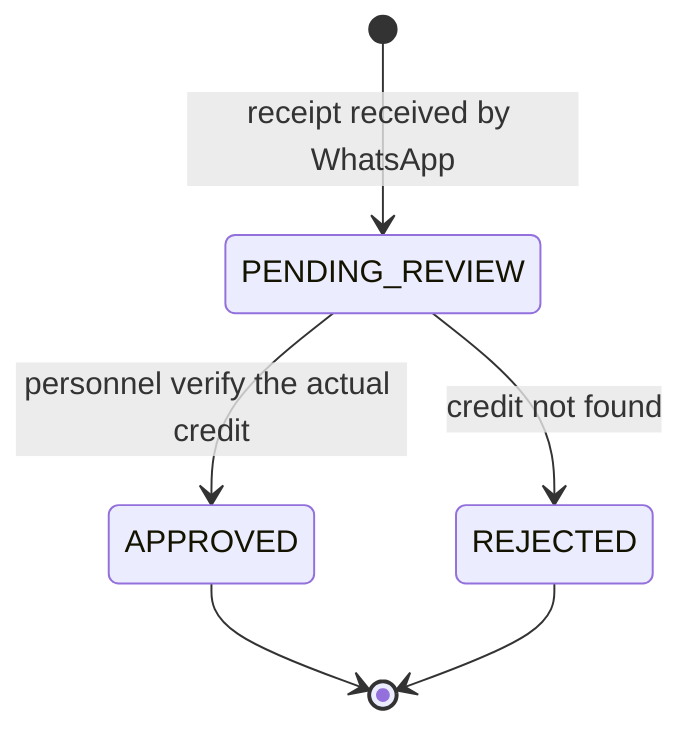

# UC-03 — Domain Invariants

> **Status:** In Review — product-owner reconciliation 2026-11-04; not collective team approval and not implemented. The [handoff](../../../agendoxa_audit_handoff.md) supersedes incompatible earlier proposals.
> **Objective:** State what the system must guarantee **always**, regardless of channel, event order, retries or partial failures, with examples that can become tests.
> **Complements:** [business-rules.md](./business-rules.md) (rules `BR-*` and pending decisions `P-NN`) and [UC-02 use cases](../uc-02/use-cases.md) (`CU-XX`).
> **References:** [UC-01 actors](../uc-01/actors.md) and [UC-01 flows](../uc-01/flows.md); [MVP definition](../mvp.md) v0.3 §6.3; [target architecture](../../design-docs/target-architecture.md) v1.2 §9, §10, §13 (proposed direction, not the implemented [`ARCHITECTURE.md`](../../../ARCHITECTURE.md)).

## 0. What an Invariant Is Here

A condition that **must always hold**. If an operation would break it, the operation fails and nothing changes.

Each invariant states **where it is guaranteed**:

| Tag | Meaning |
|---|---|
| `DB` | PostgreSQL constraint (unique, foreign key, exclusion). Holds even if application code is wrong. |
| `TX` | Checked inside the use case's transaction, against current state. |
| `UC` | Validation of the use case (authorization, policy). |
| `JOB` | Idempotent, state-aware `pg-boss` job. |

When the concrete mechanism depends on a decision that is still open, the invariant states the guarantee, names the pending decision and does not commit to a mechanism. All such cases are listed in [§14](#14-invariants-that-depend-on-pending-decisions).

Examples `EJ-NN` follow *Given / When / Then* and are written to become tests (ARQ §13). Money amounts are illustrative. Example numbers are stable for review; EJ-48 and EJ-49 were added later and sit in §5 and §4.

## 1. Tenant Isolation

| ID | Invariant | Where | Origin |
|---|---|---|---|
| INV-TEN-01 | Every operational record has a non-null tenant. Personnel `User` is global and linked through memberships; `Permission` is a global system-defined catalog. Roles and role-permission assignments are tenant-local. | DB | BR-TEN-01, BR-IAM-01; F-001 |
| INV-TEN-02 | A reference between operational records always points to a record **of the same tenant** (for example, a composite key `(tenant, resource)`). | DB | BR-TEN-03; ARQ §8.2 |
| INV-TEN-03 | No operational read or write runs without a **validated** tenant context (membership or validated channel connection). | UC | BR-TEN-02 |
| INV-TEN-04 | Jobs, conversations, messages, receipts, cash sessions and audit records also carry their tenant; a job never acts on another tenant's data. | DB + JOB | BR-TEN-01; ARQ §8.2 |

**EJ-01 · Tampered ID.** Given a Staff member of tenant A and a booking of tenant B, when they request that booking by its ID, then they get `not_found` (not `forbidden`, so its existence is not confirmed) and no data leaks.

**EJ-02 · Cross reference.** Given a service of A and a resource of B, when a booking combining them is inserted, then the database rejects it even if the use-case validation was skipped.

**EJ-03 · Same number, two tenants.** Given the same number as a customer in A (2 no-show bookings, `BLOCKED`) and in B (no history), when it writes to B's WhatsApp, then B treats it as a customer without no-shows or restrictions.

## 2. Booking Lifecycle

The diagram shows confirmed transitions and, labeled as such, proposed and pending ones. The status of each transition is in §2.1–§2.3. `PENDING_PAYMENT_REVIEW` is a conceptual booking label covering two distinct conditions: an actually pending `PaymentReview` has no automatic decision timeout; rejected evidence awaiting correction instead follows the 15-minute deadline and second-distinct-rejection rule before start (BR-SEN-10). A started appointment is escalated manually, not automatically cancelled or publicly released.

```mermaid
stateDiagram-v2
    [*] --> HOLD: WhatsApp slot selected
    [*] --> CONFIRMED: CRM direct booking
    [*] --> PENDING_PAYMENT_REVIEW: CRM booking with an unverified receipt
    HOLD --> CONFIRMED: explicit confirmation without deposit
    HOLD --> PENDING_PAYMENT_REVIEW: receipt before deadline
    HOLD --> EXPIRED: deadline without confirmation or receipt
    HOLD --> CANCELLED: withdrawn (proposal)
    PENDING_PAYMENT_REVIEW --> CONFIRMED: credit verified and manually allocated to required threshold
    PENDING_PAYMENT_REVIEW --> CANCELLED: second distinct rejection or correction window expires, before start
    PENDING_PAYMENT_REVIEW --> PENDING_PAYMENT_REVIEW: before start, first rejection opens correction window; new evidence creates pending review
    CONFIRMED --> CONFIRMED: permitted reschedule, then request difference
    CONFIRMED --> CANCELLED: cancellation
    CONFIRMED --> COMPLETED: personnel complete
    CONFIRMED --> NO_SHOW: personnel record absence
    NO_SHOW --> COMPLETED: audited correction
    COMPLETED --> NO_SHOW: pending P-05
    EXPIRED --> [*]
    CANCELLED --> [*]
    COMPLETED --> [*]
```

### 2.1 Allowed Transitions

**Status:** Earlier confirmed decisions remain subject to the handoff; *Proposal* awaits review and *Pending* depends on an open `P-NN`. Every personnel action in this table requires its role permission, regardless of the Staff column; Admin-only exceptions are non-delegable.

| Transition | Customer (WhatsApp, via the AI) | Staff | Admin | System (job) | Condition | Status |
|---|---|---|---|---|---|---|
| ∅ → `HOLD` | Yes | No | No | No (an accepted offer creates the HOLD for the customer) | Concrete slot, eligible requester, slot free. | Confirmed (MVP §6.3.3); the CRM never creates a HOLD (BR-SEN-09) |
| ∅ → `CONFIRMED` | No | If role permits | Yes, also without required deposit with recorded balance | No | CRM booking; free slot; required deposit verified and explicitly manually allocated to the charge, or Admin exception; authorized openings are available in both channels. | Product-owner decisions F-001, F-004, F-011; `BLOCKED` CRM customers pending P-16 |
| ∅ → `PENDING_PAYMENT_REVIEW` | No | Yes | Yes | No | CRM booking with a transfer receipt not yet verified; slot free. | Confirmed (UC-01 Confirmed Decisions; BR-SEN-09) |
| `HOLD` → `CONFIRMED` (no deposit) | Yes, explicit confirmation | Proposal | Proposal | No | No deposit required; HOLD still valid. | Confirmed for the customer (MVP §6.3.4); Proposal for personnel |
| `HOLD` → `CONFIRMED` (deposit verified directly) | No | Proposal | Proposal | No | Required amount verified and explicitly manually allocated by personnel while the HOLD is valid (e.g., paid at the counter). | Proposal |
| `HOLD` → `PENDING_PAYMENT_REVIEW` | Yes, by sending the receipt | — | — | No | Receipt registered **before** the deadline. | Confirmed (MVP §6.3.5) |
| `HOLD` → `EXPIRED` | No | No | No | **Yes** | Deadline reached and still `HOLD`. | Confirmed (MVP §6.3.6) |
| `HOLD` → `CANCELLED` | Yes | Yes | Yes | No | Withdrawn before confirmation. | Proposal (UC-01 does not cover withdrawing a HOLD) |
| `PENDING_PAYMENT_REVIEW` → `CONFIRMED` | No | Yes | Yes | **No** | Actual credit verified and explicitly manually allocated to the charge to meet the required deposit threshold (insufficient amount: P-27). | MVP §6.3.5; F-004 |
| Initial evidence rejection / correction | New evidence or valid manual resolution | Authorized role | Yes | Timeout may cancel | First rejection retains occupancy for 15 minutes; pending new review suspends timeout. Second distinct rejection or expiry cancels before start; started appointment requires manual handling. | Product-owner decision F-018; correction window is a condition, not a final enum |
| `CONFIRMED` → `CONFIRMED` (reschedule) | Yes, within policy | Authorized role, within policy | Yes, also out of policy with a reason | No | With partial deposit already verified, move atomically to free target then request difference; enforce `FULL_PREPAYMENT` and Admin exceptions. | Product-owner decision F-006, F-010 |
| `CONFIRMED` → `CANCELLED` | Yes, within policy, after the deposit warning | Yes, within policy | Yes, also out of policy with a reason | No | Explicit confirmation from the customer. | Confirmed (MVP §6.3.9) |
| `CONFIRMED` → `COMPLETED` | No | Yes | Yes | **No** | Recorded by personnel. | Confirmed (MVP §6.3.11); timing Pending P-06 |
| `CONFIRMED` → `NO_SHOW` | No | Yes | Yes | **No** | Absent person identified. | Confirmed (MVP §6.3.11); timing Pending P-06 |
| `NO_SHOW` → `COMPLETED` | No | Yes | Yes | No | Audited correction. | Confirmed (actors.md §2) |

### 2.2 Pending Transitions

These are **neither allowed nor forbidden** until their decision is taken. They are not implemented meanwhile.

| Transition or question | Decision |
|---|---|
| `COMPLETED` → `NO_SHOW` (correcting a completion) | P-05 |
| From which moment `COMPLETED` / `NO_SHOW` can be recorded | P-06 |
| ∅ → `CONFIRMED` for a `BLOCKED` customer | P-16 |
| `PENDING_PAYMENT_REVIEW` → `CANCELLED` requested by the customer or by personnel without rejecting the receipt | P-24 |

### 2.3 Confirmed Prohibitions

| Prohibition | Origin |
|---|---|
| `PENDING_PAYMENT_REVIEW` → `EXPIRED` never happens: review has no automatic timeout. | MVP §6.3.5, §9.2 |
| Time never confirms, completes or marks a no-show. Automatic cancellation is limited by the initial-evidence correction rule; it never cancels a started appointment or an F-006 supplemental-deposit booking. | Handoff F-006, F-018 |
| `EXPIRED` and `CANCELLED` never return to an occupying state; a late payment never rebooks. | MVP §6.3.6 |
| The AI never performs a transition that requires verifying a payment or recording an outcome. | SYS-01 |

A transition that appears in none of §2.1–§2.3 is outside the MVP; adding one requires a decision.

### 2.4 Occupying States

| State | Occupies the resource? | Status |
|---|---|---|
| `HOLD` | **Yes** | Confirmed (MVP §6.3.2) |
| `PENDING_PAYMENT_REVIEW` | **Yes**; no decision timeout while a review is actually pending; correction-waiting condition follows BR-SEN-10 | F-005, F-018; same conceptual booking label, distinct review conditions |
| `CONFIRMED` | **Yes** | Confirmed (MVP §6.3.2) |
| Active exclusive offer (not a booking state) | **Yes**, for 5 minutes | Separate offer claim (F-008) |
| `COMPLETED`, `NO_SHOW` | Residual time remains private | Explicit atomic CRM walk-in reuse only (F-007); earliest outcome timing P-06 |
| `EXPIRED`, `CANCELLED` | No | Confirmed |
| Target slot awaiting prior reschedule authorization | No | F-006; after permitted move the target is confirmed, including while the difference remains unpaid |

| ID | Invariant | Where | Origin |
|---|---|---|---|
| INV-RES-01 | Only the transitions in §2.1 run, by the actors listed. Rows marked *Proposal* run only after approval; §2.2 stays unimplemented until each decision is taken. | UC | MVP §6.3; BR-RES-* |
| INV-RES-02 | `EXPIRED` and `CANCELLED` are terminal. `COMPLETED` is terminal unless P-05 allows correcting it. `NO_SHOW` is terminal except for its audited correction. | UC | BR-RES-12 |
| INV-RES-03 | Automatic transitions include HOLD expiry and initial-deposit correction-window cancellation under BR-SEN-10; time never completes or marks no-show. | UC + JOB | Handoff F-018 |
| INV-RES-04 | Every transition records actor, time, previous state and reason when applicable. | TX | BR-AUD-01 |
| INV-RES-05 | Booking state and payment state are **independent**: `CONFIRMED` and `COMPLETED` may both have a balance due. | UC | BR-RES-10, BR-COB-09 |
| INV-RES-06 | An actually pending human review is not cancelled for elapsed time alone; a rejected initial review instead follows the correction window in BR-SEN-10. | UC + JOB | Handoff F-005, F-018 |
| INV-RES-07 | Early terminal outcome retains private residual occupancy; explicit authorized CRM walk-in reuse adjusts prior claim and creates the walk-in atomically without overlap, preserving history. A later correction cannot evict it. | TX + UC | BR-RES-17 |

**EJ-04 · No automatic close.** Given a `CONFIRMED` booking from 10:00 to 11:00, when it is 11:00 the next day, then it is still `CONFIRMED` and appears as *pending operational close*.

**EJ-05 · Completing is not paying.** Given a $10,000 booking with a $3,000 verified deposit explicitly manually allocated to its charge, when authorized personnel complete it with balance due, then it is `COMPLETED` with $7,000 outstanding. Verification without allocation would leave $10,000 due.

**EJ-06 · Audited correction.** Given a booking in `NO_SHOW`, when authorized personnel correct it to `COMPLETED`, the booking customer's no-show count drops by 1 and the correction records who, when and the previous state.

**EJ-07 · Review does not expire.** Given a booking that entered `PENDING_PAYMENT_REVIEW` at 15:07, when it is 18:00 and nobody has reviewed it, then it is still `PENDING_PAYMENT_REVIEW` and the slot is still blocked.

## 3. Availability and Concurrency

| ID | Invariant | Where | Origin |
|---|---|---|---|
| INV-DISP-01 | Active occupying claims never overlap for a tenant resource; offer and booking claims have exactly one owner, and private residual occupancy is protected until explicit atomic reuse. | TX | Handoff F-007, F-008 |
| INV-DISP-02 | Ranges are `[start, end)`: a booking ending at 11:00 does not overlap one starting at 11:00. | DB + TX | BR-RES-02 |
| INV-DISP-03 | Instants are stored unambiguously; business hours are interpreted in the tenant's timezone. | DB + UC | BR-TEN-04 |
| INV-DISP-04 | WhatsApp and CRM may use authorized extraordinary openings, but no booking overrides a block or active claim. | UC | BR-DISP-03, BR-DISP-07 |
| INV-DISP-08 | Extraordinary openings require an authorized availability role and retain attribution; blocks require explicit authorized modification or removal. | UC | BR-DISP-06, BR-IAM-05 |
| INV-DISP-05 | A booking's resource is compatible with its service. | UC (+ DB where the relation allows it) | BR-CAT-03 |
| INV-DISP-06 | An availability query **never** creates occupancy. | UC | BR-DISP-04 |
| INV-DISP-07 | No database transaction stays open while waiting for a human, an LLM or WhatsApp delivery. | TX | ARQ §6.5, §9.3 |

**EJ-08 · Race between channels.** Given two simultaneous requests for Court 1 from 19:00 to 20:00 — one by WhatsApp, one by the CRM — when both passed the availability query, then exactly one claim is created and the other gets `conflict`.

**EJ-09 · Borders.** Given a booking from 10:00 to 10:30 with barber Juan, when 10:30 to 11:00 with Juan is requested, then it is accepted.

**EJ-10 · HOLD occupies.** Given a valid HOLD from 18:00 to 19:00, when another customer asks for availability, then 18:00 is not offered.

**EJ-11 · Review occupies.** Given a booking in `PENDING_PAYMENT_REVIEW` for 18:00, when Staff try a walk-in booking at 18:00 on the same resource, then it is rejected with `conflict`.

**EJ-12 · Extraordinary opening.** Given an authorized opening at 21:00 outside regular hours, when the resource is free and unblocked, both CRM and WhatsApp can offer it; an unauthorized role cannot create the opening.

## 4. HOLDs and Deposit Review

| ID | Invariant | Where | Origin |
|---|---|---|---|
| INV-SEN-01 | `HOLD` → `CONFIRMED` without a deposit requires an explicit confirmation recorded **while the HOLD is valid**, checked in the same transaction. | TX | BR-RES-04 |
| INV-SEN-02 | `HOLD` → `PENDING_PAYMENT_REVIEW` happens only if the receipt is registered **while the HOLD is valid**. Expiry and receipt cannot both succeed for the same HOLD. | TX | BR-RES-06 |
| INV-SEN-03 | HOLD expiry is idempotent: if the booking is no longer `HOLD` when the job runs, it does nothing. | JOB | ARQ §10.3 |
| INV-SEN-04 | A receipt or payment that arrives **after** expiry never reactivates the booking or takes the slot; it is recorded as a financial incident. | TX | BR-COB-12 |
| INV-SEN-05 | A deposit becomes verified **only** through a recorded human verification. Nothing created by the AI or by an image is verified. | UC | BR-SEN-07, BR-COB-07 |
| INV-SEN-06 | If the expiry job fails to enqueue, a **durable intention** in PostgreSQL lets it be reconciled: a HOLD never occupies a slot indefinitely. | TX + JOB | ARQ §6.5, §10.3 |
| INV-SEN-07 | The required deposit is computed by the backend; with `FULL_PREPAYMENT` it is 100% of the charge. | UC | BR-SEN-04, BR-SEN-05 |
| INV-SEN-08 | An `EXPIRED` HOLD never counts as a no-show. | UC | BR-RES-16 |
| INV-SEN-09 | A CRM booking that requires a deposit reaches `CONFIRMED` only with verified funds explicitly manually allocated to its charge to meet the required threshold, or with an Admin exception that records that no deposit was paid and the outstanding balance (reason optional); with an unverified receipt it enters `PENDING_PAYMENT_REVIEW`; otherwise it occupies nothing. | TX + UC | BR-SEN-09 |
| INV-SEN-10 | First initial-evidence rejection retains occupancy for 15 minutes; timely distinct evidence creates a new review and suspends timeout while pending. Second distinct human rejection cancels immediately before start, notifying customer and staff. Expiry cancels only after transactional revalidation of deadline, state and active review; duplicates and retries are idempotent. Started appointments and supplemental F-006 deposits never auto-cancel or release residual time. Verified partial funds remain. | TX + JOB | BR-SEN-10 |

**EJ-13 · Timely receipt.** Given a HOLD created at 15:00 (deadline 15:10), when the receipt arrives at 15:07, then the booking is `PENDING_PAYMENT_REVIEW` and the slot is still blocked at 15:30.

**EJ-14 · Late receipt.** Given a HOLD that expired at 15:10 and the slot taken by another customer at 15:11, when the first customer's receipt arrives at 15:12, then a financial incident is recorded, the first booking stays `EXPIRED` and the other booking is untouched.

**EJ-15 · Expiry after the receipt.** Given a receipt registered at 15:09, when the expiry job runs at 15:10, then nothing changes.

**EJ-16 · Expiry after confirmation.** Given a no-deposit HOLD confirmed by the customer at 15:09, when the expiry job runs at 15:10, then nothing changes.

**EJ-17 · Receipt image.** Given a customer who sends a $5,000 transfer screenshot, when the AI interprets it, then a pending `PaymentReview` exists, no verified `Payment` is created and the balance does not change.

**EJ-18 · Expiry is not absence.** Given a customer with one expired HOLD and one cancellation within policy, then their no-show booking count is 0.

**EJ-49 · CRM booking with a deposit.** Given a $10,000 service with a $3,000 deposit, when authorized personnel book it in the CRM, record $3,000 in cash in an open session and explicitly manually allocate it to the charge to meet the deposit threshold, then it is `CONFIRMED` with no HOLD; when they attach a transfer receipt not yet verified, then it is `PENDING_PAYMENT_REVIEW` and the slot is blocked; when nothing is paid, then it is not confirmed and the slot stays free, unless an Admin confirms it; in that case the booking records that no deposit was paid and a $10,000 balance due, with or without a reason.

## 5. Payments and Balances

This is the conceptual `PaymentReview` lifecycle; a directly verified CRM `Payment` needs no review. Approval may link at most one verified payment; rejection creates none.

| ID | Invariant | Where | Origin |
|---|---|---|---|
| INV-PAY-01 | Every `Payment` is verified commercial money with method and provenance; only valid explicit allocations reduce charge balances. Evidence review is separate. | UC | BR-COB-02, BR-COB-03, BR-COB-04 |
| INV-PAY-02 | A **retry of the same operation** — the same request sent again, repeated approval of the same pending `PaymentReview`, a duplicated incoming message — never creates a second payment or approval. The operation carries an identifier (idempotency key, review ID or message ID); `Payment` represents verified money only. | DB + TX | BR-COB-16; ARQ §6.5, §9.3 |
| INV-PAY-03 | A verified transfer records who verified it and when. | DB + UC | BR-COB-05 |
| INV-PAY-04 | The AI may attach evidence to a pending `PaymentReview`, but cannot approve it or create a `Payment`; payments represent verified money only, not pending evidence. | UC | BR-COB-07 |
| INV-PAY-05 | Every payment has a known same-tenant commercial origin; it may have zero allocations. Unknown or personal transfers are not payments. | UC | BR-COB-02 |
| INV-PAY-06 | Original payments are immutable and never deleted; corrections append linked history. The open-session/after-close authorization boundary applies to physical-cash corrections only, with Admin-only `CashAdjustment` after close. Transfers need no session; their technical ledger-correction mechanism and other non-cash-session corrections remain pending (P-26). `CashAdjustment` is not a general financial log; refunds use `Refund`, never negative payments. | UC + DB | BR-COB-11 |
| INV-PAY-07 | Charge balance = max(0, net due − valid allocations); available payment = net verified and unrefunded amount − valid allocations. Neither allocation cap may be exceeded; excess remains unallocated. | TX | BR-COB-03, BR-COB-17 |
| INV-PAY-08 | Two **separate manual entries** that may be the same money (for example, two cash payments with the same amount on the same booking a few minutes apart) are both kept: the system cannot prove they are duplicates. They are flagged for human review and corrected through INV-PAY-06. | UC | BR-COB-16 (Proposal) |
| INV-PAY-09 | A `Refund` is separate from its immutable original payment, never a negative payment; only execution reduces retained funds. Pending refunds and allocations cannot compete for more than available funds. Cash refunds require an open session and cash movement; transfer refunds are bank outflows, not cash movements. | TX + UC | BR-COB-18 |
| INV-PAY-10 | A review and a payment have at most one counterpart each; rejection creates no payment, and direct verification can create one without a review. | TX | BR-COB-04 |

**EJ-19 · Mixed methods.** Given a $12,000 booking, when a $4,000 transfer deposit is verified and $8,000 is received in cash in an open session, then $12,000 remains due until authorized personnel explicitly manually allocate both payments to the charge. After those allocations the balance is $0; each payment keeps its method and responsible employee.

**EJ-20 · Double verification.** Given a pending `PaymentReview`, when two authorized employees approve the same review at the same moment, then there is one approval and at most one linked verified `Payment`. Verification alone does not change the charge balance or confirm the booking; explicit manual allocation meeting the required deposit threshold permits one transition to `CONFIRMED`, without duplicate allocations.

**EJ-21 · Correction after close.** Given a cash payment whose physical cash session is closed, when a Staff member tries a post-close cash correction, then they get `forbidden`; when an Admin does, then a separate `CashAdjustment` is recorded and both the original payment and closed session are unchanged.

**EJ-48 · Possible manual duplicate.** Given two separate $5,000 cash entries on the same booking, both are retained and flagged for review. Valid allocations cannot exceed the charge or available funds; any excess stays unallocated and the balance never becomes negative, even before audited correction.

## 6. Cancellation, Rescheduling and Ownership

| ID | Invariant | Where | Origin |
|---|---|---|---|
| INV-CAN-01 | Over WhatsApp, only bookings managed by the sender number in that tenant can be consulted or changed. The attendee's name grants nothing. | UC | BR-CAN-02, BR-CLI-03 |
| INV-CAN-02 | A failed reschedule (unavailable target, unauthorized exception or conflict) leaves the original booking intact. | TX | BR-CAN-08 |
| INV-CAN-03 | A successful reschedule occupies the new slot and releases the old one **in the same transaction**. | TX | BR-CAN-12 |
| INV-CAN-04 | After a reschedule, verified payments stay linked to the booking. | TX | BR-CAN-09 |
| INV-CAN-05 | For an eligible reschedule with verified partial deposit, move first and request the difference afterwards; it remains confirmed if unpaid. Prior authorization does not hold the target; `FULL_PREPAYMENT` still applies absent Admin exception. | TX + UC | BR-CAN-10 |
| INV-CAN-06 | Cancelling or rescheduling voids the reminders scheduled for the old slot. | TX + JOB | BR-NOT-03 |
| INV-CAN-07 | An out-of-policy change happens only with a recorded Admin authorization and reason. | UC | BR-CAN-03 |

**EJ-22 · Another number.** Given a booking made from number X for attendee "Lucas", when Lucas writes from number Y asking to cancel it, then the AI refuses and refers him to the business.

**EJ-23 · Outside the notice window.** Given a tenant with 2 hours of notice and a booking at 18:00, when the customer asks to cancel at 17:00, then the AI declines and explains the policy; the booking stays `CONFIRMED`.

**EJ-24 · Deposit warning.** Given a booking with a verified deposit, when the customer asks to cancel within policy, then the AI warns that the deposit is forfeited and offers to reschedule **before** cancelling.

**EJ-25 · Reschedule without room.** Given a booking on Thursday 19:00, when the customer asks for Friday 19:00 and it is taken, then the Thursday booking is unchanged.

**EJ-26 · Cheaper reschedule.** Given $8,000 verified and explicitly manually allocated to a booking's charge, when it is rescheduled to a service with a $15,000 total and those allocations remain valid, then $7,000 is due and nothing is refunded. If the funds were unallocated, $15,000 would remain due until explicit manual allocation.

**EJ-27 · Extra deposit pending.** Given an eligible reschedule with a previously verified partial deposit and $2,000 additional deposit, when the move succeeds, the new slot is confirmed and the old slot released before requesting the difference; pending review or nonpayment does not reverse or cancel the move.

## 7. Waitlist and Exclusive Offers

| ID | Invariant | Where | Origin |
|---|---|---|---|
| INV-WL-01 | There is at most one active exclusive offer per released slot, never overlapping another claim. | TX | BR-WL-07 |
| INV-WL-02 | An offer is created only for a slot that is free at that moment, and it never displaces an occupying claim. | TX | BR-WL-05, BR-WL-07 |
| INV-WL-03 | An offer ends at 5 minutes; its expiry job is idempotent and **never affects the HOLD created by accepting it**. | JOB | BR-WL-08; ARQ §13.3 |
| INV-WL-04 | An acceptance after the offer expired is not accepted. | TX | BR-WL-08 |
| INV-WL-05 | Offers follow arrival order; an entry is skipped only if its requester is no longer eligible (proposal). | UC | BR-WL-06 |
| INV-WL-06 | A waitlist entry exists only with an explicit opt-in and consent, and never occupies a slot. | UC | BR-WL-02, BR-WL-03 |
| INV-WL-07 | A failed notice never extends an offer beyond its 5 minutes. | JOB | BR-WL-10 |
| INV-WL-08 | Accepting a valid offer atomically ends its claim and creates a distinct booking claim for a 10-minute HOLD, linked to at most one resulting booking; a claim has exactly one owner. | TX | BR-WL-08 |
| INV-WL-09 | Resource preference, if set, is same-tenant and service-compatible; otherwise any compatible resource may qualify. Time preferences and arrival priority apply among eligible entries. | UC | BR-WL-11 |

**EJ-28 · One offer at a time.** Given two customers waiting for Court 2 at 22:00, when the slot is released, then only the first one receives an offer.

**EJ-29 · Acceptance.** Given an offer sent at 18:00, when the customer accepts at 18:04, then a HOLD with a 10-minute deadline is created; it is not a confirmation.

**EJ-30 · Late acceptance.** Given an offer that expired at 18:05 and was passed to the next customer, when the first customer accepts at 18:06, then the acceptance is refused and the second customer's offer is unaffected.

**EJ-31 · Offer expiry vs. newer HOLD.** Given an offer accepted at 18:03, which created a HOLD, when the offer's expiry job runs at 18:05, then the HOLD is untouched.

**EJ-32 · Failed notice.** Given an offer whose WhatsApp notice failed, when 5 minutes pass, then the offer ends and the next eligible customer is considered.

## 8. Customers and Restrictions

| ID | Invariant | Where | Origin |
|---|---|---|---|
| INV-CLI-01 | The count derives solely from current `NO_SHOW` bookings by `Booking.customer_id`, once per booking even for third-party attendees; `CustomerIncident` is for other incidents. Correction recalculates the count. | UC | BR-CLI-06 |
| INV-CLI-02 | The internal indicator appears from two no-shows and on its own restricts nothing. | UC | BR-CLI-07 |
| INV-CLI-03 | With `BLOCKED`, no new booking is created over WhatsApp. In the CRM, pending P-16. | UC | BR-CLI-09 |
| INV-CLI-04 | With `FULL_PREPAYMENT`, no new booking reaches `CONFIRMED` without 100% verified and explicitly manually allocated to its charge, unless an Admin exception from the CRM records that it was not paid and the outstanding balance (INV-SEN-09). | TX | BR-CLI-09, BR-SEN-09 |
| INV-CLI-05 | Every restriction change records actor and reason and requires the appropriate role permission. | UC | BR-CLI-08 |
| INV-CLI-06 | Internal labels never appear in customer-facing messages. | UC | BR-AGT-03 |

**EJ-33 · Label without sanction.** Given a customer with 2 no-show bookings and restriction `NONE`, when they book by WhatsApp, then the normal deposit rule applies and the CRM shows "Problematic customer".

**EJ-34 · Full prepayment.** Given a `FULL_PREPAYMENT` customer and an $8,000 service with a 30% default deposit, when they book by WhatsApp, then $8,000 is required. Confirmation requires human verification and explicit manual allocation of that amount to the charge; while awaiting them, the applicable HOLD expiry or evidence-review/correction rules still apply.

**EJ-35 · A friend's no-show.** Given a booking made by requester X for attendee "Ana", when authorized personnel record a no-show, X's count increases once from the booking; no no-show `CustomerIncident` is created.

## 9. Cash Register

| ID | Invariant | Where | Origin |
|---|---|---|---|
| INV-CAJA-01 | A tenant has **at most one open session** at a time. | DB | BR-CAJA-01 |
| INV-CAJA-02 | Opening and closing sessions require the corresponding role permission. | UC | BR-CAJA-02 |
| INV-CAJA-03 | A close records responsible person, time, session, expected cash, counted cash and difference. | DB | BR-CAJA-04 |
| INV-CAJA-04 | Expected cash is opening cash plus signed physical movements; a cash payment and its movement are not summed twice. Transfers are separate. | UC | BR-CAJA-07; F-014 |
| INV-CAJA-05 | A closed session is never modified or deleted; later adjustments are new Admin entries. | DB + UC | BR-CAJA-09 |
| INV-CAJA-06 | Every cash-in/cash-out has a responsible person and a reason. | DB | BR-CAJA-05 |
| INV-CAJA-07 | Opening cash is explicit and auditable; the first is declared, subsequent openings reconcile with the previous close. | UC | BR-CAJA-03 |
| INV-CAJA-08 | Cash payment requires an open session; configured automatic opening is triggered by the first payment, otherwise an authorized manual opening is required. Payment and closing serialize; verified transfers need no session and cannot alter a closed session. | TX | BR-CAJA-03; F-012 |

**EJ-36 · Close with difference.** Given $2,000 opening cash and signed movements of $15,000 linked to cash payments, $1,000 other cash-in and $500 cash-out, when $17,000 is counted, expected cash is $17,500 and the close records a −$500 difference; linked payments are not counted again.

**EJ-37 · Methods kept apart.** Given a session with $10,000 in cash payments and their linked physical movements, plus $20,000 in verified transfers, then expected cash is only opening cash plus signed physical movements, including those linked to the cash payments exactly once. The $20,000 transfers appear separately and add no physical cash.

**EJ-38 · Privilege.** Given a member whose role lacks the close permission, when they try to close the register, then they get `forbidden`; payment recording separately requires its role permission.

**EJ-39 · Automatic opening.** Given a tenant with automatic opening and a previous close with $17,000 counted, when the next session opens, then its opening cash is $17,000.

## 10. Messaging, AI and Handoff

| ID | Invariant | Where | Origin |
|---|---|---|---|
| INV-MSG-01 | An incoming message is persisted before processing, and an Evolution event with the same ID is processed only once. | DB + UC | BR-AGT-05; ARQ §10.2 |
| INV-MSG-02 | The tenant of an incoming message comes from the validated WhatsApp connection, never from the message content. | UC | BR-TEN-02 |
| INV-MSG-03 | Every AI tool call carries the tenant and requester of its conversation; the backend checks them again. | UC | BR-AGT-02 |
| INV-MSG-04 | While a human has taken over a conversation, the AI sends nothing in it. | UC | BR-HND-02; ARQ §13.8 |
| INV-MSG-05 | With global AI disabled, the AI sends nothing in any conversation of the tenant. | UC | BR-HND-04 |
| INV-MSG-06 | Messages sent by the bot never count as human replies, nor restart the 60-minute timer. | UC | BR-HND-05 |
| INV-MSG-07 | Resuming the AI never changes the status of a payment. | UC | BR-HND-06 |

**EJ-40 · Duplicate webhook.** Given an incoming message already processed, when Evolution delivers the same event again, then it is stored once and the AI answers once.

**EJ-41 · Takeover.** Given a conversation taken over by Staff at 10:00, when the customer writes at 10:05, then the AI does not answer and the message waits in the shared inbox.

**EJ-42 · Return after 60 minutes.** Given the last human reply at 10:10 and global AI enabled, when the customer writes at 11:15, then the AI answers. If the human had replied again at 10:50, the AI would stay paused until 11:50.

**EJ-43 · Global AI off.** Given an Admin who disabled global AI, when 60 minutes pass without a human reply, then the AI stays paused.

## 11. Reminders and Notices

| ID | Invariant | Where | Origin |
|---|---|---|---|
| INV-NOT-01 | Each confirmed booking slot has **at most one logical reminder** (deduplication key). This is an internal guarantee: WhatsApp delivery is not exactly once. | DB + JOB | BR-NOT-01; ARQ §10.3 |
| INV-NOT-02 | Before each reminder attempt, re-check `CONFIRMED`, same slot, reminder consent, enabled channel and phone. Offer attempts instead require a valid unexpired offer and its independent opt-in. The staff rejection alert validates its recorded event and authorized tenant audience, not customer consent or `CONFIRMED` status. A failed applicable guard suppresses the send. | JOB | BR-NOT-03 |
| INV-NOT-03 | Every attempt and its result are recorded, and none of them changes the booking. | JOB | BR-NOT-04 |
| INV-NOT-04 | A reminder is sent only with reminder consent, and a waitlist notice only with waitlist consent. | JOB | BR-NOT-02, BR-WL-02 |
| INV-NOT-05 | One tenant notification has zero or more attempts, each with zero or one conversation-linked message. Retry preserves the logical notification; provider acceptance does not prove delivery, and uncertain outcomes are reconciled before retry where possible. | TX + JOB | BR-NOT-04 |
| INV-NOT-06 | If start minus lead time is at or before confirmation, omit the reminder, not the separate confirmation. On reschedule invalidate the old reminder and schedule only a future new one; use tenant timezone for calendar rules and UTC instants. | JOB | BR-NOT-08 |

**EJ-44 · Cancelled booking.** Given a booking with a reminder scheduled for 9:00, when it is cancelled at 8:00, then nothing is sent at 9:00.

**EJ-45 · Retry after a failure.** Given a reminder whose first attempt failed, when a retry succeeds, then there is still one logical reminder with two recorded attempts (failed, sent), and no new reminder is created for that slot. The system does not guarantee that the customer receives exactly one message: if WhatsApp delivered the first attempt without confirming it, the customer may see it twice.

**EJ-46 · WhatsApp down when booking.** Given WhatsApp disconnected, when Staff create a booking in the CRM, then it is confirmed normally and its reminder is scheduled as usual. If the connection is back when the reminder is due, it is sent; if it is still down, the attempt is recorded as failed with its reason and retried within the configured limits.

**EJ-47 · Consent revoked.** Given a customer who revoked reminder consent at 8:00, when the 9:00 reminder job runs, then nothing is sent.

## 12. Audit

| ID | Invariant | Where | Origin |
|---|---|---|---|
| INV-AUD-01 | Every action listed in BR-AUD-01 writes its audit record **in the same transaction** as the change. | TX | BR-AUD-01 |
| INV-AUD-02 | Audit records are never modified or deleted. | DB + UC | BR-AUD-01 |
| INV-AUD-03 | Independent reminder and waitlist consent grants and revocations update their respective state and append an `AuditEvent` atomically with actor, channel, time and scope; individual messages and retries do not generate consent audit events. | TX | BR-AUD-03 |
| INV-AUD-04 | Each membership has exactly one tenant role; effective permissions are checked in the backend and never granted directly to members. Admin is full-access, non-deletable and non-reducible, its last active member protected, and BR-IAM-04 operations non-delegable. | UC + TX | BR-IAM-01, BR-IAM-02, BR-IAM-04 |

## 13. Mapping to the Mandatory Architecture Tests

The target architecture v1.2 §13 lists nine outcomes that must be verified.

| ARQ §13 outcome | Invariants | Examples |
|---|---|---|
| 1. No cross-tenant access, even with tampered IDs | INV-TEN-01 to INV-TEN-04 | EJ-01, EJ-02, EJ-03 |
| 2. No overlapping active claims (HOLDs, review, offers) | INV-DISP-01, INV-WL-01 | EJ-08, EJ-10, EJ-11, EJ-28 |
| 3. Expiry never releases confirmed or under-review bookings; offer expiry never bypasses a newer HOLD | INV-SEN-03, INV-RES-06, INV-WL-03 | EJ-07, EJ-15, EJ-16, EJ-31 |
| 4. No deposit paid without human verification; no duplicated payments or confirmations | INV-SEN-05, INV-PAY-02, INV-PAY-04, INV-MSG-01 | EJ-17, EJ-20, EJ-40 |
| 5. CRM and WhatsApp use the same core; the landing never books | BR-CH-02, BR-CH-05 (checked by contract tests) | EJ-08 |
| 6. A requester cannot change another number's bookings, even with a matching attendee name | INV-CAN-01 | EJ-22 |
| 7. Privileged operations restricted; post-close correction Admin-only with immutable history | INV-CAJA-02, INV-CAJA-05, INV-PAY-06 | EJ-21, EJ-38 |
| 8. Takeover prevents competing AI messages; the 60-minute return respects global AI | INV-MSG-04, INV-MSG-05 | EJ-41, EJ-42, EJ-43 |
| 9. CRM and core work with Evolution/AI down; independent installation | BR-CH-06, INV-NOT-03 | EJ-46 (independent installation: operations, outside UC-03) |

## 14. Invariants That Depend on Pending Decisions

The guarantee in the "Holds meanwhile" column is valid today; the rest waits for the decision.

| Invariant | Depends on | Holds meanwhile |
|---|---|---|
| INV-RES-01, INV-RES-02 | P-05, P-06, P-16, P-24 | The specified transitions and prohibitions (§2.1, §2.3) apply; exact earliest outcome time remains open. |
| INV-CLI-03 | P-16 | No new WhatsApp booking for a `BLOCKED` customer. |
| INV-PAY-08 | Proposal | Payments are never deleted (INV-PAY-06). |
| INV-WL-05 | Proposal | Offers follow arrival order. |

See the [decision register](./business-rules.md#16-pending-decisions) for remaining questions and resolved portions.
