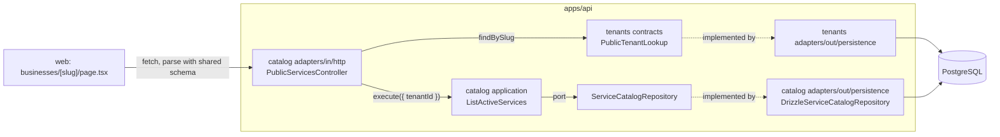

# Backend module reference: `catalog` public services

> **Status:** Implemented in [REP-03 #16](https://github.com/nanonoir/Agendoxa/issues/16) as the first concrete module. It follows proposals that are still **in review**: [CON-01 modules](../design-docs/modules.md), [CON-02 API contracts](../design-docs/api-contracts.md) and [DOM-02 tenancy](../design-docs/tenancy.md). If they change, this guide and the code change with them; this guide does not ratify them.
> **Purpose:** Show, with one real and small use case, how a request travels through the layers and which conventions a new module should copy. It is a reference, not a framework: copy the decisions, not the file count.

## 1. What the module does

`GET /api/v1/public/businesses/{slug}/services` (`listPublicServices`, [CON-02 §7.2](../design-docs/api-contracts.md#72-tenants-and-the-public-endpoints)) returns the active services of the business a landing slug names, ordered by name. It is read-only, needs no session and exposes no booking capability ([API-DM-01](../design-docs/api-contracts.md#api-dm-01-no-public-booking-the-public-api-is-read-only-landing-information)).

It was chosen because it is real (the landing needs it), crosses every layer with a mandatory tenant filter, and does not require authentication, which `identity` does not provide yet. Its limit: it has almost no business rules, so it shows the layering but not a rich domain. [MOD-DM-11](../design-docs/modules.md#mod-dm-11-bookings-is-the-conceptual-reference-module) keeps `bookings` as the conceptual reference for rule-heavy modules.

| Response | When |
|---|---|
| `200 { items: PublicService[] }`, `Cache-Control: public, max-age=300` | The slug names a business. `items` may be empty |
| `400` problem, `code: validation`, `errors[].path: /slug` | The slug does not match `slugSchema` |
| `404` problem, `code: not_found` | No business has that slug |

Problems carry `requestId` (the incoming `X-Request-Id` when valid, otherwise a UUID), are sent as `application/problem+json` and use `Cache-Control: no-store`.

## 2. The request path



1. **Web.** [`page.tsx`](../../apps/web/src/app/%28public%29/businesses/%5Bslug%5D/page.tsx) is a Server Component. It calls [`listPublicServices`](../../apps/web/src/lib/api/public-catalog.ts), which fetches the API at `API_BASE_URL` and parses the body with `publicServiceListSchema`. A `404` or `400` becomes `notFound()`. The web only formats what the API returns.
2. **Inbound HTTP adapter.** [`PublicServicesController`](../../apps/api/src/modules/catalog/adapters/in/http/public-services.controller.ts) validates the slug with the shared `slugSchema` through `parseRequest`. It resolves the tenant once through the `tenants` public contract, calls the use case and maps the result to the HTTP view with `publicServiceListSchema.parse`. It holds no business rules.
3. **Tenant lookup.** [`PublicTenantLookup`](../../apps/api/src/modules/tenants/contracts/public-tenant-lookup.ts) is the `tenants` public contract. Its Drizzle implementation reads `Tenant` by `slug` and returns only the ID ([TEN-DM-07](../design-docs/tenancy.md#ten-dm-07-every-entry-point-has-one-source-of-tenant-context), "Public routing").
4. **Use case.** [`ListActiveServices`](../../apps/api/src/modules/catalog/application/use-cases/list-active-services.ts) receives `{ tenantId }`, rejects an empty context and asks its port.
5. **Outbound persistence adapter.** [`DrizzleServiceCatalogRepository`](../../apps/api/src/modules/catalog/adapters/out/persistence/drizzle-service-catalog-repository.ts) queries `services` filtered by `tenant_id` and `is_active`, ordered by `name` and then `id`, and maps rows to the `ActiveService` read model.

## 3. Structure

```text
apps/api/src/
├── platform/http/                       # HTTP conventions, no business rules
│   ├── configure-http.ts                # /api/v1 prefix (except /health) + problem filter
│   ├── problem-details.filter.ts        # Every error as RFC 9457 problem details
│   └── request-validation.ts            # parseRequest(sharedSchema, value, pointer)
└── modules/
    ├── tenants/
    │   ├── contracts/public-tenant-lookup.ts                  # Public contract: interface + token
    │   ├── adapters/out/persistence/drizzle-public-tenant-lookup.ts
    │   ├── tenants.module.ts                                  # Nest composition
    │   └── index.ts                                           # Composition export
    └── catalog/
        ├── application/
        │   ├── ports/service-catalog-repository.ts            # Port + read model + token
        │   └── use-cases/list-active-services.ts (+ .spec.ts)
        ├── adapters/
        │   ├── in/http/public-services.controller.ts
        │   └── out/persistence/drizzle-service-catalog-repository.ts
        ├── catalog.module.ts                                  # Composition root of the module
        └── index.ts                                           # Composition export
```

This applies [modules §7.1](../design-docs/modules.md#71-folder-and-public-contract-conventions). Folders exist only because this use case needs them. What is missing on purpose:

| Not created | Why | Create it when |
|---|---|---|
| `catalog/domain/` | See [§4](#4-why-there-is-no-domain-folder) | A rule that must hold whatever the entry point |
| `catalog/contracts/` | No other module consumes `catalog` yet | The first consumer appears, for example `bookings` reading compatibility or agent tools listing services ([MOD-DM-10](../design-docs/modules.md#mod-dm-10-a-modules-public-surface-separates-contracts-from-nest-composition)) |
| `tenants/application/`, `tenants/domain/` | The lookup has no rule: the adapter implements the public contract directly | `tenants` gets a rule or a command, such as updating the profile |
| Mappers, base repositories, generic use-case classes | One mapping in one place is clearer than an abstraction | Never by default; only when duplication actually hurts |
| A transaction runner | A single read needs no transaction | The first multi-statement command ([MOD-DM-08](../design-docs/modules.md#mod-dm-08-the-initiating-use-case-owns-the-transaction)) |

## 4. Why there is no `domain/` folder

`domain/` holds rules that are true about the business regardless of who asks or how data is stored. Examples are invariants, state transitions and calculations, which are pure functions or entities with no framework, ORM or HTTP imports ([modules §7.2](../design-docs/modules.md#72-layer-rules)).

This use case has none:

- **"Only active services"** is a selection criterion of this query, not an invariant of `Service`. It is cheaper and more correct as a `WHERE is_active` in SQL than as an in-memory filter on rows loaded for nothing.
- **"Ordered by name"** is part of the HTTP contract (CON-02), not business behavior.
- **Tenant scoping** is an isolation rule that every adapter applies ([TEN-DM-09](../design-docs/tenancy.md#ten-dm-09-application-and-database-constraints-are-required-rls-is-evaluated-in-rep-02)), not a catalog rule.
- **Duration > 0, price ≥ 0** are already enforced by database checks, and nothing here writes services.

A `Service` entity that only repeated the row's fields would be ceremony: one more type to keep in sync, with no behavior to test. The use case returns `ActiveService`, a read model declared next to its port, because that is the shape the application reads.

**Create `catalog/domain/` with the first operation that has a rule the database cannot express, or that must be checked before persisting.** Likely first cases in `catalog`:

| Future operation | Domain content |
|---|---|
| Create or update a service (`POST`/`PATCH /services`) | Validation of name, duration and price as business rules, with errors the API maps to `422 rule_violation`; "a new price applies to new bookings only" |
| Effective booking policy ([MOD-DM-03](../design-docs/modules.md#mod-dm-03-booking-policies-belong-to-catalog)) | Per-field resolution resource > service > tenant, with inherit, set and disable: a pure function, tested without a database |
| Effective windows ([MOD-DM-05](../design-docs/modules.md#mod-dm-05-catalog-supplies-windows-bookings-finds-free-slots)) | Weekly rules, blocks and openings combined in the tenant timezone |

When it is created, `domain/` imports nothing outside itself, application code depends on it, and adapters translate rows to and from it.

## 5. Ports: when to create one

A port exists only where a dependency must be swapped or kept out of the application ([modules §7.2](../design-docs/modules.md#72-layer-rules)).

| Dependency | Port? | Reason |
|---|---|---|
| Persistence of `services` | **Yes**, `ServiceCatalogRepository` | Keeps Drizzle out of the application and lets the use case be tested with an in-memory fake |
| Tenant resolution | **Yes**, `PublicTenantLookup`, owned by `tenants` | `Tenant` belongs to `tenants` ([MOD-DM-02](../design-docs/modules.md#mod-dm-02-every-entity-has-one-owner-only-the-owner-touches-its-tables)); `catalog` must not read or join the `tenants` table. The edge `catalog → tenants` is allowed ([modules §5.1](../design-docs/modules.md#51-dependency-diagram)) |
| The use case, for the controller | No | The controller is its only caller; Nest injects the class itself |
| Clock, IDs, logging | No | The use case does not need them |

Ports, read models and DI tokens are plain TypeScript (`Symbol` tokens), so the application and the `contracts/` surface import neither Nest nor Drizzle.

## 6. Tenant context

**Today (no authentication).** The only entry point is the public landing. Its tenant comes from the slug, resolved by the server through `tenants` (TEN-DM-07, "Public routing"). The slug **selects what to display and authorizes nothing**. The resolved `{ tenantId }` is passed explicitly to the use case, which rejects an empty value (`MissingTenantContextError`, a defect that becomes `500`). The adapter filters every query by `tenant_id`. No header, query parameter or body field chooses a tenant, and nothing imitates a session.

**Later.**

| Entry point | Resolves `tenantId` from | Reuses |
|---|---|---|
| CRM `GET /tenants/{tenantId}/services` | The caller's active membership in the path tenant, revalidated per request ([API-DM-07](../design-docs/api-contracts.md#api-dm-07-the-tenant-is-a-path-segment-revalidated-on-every-request)); without it, `404` | The same use case, once `identity` exists. That endpoint also lists inactive services, so it gets its own query |
| Agent tools ("services and prices") | The validated WhatsApp connection ([BR-AGT-02](../product-specs/uc-03/business-rules.md#13-ai-agent-agt-and-human-handoff-hnd)) | The same use case through a future `catalog/contracts` facade ([API-DM-15](../design-docs/api-contracts.md#api-dm-15-the-agent-reuses-module-use-cases-in-process-not-the-http-api)) |

The use case never learns which entry point called it; that is why it takes `tenantId` and not `slug`.

RLS is not active ([REP-02](../design-docs/rep-02-core-persistence.md)). Only the explicit filter, and the two-tenant integration test that guards it, keep reads isolated.

## 7. HTTP conventions

- **`configureHttp(app)`** sets the `/api/v1` prefix, excluding `GET /health`, and the problem filter. `main.ts` and every HTTP test call it, so tests serve the same contract as production.
- **Validation:** request parts are validated with the shared schemas through `parseRequest(schema, value, '/pointer')`. A failure becomes a `400 validation` problem with JSON Pointer paths. `apps/api` does not depend on `zod` directly: it only uses schemas exported by `@agendoxa/shared`.
- **Errors:** throw Nest's HTTP exceptions (`NotFoundException`, …) or `RequestValidationException`. The filter maps the status to the CON-02 `code`. Other client errors of the framework keep their HTTP status: `413` and `415` become `validation` with `file_too_large` and `unsupported_media_type`, `429` becomes `conflict` / `rate_limited` and forwards `Retry-After` when present, and any other `4xx` becomes `validation` without a reason. The `title` is fixed per status; an exception message is never copied. Any other error, including an unlisted `5xx`, becomes a generic `500 internal` that is logged and never exposes stack traces or SQL. Problems are `no-store`, which overrides a `@Header` cache policy that Nest applies before the handler runs.
- **Responses** are built from the use-case result field by field, then parsed with the shared schema, so a contract drift fails loudly instead of leaking extra fields such as `tenant_id`.

## 8. Composition in Nest

- `catalog.module.ts` is the only place that knows which adapter implements each port. Providers use `useFactory` with `inject`, so `ListActiveServices` and the adapters stay free of decorators.
- `CatalogModule` imports `TenantsModule` through `tenants/index.ts` (composition), while the controller imports the `PublicTenantLookup` type and token from `tenants/contracts/` (plain contract). Neither surface exports adapters or tables.
- `AppModule` imports `CatalogModule`. Every module that needs the connection imports `DatabaseModule`; Nest keeps one connection per application.

## 9. Persistence adapter

- It uses Drizzle's relational query API (`db.query.services.findMany`) with the operators passed to its callbacks. `apps/api` therefore needs no direct `drizzle-orm` dependency, and only the owner's adapter names its tables.
- It filters by `tenant_id` first, selects only the needed columns, orders deterministically (`name`, then `id`) and maps `duration` → `durationMinutes`. `price` stays the exact decimal string node-postgres returns.
- Schema and migrations stay in `packages/database`; this module changed neither.

## 10. Tests

| Level | File | Proves | Command |
|---|---|---|---|
| Use case, isolated | [`list-active-services.spec.ts`](../../apps/api/src/modules/catalog/application/use-cases/list-active-services.spec.ts) | Tenant passed through; empty context rejected before persistence. No Nest, HTTP or Drizzle | `pnpm --filter @agendoxa/api test src/modules/catalog` |
| HTTP contract, in memory | [`public-services.e2e-spec.ts`](../../apps/api/test/public-services.e2e-spec.ts) | 200 body and cache header; 404 and 400 problems; a framework `413` kept as a problem; `/health` outside the prefix. Ports overridden with fakes | `pnpm --filter @agendoxa/api test:e2e test/public-services.e2e-spec.ts` |
| PostgreSQL integration | [`public-services.integration-spec.ts`](../../apps/api/test/public-services.integration-spec.ts) | Real `AppModule`, migrations and HTTP against a unique child database. Two tenants alternated A/B/A/B on one reused connection, an inactive service that would sort first, an empty tenant and an unknown slug | `pnpm db:test:up`, then `pnpm --filter @agendoxa/api test:integration` |

The integration test creates `agendoxa_api_it_<uuid>` from `DATABASE_URL_TEST`, applies the versioned SQL with `packages/database/scripts/migrate.ts`, and drops the database afterwards. Removing the `tenant_id` filter from the adapter makes it fail, which was checked when it was written.

Before the `pnpm --filter` commands, build the workspace dependencies (`pnpm --filter @agendoxa/shared build` and `pnpm --filter @agendoxa/database build`), or run them through Turbo.

## 11. Running the flow locally

```bash
pnpm db:up && pnpm db:migrate && pnpm db:seed   # demo-barber and demo-club
pnpm dev                                         # web :3000, API :3001
```

Open `http://localhost:3000/businesses/demo-barber` or `…/demo-club`, or call `http://localhost:3001/api/v1/public/businesses/demo-barber/services`. The web reads `API_BASE_URL` from `apps/web/.env.local`, defaulting to `http://localhost:3001`.

## 12. Checklist for the next use case

1. Read the owner in [MOD-DM-02](../design-docs/modules.md#mod-dm-02-every-entity-has-one-owner-only-the-owner-touches-its-tables) and the contract in CON-02. The endpoint goes in the owner's `adapters/in/http`, or in `workflows` for a multi-owner command.
2. Add the shared Zod schemas the endpoint uses to `packages/shared/src/contracts/<owner>.ts`, and only those.
3. Write the use case as a plain class with an explicit tenant context. Add `domain/` only for real rules ([§4](#4-why-there-is-no-domain-folder)).
4. Declare a port only for persistence or a replaceable provider; implement it in `adapters/out/…`, scoped by `tenant_id`.
5. Wire with `useFactory` in `<module>.module.ts`. Cross-module access uses the other module's `contracts/` and its `index.ts`, and respects the DAG ([MOD-DM-07](../design-docs/modules.md#mod-dm-07-dependencies-only-point-to-lower-levels)).
6. Test the use case with fakes, the HTTP contract with overridden ports, and PostgreSQL behavior with two tenants.
7. Check the boundaries: `grep -rlsE "@nestjs|drizzle|@agendoxa/database|express" apps/api/src/modules/*/application apps/api/src/modules/*/domain apps/api/src/modules/*/contracts` must print nothing.

## 13. Known limits

- `GET /public/businesses/{slug}` (profile, hours and WhatsApp link) is not implemented; the page shows the slug as its heading. Its location is open ([API-Q-10](../design-docs/api-contracts.md#13-decisions-and-open-questions), D-6).
- `PublicService` has no currency, so the page shows amounts without a symbol.
- CON-02 defines no category for `413` and `429`. The filter keeps their HTTP status and uses `validation` / `file_too_large` and `conflict` / `rate_limited`; the team has not yet decided whether CON-02 should list them. Nothing in the API produces a `429` yet: rate limiting is not implemented.
- `/businesses/[slug]` is a provisional landing route: TEN-DM-07 leaves public routing open.
- Import boundaries are checked by review and the grep above, not by lint ([MOD-Q-03](../design-docs/modules.md#10-decisions-and-open-questions)).
